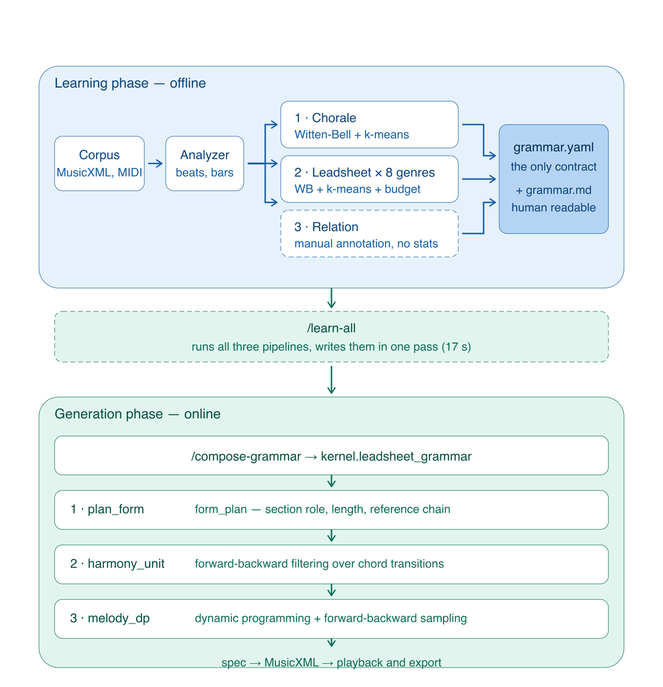

# 学习算法框架

> composerchat 的规则学习与生成算法全景
> 日期：2026-10-04 · 基线 `score_learning/`（learn_core 220 行 / leadsheet 1542 行 / grammar 870 行）

---

## 零、先纠正一个常见误解

**「学习侧只有统计，生成侧才有 DP」—— 这个划分不准确。**

实际情况是：**k-means 两侧都有，DP 只在生成侧，而学习侧有一套
「剪枝即模型选择」的机制在扮演生成侧 DP 的角色**。具体分布：

| 算法 | 学习侧（learn） | 生成侧（compose） |
|---|---|---|
| **k-means** | ✅ `learn_core.kmeans`（轮廓聚类） | ❌（生成时读已学好的模板） |
| **动态规划** | ❌ | ✅ `melody_dp`（leadsheet）<br>✅ `alpha/beta` 前后向（chorale） |
| **Viterbi** | ❌ | ✅ `grammar/compose.py:325-337` |
| **前后向采样** | ❌ | ✅ 两套都有 |
| **Witten-Bell 回退** | ✅ | 读表（`model_from_rules`） |
| **剪枝回退** | ✅ `prune_with_regression` | — |
| **复杂度预算** | ✅ `_complexity_budget` | — |

**唯一两侧共用的是 k-means**，其余算法各司其职。学习侧负责**把语料压成规则表**，
生成侧负责**在规则约束下搜索**。

---

## 一、整体架构：两个阶段，三条学习流水线



矢量原图：`architecture_en.svg`（680×706，可无损缩放）

### 三条流水线的分工

| # | 流水线 | 输入 | 学什么 | 产出字段 | 有无优化算法 |
|---|---|---|---|---|---|
| ① | **chorale** | 巴赫众赞歌 350 首 | 四声部全曲：和声转移、终止公式、声部配置、旋律轮廓 | `harmony` `cadences` `melody` `voicing` `bass` | k-means |
| ② | **leadsheet** | 8 体裁 3845 首 | 旋律+和弦：和声转移、节奏模板、旋律轮廓、硬规则 | `harmony` `rhythm` `melody` `form` | k-means |
| ③ | **关系** | Weimar 人工标注 456 首 | **段落结构 + 段间关系**（引用/承接/对比/递进） | `form.form_plan` | 无（直接读标注） |

**为什么 ③ 独立于 ①②**：
① ② 是**从音符统计推断**规则（乐谱没有段落标注，只能靠启发式）；
③ 是**直接读人工标注**（段落边界是标注出来的，不是推断的）。
两者互补 —— ①② 提供「段内怎么写」，③ 提供「段与段怎么组织」。

**统一入口**：`/learn-all`（见 §2.6）依次跑完三条，一次性入库，
保证生成侧读到的 `grammar.yaml` 一定是完整的。

### 关键设计：学习与生成解耦

生成侧只读 `grammar.yaml`，不碰语料；学习侧不知道生成侧的存在。
**规则脚本是唯一的接口契约** —— 这也是 ③ 能后加而不改动 ①② 的原因：
`form_plan` 是 `form` 下的新字段，`plan_form` 读不到就回退到 `templates`。

---

## 二、学习阶段：六种算法

### 2.1 Witten-Bell 回退（`learn_core.py:71-125`）

**问题**：和声转移要估计 `P(cₜ | cₜ₋₂, cₜ₋₁, pos)`，但三阶条件太稀疏
（语料里绝大多数三元组只出现 1-2 次）。

**算法**：逐级回退，每级用下层概率做插值先验。

```python
# learn_core.py:102-113
p = 1.0 / V                        # L-1：均匀
for lv in ('L0', 'L1', 'L2', 'L3'): # 由浅入深
    cnt = self.t[lv].get(ctx(lv, p2, p1, pos))
    if not cnt: continue
    n, types = sum(cnt.values()), len(cnt)
    p = (cnt.get(c, 0) + types * p) / (n + types)   # ★ 关键：下层当先验
if self.floor:                      # 与 unigram 线性插值
    p = (1 - self.floor) * p + self.floor * self.unigram(c)
```

| 层 | 上下文 | 含义 |
|---|---|---|
| L3 | `(p2, p1, pos)` | 前两和弦 + 位置 |
| L2 | `(p1, pos)` | 前一和弦 + 位置 |
| L1 | `(p1,)` | 前一和弦 |
| L0 | `(pos,)` | 仅位置 |

**为什么用 Witten-Bell 而不是 Kneser-Ney**：WB 不需要估计
 discounting 计数（`N1+/N1`），在中小语料上更稳。这是 1990 年代 IBM 的
NEMSES 语言模型做法。

**位置条件 `pos_class`**（`grammar/learn.py:36-44`）：chorale 用 7 类
`cad0/cad1/cad2/cad3/start/mid_s/mid_w`，按「离终止几拍 + 强弱拍」划分；
leadsheet 用 8 小节网格（`pos_label`，`leadsheet/learn.py:137`）。

---

### 2.2 k-means++ 多次重启（`learn_core.py:150-182`）

**用途**：把乐句旋律轮廓（等时间重采样成 8 维）聚成 k 个「轮廓模板」。

```python
def kmeans(X, k, seed=7, iters=60, n_init=10):
    for init in range(n_init):                      # ★ 10 次重启
        rng = np.random.default_rng(seed + init * 9973)
        C = [X[rng.integers(len(X))]]               # 第一个质心随机
        for _ in range(1, k):
            d2 = np.min(((X[:,None,:] - C[None])**2).sum(-1), axis=1)
            C.append(X[rng.choice(len(X), p=d2/d2.sum())])   # ★ D² 加权
        for _ in range(iters):                      # Lloyd 迭代
            lab = np.argmin(((X[:,None,:] - C[None])**2).sum(-1), axis=1)
            newC = np.array([X[lab==j].mean(0) if np.any(lab==j) else C[j] ...])
            if np.allclose(newC, C): break
        inertia = ((X - C[lab])**2).sum()
        if best is None or inertia < best[0]: best = (inertia, C, lab)
```

**两个调用点，k 值来源完全不同**：

| 调用点 | k | 样本单位 | 守卫 |
|---|---|---|---|
| `grammar/learn.py:339` | 固定 **5** | 乐句（≥4 拍） | 无 |
| `leadsheet/learn.py:709` | `contour_k` = 4-16 **自适应** | 4 小节窗口（≥6 音） | `len ≥ max(30, k*5)` |

自适应 k 由 `_complexity_budget`（`L49-89`）给出：
`contour_k = max(4, min(16, 6 * scale))`，`scale` 随声部数/配器/乐句数增长。

**已知局限**：`grammar/learn.py` 硬编码 `k=5` 且无守卫。实测 pop 语料会聚出
「平稳波形幅度 1 半音占 52%」这种无作曲价值的模板（局部最优）。
leadsheet 侧的样本守卫缓解了这个问题。

---

### 2.3 剪枝 + 回归检验（`learn_core.py:120-148`）★ 相当于模型选择

这是学习侧**唯一的「优化」环节**，也是最容易被忽略的一步。

```python
def prune_with_regression(model, held_events, levels=('L3','L2'), ctx_min=CTX_MIN):
    unpruned = perplexity(model, held_events)   # 剪枝前
    snap = model.snapshot()
    removed = model.prune_context(levels, ctx_min)
    script = perplexity(model, held_events)      # 剪枝后
    if script > unpruned + 1e-9:                 # ★ 负收益 → 回滚
        model.restore(snap)
        return {'pruned': False, 'perplexity_script': unpruned, ...}
```

**思想**：剪枝是**用归纳偏置换泛化**。如果留出集困惑度变差，说明这个偏置
不适合当前语料，就该**放弃剪枝、保留完整模型**。这在统计上等价于
「用验证集做模型选择」，只是选择的是「剪不剪」这一个二元决策。

**实测影响**（`runs/relation/learn_all_report.md`）：

| 体裁 | 剪枝前 | 剪枝后 | 结果 |
|---|---|---|---|
| `hardbop/minor` | 12.89 | **18.34** | 自动回退，最终 **12.89** |
| jazz 8 个调式 | — | — | **6 个回退**，2 个保留 |

回退比例这么高（6/8）说明 `CTX_MIN=3` 对多数体裁偏激进，
**这是后续调参的首要方向**。

---

### 2.4 复杂度预算（`leadsheet/learn.py:49-89`）

leadsheet 独有的**容量自适应**机制：根据织体复杂度反向调节 5 个容量参数。

```python
scale = tex * (1 + 0.08*(parts_med-1) + 0.06*(fam_med-1) + 0.04*(phr_med-2))
scale = max(1.0, min(3.5, scale))
ctx = max(2, round(CTX_MIN / (1 + 0.35*(scale-1))))   # 越大→保留越多规则
contour_k = max(4, min(16, 6*scale))                   # 越大→轮廓类越多
```

| 参数 | 作用 |
|---|---|
| `ctx_min` | 上下文剪枝阈值（越小保留越多 L2/L3 规则） |
| `contour_k` | 轮廓聚类数 |
| `rhythm_top` | 节奏模板保留数 |
| `cell_cap` | 按拍节奏单元的容量 |
| `openings` | 前 n 段曲式候选集 |

---

### 2.5 留出集切分与评估（`learn_core.py:23, 107-118`）

```python
def is_heldout(pid, fold=10):
    return int(hashlib.md5(pid.encode()).hexdigest(), 16) % fold == 0
```

**MD5 哈希确定性切分**——同一 id 永远落在同一侧，可复现。

**四个评估指标**（`leadsheet/learn.py:335-344`）：

| 指标 | 含义 | 对照 |
|---|---|---|
| `perplexity_script` | 规则模型（剪枝后） | ↓ 越低越好 |
| `perplexity_unpruned` | 剪枝前 | 消融对照 |
| `perplexity_no_position` | 去掉位置条件 | **消融：位置条件是否有用** |
| `perplexity_unigram` | 只用词频 | **下限基线** |

`no_position` 这一项很有价值：实测 `hardbop/major` 的
`no_position`(8.86) < `script`(10.86)，说明**位置条件在该体裁是噪声**。

**已知陷阱**：`is_heldout` 按 id 哈希，但 `mazurka-50` 这类 id 会出现多次
（不同调区切成多首）→ 同一首的多个调区会同时落进 train 或 heldout，**造成泄漏**。
正确做法是按 id 分组切分。

---

### 2.6 关系学习（`score_learning/relation/`）★ 第三条流水线

前五条都是**从音符统计推断**规则。这条不同：**直接读人工标注**，
因为段落边界是标注出来的，不是从乐谱能推断的。

**为什么必须有它**：① ② 学的是「段内怎么写」（和弦怎么转、旋律怎么走），
但**「段与段怎么组织」学不到** —— 乐谱没有段落标注。
`leadsheet/learn.py:430` 的 `_letters_from` 只能用「首和弦序列 ≥75% 逐位相等」
这种启发式去猜，实测纯旋律信号对它的预测力 **AUC=0.4994（等于随机）**。

#### 数据源

`scores/corpus/weimar-jazz/_source/wjazzd.db`（42.5 MB SQLite，只读）
的 `sections` 表，**58,560 行人工标注 / 456 首全覆盖**：

| type | 行数 | 用途 |
|---|---|---|
| FORM | 3,292 | 段落标签（A1/A2/B1/C1/D1/I1）→ `form_plan` 的骨架 |
| IDEA | 15,414 | 即兴手法（615 种词）→ 各段落的典型手法 |
| PHRASE | 11,082 | 乐句 → 层级结构的中间层 |
| CHORUS | 1,670 | 主歌/副歌 → 「副歌=同段」的独立定义 |

**索引语义（最大的坑）**：`sections.start/end` **既不是 `eventid` 也不是 `bar`**，
而是「该 melid 内按 eventid 排序后的 **0-based 行偏移**」。
误判会**静默返回 0 首可用**（melid=3 的 eventid 范围 1197-1569 vs 标注 0-372）。

#### 三步

| 步骤 | 实现 | 产出 |
|---|---|---|
| 提取 | `extract.py` | 35,412 小节 / 8,802 条关系边 + 层级树 |
| 编译 | `compile_form_plan.py` | `form_plan`（段落角色 + 真实长度 + 引用链） |
| 注入 | `inject_form_plan.py` | 各风格包 `grammar.yaml` 的 `form.form_plan` |

**关系类型**（8,802 条边）：

| 关系 | 边数 | 判定 |
|---|---|---|
| `cause` 因果 | 2,836 | 段落终止 → 下一段起始 |
| `contrast` 对比 | 1,589 | 字母族改变 |
| `quote` 引用 | 1,443 | 同族再现且中间插入他族 |
| `introduce` 引入 | 1,073 | 该族首次出现 |
| `continue` 承接 | 776 | 同族紧邻再现 |
| `unclear` 不确定 | 659 | 不在任何 FORM 段内（前导/间奏/尾声） |
| `sequence` 递进 | 426 | 同族序号递增 |

**段落角色推导**（`compile_form_plan._seg_role`）：

| 角色 | 判定 | 语料占比（SWING） |
|---|---|---|
| `introduce` 引入 | 该字母族首次出现 | 134 |
| `sequence` 递进变体 | 同族序号递增（A1→A2） | 84 |
| `quote` 引用 | 同族材料再现 | 62 |
| `coda` 尾声 | 末段且序号>1 | 28 |

#### 编译产物：`form.form_plan`

```yaml
form:
  form_plan:
    unit_bars: 8
    source: Weimar Jazz 人工段落标注 / SWING
    policies:
      '4':                          # 按段数索引
        - form: A1A2B1A3           # 带编号的段落序列（不是抽象的 AABA）
          p: 0.8
          segments:
            - {label: A1, role: introduce, role_zh: 引入, bars: 10, ref: null,
               idea: 主题引用(t3-4)}
            - {label: A2, role: sequence,  role_zh: 递进变体, bars: 10, ref: A1,
               idea: 旋律陈述}      # ← ref 指向被引用的段
            - {label: B1, role: introduce, role_zh: 引入, bars: 8,  ref: null}
            - {label: A3, role: coda,      role_zh: 尾声, bars: 13, ref: A1}
          relations: [{rel: sequence, from: A1, to: A2}, ...]
    segment_len: {...}     # 段落长度分布（8/10/12/13…不再恒为 8）
    role_dist: {...}       # 各角色占比
    idea_by_role: {...}    # 各角色的典型手法
```

**与 ①② 的字段关系**：`form_plan` 是 `form` 下的**新字段**，
`form.templates` / `form.units` / `form.openings` 全部保留。
`plan_form` 优先读 `form_plan`，读不到就回退 —— **向后兼容**。

#### 统一入口 `/learn-all`

```bash
/learn-all                                # 三条流水线全跑（17 秒）
venv/bin/python -m score_learning.relation.learn_all
```

按 pack 聚合并一次性写盘（jazz 的 6 个体裁都在同一个 pack 的不同 sub，
逐个写会互相覆盖）。注入时自动生成 `.bak`。

#### 当前局限

- **只覆盖 6 个爵士子风格**（Weimar 标注只有 8 种爵士体裁），
  民谣/流行/牧歌/古典仍走 `templates` 老逻辑
- **`ref` 还没落到旋律材料上** —— 知道 `A2` 引用 `A1`，但生成时
  `A2` 仍独立写 melody，没有复用 `A1` 的动机。
  所以「引用」目前是**标注出来的**，还不是**听得出来的**

---

## 三、生成阶段：四种搜索算法

生成侧的算法比学习侧复杂得多，因为要在**多个硬约束**下找可行解。

### 3.1 和声：前后向滤波（`leadsheet/compose.py:363+`）

**问题**：逐拍采样和声会走进死胡同（后面无解），逐拍贪心又太机械。

**算法**：前向-后向平滑，段首用 `first_chord` 分布锁定，
段末用终止公式约束，然后按位置采样。

```python
# 1. 排布位置（按学到的 harmonic_rhythm）
for i in range(UNIT):
    dist = hr.get(str(i)) or [['0', 1.0, 1]]
    pat = _pick(rng, [(p, w) for p, w, _n in dist])
    beats = sorted({0, *[int(x) for x in str(pat).split(',') if x != '']})

# 2. 终止公式筛选（多重过滤）
pool = cads['final'] if final else cads['mid']
pool = [c for c in pool if is_tonic(c['chords'][1])]        # 末段必须主和弦
pool = [c for c in pool if all(t in g.idx for t in c['chords'])]  # 词表内
if next_tok: pool = [c for c in pool if g.attested(c['chords'][1], next_tok)]

# 3. 前向 alpha + 后向 beta
unary[0] = log(first_chord)      # 段首
...
```

**约束来自 `attested()`**（`learn_core.py:102-104`）——这就是 R07
「和弦转移必须在语料中出现过」的实现：生成时硬过滤，**不可能违规**。

---

### 3.2 旋律：动态规划 + 前后向采样（`leadsheet/compose.py:556-660`）★核心

这是整个项目最复杂的算法。

**状态设计**：`state = (音高, 待解决标记, 跳进方向)`

```python
S = nR * 6      # 状态空间 = 音高数 × 2（待解决）× 3（跳进方向）
```

**发射概率**（每个音符位置）：

```python
e = log P(音级类别 | 强弱位) - 0.5 * ((R - target) / CONTOUR_SIGMA)**2
#      ↑ 学到的和弦音比例      ↑ 乐句轮廓目标（高斯软约束）
if n.get('force') is not None:  e = np.where(R == n['force'], e, NEG)  # 硬锁定
if end_tonic and k == N-1:      e = np.where((音高是主音) & (是和弦音), e, NEG)
if next_midi is not None:       e = np.where(leap_ok(...), e, NEG)      # 大跳回补
```

**转移概率**（向量化为 `(S, S)` 矩阵）：

```python
base = log P(音程)              if |iv| ≤ max_leap and |iv| not in forbidden
                                  else NEG
rec  = log p_rec  if 跳进后反向级进 else log(1-p_rec)   # 大跳回补（R08）
step = 级进（|iv| ≤ 2）→ 只允许 step 转移，否则 NEG        # 非和弦音须级进（R02）
```

**前向递推**（`_lse` = log-sum-exp，数值稳定）：

```python
alpha[0] = init + em_state(0)
for k in range(1, N):
    alpha[k] = _lse(alpha[k-1][:, None] + Ms[k], axis=0) + em_state(k, ...)
if alpha[-1].max() < NEG/2: raise _Dead('旋律约束无解')    # ★ 硬失败信号
```

**反向采样 10 次取最优**：

```python
tau = max(temp, 0.3)
for _ in range(10):
    path = [_sample_log(rng, alpha[-1], tau)]              # 末端按 DP 分布抽
    for k in range(N-1, 0, -1):
        path.append(_sample_log(rng, alpha[k-1] + Ms[k][:, path[-1]], tau))
    path.reverse()
    sc = -1.5 * runs          # 同音三连降权
    key = sc/temp + _gumbel(rng)   # Gumbel 扰动
```

**三个要点**：
1. **`_Dead` 异常** = 约束无解，`compose()` 捕获后换种子重试（最多 40 次）
2. **`_lse` 而非 `log(sum(exp))`**：避免下溢，这是 DP 的标准做法
3. **`temperature` 有下限 0.3**：太低会退化成 argmax，破坏多样性

`_sample_log`（`L112-125`）是 Gumbel-max 等价的精确采样：

```python
x = np.where(ok, (lp - lp[ok].max()) / tau, -np.inf)
p = np.exp(x); p /= p.sum()
r, acc = rng.random(), 0.0
for i in np.flatnonzero(ok):
    acc += p[i]
    if r <= acc: return i
```

---

### 3.3 chorale：Viterbi + 前后向采样并存（`grammar/compose.py:318-355`）

**chorale 侧两种算法都实现了**，leadsheet 只有前后向：

```python
# ① 前向（log-sum-exp）
alpha = [(init + E[0]) / tau]
for t in range(1, L):
    a = _logsumexp(alpha[-1][:, None] + Ts[t], axis=0) + E[t] / tau
    alpha.append(a)

# ② Viterbi（最可能路径）
delta = [(init + E[0])]; back = [None]
for t in range(1, L):
    sc = delta[-1][:, None] + Ts[t] * tau
    back.append(np.argmax(sc, axis=0))
    delta.append(np.max(sc, axis=0) + E[t])
paths.append(Viterbi回溯)                    # 先收一条最可能路径

# ③ 前向后向采样（n_samples 条）
for _ in range(n_samples):
    j = rng_np.choice(len(p), p=p/p.sum())  # 末端按 alpha 抽
    for t in range(L-1, 0, -1):
        sc = alpha[t-1] + Ts[t][:, j]
        p = np.exp(sc - sc.max())
        j = rng_np.choice(len(p), p=p/p.sum())
    paths.append(path)
```

**Viterbi 作为兜底**：若 `alpha` 全是 -inf（无解），Viterbi 路径仍可能
给出次优可行解；且 `paths` 列表第一个元素是最可能路径，最后按
`_path_score` 过滤。

---

### 3.4 曲式规划（`leadsheet/compose.py:279+`）

**三层回退**：

```python
rel = _relation_form(g, n_units, rng, total_bars)   # ① 人工段落关系（优先）
if rel is not None: return rel
cands = [(t, p) for t, p, _n in form['templates'] if len(t) == n_units]
if cands and sum(p) >= 0.15: letters = _pick(rng, cands)      # ② 字母曲式
elif opening:  letters = _pick(rng, opening)                 # ③ 前 n 段曲式
else:          letters = _DEFAULT_FORM[n_units]              # ④ 硬编码兜底
```

第① 层是本轮新增的（见 `docs/关系结果接入compose-grammar_2026-10-04.md`）。
它提供的不只是字母串，还有每段的**角色、真实长度、引用来源**。

---

### 3.5 生成侧的整体搜索策略

| 维度 | 算法 | 失败处理 |
|---|---|---|
| 曲式 | 加权采样（`_pick`） | 兜底 `_DEFAULT_FORM` |
| 和声 | 前后向滤波 | `_Dead` → 换种子 |
| 旋律 | DP + 前后向采样 ×10 | `_Dead` → 换种子（最多 40 次） |
| 节奏 | 模板/按拍链 + 采样 | 降级到 `mode='cell'` |
| 低音 | DP（`_bass_line`） | `_Dead` |
| 声部 | 候选集 + 平行五八度规避 | 回退候选 |

**核心模式：约束满足 + 随机重启。**
不是优化求解（没有线性规划、没有梯度下降），而是
「构造可行解 → 检查 → 违反则换种子重来」。

---

## 四、算法与规则字段的对应关系

**这张表是理解整个项目的关键** —— 每个算法消费哪些规则字段。

| 算法 | 消费的规则字段 | 位置 |
|---|---|---|
| Witten-Bell 回退 | `harmony[mode].L0-L3` | `learn_core.py:81` |
| k-means | `melody.contour_templates` | `leadsheet/learn.py:709` / `grammar/learn.py:339` |
| 剪枝回退 | `evaluation.*.prune_kept` | `learn_core.py:120` |
| 复杂度预算 | `complexity` | `learn.py:50-89` |
| 和声滤波 | `harmony` + `harmonic_rhythm` + `first_chord` | `leadsheet/compose.py:363` |
| 和声滤波（终止） | `cadences[mode].final/mid` | `leadsheet/compose.py:381` |
| 旋律 DP | `melody.class_by_strength`（发射）<br>`melody.intervals`（转移）<br>`melody.leap_recovery_prob` | `leadsheet/compose.py:556` |
| 旋律 DP（硬约束） | `max_leap` / `forbidden_leaps` / `nct_step_*` | `leadsheet/compose.py:585-600` |
| 曲式规划 | `form.templates` / `form.openings` | `leadsheet/compose.py:279` |
| 曲式规划（新） | `form.form_plan`（段落角色+长度+引用） | `leadsheet/compose.py:211` |
| 节奏 | `rhythm.templates` / `cells.by_prev` | `leadsheet/compose.py` 节奏段 |
| 低音 DP | `melody.intervals` + 平行五八度约束 | `leadsheet/compose.py:593` |
| 和声验证 | `hard_rules` R01-R10 | `check.py` |

**注意最后一行**：`hard_rules` 只被 `check.py`（校验器）和
`script.py`（渲染 markdown）消费，**生成主路径不读它**。
真正的硬约束是以 `NEG` 概率直接写进 DP 的发射/转移矩阵
（如 `_R02` 非和弦音须级进、`R03` 跳进上限）。

---

## 五、评估体系

### 5.1 学习侧：留出集困惑度

```
perplexity = exp(Σ -log P(真实事件) / 事件数)
```

四个指标互为对照（见 §2.5），其中 `no_position` 是**消融实验**，
用来判断某个条件维度是否真的携带信息。

**当前实测**（`runs/relation/learn_all_report.md`）：

| 体裁 | script | 无位置 | 一元基线 | 剪枝 |
|---|---|---|---|---|
| jazz/swing | 8.35 | 10.15 | 15.57 | 已回退 |
| jazz/cool | 3.90 | 6.06 | 21.33 | 已回退 |
| jazz/hardbop | 10.86 | **8.86** | 20.32 | 保留 |
| jazz/hardbop (minor) | 12.89 | 23.11 | 17.37 | 已回退 |

### 5.2 生成侧：硬规则零违例

生成侧**不用困惑度**，而是检查 `violations` 是否为空：

```python
res = compose(...)
if not res['violations']:
    return res           # ✓ 零违例
raise RuntimeError(...)  # ✗ 40 个种子都失败
```

`check.py` 的检查项：平行五/八度、声部交叉、间距超限、
非和弦音未级进、跳进超限、终止式违规、和弦转移不在语料内。

**这个设计的好处**：不存在「概率上违反规则但听起来还行」的灰地带 ——
要么完全合规，要么生成失败换种子。

### 5.3 两个阶段的指标不互通

| | 学习侧 | 生成侧 |
|---|---|---|
| 指标 | 留出集困惑度 | 硬规则违例数 |
| 衡量 | 模型是否拟合了语料 | 产物是否合规 |
| 失败含义 | 规则质量差 | 约束太紧或实现有 bug |

**目前没有端到端指标**衡量「生成的音乐好不好听」。这是当前的
主要评估缺口 —— `evaluate.py` 有生成 vs 语料的分布对比，
但没有综合评分。

---

## 六、零第三方依赖

**学习侧的算法栈只依赖 numpy**（`learn_core.py` 顶部仅 `import numpy as np`）：

| 常规做法 | 本项目的实现 | 位置 |
|---|---|---|
| sklearn 的 KMeans | 手写 k-means++ | `learn_core.py:150` |
| scipy 的 logsumexp | 手写 `_lse` / `_logsumexp` | `leadsheet/compose.py` / `grammar/compose.py` |
| scipy 的树状图 DP | 手写前向递推 | 同上 |
| numpy.random.choice | 手写 Gumbel-max 采样 | `leadsheet/compose.py:112` |
| 网络结构/优化器 | **无**（不走梯度） | — |

`venv` 里实测**没有** torch / sklearn / scipy。算法层面的第三方库只有
`music21`（乐谱解析）。

**关系学习（③）多依赖一个 `sqlite3`** —— 标准库，用来读
`wjazzd.db`。这是唯一非 numpy 的数据通路，但仍是零第三方依赖。

**这带来的约束**：不能直接用成熟的 DP/图算法库，所有状态转移矩阵都要
手工构造并向量化。这也是为什么状态空间设计得紧凑
（`(音高, 待解决, 跳进方向)` 只有 `nR*6` 个状态）。

---

## 七、代码位置速查

### 学习侧

>注：`compose_kernel.py` 在**仓库根**（`score_learning/` 内没有同名文件）。

| 文件 | 行数 | 内容 |
|---|---|---|
| `learn_core.py` | 220 | **共用核心**：Witten-Bell、k-means、剪枝回退、评估 |
| `grammar/learn.py` | 471 | chorale 流水线 |
| `grammar/theory.py` | 258 | 罗马数字、和弦音级映射 |
| `leadsheet/learn.py` | 783 | leadsheet 流水线 + 复杂度预算 |
| `relation/extract.py` | 547 | 人工段落标注 → 小节关系（读 wjazzd.db） |
| `relation/compile_form_plan.py` | 254 | 关系 → `form_plan`（角色 + 长度 + 引用链） |
| `relation/inject_form_plan.py` | 114 | `form_plan` → 各风格包 `grammar.yaml` |
| `relation/learn_all.py` | 373 | 统一编排（`/learn-all`，跑完三条流水线） |

### 生成侧

| 文件 | 行数 | 内容 |
|---|---|---|
| `leadsheet/compose.py` | 1542 | **DP + 前后向采样 + 曲式规划** |
| `grammar/compose.py` | 870 | Viterbi + 前后向采样 |
| `compose_kernel.py`（仓库根） | 4752 | 内核状态机（`run_program`） |
| `leadsheet/check.py` | 268 | 硬规则校验器 |

---

## 八、三个改进方向（基于实测）

### 8.1 剪枝阈值调参（最高 ROI）

`CTX_MIN=3` 导致 jazz 8 个调式里 **6 个剪枝负收益被回退**。
等于剪枝这个功能大部分时候不起作用。

**做法**：把 `ctx_min` 做成网格搜索，对每个体裁选留出集最优值，
连同 `prune_kept` 一起写进 `grammar.yaml`。

### 8.2 位置条件的消融推广

现在只对 `pos` 做了消融（`no_position`）。实测 `hardbop/major`
的位置条件是噪声（8.86 < 10.86）。

**做法**：对每条规则维度都做消融（和弦转移条件、乐句轮廓、
节奏位置），自动关掉无信息量的维度。当前这些维度的增益从未被验证。

### 8.3 曲式层用 DTW 替换贪心匹配

`leadsheet/learn.py:430-447` 的 `_letters_from` 用「75% 相似度贪心
首次匹配」判断两个段是否同材料 —— **依赖输入顺序，不保证最优**。

**做法**：改用 DTW 距离或 Needleman-Wunsch 对齐。
这会让「同段」判定更准，进而让 `form_plan` 的引用链更可靠。

---

## 附：与本项目其他文档的关系

| 文档 | 关注点 |
|---|---|
| `docs/learn_算法分析_2026-10-04.md` | learn 侧算法详解 + 缺失规则分析 |
| `docs/关系结果接入compose-grammar_2026-10-04.md` | `form_plan` 如何接入生成 |
| `docs/统一学习命令learn-all_2026-10-04.md` | 三条流水线的统一编排 |
| `docs/小节关系提取报告_2026-10-04.md` | 关系提取的规则类型与规模 |
| **本文档** | **两侧算法的全景与对应关系** |
