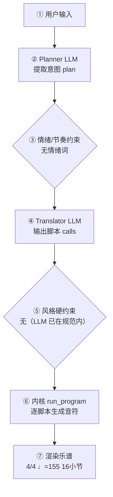

# 作曲生产报告：摇摆标准曲（爵士）小品（程序员版）

> 面向产品/工程：记录本次生成的完整生产链路与系统状态，用于核对「说得 vs 写得」、排查缺陷与回归测试；可整体喂回大模型进一步定位具体小节/声部的问题。谱面检查与编辑者版一致，编辑者版见：`验收样例_摇摆标准曲_编辑者版.md`。

## 1. 会话与生成环境

- 生成时间: —
- 生成路径: skeleton
- 命中技能: compose-full
- 原始数据: `session.compose_trace`（本报告第 4 节即其展开，确定性可复现）

## 2. 谱面事实（与编辑者版「基本信息」一致）

- 调性: B 大调（5 个升号）
- 拍号: 4/4
- 速度: 四分音符 = 155 BPM
- 段落速度: 第 9 小节 Presto（♩=170）；第 13 小节 Presto（♩=153）
- 调内音级: C#, D#, E, F#, G#, A#, B
- 声部 1: Soprano，高音谱号，16 小节
- 声部 2: Alto，高音谱号，16 小节
- 声部 3: Bass，低音谱号，16 小节

## 3. 自动检查结果（与编辑者版「第 3 节」一致）

| 检查类别 | 状态 | 描述 |
|---|---|---|
| 调号一致性 | ⚠️ 注意 | B 大调下出现变化音 C, D, F, G, A（经过音/离调） |
| 声部交叉 | ⚠️ 注意 | 纵向上方声部 1（Soprano）与下方声部 2（Alto）在第 6.0 拍交叉：F#4 低于 A#4（同类交叉共 2 处，此处为第 1 例） |

> 说明：平行五/八度仅检查最高与最低外声部；相邻声部交叉为提示项。 共检查 55 项（✅ 53 / ⚠️ 2 / ❌ 0）。

## 4. 作曲过程透明化（可追溯）

> 本节约等于把「需求 → 大模型 → 脚本 → 谱面」的完整链路展开，便于核对「说得 vs 写得」是否一致。数据来自本次生成的 `session.compose_trace`，确定性可复现。把本报告整体喂回大模型，可进一步定位具体小节/声部的问题与修正建议。

### 4.1 流程图（本次实际链路）



（文字版流程图，便于无 Mermaid 渲染环境阅读）

```
用户输入
  → [② Planner LLM] 提取意图 plan
  → [③ 情绪/节奏约束] 命中=否
  → [④ Translator LLM] 输出 calls + reasoning
  → [⑤ 风格硬约束] 触发=否
  → [⑥ 内核 run_program] 逐脚本执行
  → [⑦ 渲染谱面] 4/4 ♩=155 16小节
```

### 4.2 大模型输入输出（LLM I/O）

（本次为确定性生成，未调用大模型——见 4.3 / 4.5 说明）

### 4.3 脚本调用与输入输出

| # | 脚本 | 输入(args) | 输出（新增音符 / 状态变更） |
|---|---|---|---|
| 1 | new_score | title=摇摆标准曲（爵士）小品，key_sharps=5，mode=major，meter=4/4，tempo=155，bars=16，style=jazz/swing-standard，seed=acceptance，voices=3 | 建立乐曲：4/4 ♩=155 3声部 major；新增 — |
| 2 | set_sections | sections=[{"name": "呈示", "bars": 4, "meter": "4/4", "dynamic": "p", "tempo_text": "Presto", "bpm": 155}, {"name": "发展", "bars": 4, "meter": "4/4", "dynamic": "mp", "tempo_text": "Presto", "bpm": 155}, {"name": "高潮", "bars": 4, "meter": "4/4", "dynamic": "mf", "tempo_text": "Presto", "bpm": 170}, {"name": "收束", "bars": 4, "meter": "4/4", "dynamic": "p", "tempo_text": "Presto", "bpm": 153}] | 分段：呈示(4小节)，发展(4小节)，高潮(4小节)，收束(4小节)；新增 — |
| 3 | set_harmony | section=呈示，progression=["ii", "V", "I", "ii"] | 和声：段落呈示 进行['ii', 'V', 'I', 'ii']；新增 — |
| 4 | accompaniment | section=呈示，pattern=broken_arpeggio，register=low，density=1.0 | 伴奏：段落呈示 pattern=broken_arpeggio register=low density=1.0；新增 声部2:+4，声部3:+16 |
| 5 | melody | section=呈示，register=mid，rhythm=flowing，contour=arch，motif=[[5, "eighth"], [4, "eighth"], [3, "eighth"], [2, "quarter"]] | 旋律：段落呈示 rhythm=flowing；新增 声部1:+20 |
| 6 | set_harmony | section=发展，progression=["I", "VI7", "ii7", "V7"] | 和声：段落发展 进行['I', 'VI7', 'ii7', 'V7']；新增 — |
| 7 | accompaniment | section=发展，pattern=broken_arpeggio，register=low，density=1.0 | 伴奏：段落发展 pattern=broken_arpeggio register=low density=1.0；新增 声部2:+4，声部3:+16 |
| 8 | melody | section=发展，register=mid，rhythm=flowing，contour=arch | 旋律：段落发展 rhythm=flowing；新增 声部1:+18 |
| 9 | thicken | section=发展 | 加厚：段落发展；新增 — |
| 10 | set_harmony | section=高潮，progression=["ii", "V", "I", "ii"] | 和声：段落高潮 进行['ii', 'V', 'I', 'ii']；新增 — |
| 11 | accompaniment | section=高潮，pattern=broken_arpeggio，register=low，density=1.0 | 伴奏：段落高潮 pattern=broken_arpeggio register=low density=1.0；新增 声部2:+4，声部3:+16 |
| 12 | melody | section=高潮，register=mid，rhythm=driving，contour=ascending | 旋律：段落高潮 rhythm=driving；新增 声部1:+19 |
| 13 | thicken | section=高潮 | 加厚：段落高潮；新增 — |
| 14 | set_harmony | section=收束，progression=["ii", "V", "V7", "I"] | 和声：段落收束 进行['ii', 'V', 'V7', 'I']；新增 — |
| 15 | accompaniment | section=收束，pattern=broken_arpeggio，register=low，density=1.0 | 伴奏：段落收束 pattern=broken_arpeggio register=low density=1.0；新增 声部2:+4，声部3:+16 |
| 16 | melody | section=收束，register=mid，rhythm=sparse，contour=descending | 旋律：段落收束 rhythm=sparse；新增 声部1:+10 |
| 17 | cadence | bars=1 | 终止：bars=1；新增 — |
| 18 | finalize |  | 收束装配：16小节 / 3声部；新增 声部1:+21 |

<details><summary>逐脚本新增音符样例（前 8 个 / 声部）</summary>

- **new_score**：声部1: —；声部2: —；声部3: —
- **set_sections**：声部1: —；声部2: —；声部3: —
- **set_harmony**：声部1: —；声部2: —；声部3: —
- **accompaniment**：声部1: —；声部2: E4:whole, A#4:whole, D#4:whole, E4:whole；声部3: C#2:quarter, E3:quarter, G#3:quarter, C#2:quarter, F#2:quarter, A#3:quarter, C#3:quarter, F#2:quarter
- **melody**：声部1: F#4:eighth, E4:eighth, D#4:eighth, B4:quarter, C#5:quarter, C#5:eighth, B4:eighth, A#4:eighth；声部2: —；声部3: —
- **set_harmony**：声部1: —；声部2: —；声部3: —
- **accompaniment**：声部1: —；声部2: D#4:whole, C5:whole, E4:whole, A#4:whole；声部3: B2:quarter, D#3:quarter, F#3:quarter, A3:quarter, G#2:quarter, C3:quarter, D#3:quarter, F#3:quarter
- **melody**：声部1: B4:quarter, A#4:eighth, A4:eighth, A4:quarter, F#4:quarter, C5:quarter, C#5:eighth, D#5:eighth；声部2: —；声部3: —
- **thicken**：声部1: —；声部2: —；声部3: —
- **set_harmony**：声部1: —；声部2: —；声部3: —
- **accompaniment**：声部1: —；声部2: E4:whole, A#4:whole, D#4:whole, E4:whole；声部3: C#2:quarter, E3:quarter, G#3:quarter, B3:quarter, F#2:quarter, A#3:quarter, C#3:quarter, E3:quarter
- **melody**：声部1: C#5:eighth, B4:eighth, G#4:quarter, E4:quarter, B4:quarter, A#4:quarter, F#4:quarter, C#5:quarter；声部2: —；声部3: —
- **thicken**：声部1: —；声部2: —；声部3: —
- **set_harmony**：声部1: —；声部2: —；声部3: —
- **accompaniment**：声部1: —；声部2: E4:whole, A#4:whole, A#4:whole, D#4:whole；声部3: C#2:quarter, E3:quarter, G#3:quarter, B3:quarter, F#2:quarter, A#3:quarter, C#3:quarter, F#2:quarter
- **melody**：声部1: E5:half, C#5:half, F#5:half, C#5:quarter, A#4:quarter, E5:half, C#5:quarter, A#4:quarter；声部2: —；声部3: —
- **cadence**：声部1: —；声部2: —；声部3: —
- **finalize**：声部1: E5+E6:eighth, F#5+F#6:eighth, F#5+F#6:quarter, E5+E6:eighth, D#5+D#6:eighth, C#5+C#6:quarter, E5+E6:quarter, G#5+G#6:quarter；声部2: —；声部3: —

</details>

### 4.4 本地强制约束（确定性兜底，优先级高于 LLM）

- 情绪/节奏约束：未触发（用户未给情绪/速度词，或已被风格基线覆盖）
- 风格/速度强制纠正：未触发（LLM 输出已在 genre 规范内）
- **风格契约施加的约束**（6 条，来自该包实测语料的 `style_contract.yaml`）：
  - 段落 呈示 按风格契约加和弦品质：ii→ii7
  - 段落 发展 按风格契约加和弦品质：I→I7
  - 段落 高潮 按风格契约加和弦品质：ii→ii7
  - 段落 高潮 按风格契约加和弦品质：V→V7
  - 段落 收束 按风格契约加和弦品质：ii→ii7
  - 段落 收束 按风格契约加和弦品质：I→I7
### 4.5 自动问题定位（可疑点 + 程度）

| 检查项 | 程度 | 说明 |
|---|---|---|
| 情绪约束 | 🟢 未触发 | 用户未给情绪/速度词 |
| 意图拍号↔谱面 | 🟢 一致 | 最终拍号 4/4 |
| 计划小节↔实际小节 | 🟢 一致 | 16 小节 |
| 风格规范遵循 | 🟢 良好 | LLM 输出均在 genre 规范内，无需强制 |

> 说明：上表为程序自动比对「意图 ↔ 谱面」的初判（🔴 严重 / 🟡 注意 / 🟢 一致）。将本报告整体喂给大模型，可进一步定位具体小节/声部的问题与修正建议。

## 5. 记谱与演奏法

可演奏性：0 项 MAJOR / 19 项总计
- [MINOR] 声部3 大跳 15 半音（>八度）
- [MINOR] 声部3 大跳 19 半音（>八度）
- [MINOR] 声部3 大跳 16 半音（>八度）
- [MINOR] 声部3 大跳 15 半音（>八度）
- [MINOR] 声部3 大跳 13 半音（>八度）
- [MINOR] 声部3 大跳 17 半音（>八度）
- [MINOR] 声部3 大跳 15 半音（>八度）
- [MINOR] 声部3 大跳 17 半音（>八度）
- …其余 11 项从略

## 6. 生成质量评估（三指标）

- **风格重叠率**：0.11（目标包 swing-standard）
- **风格命中**：第 14/31 名 — ❌ 未进前三
- **属性遵循度**：1.00（0 项）
- **最近邻**：piano-prelude（相似度 0.38）— ✅ 无抄袭嫌疑
