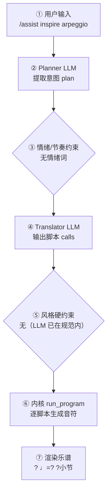

# 作曲生产报告：新乐谱（程序员版）

> 面向产品/工程：记录本次生成的完整生产链路与系统状态，用于核对「说得 vs 写得」、排查缺陷与回归测试；可整体喂回大模型进一步定位具体小节/声部的问题。谱面检查与编辑者版一致，编辑者版见：`3d4576c51a_report.md`。

## 1. 会话与生成环境

- 生成时间: 2026-09-29T20:13:40
- 生成路径: —
- 命中技能: —
- 用户原始输入: /assist inspire arpeggio
- 原始数据: `session.compose_trace`（本报告第 4 节即其展开，确定性可复现）

## 2. 谱面事实（与编辑者版「基本信息」一致）

- 调性: G 大调（1 个升号）
- 拍号: 4/4
- 速度: 四分音符 = 120 BPM
- 调内音级: C, D, E, F#, G, A, B
- 声部 1: 声部 1，高音谱号，8 小节

## 3. 自动检查结果（与编辑者版「第 3 节」一致）

| 检查类别 | 状态 | 描述 |
|---|---|---|
| 终止式 | ⚠️ 注意 | 未能提取终止处音高 |

> 说明：平行五/八度仅检查最高与最低外声部；相邻声部交叉为提示项。 共检查 12 项（✅ 11 / ⚠️ 1 / ❌ 0）。

## 4. 作曲过程透明化（可追溯）

> 本节约等于把「需求 → 大模型 → 脚本 → 谱面」的完整链路展开，便于核对「说得 vs 写得」是否一致。数据来自本次生成的 `session.compose_trace`，确定性可复现。把本报告整体喂回大模型，可进一步定位具体小节/声部的问题与修正建议。

### 4.1 流程图（本次实际链路）



（文字版流程图，便于无 Mermaid 渲染环境阅读）

```
用户输入
  → [② Planner LLM] 提取意图 plan
  → [③ 情绪/节奏约束] 命中=否
  → [④ Translator LLM] 输出 calls + reasoning
  → [⑤ 风格硬约束] 触发=否
  → [⑥ 内核 run_program] 逐脚本执行
  → [⑦ 渲染谱面] ? ♩=? ?小节
```

### 4.2 大模型输入输出（LLM I/O）

（本次为确定性生成，未调用大模型——见 4.3 / 4.5 说明）

### 4.3 脚本调用与输入输出

（本次路径未经过确定性脚本内核：`None`—— 该路径由 LLM 直接产出乐谱或纯确定性生成，无逐脚本记录）

### 4.4 本地强制约束（确定性兜底，优先级高于 LLM）

- 情绪/节奏约束：未触发（用户未给情绪/速度词，或已被风格基线覆盖）
- 风格/速度强制纠正：未触发（LLM 输出已在 genre 规范内）
- **风格契约施加的约束**：无（该风格包没有 `style_contract.yaml`，或契约证据量不足、和声分区未生效）
### 4.5 自动问题定位（可疑点 + 程度）

| 检查项 | 程度 | 说明 |
|---|---|---|
| 情绪约束 | 🟢 未触发 | 用户未给情绪/速度词 |
| 意图拍号↔谱面 | 🟢 一致 | 最终拍号 None |
| 计划小节↔实际小节 | 🟢 一致 | None 小节 |
| 风格规范遵循 | 🟢 良好 | LLM 输出均在 genre 规范内，无需强制 |

> 说明：上表为程序自动比对「意图 ↔ 谱面」的初判（🔴 严重 / 🟡 注意 / 🟢 一致）。将本报告整体喂给大模型，可进一步定位具体小节/声部的问题与修正建议。
