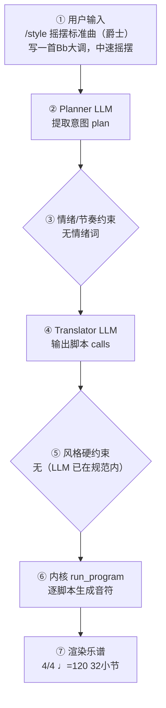

# 作曲生产报告：Bb Swing Standard（程序员版）

> 面向产品/工程：记录本次生成的完整生产链路与系统状态，用于核对「说得 vs 写得」、排查缺陷与回归测试；可整体喂回大模型进一步定位具体小节/声部的问题。谱面检查与编辑者版一致，编辑者版见：`5f648f9393_report.md`。

## 1. 会话与生成环境

- 生成时间: 2026-09-28T21:44:23
- 生成路径: translator（LLM 翻译 + 确定性内核）
- 命中技能: compose-full, genre:jazz/swing-standard
- 用户原始输入: /style 摇摆标准曲（爵士） 写一首Bb大调，中速摇摆
- 原始数据: `session.compose_trace`（本报告第 4 节即其展开，确定性可复现）

## 2. 谱面事实（与编辑者版「基本信息」一致）

- 调性: Bb 大调（2 个降号）
- 转调: 第 17 小节 → Cb 小调
- 拍号: 4/4
- 速度: 四分音符 = 120 BPM
- 段落速度: 第 9 小节 Medium Swing（♩=126）；第 17 小节 Swing（♩=132）
- 调内音级: C, D, D#, F, G, A, A#
- 声部 1: 小号 (Trumpet)，高音谱号，32 小节
- 声部 2: Piano，高音谱号，32 小节
- 声部 3: Contrabass，低音谱号，32 小节
- 声部 4: 定音鼓 (Timpani)，低音谱号，32 小节

## 3. 自动检查结果（与编辑者版「第 3 节」一致）

| 检查类别 | 状态 | 描述 |
|---|---|---|
| 调号一致性 | ⚠️ 注意 | Bb 大调 段出现变化音 B；Cb 小调 段出现变化音 Db, E, Gb, A（转调段调外音/经过音） |
| 声部交叉 | ⚠️ 注意 | 纵向上方声部 1（小号 (Trumpet)）与下方声部 2（Piano）在第 2.0 拍交叉：C5 低于 A#5（同类交叉共 13 处，此处为第 1 例） |
| 音域 | ⚠️ 注意 | 小号 (Trumpet): G4–G6（MIDI 67–91） |
| 终止式 | ⚠️ 注意 | Cb 小调结尾音级含 D, F, A#，旋律落在 A#5（主音上方 10 个半音） |

> 说明：平行五/八度仅检查最高与最低外声部；相邻声部交叉为提示项。 共检查 136 项（✅ 132 / ⚠️ 4 / ❌ 0）。

## 4. 作曲过程透明化（可追溯）

> 本节约等于把「需求 → 大模型 → 脚本 → 谱面」的完整链路展开，便于核对「说得 vs 写得」是否一致。数据来自本次生成的 `session.compose_trace`，确定性可复现。把本报告整体喂回大模型，可进一步定位具体小节/声部的问题与修正建议。

### 4.1 流程图（本次实际链路）



（文字版流程图，便于无 Mermaid 渲染环境阅读）

```
用户输入
  → [② Planner LLM] 提取意图 plan
  → [③ 情绪/节奏约束] 命中=否
  → [④ Translator LLM] 输出 calls + reasoning
  → [⑤ 风格硬约束] 触发=否
  → [⑥ 内核 run_program] 逐脚本执行
  → [⑦ 渲染谱面] 4/4 ♩=120 32小节
```

### 4.2 大模型输入输出（LLM I/O）

#### Planner（意图解析）

- **系统提示**（固定指令模板，已截断）：

```
You are a professional composer and music theorist acting as an Intent Parser.

Transform the user's natural-language request (and optional slash-commands already applied as preferences) into a Composition Plan JSON only.

Think like a composer first: infer genre, mood, form, motif character, harmony language, climax — do NOT invent note lists yet.

A **风格目录（仅已学包）** is injected at the end of this system prompt. Use it to set `genre_id`.

Output ONE JSON object, no Markdown:
{
  "title": "string",
  "genre": "string (human label, e.g. 摇摆标准曲（爵士）)",
  "genre_id": "family/pack_id from 风格目录, e.g. jazz/swing-standard; empty if none",
  "mood": ["..."],
  "tempo": 72,
  "meter": "4/4",
  "key_sharps": 0,
  "mode": "major|minor",
  "instrumentation": ["trumpet","piano","contrabass"] (kernel English names; map fiddle→violin, double bass→contrabass, tin whistle→flute; avoid unknown names),
  "form": ["A","B","A"],
  "bars": 16,
  "motif": {"character": "...", "development": ["repetition","sequence"]},
  "harmony": {"language": "...", "density": "sparse|moderate|dense"},
  "rhythm": {"character": "..."},
  "texture": "homophonic|polyphonic|sparse|orchestral",
  "climax": {"location": "section B", "dynamic": "f"},
  "difficulty": "easy|medium",
  "summary": "one sentence for the user",
  "edit_intent": null
}
Rules:
- Original music only; no copyrighted melodies.
- If user is vague, choose
…（已截断，完整 6842 字；固定指令模板见 skills/composition/base/ 与内核 kernel_docs）
```

- **用户输入**（喂给模型的结构化上下文）：

```json
{
  "user_request": "Bb大调，中速摇摆",
  "preferences": {
    "key_sharps": 0,
    "mode": "major",
    "tempo": 120,
    "bars": 8,
    "meter": "4/4",
    "style": "摇摆标准曲（爵士）",
    "genre_id": "genre:jazz/swing-standard",
    "instrumentation": "",
    "fugue": "auto",
    "voices": 0,
    "_explicit": {}
  },
  "edit_intent": null,
  "skills": [
    "compose-full",
    "genre:jazz/swing-standard"
  ],
  "existing_plan": null,
  "revision_edits": null,
  "existing_score_summary": null
}
```

- **模型返回（原始）**：

```json
{
  "title": "Bb Swing Standard",
  "genre": "摇摆标准曲（爵士）",
  "genre_id": "jazz/swing-standard",
  "mood": [
    "urban",
    "relaxed",
    "swinging",
    "warm"
  ],
  "tempo": 120,
  "meter": "4/4",
  "key_sharps": -2,
  "mode": "major",
  "instrumentation": [
    "trumpet",
    "piano",
    "contrabass",
    "drum_set"
  ],
  "form": [
    "A",
    "A'",
    "B",
    "A''"
  ],
  "bars": 32,
  "motif": {
    "character": "syncopated 3-note head with a rising fourth, answered by a relaxed off-beat tail",
    "development": [
      "repetition",
      "sequence",
      "rhythmic displacement",
      "inversion"
    ]
  },
  "harmony": {
    "language": "extended functional jazz harmony with ii-V-I cadences, secondary dominants, and seventh-chord vocabulary",
    "density": "moderate"
  },
  "rhythm": {
    "character": "swing eighth feel, walking bass, syncopated comping, off-beat phrasing with clear motivic identity"
  },
  "texture": "homophonic",
  "climax": {
    "location": "section B",
    "dynamic": "f"
  },
  "difficulty": "medium",
  "summary": "A 32-bar Bb major swing standard with a syncopated motif, ii-V-I harmony, and a trumpet-led AABA form.",
  "edit_intent": null
}
```

#### Translator（脚本翻译）

- **系统提示**（固定指令模板，已截断）：

````
# 翻译器（Translator）

你不是作曲家，是**翻译器**：把用户的自然语言音乐需求与 plan 翻译成
对确定性脚本的调用序列。你**不写任何音符**——所有音符由脚本生成并保证
正确（时值、调性、织体、力度、终止）。你的职责是选对脚本、给对参数。

## 输出格式（只输出 JSON，不要任何解释文字）

```
{"reasoning": "用中文简述你如何把需求翻译成参数与脚本（2–5 句）：识别了什么风格/情绪，怎么决定速度/调式/织体，段落如何安排，调用了哪些脚本。", "calls": [{"script": "脚本名", "args": {...}}, ...]}
```

## 硬规则

1. 调用顺序：`new_score` → `set_sections` → 对每个段落 `{ set_harmony →
   accompaniment → melody }` →（高潮段可加 `thicken`）→（最后一段可加
   `cadence`）→（**可选** `narrative(...)`：仅当你需要关掉自动叙事层的
   动机变形/惊喜和弦时，见下「叙事层」）→ `finalize`
2. `new_score` 与 `finalize` 必须各恰好一次，且分别在最前/最后
3. **每个段落**都必须调用 set_harmony / accompaniment / melody，
   一次都不许漏（漏了 finalize 会报错）
4. args 必须严格符合脚本文档的字段名与取值范围；不要发明不存在的参数
5. 脚本执行失败时你会收到错误信息——修正 calls 后完整重新输出
6. `plan.tempo` / `plan.mode` / `plan.mood` / `plan.tempo_text` /
   `plan._emotion_hint` 是已解析的**明确约束**（来自用户情绪/速度词或
   `/tempo`），**优先级最高**——调用 `new_score` / `set_harmony` / `melody`
   时直接采用，不要用风格基线默认值覆盖。`reasoning` 字段必须如实写出你
   如何据此翻译，便于用户核查。
7. **乐器编制**：brief 提到管弦乐/弦乐/铜管/木管/具体乐器（小提琴、长笛、
   圆号、定音鼓…）或某种编制（弦乐四重奏、铜管五重奏…）时，`new_score`
   **必须传 `instruments`**（长度=voices，从高音到低音，低音乐器放最后），
   可用名：flute/oboe/**piccolo**/clarinet/bassoon/horn/trumpet/trombone/
   tuba/violin/viola/cello/contrabass/timpani/**harp**/piano/soprano/alto/
   tenor/bass。例：「弦乐四重奏」→ voices=4 +
   `["violin","violin","viola","cello"]`；「管弦乐小品」→ voices=4 +
   `["flute","violin","cello","timpani"]` 之类按 brief
…（已截断，完整 21165 字；固定指令模板见 skills/composition/base/ 与内核 kernel_docs）
````

- **用户输入**（喂给模型的结构化上下文）：

```json
{
  "plan": {
    "title": "Bb Swing Standard",
    "genre": "摇摆标准曲（爵士）",
    "mood": [
      "urban",
      "relaxed",
      "swinging",
      "warm"
    ],
    "tempo": 120,
    "tempo_text": null,
    "meter": "4/4",
    "key_sharps": -2,
    "mode": "major",
    "_emotion_hint": null,
    "instrumentation": [
      "trumpet",
      "piano",
      "contrabass",
      "timpani"
    ],
    "form": [
      "A",
      "A'",
      "B",
      "A''"
    ],
    "bars": 32,
    "motif": {
      "character": "syncopated 3-note head with a rising fourth, answered by a relaxed off-beat tail",
      "development": [
        "repetition",
        "sequence",
        "rhythmic displacement",
        "inversion"
      ]
    },
    "harmony": {
      "language": "extended functional jazz harmony with ii-V-I cadences, secondary dominants, and seventh-chord vocabulary",
      "density": "moderate"
    },
    "rhythm": {
      "character": "swing eighth feel, walking bass, syncopated comping, off-beat phrasing with clear motivic identity"
    },
    "texture": "homophonic",
    "climax": {
      "location": "section B",
      "dynamic": "f"
    },
    "summary": "A 32-bar Bb major swing standard with a syncopated motif, ii-V-I harmony, and a trumpet-led AABA form."
  },
  "user_brief": "Bb大调，中速摇摆 摇摆标准曲（爵士）"
}
```

- **模型返回（原始）**：

```json
{
  "reasoning": "识别为爵士摇摆标准曲（plan.genre_id=jazz/swing-standard），Bb大调、4/4、中速♩=120，符合摇摆标准曲 92–240 的中速区间。按 AABA 32 小节：A(8)/A'(8)/B(8)/A''(8)，B 段为高潮 f，A'' 作再现收束。编制按 plan.instrumentation 传 trumpet/piano/contrabass/timpani 四声部，solo_instrument=trumpet 让旋律路由到小号。和声全程以七和弦为颗粒（Imaj7–vi7–ii7–V7、ii–V–I），B 段用副属/关系小调偏离制造调性对比，A'' 回归主调终止。旋律节奏逐段对比：A flowing+arch、A' driving+ascending、B fragmented+wave、A'' flowing+descending，末段 cadence。",
  "calls": [
    {
      "script": "new_score",
      "args": {
        "title": "Bb Swing Standard",
        "key_sharps": -2,
        "mode": "major",
        "meter": "4/4",
        "tempo": 120,
        "bars": 32,
        "voices": 4,
        "instruments": [
          "trumpet",
          "piano",
          "contrabass",
          "timpani"
        ],
        "solo_instrument": "trumpet",
        "style": "jazz/swing-standard"
      }
    },
    {
      "script": "set_sections",
      "args": {
        "sections": [
          {
            "name": "A",
            "bars": 8,
            "meter": "4/4",
            "dynamic": "mf",
            "tempo_text": "Medium Swing",
            "bpm": 120
          },
          {
            "name": "A'",
            "bars": 8,
            "meter": "4/4",
            "dynamic": "f",
            "tempo_text": "Medium Swing",
            "bpm": 126
          },
          {
            "name": "B",
            "bars": 8,
            "meter": "4/4",
            "dynamic": "ff",
            "tempo_text": "Swing",
            "bpm": 132
          },
          {
            "name": "A''",
            "bars": 8,
            "meter": "4/4",
            "dynamic": "mf",
            "tempo_text": "Medium Swing",
            "bpm": 120
          }
        ]
      }
    },
    {
      "script": "set_harmony",
      "args": {
        "section": "A",
        "progression": [
          "Imaj7",
          "vi7",
          "ii7",
          "V7",
          "Imaj7",
          "VI7",
          "ii7",
          "V7"
        ]
      }
    },
    {
      "script": "accompaniment",
      "args": {
        "section": "A",
        "pattern": "block_chords",
        "register": "low",
        "density": 1
      }
    },
    {
      "script": "melody",
      "args": {
        "section": "A",
        "register": "mid",
        "rhythm": "flowing",
        "contour": "arch",
        "motif": [
          [
            5,
            "quarter"
          ],
          [
            1,
            "eighth"
          ],
          [
            3,
            "eighth"
          ],
          [
            2,
            "half"
          ]
        ]
      }
    },
    {
      "script": "set_harmony",
      "args": {
        "section": "A'",
        "progression": [
          "Imaj7",
          "vi7",
          "ii7",
          "V7",
          "iii7",
          "VI7",
          "ii7",
          "V7"
        ]
      }
    },
    {
      "script": "accompaniment",
      "args": {
        "section": "A'",
        "pattern": "broken_arpeggio",
        "register": "low",
        "density": 1
      }
    },
    {
      "script": "melody",
      "args": {
        "section": "A'",
        "register": "high",
        "rhythm": "driving",
        "contour": "ascending"
      }
    },
    {
      "script": "set_harmony",
      "args": {
        "section": "B",
        "progression": [
          "ii7",
          "V7",
          "Imaj7",
          "VI7",
          "ii7",
          "V7",
          "iii7",
          "VI7"
        ],
        "key_sharps": -3,
        "mode": "minor"
      }
    },
    {
      "script": "accompaniment",
      "args": {
        "section": "B",
        "pattern": "octave_pulse",
        "register": "low",
        "density": 2
      }
    },
    {
      "script": "melody",
      "args": {
        "section": "B",
        "register": "very_high",
        "rhythm": "fragmented",
        "contour": "wave"
      }
    },
    {
      "script": "thicken",
      "args": {
        "section": "B"
      }
    },
    {
      "script": "set_harmony",
      "args": {
        "section": "A''",
        "progression": [
          "Imaj7",
          "vi7",
          "ii7",
          "V7",
          "IVmaj7",
          "iii7",
          "ii7",
          "V7"
        ]
      }
    },
    {
      "script": "accompaniment",
      "args": {
        "section": "A''",
        "pattern": "block_chords",
        "register": "low",
        "density": 1
      }
    },
    {
      "script": "melody",
      "args": {
        "section": "A''",
        "register": "mid",
        "rhythm": "flowing",
        "contour": "descending"
      }
    },
    {
      "script": "cadence",
      "args": {
        "bars": 2,
        "section": "A''"
      }
    },
    {
      "script": "finalize",
      "args": {}
    }
  ]
}
```

### 4.3 脚本调用与输入输出

| # | 脚本 | 输入(args) | 输出（新增音符 / 状态变更） |
|---|---|---|---|
| 1 | new_score | title=Bb Swing Standard，key_sharps=-2，mode=major，meter=4/4，tempo=120，bars=32，voices=4，instruments=["trumpet", "piano", "contrabass", "timpani"]，solo_instrument=trumpet，style=jazz/swing-standard | 建立乐曲：4/4 ♩=120 4声部 major；新增 — |
| 2 | set_sections | sections=[{"name": "A", "bars": 8, "meter": "4/4", "dynamic": "mf", "tempo_text": "Medium Swing", "bpm": 120}, {"name": "A'", "bars": 8, "meter": "4/4", "dynamic": "f", "tempo_text": "Medium Swing", "bpm": 126}, {"name": "B", "bars": 8, "meter": "4/4", "dynamic": "ff", "tempo_text": "Swing", "bpm": 132}, {"name": "A''", "bars": 8, "meter": "4/4", "dynamic": "mf", "tempo_text": "Medium Swing", "bpm": 120}] | 分段：A(8小节)，A'(8小节)，B(8小节)，A''(8小节)；新增 — |
| 3 | set_harmony | section=A，progression=["Imaj7", "vi7", "ii7", "V7", "Imaj7", "VI7", "ii7", "V7"] | 和声：段落A 进行['Imaj7', 'vi7', 'ii7', 'V7', 'Imaj7', 'VI7', 'ii7', 'V7']；新增 — |
| 4 | accompaniment | section=A，pattern=block_chords，register=low，density=1 | 伴奏：段落A pattern=block_chords register=low density=1；新增 声部2:+64，声部3:+64，声部4:+16 |
| 5 | melody | section=A，register=mid，rhythm=flowing，contour=arch，motif=[[5, "quarter"], [1, "eighth"], [3, "eighth"], [2, "half"]] | 旋律：段落A rhythm=flowing；新增 声部1:+34 |
| 6 | set_harmony | section=A'，progression=["Imaj7", "vi7", "ii7", "V7", "iii7", "VI7", "ii7", "V7"] | 和声：段落A' 进行['Imaj7', 'vi7', 'ii7', 'V7', 'iii7', 'VI7', 'ii7', 'V7']；新增 — |
| 7 | accompaniment | section=A'，pattern=broken_arpeggio，register=low，density=1 | 伴奏：段落A' pattern=broken_arpeggio register=low density=1；新增 声部2:+64，声部3:+64，声部4:+32 |
| 8 | melody | section=A'，register=high，rhythm=driving，contour=ascending | 旋律：段落A' rhythm=driving；新增 声部1:+36 |
| 9 | set_harmony | section=B，progression=["ii7", "V7", "Imaj7", "VI7", "ii7", "V7", "iii7", "VI7"]，key_sharps=-3，mode=minor | 和声：段落B 进行['ii7', 'V7', 'Imaj7', 'VI7', 'ii7', 'V7', 'iii7', 'VI7']；新增 — |
| 10 | accompaniment | section=B，pattern=octave_pulse，register=low，density=2 | 伴奏：段落B pattern=octave_pulse register=low density=2；新增 声部2:+64，声部3:+64，声部4:+64 |
| 11 | melody | section=B，register=very_high，rhythm=fragmented，contour=wave | 旋律：段落B rhythm=fragmented；新增 声部1:+44 |
| 12 | thicken | section=B | 加厚：段落B；新增 — |
| 13 | set_harmony | section=A''，progression=["Imaj7", "vi7", "ii7", "V7", "IVmaj7", "iii7", "ii7", "V7"] | 和声：段落A'' 进行['Imaj7', 'vi7', 'ii7', 'V7', 'IVmaj7', 'iii7', 'ii7', 'V7']；新增 — |
| 14 | accompaniment | section=A''，pattern=block_chords，register=low，density=1 | 伴奏：段落A'' pattern=block_chords register=low density=1；新增 声部2:+64，声部3:+64，声部4:+16 |
| 15 | melody | section=A''，register=mid，rhythm=flowing，contour=descending | 旋律：段落A'' rhythm=flowing；新增 声部1:+34 |
| 16 | cadence | bars=2，section=A'' | 终止：bars=2；新增 — |
| 17 | finalize |  | 收束装配：32小节 / 4声部；新增 — |

<details><summary>逐脚本新增音符样例（前 8 个 / 声部）</summary>

- **new_score**：声部1: —；声部2: —；声部3: —；声部4: —
- **set_sections**：声部1: —；声部2: —；声部3: —；声部4: —
- **set_harmony**：声部1: —；声部2: —；声部3: —；声部4: —
- **accompaniment**：声部1: —；声部2: None:eighth, Bb4:eighth, D4:eighth, F4:eighth, Bb5:eighth, Bb4:eighth, D4:eighth, F4:eighth；声部3: None:eighth, Bb2:eighth, D3:eighth, F3:eighth, Bb3:eighth, Bb2:eighth, D3:eighth, F3:eighth；声部4: Bb2+D3+F3+A3:half, Bb2+D3+F3+A3:half, G2+Bb3+D3+F3:half, G2+Bb3+D3+F3:half, C2+Eb3+G3+Bb3:half, C2+Eb3+G3+Bb3:half, F2+A3+C3+Eb3:half, F2+A3+C3+Eb3:half
- **melody**：声部1: F5:quarter, A4:eighth, D5:eighth, C5:half, Bb4:quarter, C5:eighth, None:eighth, D5:half；声部2: —；声部3: —；声部4: —
- **set_harmony**：声部1: —；声部2: —；声部3: —；声部4: —
- **accompaniment**：声部1: —；声部2: None:eighth, Bb4:eighth, D4:eighth, F4:eighth, Bb5:eighth, Bb4:eighth, D4:eighth, F4:eighth；声部3: None:eighth, Bb2:eighth, D3:eighth, F3:eighth, Bb3:eighth, Bb2:eighth, D4:eighth, F3:eighth；声部4: Bb2:quarter, D3:quarter, F3:quarter, A3:quarter, G2:quarter, Bb3:quarter, D3:quarter, F3:quarter
- **melody**：声部1: D5:quarter, Eb5:eighth, F5:eighth, F5:quarter, A5:quarter, G5:quarter, F5:eighth, F5:eighth；声部2: —；声部3: —；声部4: —
- **set_harmony**：声部1: —；声部2: —；声部3: —；声部4: —
- **accompaniment**：声部1: —；声部2: None:eighth, D4:eighth, F4:eighth, A4:eighth, D5:eighth, D4:eighth, F4:eighth, A4:eighth；声部3: None:eighth, D3:eighth, F3:eighth, A2:eighth, D4:eighth, D3:eighth, F3:eighth, A2:eighth；声部4: D2+D3:eighth, D2+D3:eighth, D2+D3:eighth, D2+D3:eighth, D2+D3:eighth, D2+D3:eighth, D2+D3:eighth, D2+D3:eighth
- **melody**：声部1: C6:quarter, None:eighth, D6:eighth, D6:quarter, A5:quarter, B5:quarter, C6:eighth, D6:eighth；声部2: —；声部3: —；声部4: —
- **thicken**：声部1: —；声部2: —；声部3: —；声部4: —
- **set_harmony**：声部1: —；声部2: —；声部3: —；声部4: —
- **accompaniment**：声部1: —；声部2: None:eighth, Bb4:eighth, D4:eighth, F4:eighth, Bb5:eighth, Bb4:eighth, D4:eighth, F4:eighth；声部3: None:eighth, Bb2:eighth, D3:eighth, F3:eighth, Bb3:eighth, Bb2:eighth, D3:eighth, F3:eighth；声部4: Bb2+D3+F3+A3:half, Bb2+D3+F3+A3:half, G2+Bb3+D3+F3:half, G2+Bb3+D3+F3:half, C2+Eb3+G3+Bb3:half, C2+Eb3+G3+Bb3:half, F2+A3+C3+Eb3:half, F2+A3+C3+Eb3:half
- **melody**：声部1: F5:quarter, G5:eighth, F5:eighth, D5:half, Eb5:16th, F5:16th, G5:quarter, F5:quarter；声部2: —；声部3: —；声部4: —
- **cadence**：声部1: —；声部2: —；声部3: —；声部4: —
- **finalize**：声部1: —；声部2: —；声部3: —；声部4: —

</details>

### 4.4 本地强制约束（确定性兜底，优先级高于 LLM）

- 情绪/节奏约束：未触发（用户未给情绪/速度词，或已被风格基线覆盖）
- 风格/速度强制纠正：未触发（LLM 输出已在 genre 规范内）
- **风格契约施加的约束**：无（该风格包没有 `style_contract.yaml`，或契约证据量不足、和声分区未生效）
### 4.5 自动问题定位（可疑点 + 程度）

| 检查项 | 程度 | 说明 |
|---|---|---|
| 情绪约束 | 🟢 未触发 | 用户未给情绪/速度词 |
| 意图拍号↔谱面 | 🟢 一致 | 最终拍号 4/4 |
| 计划小节↔实际小节 | 🟢 一致 | 32 小节 |
| 风格规范遵循 | 🟢 良好 | LLM 输出均在 genre 规范内，无需强制 |
| 本地修复 | 🟡 注意 | 校验后触发了本地修复（时值/声部进行），说明初版谱存在 CRITICAL/MAJOR 问题 |
| 计划编制↔实际编制 | 🟢 一致 | 计划 4 件乐器与谱面 4 声部对应 |

> 说明：上表为程序自动比对「意图 ↔ 谱面」的初判（🔴 严重 / 🟡 注意 / 🟢 一致）。将本报告整体喂给大模型，可进一步定位具体小节/声部的问题与修正建议。

## 5. 记谱与演奏法

**规则日志**（共 50 条，其中仲裁 0 次）

- [spelling/correctness] p1m2 B- — → Bb：调号 -2 下变音记号更少
- [spelling/correctness] p1m3 E- — → Eb：调号 -2 下变音记号更少
- [spelling/correctness] p1m3 E- — → Eb：调号 -2 下变音记号更少
- [spelling/correctness] p1m3 E- — → Eb：调号 -2 下变音记号更少
- [spelling/correctness] p1m4 E- — → Eb：调号 -2 下变音记号更少
- [spelling/correctness] p1m5 E- — → Eb：调号 -2 下变音记号更少
- [spelling/correctness] p1m6 B- — → Bb：调号 -2 下变音记号更少
- [spelling/correctness] p1m7 E- — → Eb：调号 -2 下变音记号更少
- [spelling/correctness] p1m7 E- — → Eb：调号 -2 下变音记号更少
- [spelling/correctness] p1m8 E- — → Eb：调号 -2 下变音记号更少
- [spelling/correctness] p1m9 E- — → Eb：调号 -2 下变音记号更少
- [spelling/correctness] p1m9 E- — → Eb：调号 -2 下变音记号更少
- …另有 38 条

可演奏性：27 项 MAJOR / 103 项总计
- [MAJOR] 声部1（Trumpet）音 89 超出音域 55–88
- [MAJOR] 声部1（Trumpet）音 89 超出音域 55–88
- [MAJOR] 声部1（Trumpet）音 91 超出音域 55–88
- [MAJOR] 声部1（Trumpet）音 89 超出音域 55–88
- [MAJOR] 声部1（Trumpet）音 89 超出音域 55–88
- [MAJOR] 声部1（Trumpet）音 91 超出音域 55–88
- [MAJOR] 声部1（Trumpet）音 91 超出音域 55–88
- [MAJOR] 声部1（Trumpet）音 89 超出音域 55–88
- …其余 95 项从略

## 6. 生成质量评估（三指标）

- **风格重叠率**：N/A（未指定目标包）
- **属性遵循度**：1.00（0 项）
- **最近邻**：string-serenade（相似度 0.70）— ✅ 无抄袭嫌疑
