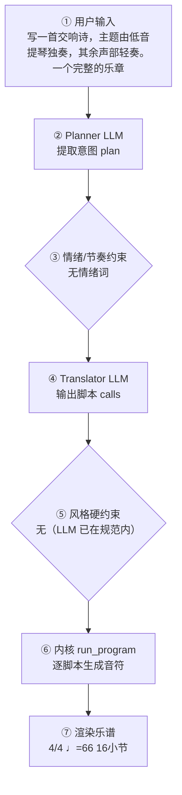

# 作曲生产报告：低音提琴的独白（程序员版）

> 面向产品/工程：记录本次生成的完整生产链路与系统状态，用于核对「说得 vs 写得」、排查缺陷与回归测试；可整体喂回大模型进一步定位具体小节/声部的问题。谱面检查与编辑者版一致，编辑者版见：`645648d8cd_report.md`。

## 1. 会话与生成环境

- 生成时间: 2026-09-27T17:20:12
- 生成路径: translator（LLM 翻译 + 确定性内核）
- 命中技能: compose-full
- 用户原始输入: 写一首交响诗，主题由低音提琴独奏，其余声部轻奏。一个完整的乐章
- 原始数据: `session.compose_trace`（本报告第 4 节即其展开，确定性可复现）

## 2. 谱面事实（与编辑者版「基本信息」一致）

- 调性: Cb 小调（3 个降号）
- 拍号: 4/4
- 速度: 四分音符 = 66 BPM
- 段落速度: 第 7 小节 Agitato（♩=76）；第 12 小节 Adagio（♩=62）
- 调内音级: C, D, D#, F, G, G#, A#
- 声部 1: Contrabass，低音谱号，16 小节
- 声部 2: 长笛 (Flute)，高音谱号，16 小节
- 声部 3: Clarinet，高音谱号，16 小节
- 声部 4: 圆号 (Horn)，高音谱号，16 小节
- 声部 5: 小提琴 (Violin)，高音谱号，16 小节
- 声部 6: 中提琴 (Viola)，ALTO，16 小节

## 3. 自动检查结果（与编辑者版「第 3 节」一致）

| 检查类别 | 状态 | 描述 |
|---|---|---|
| 调号一致性 | ⚠️ 注意 | Eb 大调下出现变化音 Db, E, A, B（经过音/离调） |
| 声部交叉 | ⚠️ 注意 | 纵向上方声部 2（长笛 (Flute)）与下方声部 3（Clarinet）在第 36.0 拍交叉：F5 低于 C#6 |
| 声部交叉 | ⚠️ 注意 | 纵向上方声部 3（Clarinet）与下方声部 5（小提琴 (Violin)）在第 4.5 拍交叉：C5 低于 F5（同类交叉共 7 处，此处为第 1 例） |
| 声部交叉 | ⚠️ 注意 | 纵向上方声部 5（小提琴 (Violin)）与下方声部 1（Contrabass）在第 31.5 拍交叉：D4 低于 G#4（同类交叉共 2 处，此处为第 1 例） |
| 音域 | ⚠️ 注意 | Contrabass: C3–G#4（MIDI 48–68） |

> 说明：平行五/八度仅检查最高与最低外声部；相邻声部交叉为提示项。 共检查 110 项（✅ 105 / ⚠️ 5 / ❌ 0）。

## 4. 作曲过程透明化（可追溯）

> 本节约等于把「需求 → 大模型 → 脚本 → 谱面」的完整链路展开，便于核对「说得 vs 写得」是否一致。数据来自本次生成的 `session.compose_trace`，确定性可复现。把本报告整体喂回大模型，可进一步定位具体小节/声部的问题与修正建议。

### 4.1 流程图（本次实际链路）



（文字版流程图，便于无 Mermaid 渲染环境阅读）

```
用户输入
  → [② Planner LLM] 提取意图 plan
  → [③ 情绪/节奏约束] 命中=否
  → [④ Translator LLM] 输出 calls + reasoning
  → [⑤ 风格硬约束] 触发=否
  → [⑥ 内核 run_program] 逐脚本执行
  → [⑦ 渲染谱面] 4/4 ♩=66 16小节
```

### 4.2 大模型输入输出（LLM I/O）

#### Planner（意图解析）

- **系统提示**（固定指令模板，已截断）：

```
You are a professional composer and music theorist acting as an Intent Parser.

Transform the user's natural-language request (and optional slash-commands already applied as preferences) into a Composition Plan JSON only.

Think like a composer first: infer genre, mood, form, motif character, harmony language, climax — do NOT invent note lists yet.

Output ONE JSON object, no Markdown:
{
  "title": "string",
  "genre": "string",
  "mood": ["..."],
  "tempo": 72,
  "meter": "4/4",
  "key_sharps": 0,
  "mode": "major|minor",
  "instrumentation": ["Piano"] or ["Violin","Cello"],
  "form": ["A","B","A"],
  "bars": 8,
  "motif": {"character": "...", "development": ["repetition","sequence"]},
  "harmony": {"language": "...", "density": "sparse|moderate|dense"},
  "rhythm": {"character": "..."},
  "texture": "homophonic|polyphonic|sparse|orchestral",
  "climax": {"location": "section B", "dynamic": "f"},
  "difficulty": "easy|medium",
  "summary": "one sentence for the user",
  "edit_intent": null
}
Rules:
- Original music only; no copyrighted melodies.
- If user is vague, choose musically appropriate defaults.
- bars: 4–32. Prefer 8–16 for a brand-new short piece.
- If the user asks to extend/lengthen to N bars (e.g. 扩展到32小节), set bars=N (not 8).
- If edit_intent is extend/longer and no N given, increase bars vs existing_score (typically +8 to +16, max 32).
- If edit_intent is rewrit
…（已截断，完整 2397 字；固定指令模板见 skills/composition/base/ 与内核 kernel_docs）
```

- **用户输入**（喂给模型的结构化上下文）：

```json
{
  "user_request": "写一首交响诗，主题由低音提琴独奏，其余声部轻奏。一个完整的乐章",
  "preferences": {
    "key_sharps": 0,
    "mode": "major",
    "tempo": 120,
    "bars": 8,
    "meter": "4/4",
    "style": "",
    "genre_id": "",
    "instrumentation": "",
    "fugue": "auto",
    "voices": 0,
    "_explicit": {}
  },
  "edit_intent": null,
  "skills": [
    "compose-full"
  ],
  "existing_plan": null,
  "revision_edits": null,
  "existing_score_summary": null
}
```

- **模型返回（原始）**：

```json
{
  "title": "低音提琴的独白",
  "genre": "交响诗",
  "mood": [
    "庄重",
    "沉思",
    "暗涌"
  ],
  "tempo": 66,
  "meter": "4/4",
  "key_sharps": -3,
  "mode": "minor",
  "instrumentation": [
    "低音提琴",
    "弦乐组",
    "木管组",
    "圆号",
    "定音鼓",
    "竖琴"
  ],
  "form": [
    "A",
    "B",
    "A'"
  ],
  "bars": 16,
  "motif": {
    "character": "低音区级进上行的叹息式动机，音域狭窄、气息悠长",
    "development": [
      "repetition",
      "sequence",
      "inversion",
      "augmentation"
    ]
  },
  "harmony": {
    "language": "晚期浪漫派半音化和声，以持续低音与变格进行为主",
    "density": "moderate"
  },
  "rhythm": {
    "character": "自由伸缩的宣叙性节奏，弦乐以长音与弱起音型衬托"
  },
  "texture": "homophonic",
  "climax": {
    "location": "section B",
    "dynamic": "f"
  },
  "difficulty": "medium",
  "summary": "一首以低音提琴独奏为叙事核心的单乐章交响诗，其余声部以轻奏铺陈，从沉思走向短暂高涨后归于寂静。",
  "edit_intent": null
}
```

#### Translator（脚本翻译）

- **系统提示**（固定指令模板，已截断）：

````
# 翻译器（Translator）

你不是作曲家，是**翻译器**：把用户的自然语言音乐需求与 plan 翻译成
对确定性脚本的调用序列。你**不写任何音符**——所有音符由脚本生成并保证
正确（时值、调性、织体、力度、终止）。你的职责是选对脚本、给对参数。

## 输出格式（只输出 JSON，不要任何解释文字）

```
{"reasoning": "用中文简述你如何把需求翻译成参数与脚本（2–5 句）：识别了什么风格/情绪，怎么决定速度/调式/织体，段落如何安排，调用了哪些脚本。", "calls": [{"script": "脚本名", "args": {...}}, ...]}
```

## 硬规则

1. 调用顺序：`new_score` → `set_sections` → 对每个段落 `{ set_harmony →
   accompaniment → melody }` →（高潮段可加 `thicken`）→（最后一段可加
   `cadence`）→ `finalize`
2. `new_score` 与 `finalize` 必须各恰好一次，且分别在最前/最后
3. **每个段落**都必须调用 set_harmony / accompaniment / melody，
   一次都不许漏（漏了 finalize 会报错）
4. args 必须严格符合脚本文档的字段名与取值范围；不要发明不存在的参数
5. 脚本执行失败时你会收到错误信息——修正 calls 后完整重新输出
6. `plan.tempo` / `plan.mode` / `plan.mood` / `plan.tempo_text` /
   `plan._emotion_hint` 是已解析的**明确约束**（来自用户情绪/速度词或
   `/tempo`），**优先级最高**——调用 `new_score` / `set_harmony` / `melody`
   时直接采用，不要用风格基线默认值覆盖。`reasoning` 字段必须如实写出你
   如何据此翻译，便于用户核查。
7. **乐器编制**：brief 提到管弦乐/弦乐/铜管/木管/具体乐器（小提琴、长笛、
   圆号、定音鼓…）或某种编制（弦乐四重奏、铜管五重奏…）时，`new_score`
   **必须传 `instruments`**（长度=voices，从高音到低音，低音乐器放最后），
   可用名：flute/oboe/**piccolo**/clarinet/bassoon/horn/trumpet/trombone/
   tuba/violin/viola/cello/contrabass/timpani/**harp**/piano/soprano/alto/
   tenor/bass。例：「弦乐四重奏」→ voices=4 +
   `["violin","violin","viola","cello"]`；「管弦乐小品」→ voices=4 +
   `["flute","violin","cello","timpani"]` 之类按 brief 取舍。不传时 2 声部
   默认钢琴大谱表、3/4 声部默认人声 SATB。
   - **「交响乐 / 交响曲 / 管
…（已截断，完整 10474 字；固定指令模板见 skills/composition/base/ 与内核 kernel_docs）
````

- **用户输入**（喂给模型的结构化上下文）：

```json
{
  "plan": {
    "title": "低音提琴的独白",
    "genre": "交响诗",
    "mood": [
      "庄重",
      "沉思",
      "暗涌"
    ],
    "tempo": 66,
    "tempo_text": null,
    "meter": "4/4",
    "key_sharps": -3,
    "mode": "minor",
    "_emotion_hint": null,
    "instrumentation": [
      "低音提琴",
      "弦乐组",
      "木管组",
      "圆号",
      "定音鼓",
      "竖琴"
    ],
    "form": [
      "A",
      "B",
      "A'"
    ],
    "bars": 16,
    "motif": {
      "character": "低音区级进上行的叹息式动机，音域狭窄、气息悠长",
      "development": [
        "repetition",
        "sequence",
        "inversion",
        "augmentation"
      ]
    },
    "harmony": {
      "language": "晚期浪漫派半音化和声，以持续低音与变格进行为主",
      "density": "moderate"
    },
    "rhythm": {
      "character": "自由伸缩的宣叙性节奏，弦乐以长音与弱起音型衬托"
    },
    "texture": "homophonic",
    "climax": {
      "location": "section B",
      "dynamic": "f"
    },
    "summary": "一首以低音提琴独奏为叙事核心的单乐章交响诗，其余声部以轻奏铺陈，从沉思走向短暂高涨后归于寂静。"
  },
  "user_brief": "写一首交响诗，主题由低音提琴独奏，其余声部轻奏。一个完整的乐章"
}
```

- **模型返回（原始）**：

```json
{
  "reasoning": "plan 已明确：交响诗，c 小调（key_sharps=-3），4/4，♩=66 慢速庄重沉思基调，A-B-A' 三段共 16 小节，高潮在 B 段（f），配器含低音提琴独奏+弦乐/木管/圆号/定音鼓/竖琴。A 段为 6 小节沉思呈示（sparse 上行叹息动机 + sustained 低音、pp），B 段 5 小节暗涌高涨（driving 上行 + broken_arpeggio 加密、f、thicken），A' 段 5 小节回归寂静（sparse 下行 + sustained + cadence）。brief 指定低音提琴独奏，new_score 传 instruments（低音提琴置末位）与 solo_instrument=contrabass，让内核把旋律路由到低音提琴并收进其可奏音域。上次 motif 总时值超 4/4 小节容量，现改为 2+1+1=4 拍。",
  "calls": [
    {
      "script": "new_score",
      "args": {
        "title": "低音提琴的独白",
        "key_sharps": -3,
        "mode": "minor",
        "meter": "4/4",
        "tempo": 66,
        "bars": 16,
        "voices": 6,
        "instruments": [
          "flute",
          "clarinet",
          "horn",
          "violin",
          "viola",
          "contrabass"
        ],
        "solo_instrument": "contrabass"
      }
    },
    {
      "script": "set_sections",
      "args": {
        "sections": [
          {
            "name": "A",
            "bars": 6,
            "meter": "4/4",
            "dynamic": "pp",
            "tempo_text": "Adagio",
            "bpm": 66
          },
          {
            "name": "B",
            "bars": 5,
            "meter": "4/4",
            "dynamic": "f",
            "tempo_text": "Agitato",
            "bpm": 76
          },
          {
            "name": "A'",
            "bars": 5,
            "meter": "4/4",
            "dynamic": "pp",
            "tempo_text": "Adagio",
            "bpm": 62
          }
        ]
      }
    },
    {
      "script": "set_harmony",
      "args": {
        "section": "A",
        "progression": [
          "i",
          "iv",
          "i",
          "V7",
          "i",
          "iv"
        ]
      }
    },
    {
      "script": "accompaniment",
      "args": {
        "section": "A",
        "pattern": "sustained",
        "register": "low",
        "density": 0.5
      }
    },
    {
      "script": "melody",
      "args": {
        "section": "A",
        "register": "low",
        "rhythm": "sparse",
        "contour": "ascending",
        "motif": [
          [
            1,
            "half"
          ],
          [
            2,
            "quarter"
          ],
          [
            3,
            "quarter"
          ]
        ]
      }
    },
    {
      "script": "set_harmony",
      "args": {
        "section": "B",
        "progression": [
          "iv",
          "V7",
          "i",
          "bII",
          "V7"
        ]
      }
    },
    {
      "script": "accompaniment",
      "args": {
        "section": "B",
        "pattern": "broken_arpeggio",
        "register": "low",
        "density": 2
      }
    },
    {
      "script": "melody",
      "args": {
        "section": "B",
        "register": "mid",
        "rhythm": "driving",
        "contour": "ascending"
      }
    },
    {
      "script": "thicken",
      "args": {
        "section": "B"
      }
    },
    {
      "script": "set_harmony",
      "args": {
        "section": "A'",
        "progression": [
          "i",
          "iv",
          "i",
          "V7",
          "i"
        ]
      }
    },
    {
      "script": "accompaniment",
      "args": {
        "section": "A'",
        "pattern": "sustained",
        "register": "low",
        "density": 0.5
      }
    },
    {
      "script": "melody",
      "args": {
        "section": "A'",
        "register": "low",
        "rhythm": "sparse",
        "contour": "descending"
      }
    },
    {
      "script": "cadence",
      "args": {
        "section": "A'",
        "bars": 2
      }
    },
    {
      "script": "narrative",
      "args": {
        "intensity": 1.1,
        "surprises": 1,
        "silence": true
      }
    },
    {
      "script": "finalize",
      "args": {}
    }
  ]
}
```

### 4.3 脚本调用与输入输出

| # | 脚本 | 输入(args) | 输出（新增音符 / 状态变更） |
|---|---|---|---|
| 1 | new_score | title=低音提琴的独白，key_sharps=-3，mode=minor，meter=4/4，tempo=66，bars=16，voices=6，instruments=["flute", "clarinet", "horn", "violin", "viola", "contrabass"]，solo_instrument=contrabass | 建立乐曲：4/4 ♩=66 6声部 minor；新增 — |
| 2 | set_sections | sections=[{"name": "A", "bars": 6, "meter": "4/4", "dynamic": "pp", "tempo_text": "Adagio", "bpm": 66}, {"name": "B", "bars": 5, "meter": "4/4", "dynamic": "f", "tempo_text": "Agitato", "bpm": 76}, {"name": "A'", "bars": 5, "meter": "4/4", "dynamic": "pp", "tempo_text": "Adagio", "bpm": 62}] | 分段：A(6小节)，B(5小节)，A'(5小节)；新增 — |
| 3 | set_harmony | section=A，progression=["i", "iv", "i", "V7", "i", "iv"] | 和声：段落A 进行['i', 'iv', 'i', 'V7', 'i', 'iv']；新增 — |
| 4 | accompaniment | section=A，pattern=sustained，register=low，density=0.5 | 伴奏：段落A pattern=sustained register=low density=0.5；新增 声部2:+48，声部3:+48，声部4:+12，声部5:+48，声部6:+12 |
| 5 | new_score | title=低音提琴的独白，key_sharps=-3，mode=minor，meter=4/4，tempo=66，bars=16，voices=6，instruments=["flute", "clarinet", "horn", "violin", "viola", "contrabass"]，solo_instrument=contrabass　⟲ **LLM 重试**：此前调用序列出错回滚，从 new_score 重新执行 | 建立乐曲：4/4 ♩=66 6声部 minor；新增 — |
| 6 | set_sections | sections=[{"name": "A", "bars": 6, "meter": "4/4", "dynamic": "pp", "tempo_text": "Adagio", "bpm": 66}, {"name": "B", "bars": 5, "meter": "4/4", "dynamic": "f", "tempo_text": "Agitato", "bpm": 76}, {"name": "A'", "bars": 5, "meter": "4/4", "dynamic": "pp", "tempo_text": "Adagio", "bpm": 62}] | 分段：A(6小节)，B(5小节)，A'(5小节)；新增 — |
| 7 | set_harmony | section=A，progression=["i", "iv", "i", "V7", "i", "iv"] | 和声：段落A 进行['i', 'iv', 'i', 'V7', 'i', 'iv']；新增 — |
| 8 | accompaniment | section=A，pattern=sustained，register=low，density=0.5 | 伴奏：段落A pattern=sustained register=low density=0.5；新增 声部2:+48，声部3:+48，声部4:+12，声部5:+48，声部6:+12 |
| 9 | melody | section=A，register=low，rhythm=sparse，contour=ascending，motif=[[1, "half"], [2, "quarter"], [3, "quarter"]] | 旋律：段落A rhythm=sparse；新增 声部1:+17 |
| 10 | set_harmony | section=B，progression=["iv", "V7", "i", "bII", "V7"] | 和声：段落B 进行['iv', 'V7', 'i', 'bII', 'V7']；新增 — |
| 11 | accompaniment | section=B，pattern=broken_arpeggio，register=low，density=2 | 伴奏：段落B pattern=broken_arpeggio register=low density=2；新增 声部2:+40，声部3:+40，声部4:+10，声部5:+40，声部6:+40 |
| 12 | melody | section=B，register=mid，rhythm=driving，contour=ascending | 旋律：段落B rhythm=driving；新增 声部1:+24 |
| 13 | thicken | section=B | 加厚：段落B；新增 — |
| 14 | set_harmony | section=A'，progression=["i", "iv", "i", "V7", "i"] | 和声：段落A' 进行['i', 'iv', 'i', 'V7', 'i']；新增 — |
| 15 | accompaniment | section=A'，pattern=sustained，register=low，density=0.5 | 伴奏：段落A' pattern=sustained register=low density=0.5；新增 声部2:+40，声部3:+40，声部4:+10，声部5:+40，声部6:+10 |
| 16 | melody | section=A'，register=low，rhythm=sparse，contour=descending | 旋律：段落A' rhythm=sparse；新增 声部1:+10 |
| 17 | cadence | section=A'，bars=2 | 终止：bars=2；新增 — |
| 18 | narrative | intensity=1.1，surprises=1，silence=True | narrative；新增 声部1:+4 |
| 19 | finalize |  | 收束装配：16小节 / 6声部；新增 — |

<details><summary>逐脚本新增音符样例（前 8 个 / 声部）</summary>

- **new_score**：声部1: —；声部2: —；声部3: —；声部4: —；声部5: —；声部6: —
- **set_sections**：声部1: —；声部2: —；声部3: —；声部4: —；声部5: —；声部6: —
- **set_harmony**：声部1: —；声部2: —；声部3: —；声部4: —；声部5: —；声部6: —
- **accompaniment**：声部1: —；声部2: G5:eighth, C6:eighth, Eb6:eighth, G6:eighth, C7:eighth, G6:eighth, Eb6:eighth, C6:eighth；声部3: C5:eighth, Eb5:eighth, G5:eighth, C6:eighth, Eb6:eighth, G6:eighth, Eb6:eighth, Bb5:eighth；声部4: C4:half, C4:half, F3:half, F3:half, C4:half, C4:half, G3:half, G3:half；声部5: None:eighth, C5:eighth, Eb5:eighth, G5:eighth, C6:eighth, C5:eighth, Eb5:eighth, G5:eighth；声部6: C3:half, G3:half, F3:half, C3:half, C3:half, G3:half, G3:half, D3:half
- **new_score**：声部1: —；声部2: —；声部3: —；声部4: —；声部5: —；声部6: —
- **set_sections**：声部1: —；声部2: —；声部3: —；声部4: —；声部5: —；声部6: —
- **set_harmony**：声部1: —；声部2: —；声部3: —；声部4: —；声部5: —；声部6: —
- **accompaniment**：声部1: —；声部2: G5:eighth, C6:eighth, Eb6:eighth, G6:eighth, C7:eighth, G6:eighth, D6:eighth, Bb5:eighth；声部3: C5:eighth, Eb5:eighth, G5:eighth, C6:eighth, Eb6:eighth, G6:eighth, E-5:eighth, Bb5:eighth；声部4: C4:half, C4:half, F3:half, F3:half, C4:half, C4:half, G3:half, G3:half；声部5: None:eighth, C5:eighth, Eb5:eighth, G5:eighth, C6:eighth, C5:eighth, Eb5:eighth, G5:eighth；声部6: C3:half, G3:half, F3:half, C3:half, C3:half, G3:half, G3:half, D3:half
- **melody**：声部1: C4:half, D4:quarter, Eb4:quarter, C4:half, Ab3:quarter, F3:quarter, G3:quarter, C4:half；声部2: —；声部3: —；声部4: —；声部5: —；声部6: —
- **set_harmony**：声部1: —；声部2: —；声部3: —；声部4: —；声部5: —；声部6: —
- **accompaniment**：声部1: —；声部2: Ab5:eighth, C6:eighth, F6:eighth, Ab6:eighth, C7:eighth, G6:eighth, F6:eighth, Bb5:eighth；声部3: C5:eighth, F5:eighth, Ab5:eighth, C6:eighth, F6:eighth, A-5:eighth, F6:eighth, C5:eighth；声部4: F3:half, F3:half, G3:half, G3:half, C4:half, C4:half, C#4:half, C#4:half；声部5: None:eighth, F5:eighth, Ab5:eighth, C5:eighth, F6:eighth, F5:eighth, Ab5:eighth, C5:eighth；声部6: F3:eighth, Ab3:eighth, C3:eighth, F3:eighth, C3:eighth, Ab3:eighth, F3:eighth, Ab3:eighth
- **melody**：声部1: F4:eighth, F4:eighth, G4:quarter, C4:quarter, Ab3:quarter, Bb3:eighth, B3:eighth, B3:quarter；声部2: —；声部3: —；声部4: —；声部5: —；声部6: —
- **thicken**：声部1: —；声部2: —；声部3: —；声部4: —；声部5: —；声部6: —
- **set_harmony**：声部1: —；声部2: —；声部3: —；声部4: —；声部5: —；声部6: —
- **accompaniment**：声部1: —；声部2: G5:eighth, C6:eighth, Eb6:eighth, G6:eighth, C7:eighth, F6:eighth, D6:eighth, C6:eighth；声部3: C5:eighth, Eb5:eighth, G5:eighth, C6:eighth, Eb6:eighth, G5:eighth, E-5:eighth, C6:eighth；声部4: C4:half, C4:half, F3:half, F3:half, C4:half, C4:half, G3:half, G3:half；声部5: None:eighth, C5:eighth, Eb5:eighth, G5:eighth, C6:eighth, C5:eighth, Eb5:eighth, G5:eighth；声部6: C3:half, G3:half, F3:half, C3:half, C3:half, G3:half, G3:half, D3:half
- **melody**：声部1: G4:whole, F4:quarter, C4:half, Ab3:quarter, G3:quarter, C4:quarter, Eb4:half, F4:half；声部2: —；声部3: —；声部4: —；声部5: —；声部6: —
- **cadence**：声部1: —；声部2: —；声部3: —；声部4: —；声部5: —；声部6: —
- **narrative**：声部1: C4:quarter, Eb4:half, C3+C4:whole, C3+C4:whole；声部2: —；声部3: —；声部4: —；声部5: —；声部6: —
- **finalize**：声部1: —；声部2: —；声部3: —；声部4: —；声部5: —；声部6: —

</details>

### 4.4 本地强制约束（确定性兜底，优先级高于 LLM）

- 情绪/节奏约束：未触发（用户未给情绪/速度词，或已被风格基线覆盖）
- 风格/速度强制纠正：未触发（LLM 输出已在 genre 规范内）
### 4.5 自动问题定位（可疑点 + 程度）

| 检查项 | 程度 | 说明 |
|---|---|---|
| 情绪约束 | 🟢 未触发 | 用户未给情绪/速度词 |
| 意图拍号↔谱面 | 🟢 一致 | 最终拍号 4/4 |
| 计划小节↔实际小节 | 🟢 一致 | 16 小节 |
| 风格规范遵循 | 🟢 良好 | LLM 输出均在 genre 规范内，无需强制 |
| 本地修复 | 🟡 注意 | 校验后触发了本地修复（时值/声部进行），说明初版谱存在 CRITICAL/MAJOR 问题 |
| 计划编制↔实际编制 | 🟡 注意 | 计划编制含 低音提琴、弦乐组、木管组、圆号、定音鼓、竖琴，但谱面 6 个声部未落地（voices 数不足或 translator 取舍）——用户对编制的明确要求可能未满足 |

> 说明：上表为程序自动比对「意图 ↔ 谱面」的初判（🔴 严重 / 🟡 注意 / 🟢 一致）。将本报告整体喂给大模型，可进一步定位具体小节/声部的问题与修正建议。

## 5. 记谱与演奏法

**规则日志**（共 48 条，其中仲裁 0 次）

- [spelling/correctness] p1m1 E- — → Eb：调号 -3 下变音记号更少
- [spelling/correctness] p1m2 A- — → Ab：调号 -3 下变音记号更少
- [spelling/correctness] p1m3 E- — → Eb：调号 -3 下变音记号更少
- [spelling/correctness] p1m4 E- — → Eb：调号 -3 下变音记号更少
- [spelling/correctness] p1m5 E- — → Eb：调号 -3 下变音记号更少
- [spelling/correctness] p1m6 A- — → Ab：调号 -3 下变音记号更少
- [spelling/correctness] p1m7 A- — → Ab：调号 -3 下变音记号更少
- [spelling/correctness] p1m8 B- — → Bb：调号 -3 下变音记号更少
- [spelling/correctness] p1m8 A- — → Ab：调号 -3 下变音记号更少
- [articulation/style] tenuto — 挂 Tenuto：叙事/风格标记 tenuto
- [spelling/correctness] p1m9 E- — → Eb：调号 -3 下变音记号更少
- [spelling/correctness] p1m9 E- — → Eb：调号 -3 下变音记号更少
- …另有 36 条

可演奏性：1 项 MAJOR / 26 项总计
- [MAJOR] 声部1（Contrabass）音 68 超出音域 28–67
- [MINOR] 声部1 大跳 15 半音（>八度）
- [MINOR] 声部2 大跳 17 半音（>八度）
- [MINOR] 声部2 大跳 16 半音（>八度）
- [MINOR] 声部2 大跳 17 半音（>八度）
- [MINOR] 声部2 大跳 15 半音（>八度）
- [MINOR] 声部2 大跳 16 半音（>八度）
- [MINOR] 声部2 大跳 16 半音（>八度）
- …其余 18 项从略

## 6. 生成质量评估（三指标）

- **风格重叠率**：N/A（未指定目标包）
- **属性遵循度**：1.00（0 项）
- **最近邻**：ballade-piano（相似度 0.62）— ✅ 无抄袭嫌疑
