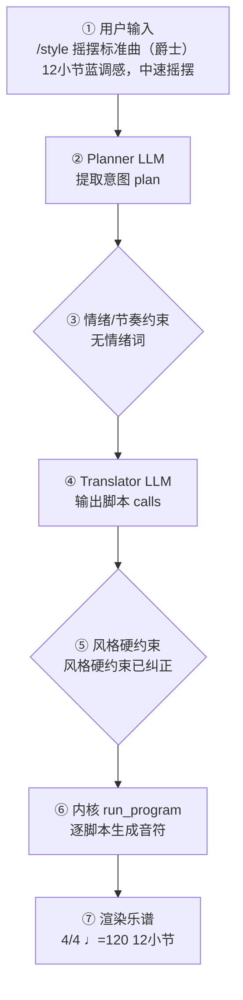

# 作曲生产报告：Twelve-Bar Swing（程序员版）

> 面向产品/工程：记录本次生成的完整生产链路与系统状态，用于核对「说得 vs 写得」、排查缺陷与回归测试；可整体喂回大模型进一步定位具体小节/声部的问题。谱面检查与编辑者版一致，编辑者版见：`65d09c5f62_report.md`。

## 1. 会话与生成环境

- 生成时间: 2026-09-29T05:21:24
- 生成路径: translator（LLM 翻译 + 确定性内核）
- 命中技能: compose-full, genre:jazz/swing-standard
- 用户原始输入: /style 摇摆标准曲（爵士） 12小节蓝调感，中速摇摆
- 原始数据: `session.compose_trace`（本报告第 4 节即其展开，确定性可复现）

## 2. 谱面事实（与编辑者版「基本信息」一致）

- 调性: C 大调（0 个升号）
- 拍号: 4/4
- 速度: 四分音符 = 120 BPM
- 段落速度: 第 7 小节 Moderato（♩=126）
- 调内音级: C, D, E, F, G, A, B
- 声部 1: 小号 (Trumpet)，高音谱号，12 小节
- 声部 2: Piano，高音谱号，12 小节
- 声部 3: Contrabass，低音谱号，12 小节

## 3. 自动检查结果（与编辑者版「第 3 节」一致）

| 检查类别 | 状态 | 描述 |
|---|---|---|
| 调号一致性 | ⚠️ 注意 | C 大调下出现变化音 C#, D#, F#, G#, A#（经过音/离调） |
| 声部交叉 | ⚠️ 注意 | 纵向上方声部 1（小号 (Trumpet)）与下方声部 2（Piano）在第 1.5 拍交叉：G4 低于 A#4（同类交叉共 2 处，此处为第 1 例） |

> 说明：平行五/八度仅检查最高与最低外声部；相邻声部交叉为提示项。 共检查 43 项（✅ 41 / ⚠️ 2 / ❌ 0）。

## 4. 作曲过程透明化（可追溯）

> 本节约等于把「需求 → 大模型 → 脚本 → 谱面」的完整链路展开，便于核对「说得 vs 写得」是否一致。数据来自本次生成的 `session.compose_trace`，确定性可复现。把本报告整体喂回大模型，可进一步定位具体小节/声部的问题与修正建议。

### 4.1 流程图（本次实际链路）



（文字版流程图，便于无 Mermaid 渲染环境阅读）

```
用户输入
  → [② Planner LLM] 提取意图 plan
  → [③ 情绪/节奏约束] 命中=否
  → [④ Translator LLM] 输出 calls + reasoning
  → [⑤ 风格硬约束] 触发=是
  → [⑥ 内核 run_program] 逐脚本执行
  → [⑦ 渲染谱面] 4/4 ♩=120 12小节
```

### 4.2 大模型输入输出（LLM I/O）

#### Planner（意图解析）

- **系统提示**（固定指令模板，已截断）：

```
You are a professional composer and music theorist acting as an Intent Parser.

Transform the user's natural-language request (and optional slash-commands already applied as preferences) into a Composition Plan JSON only.

Think like a composer first: infer genre, mood, form, motif character, harmony language, climax — do NOT invent note lists yet.

A **风格目录（仅已学包）** is injected at the end of this system prompt. Use it to set `genre_id`.

Output ONE JSON object, no Markdown:
{
  "title": "string",
  "genre": "string (human label, e.g. 摇摆标准曲（爵士）)",
  "genre_id": "family/pack_id from 风格目录, e.g. jazz/swing-standard; empty if none",
  "mood": ["..."],
  "tempo": 72,
  "meter": "4/4",
  "key_sharps": 0,
  "mode": "major|minor",
  "instrumentation": ["trumpet","piano","contrabass"] (kernel English names; map fiddle→violin, double bass→contrabass, tin whistle→flute; avoid unknown names),
  "form": ["A","B","A"],
  "bars": 16,
  "motif": {"character": "...", "development": ["repetition","sequence"]},
  "harmony": {"language": "...", "density": "sparse|moderate|dense"},
  "rhythm": {"character": "..."},
  "texture": "homophonic|polyphonic|sparse|orchestral",
  "climax": {"location": "section B", "dynamic": "f"},
  "difficulty": "easy|medium",
  "summary": "one sentence for the user",
  "edit_intent": null
}
Rules:
- Original music only; no copyrighted melodies.
- If user is vague, choose
…（已截断，完整 6207 字；固定指令模板见 skills/composition/base/ 与内核 kernel_docs）
```

- **用户输入**（喂给模型的结构化上下文）：

```json
{
  "user_request": "12小节蓝调感，中速摇摆",
  "preferences": {
    "key_sharps": 0,
    "mode": "major",
    "tempo": 120,
    "bars": 8,
    "meter": "4/4",
    "style": "摇摆标准曲（爵士）",
    "genre_id": "genre:jazz/swing-standard",
    "instrumentation": "",
    "fugue": "auto",
    "voices": 0,
    "_explicit": {}
  },
  "edit_intent": null,
  "skills": [
    "compose-full",
    "genre:jazz/swing-standard"
  ],
  "existing_plan": null,
  "revision_edits": null,
  "existing_score_summary": null
}
```

- **模型返回（原始）**：

```json
{
  "title": "Twelve-Bar Swing",
  "genre": "摇摆标准曲（爵士）",
  "genre_id": "jazz/swing-standard",
  "mood": [
    "bluesy",
    "swinging",
    "urban",
    "relaxed"
  ],
  "tempo": 120,
  "meter": "4/4",
  "key_sharps": 0,
  "mode": "major",
  "instrumentation": [
    "trumpet",
    "piano",
    "contrabass"
  ],
  "form": [
    "A",
    "A",
    "B",
    "A"
  ],
  "bars": 12,
  "motif": {
    "character": "blues-inflected syncopated riff, short-long swing eighths",
    "development": [
      "repetition",
      "sequence",
      "call-and-response"
    ]
  },
  "harmony": {
    "language": "12-bar blues with jazz seventh chords, ii-V inserts, secondary dominants",
    "density": "moderate"
  },
  "rhythm": {
    "character": "swing eighths, off-beat phrasing, walking bass quarter notes"
  },
  "texture": "homophonic",
  "climax": {
    "location": "section B",
    "dynamic": "f"
  },
  "difficulty": "medium",
  "summary": "中速摇摆的十二小节蓝调感爵士小品，七和弦与 ii–V 惯性，小号领奏加钢琴与低音。",
  "edit_intent": null
}
```

#### Translator（脚本翻译）

- **系统提示**（固定指令模板，已截断）：

````
# 翻译器（Translator）

你不是作曲家，是**翻译器**：把用户的自然语言音乐需求与 plan 翻译成
对确定性脚本的调用序列。你**不写任何音符**——所有音符由脚本生成并保证
正确（时值、调性、织体、力度、终止）。你的职责是选对脚本、给对参数。

## 输出格式（只输出 JSON，不要任何解释文字）

```
{"reasoning": "用中文简述你如何把需求翻译成参数与脚本（2–5 句）：识别了什么风格/情绪，怎么决定速度/调式/织体，段落如何安排，调用了哪些脚本。", "calls": [{"script": "脚本名", "args": {...}}, ...]}
```

## 硬规则

1. 调用顺序：`new_score` → `set_sections` → 对每个段落 `{ set_harmony →
   accompaniment → melody }` →（高潮段可加 `thicken`）→（最后一段可加
   `cadence`）→（**可选** `narrative(...)`：仅当你需要关掉自动叙事层的
   动机变形/惊喜和弦时，见下「叙事层」）→ `finalize`
2. `new_score` 与 `finalize` 必须各恰好一次，且分别在最前/最后
3. **每个段落**都必须调用 set_harmony / accompaniment / melody，
   一次都不许漏（漏了 finalize 会报错）
4. args 必须严格符合脚本文档的字段名与取值范围；不要发明不存在的参数
5. 脚本执行失败时你会收到错误信息——修正 calls 后完整重新输出
6. `plan.tempo` / `plan.mode` / `plan.mood` / `plan.tempo_text` /
   `plan._emotion_hint` 是已解析的**明确约束**（来自用户情绪/速度词或
   `/tempo`），**优先级最高**——调用 `new_score` / `set_harmony` / `melody`
   时直接采用，不要用风格基线默认值覆盖。`reasoning` 字段必须如实写出你
   如何据此翻译，便于用户核查。
7. **乐器编制**：brief 提到管弦乐/弦乐/铜管/木管/具体乐器（小提琴、长笛、
   圆号、定音鼓…）或某种编制（弦乐四重奏、铜管五重奏…）时，`new_score`
   **必须传 `instruments`**（长度=voices，从高音到低音，低音乐器放最后），
   可用名：flute/oboe/**piccolo**/clarinet/bassoon/horn/trumpet/trombone/
   tuba/violin/viola/cello/contrabass/timpani/**harp**/piano/soprano/alto/
   tenor/bass。例：「弦乐四重奏」→ voices=4 +
   `["violin","violin","viola","cello"]`；「管弦乐小品」→ voices=4 +
   `["flute","violin","cello","timpani"]` 之类按 brief
…（已截断，完整 20573 字；固定指令模板见 skills/composition/base/ 与内核 kernel_docs）
````

- **用户输入**（喂给模型的结构化上下文）：

```json
{
  "plan": {
    "title": "Twelve-Bar Swing",
    "genre": "摇摆标准曲（爵士）",
    "mood": [
      "bluesy",
      "swinging",
      "urban",
      "relaxed"
    ],
    "tempo": 120,
    "tempo_text": null,
    "meter": "4/4",
    "key_sharps": 0,
    "mode": "major",
    "_emotion_hint": null,
    "instrumentation": [
      "trumpet",
      "piano",
      "contrabass"
    ],
    "form": [
      "A",
      "A",
      "B",
      "A"
    ],
    "bars": 12,
    "motif": {
      "character": "blues-inflected syncopated riff, short-long swing eighths",
      "development": [
        "repetition",
        "sequence",
        "call-and-response"
      ]
    },
    "harmony": {
      "language": "12-bar blues with jazz seventh chords, ii-V inserts, secondary dominants",
      "density": "moderate"
    },
    "rhythm": {
      "character": "swing eighths, off-beat phrasing, walking bass quarter notes"
    },
    "texture": "homophonic",
    "climax": {
      "location": "section B",
      "dynamic": "f"
    },
    "summary": "中速摇摆的十二小节蓝调感爵士小品，七和弦与 ii–V 惯性，小号领奏加钢琴与低音。"
  },
  "user_brief": "12小节蓝调感，中速摇摆 摇摆标准曲（爵士）"
}
```

- **模型返回（原始）**：

```json
{
  "reasoning": "识别为摇摆标准曲（爵士）：plan.genre_id=jazz/swing-standard，速度按 plan.tempo=120（中速摇摆），4/4，C 大调（key_sharps=0，mode=major），编制为 trumpet/piano/contrabass，小号领奏旋律。结构按 12 小节蓝调分 A A B A 四段（各 3 小节），和声用七和弦 12 小节蓝调进行加 ii–V 插入，B 段为高潮 f。旋律用切分/驱动节奏并在 B 段加强，伴奏用 walking_bass 与 comping 保持摆动，末段加 cadence 收束。",
  "calls": [
    {
      "script": "new_score",
      "args": {
        "title": "Twelve-Bar Swing",
        "key_sharps": 0,
        "mode": "major",
        "meter": "4/4",
        "tempo": 120,
        "bars": 12,
        "voices": 3,
        "instruments": [
          "trumpet",
          "piano",
          "contrabass"
        ],
        "solo_instrument": "trumpet"
      }
    },
    {
      "script": "set_sections",
      "args": {
        "sections": [
          {
            "name": "A1",
            "bars": 3,
            "meter": "4/4",
            "dynamic": "mf",
            "tempo_text": "Moderato",
            "bpm": 120
          },
          {
            "name": "A2",
            "bars": 3,
            "meter": "4/4",
            "dynamic": "mf",
            "tempo_text": "Moderato",
            "bpm": 120
          },
          {
            "name": "B",
            "bars": 3,
            "meter": "4/4",
            "dynamic": "f",
            "tempo_text": "Moderato",
            "bpm": 126
          },
          {
            "name": "A3",
            "bars": 3,
            "meter": "4/4",
            "dynamic": "mf",
            "tempo_text": "Moderato",
            "bpm": 120
          }
        ]
      }
    },
    {
      "script": "set_harmony",
      "args": {
        "section": "A1",
        "progression": [
          "I7",
          "IV7",
          "I7"
        ]
      }
    },
    {
      "script": "accompaniment",
      "args": {
        "section": "A1",
        "pattern": "walking_bass",
        "register": "low",
        "density": 1
      }
    },
    {
      "script": "melody",
      "args": {
        "section": "A1",
        "register": "mid",
        "rhythm": "flowing",
        "contour": "arch",
        "motif": [
          [
            5,
            "quarter"
          ],
          [
            6,
            "eighth"
          ],
          [
            5,
            "eighth"
          ],
          [
            3,
            "half"
          ]
        ]
      }
    },
    {
      "script": "set_harmony",
      "args": {
        "section": "A2",
        "progression": [
          "IV7",
          "I7",
          "ii7",
          "V7"
        ]
      }
    },
    {
      "script": "accompaniment",
      "args": {
        "section": "A2",
        "pattern": "walking_bass",
        "register": "low",
        "density": 1
      }
    },
    {
      "script": "melody",
      "args": {
        "section": "A2",
        "register": "mid",
        "rhythm": "flowing",
        "contour": "wave"
      }
    },
    {
      "script": "set_harmony",
      "args": {
        "section": "B",
        "progression": [
          "ii7",
          "V7",
          "I7"
        ]
      }
    },
    {
      "script": "accompaniment",
      "args": {
        "section": "B",
        "pattern": "comping",
        "register": "low",
        "density": 2
      }
    },
    {
      "script": "melody",
      "args": {
        "section": "B",
        "register": "high",
        "rhythm": "driving",
        "contour": "ascending"
      }
    },
    {
      "script": "thicken",
      "args": {
        "section": "B"
      }
    },
    {
      "script": "set_harmony",
      "args": {
        "section": "A3",
        "progression": [
          "I7",
          "VI7",
          "ii7",
          "V7"
        ]
      }
    },
    {
      "script": "accompaniment",
      "args": {
        "section": "A3",
        "pattern": "walking_bass",
        "register": "low",
        "density": 1
      }
    },
    {
      "script": "melody",
      "args": {
        "section": "A3",
        "register": "mid",
        "rhythm": "flowing",
        "contour": "descending"
      }
    },
    {
      "script": "cadence",
      "args": {
        "section": "A3",
        "bars": 1
      }
    },
    {
      "script": "finalize",
      "args": {}
    }
  ]
}
```

### 4.3 脚本调用与输入输出

| # | 脚本 | 输入(args) | 输出（新增音符 / 状态变更） |
|---|---|---|---|
| 1 | new_score | title=Twelve-Bar Swing，key_sharps=0，mode=major，meter=4/4，tempo=120，bars=12，voices=3，instruments=["trumpet", "piano", "contrabass"]，solo_instrument=trumpet，style=jazz/swing-standard | 建立乐曲：4/4 ♩=120 3声部 major；新增 — |
| 2 | set_sections | sections=[{"name": "A1", "bars": 3, "meter": "4/4", "dynamic": "mf", "tempo_text": "Moderato", "bpm": 120}, {"name": "A2", "bars": 3, "meter": "4/4", "dynamic": "mf", "tempo_text": "Moderato", "bpm": 120}, {"name": "B", "bars": 3, "meter": "4/4", "dynamic": "f", "tempo_text": "Moderato", "bpm": 126}, {"name": "A3", "bars": 3, "meter": "4/4", "dynamic": "mf", "tempo_text": "Moderato", "bpm": 120}] | 分段：A1(3小节)，A2(3小节)，B(3小节)，A3(3小节)；新增 — |
| 3 | set_harmony | section=A1，progression=["I7", "IV7", "I7"] | 和声：段落A1 进行['I7', 'IV7', 'I7']；新增 — |
| 4 | accompaniment | section=A1，pattern=walking_bass，register=low，density=1 | 伴奏：段落A1 pattern=walking_bass register=low density=1；新增 声部2:+12，声部3:+12 |
| 5 | melody | section=A1，register=mid，rhythm=flowing，contour=arch，motif=[[5, "quarter"], [6, "eighth"], [5, "eighth"], [3, "half"]] | 旋律：段落A1 rhythm=flowing；新增 声部1:+12 |
| 6 | set_harmony | section=A2，progression=["IV7", "I7", "ii7", "V7"] | 和声：段落A2 进行['IV7', 'I7', 'ii7', 'V7']；新增 — |
| 7 | accompaniment | section=A2，pattern=walking_bass，register=low，density=1 | 伴奏：段落A2 pattern=walking_bass register=low density=1；新增 声部2:+12，声部3:+12 |
| 8 | melody | section=A2，register=mid，rhythm=flowing，contour=wave | 旋律：段落A2 rhythm=flowing；新增 声部1:+13 |
| 9 | set_harmony | section=B，progression=["ii7", "V7", "I7"] | 和声：段落B 进行['ii7', 'V7', 'I7']；新增 — |
| 10 | accompaniment | section=B，pattern=walking_bass，register=low，density=2 | 伴奏：段落B pattern=walking_bass register=low density=2；新增 声部2:+18，声部3:+12 |
| 11 | melody | section=B，register=high，rhythm=driving，contour=ascending | 旋律：段落B rhythm=driving；新增 声部1:+17 |
| 12 | thicken | section=B | 加厚：段落B；新增 — |
| 13 | set_harmony | section=A3，progression=["I7", "VI7", "ii7", "V7"] | 和声：段落A3 进行['I7', 'VI7', 'ii7', 'V7']；新增 — |
| 14 | accompaniment | section=A3，pattern=walking_bass，register=low，density=1 | 伴奏：段落A3 pattern=walking_bass register=low density=1；新增 声部2:+12，声部3:+12 |
| 15 | melody | section=A3，register=mid，rhythm=flowing，contour=descending | 旋律：段落A3 rhythm=flowing；新增 声部1:+15 |
| 16 | cadence | section=A3，bars=1 | 终止：bars=1；新增 — |
| 17 | finalize |  | 收束装配：12小节 / 3声部；新增 声部1:+2 |

<details><summary>逐脚本新增音符样例（前 8 个 / 声部）</summary>

- **new_score**：声部1: —；声部2: —；声部3: —
- **set_sections**：声部1: —；声部2: —；声部3: —
- **set_harmony**：声部1: —；声部2: —；声部3: —
- **accompaniment**：声部1: —；声部2: None:quarter, E4+G4+Bb4:quarter, None:quarter, E4+G4+Bb4:quarter, None:quarter, A4+C4+Eb4:quarter, None:quarter, A4+C4+Eb4:quarter；声部3: C3:quarter, G2:quarter, E2:quarter, E3:quarter, F3:quarter, C3:quarter, A2:quarter, B2:quarter
- **melody**：声部1: G4:quarter, A4:eighth, G4:eighth, E4:half, A4:quarter, B4:eighth, None:eighth, C5:half；声部2: —；声部3: —
- **set_harmony**：声部1: —；声部2: —；声部3: —
- **accompaniment**：声部1: —；声部2: None:quarter, A4+C4+Eb4:quarter, None:quarter, A4+C4+Eb4:quarter, None:quarter, E4+G4+Bb4:quarter, None:quarter, E4+G4+Bb4:quarter；声部3: F3:quarter, C3:quarter, A2:quarter, B2:quarter, C3:quarter, G2:quarter, E2:quarter, Db3:quarter
- **melody**：声部1: C5:quarter, D5:eighth, Eb5:eighth, Eb5:quarter, F5:quarter, E5:half, C5:quarter, Bb4:quarter；声部2: —；声部3: —
- **set_harmony**：声部1: —；声部2: —；声部3: —
- **accompaniment**：声部1: —；声部2: None:eighth, F4+A4+C4:eighth, F4+A4+C4:quarter, None:eighth, F4+A4+C4:eighth, F4+A4+C4:quarter, None:eighth, B3+D4+F4:eighth；声部3: D3:quarter, A2:quarter, F2:quarter, Gb2:quarter, G2:quarter, D3:quarter, B2:quarter, B2:quarter
- **melody**：声部1: D5:eighth, E5:eighth, F5:eighth, F5:eighth, E5:quarter, D5:quarter, F5:quarter, G5:eighth；声部2: —；声部3: —
- **thicken**：声部1: —；声部2: —；声部3: —
- **set_harmony**：声部1: —；声部2: —；声部3: —
- **accompaniment**：声部1: —；声部2: None:quarter, E4+G4+Bb4:quarter, None:quarter, E4+G4+Bb4:quarter, None:quarter, C#4+E4+G4:quarter, None:quarter, C#4+E4+G4:quarter；声部3: C3:quarter, G2:quarter, E2:quarter, Ab2:quarter, A2:quarter, E3:quarter, C#3:quarter, C#3:quarter
- **melody**：声部1: C5:eighth, D5:eighth, E5:quarter, G5:quarter, F5:quarter, E5:eighth, E5:eighth, D5:eighth；声部2: —；声部3: —
- **cadence**：声部1: —；声部2: —；声部3: —
- **finalize**：声部1: E5:half, C5+C6:whole；声部2: —；声部3: —

</details>

### 4.4 本地强制约束（确定性兜底，优先级高于 LLM）

- 情绪/节奏约束：未触发（用户未给情绪/速度词，或已被风格基线覆盖）
- 风格/速度强制纠正：accompaniment pattern 'comping' → walking_bass
- **风格契约施加的约束**：无（该风格包没有 `style_contract.yaml`，或契约证据量不足、和声分区未生效）
### 4.5 自动问题定位（可疑点 + 程度）

| 检查项 | 程度 | 说明 |
|---|---|---|
| 情绪约束 | 🟢 未触发 | 用户未给情绪/速度词 |
| 意图拍号↔谱面 | 🟢 一致 | 最终拍号 4/4 |
| 计划小节↔实际小节 | 🟢 一致 | 12 小节 |
| 风格规范遵循 | 🟡 注意 | LLM 偏离 genre 规范，已强制纠正 1 处（说明模型未严格遵循风格包） |
| 计划编制↔实际编制 | 🟢 一致 | 计划 3 件乐器与谱面 3 声部对应 |

> 说明：上表为程序自动比对「意图 ↔ 谱面」的初判（🔴 严重 / 🟡 注意 / 🟢 一致）。将本报告整体喂给大模型，可进一步定位具体小节/声部的问题与修正建议。

## 5. 记谱与演奏法

**规则日志**（共 30 条，其中仲裁 0 次）

- [spelling/correctness] p1m4 E- — → D#：调号 0 下变音记号更少
- [spelling/correctness] p1m4 E- — → D#：调号 0 下变音记号更少
- [spelling/correctness] p1m5 B- — → A#：调号 0 下变音记号更少
- [articulation/style] tenuto — 挂 Tenuto：叙事/风格标记 tenuto
- [articulation/style] tenuto — 挂 Tenuto：叙事/风格标记 tenuto
- [spelling/correctness] p1m9 B- — → A#：调号 0 下变音记号更少
- [articulation/style] accent — 挂 Accent：叙事/风格标记 accent
- [articulation/style] tenuto — 挂 Tenuto：叙事/风格标记 tenuto
- [spelling/correctness] p2m1 B- — → A#：调号 0 下变音记号更少
- [spelling/correctness] p2m1 B- — → A#：调号 0 下变音记号更少
- [spelling/correctness] p2m2 E- — → D#：调号 0 下变音记号更少
- [spelling/correctness] p2m2 E- — → D#：调号 0 下变音记号更少
- …另有 18 条

可演奏性：0 项 MAJOR / 2 项总计
- [MINOR] 声部1 大跳 14 半音（>八度）
- [MINOR] 声部3 大跳 13 半音（>八度）

## 6. 生成质量评估（三指标）

- **风格重叠率**：N/A（未指定目标包）
- **属性遵循度**：1.00（0 项）
- **最近邻**：celtic-jig（相似度 0.28）— ✅ 无抄袭嫌疑
