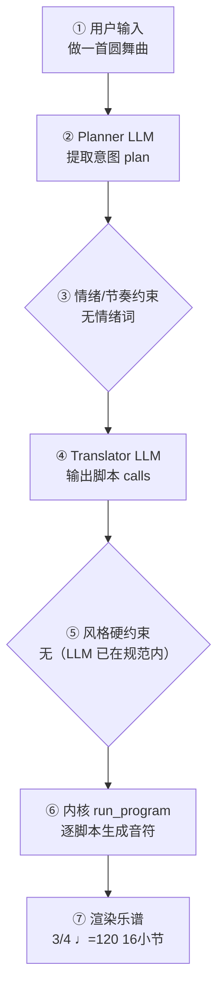

# 作曲生产报告：维也纳清晨圆舞曲（程序员版）

> 面向产品/工程：记录本次生成的完整生产链路与系统状态，用于核对「说得 vs 写得」、排查缺陷与回归测试；可整体喂回大模型进一步定位具体小节/声部的问题。谱面检查与编辑者版一致，编辑者版见：`6d0fe44348_report.md`。

## 1. 会话与生成环境

- 生成时间: 2026-10-01T17:15:46
- 生成路径: composer（LLM 直出乐谱，无脚本序列）
- 命中技能: compose-full, genre:dance/waltz
- 用户原始输入: 做一首圆舞曲
- 原始数据: `session.compose_trace`（本报告第 4 节即其展开，确定性可复现）

## 2. 谱面事实（与编辑者版「基本信息」一致）

- 调性: C 大调（0 个升号）
- 拍号: 3/4
- 速度: 四分音符 = 120 BPM
- 段落速度: 第 9 小节 Poco meno mosso（♩=108）；第 15 小节 Rit. e dim.（♩=96）
- 调内音级: C, D, E, F, G, A, B
- 声部 1: Piano Melody，高音谱号，16 小节
- 声部 2: Piano Accompaniment，低音谱号，16 小节

## 3. 自动检查结果（与编辑者版「第 3 节」一致）

| 检查类别 | 状态 | 描述 |
|---|---|---|
| 调号一致性 | ⚠️ 注意 | C 大调下出现变化音 F#（经过音/离调） |

> 说明：平行五/八度仅检查最高与最低外声部；相邻声部交叉为提示项。 共检查 38 项（✅ 37 / ⚠️ 1 / ❌ 0）。

## 4. 作曲过程透明化（可追溯）

> 本节约等于把「需求 → 大模型 → 脚本 → 谱面」的完整链路展开，便于核对「说得 vs 写得」是否一致。数据来自本次生成的 `session.compose_trace`，确定性可复现。把本报告整体喂回大模型，可进一步定位具体小节/声部的问题与修正建议。

### 4.1 流程图（本次实际链路）



（文字版流程图，便于无 Mermaid 渲染环境阅读）

```
用户输入
  → [② Planner LLM] 提取意图 plan
  → [③ 情绪/节奏约束] 命中=否
  → [④ Translator LLM] 输出 calls + reasoning
  → [⑤ 风格硬约束] 触发=否
  → [⑥ 内核 run_program] 逐脚本执行
  → [⑦ 渲染谱面] 3/4 ♩=120 16小节
```

### 4.2 大模型输入输出（LLM I/O）

#### Planner（意图解析）

- **系统提示**（固定指令模板，已截断）：

```
You are a professional composer and music theorist acting as an Intent Parser.

Transform the user's natural-language request (and optional slash-commands already applied as preferences) into a Composition Plan JSON only.

Think like a composer first: infer genre, mood, form, motif character, harmony language, climax — do NOT invent note lists yet.

A **风格目录（仅已学包）** is injected at the end of this system prompt. Use it to set `genre_id`.

Output ONE JSON object, no Markdown:
{
  "title": "string",
  "genre": "string (human label, e.g. 摇摆标准曲（爵士）)",
  "genre_id": "family/pack_id from 风格目录, e.g. jazz/swing-standard; empty if none",
  "mood": ["..."],
  "tempo": 72,
  "meter": "4/4",
  "key_sharps": 0,
  "mode": "major|minor",
  "instrumentation": ["trumpet","piano","contrabass"] (kernel English names; map fiddle→violin, double bass→contrabass, tin whistle→flute; avoid unknown names),
  "form": ["A","B","A"],
  "bars": 16,
  "motif": {"character": "...", "development": ["repetition","sequence"]},
  "harmony": {"language": "...", "density": "sparse|moderate|dense"},
  "rhythm": {"character": "..."},
  "texture": "homophonic|polyphonic|sparse|orchestral",
  "climax": {"location": "section B", "dynamic": "f"},
  "difficulty": "easy|medium",
  "summary": "one sentence for the user",
  "edit_intent": null
}
Rules:
- Original music only; no copyrighted melodies.
- If user is vague, choose
…（已截断，完整 4384 字；固定指令模板见 skills/composition/base/ 与内核 kernel_docs）
```

- **用户输入**（喂给模型的结构化上下文）：

```json
{
  "user_request": "做一首圆舞曲",
  "preferences": {
    "key_sharps": 0,
    "mode": "major",
    "tempo": 120,
    "bars": 8,
    "meter": "4/4",
    "style": "",
    "genre_id": "",
    "instrumentation": "",
    "fugue": "auto",
    "voices": 0,
    "_explicit": {}
  },
  "edit_intent": null,
  "skills": [
    "compose-full"
  ],
  "existing_plan": null,
  "revision_edits": null,
  "existing_score_summary": null
}
```

- **模型返回（原始）**：

```json
{
  "title": "维也纳清晨圆舞曲",
  "genre": "圆舞曲",
  "genre_id": "dance/waltz",
  "mood": [
    "优雅",
    "明快",
    "抒情"
  ],
  "tempo": 120,
  "meter": "3/4",
  "key_sharps": 0,
  "mode": "major",
  "instrumentation": [
    "piano"
  ],
  "form": [
    "A",
    "B",
    "A"
  ],
  "bars": 16,
  "motif": {
    "character": "级进上行的歌唱性动机，带附点节奏的轻盈起句",
    "development": [
      "repetition",
      "sequence",
      "rhythmic change"
    ]
  },
  "harmony": {
    "language": "功能和声，I–V–I 与 ii–V–I 终止式，中段转入属调",
    "density": "moderate"
  },
  "rhythm": {
    "character": "典型三拍子：第一拍稳定低音，二三拍轻盈和弦，旋律含附点与连断对比"
  },
  "texture": "homophonic",
  "climax": {
    "location": "section B",
    "dynamic": "mf"
  },
  "difficulty": "easy",
  "summary": "一首16小节C大调钢琴圆舞曲，A–B–A结构，中段转属调带来对比，旋律优雅明快。",
  "edit_intent": null
}
```

### 4.3 脚本调用与输入输出

| # | 脚本 | 输入(args) | 输出（新增音符 / 状态变更） |
|---|---|---|---|
| 1 | new_score | title=维也纳清晨圆舞曲，key_sharps=0，mode=major，meter=3/4，tempo=120，bars=16，voices=1，instruments=["piano"]，style=dance/waltz | 建立乐曲：3/4 ♩=120 1声部 major；新增 — |
| 2 | set_sections | sections=[{"name": "A", "bars": 8, "meter": "3/4", "dynamic": "mp", "tempo_text": "Allegretto", "bpm": 120}, {"name": "B", "bars": 4, "meter": "3/4", "dynamic": "mf", "tempo_text": "Allegretto", "bpm": 126}, {"name": "A'", "bars": 4, "meter": "3/4", "dynamic": "mp", "tempo_text": "Allegretto", "bpm": 120}] | 分段：A(8小节)，B(4小节)，A'(4小节)；新增 — |
| 3 | set_harmony | section=A，progression=["I", "V7", "I", "IV", "I", "ii", "V7", "I"] | 和声：段落A 进行['I', 'V7', 'I', 'IV', 'I', 'ii', 'V7', 'I']；新增 — |
| 4 | accompaniment | section=A，pattern=waltz，register=low，density=1 | 伴奏：段落A pattern=waltz register=low density=1；新增 声部1:+24 |
| 5 | new_score | title=维也纳清晨圆舞曲，key_sharps=0，mode=major，meter=3/4，tempo=120，bars=16，voices=1，instruments=["piano"]，style=dance/waltz　⟲ **LLM 重试**：此前调用序列出错回滚，从 new_score 重新执行 | 建立乐曲：3/4 ♩=120 1声部 major；新增 — |
| 6 | set_sections | sections=[{"name": "A", "bars": 8, "meter": "3/4", "dynamic": "mp", "tempo_text": "Allegretto", "bpm": 120}, {"name": "B", "bars": 4, "meter": "3/4", "dynamic": "mf", "tempo_text": "Allegretto", "bpm": 126}, {"name": "A'", "bars": 4, "meter": "3/4", "dynamic": "mp", "tempo_text": "Allegretto", "bpm": 120}] | 分段：A(8小节)，B(4小节)，A'(4小节)；新增 — |
| 7 | set_harmony | section=A，progression=["I", "V7", "I", "IV", "I", "ii", "V7", "I"] | 和声：段落A 进行['I', 'V7', 'I', 'IV', 'I', 'ii', 'V7', 'I']；新增 — |
| 8 | accompaniment | section=A，pattern=waltz，register=low，density=1 | 伴奏：段落A pattern=waltz register=low density=1；新增 声部1:+24 |

<details><summary>逐脚本新增音符样例（前 8 个 / 声部）</summary>

- **new_score**：声部1: —
- **set_sections**：声部1: —
- **set_harmony**：声部1: —
- **accompaniment**：声部1: C2:quarter, E3+G3:quarter, E3+G3:quarter, G2:quarter, B3+D3:quarter, B3+D3:quarter, C2:quarter, E3+G3:quarter
- **new_score**：声部1: —
- **set_sections**：声部1: —
- **set_harmony**：声部1: —
- **accompaniment**：声部1: C2:quarter, E3+G3:quarter, E3+G3:quarter, G2:quarter, B3+D3:quarter, B3+D3:quarter, C2:quarter, E3+G3:quarter

</details>

### 4.4 本地强制约束（确定性兜底，优先级高于 LLM）

- 情绪/节奏约束：未触发（用户未给情绪/速度词，或已被风格基线覆盖）
- 风格/速度强制纠正：未触发（LLM 输出已在 genre 规范内）
- **风格契约施加的约束**：无（该风格包没有 `style_contract.yaml`，或契约证据量不足、和声分区未生效）
### 4.5 自动问题定位（可疑点 + 程度）

| 检查项 | 程度 | 说明 |
|---|---|---|
| 情绪约束 | 🟢 未触发 | 用户未给情绪/速度词 |
| 意图拍号↔谱面 | 🟢 一致 | 最终拍号 3/4 |
| 计划小节↔实际小节 | 🟢 一致 | 16 小节 |
| 风格规范遵循 | 🟢 良好 | LLM 输出均在 genre 规范内，无需强制 |
| 生成路径 | 🟡 提示 | 旧 composer 路径：LLM 直出乐谱 JSON，无脚本调用序列（透明度为脚本级缺失，建议改用翻译路径） |
| 本地修复 | 🟡 注意 | 校验后触发了本地修复（时值/声部进行），说明初版谱存在 CRITICAL/MAJOR 问题 |
| 计划编制↔实际编制 | 🟢 一致 | 计划 1 件乐器与谱面 2 声部对应 |

> 说明：上表为程序自动比对「意图 ↔ 谱面」的初判（🔴 严重 / 🟡 注意 / 🟢 一致）。将本报告整体喂给大模型，可进一步定位具体小节/声部的问题与修正建议。

## 5. 记谱与演奏法

**规则日志**（共 4 条，其中仲裁 0 次）

- [stem/layout] 97 处 — 已应用：符干方向
- [beams/layout] 10 处 — 已应用：连符尾分组
- [layout/layout] 4 处 — 已应用：系统换行
- [rehearsal/layout] 1 处 — 已应用：排练记号

可演奏性：1 项 MAJOR / 31 项总计
- [MINOR] 声部2 大跳 16 半音（>八度）
- [MINOR] 声部2 大跳 19 半音（>八度）
- [MINOR] 声部2 大跳 16 半音（>八度）
- [MINOR] 声部2 大跳 24 半音（>八度）
- [MINOR] 声部2 大跳 19 半音（>八度）
- [MINOR] 声部2 大跳 22 半音（>八度）
- [MINOR] 声部2 大跳 19 半音（>八度）
- [MINOR] 声部2 大跳 20 半音（>八度）
- …其余 23 项从略

## 生成质量评估

- **风格重叠率**：N/A（未指定目标包）
- **属性遵循度**：1.00（0 项）
- **包级最近邻**：british-folk-tune（相似度 0.55）— ✅ 无抄袭嫌疑
