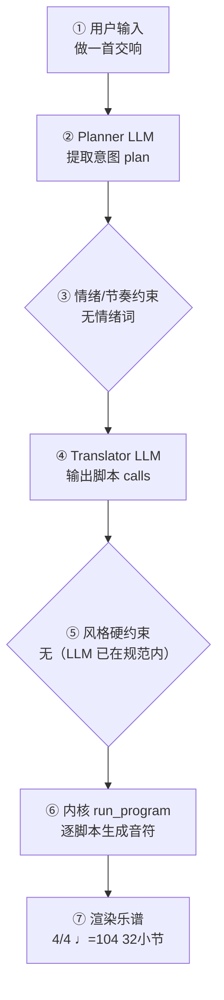

# 作曲生产报告：苍穹（程序员版）

> 面向产品/工程：记录本次生成的完整生产链路与系统状态，用于核对「说得 vs 写得」、排查缺陷与回归测试；可整体喂回大模型进一步定位具体小节/声部的问题。谱面检查与编辑者版一致，编辑者版见：`97d81bf0f6_report.md`。

## 1. 会话与生成环境

- 生成时间: 2026-10-02T18:41:06
- 生成路径: composer（LLM 直出乐谱，无脚本序列）
- 命中技能: compose-full, genre:classical/symphony
- 用户原始输入: 做一首交响
- 原始数据: `session.compose_trace`（本报告第 4 节即其展开，确定性可复现）

## 2. 谱面事实（与编辑者版「基本信息」一致）

- 调性: C 大调（0 个升号）
- 拍号: 4/4
- 速度: 四分音符 = 72 BPM
- 段落速度: 第 9 小节 Allegro（♩=116）；第 17 小节 Agitato（♩=132）；第 25 小节 Tempo I（♩=104）
- 调内音级: C, D, E, F, G, A, B
- 声部 1: Violin I，高音谱号，32 小节
- 声部 2: Violin II，高音谱号，32 小节
- 声部 3: 长笛 (Flute)，高音谱号，32 小节
- 声部 4: 双簧管 (Oboe)，高音谱号，32 小节
- 声部 5: Clarinet，高音谱号，32 小节
- 声部 6: Bassoon，低音谱号，32 小节
- 声部 7: 圆号 (Horn)，高音谱号，32 小节
- 声部 8: 小号 (Trumpet)，高音谱号，32 小节
- 声部 9: 定音鼓 (Timpani)，低音谱号，32 小节
- 声部 10: 中提琴 (Viola)，中音谱号，32 小节
- 声部 11: 大提琴 (Cello)，低音谱号，32 小节
- 声部 12: Contrabass，低音谱号，32 小节

## 3. 自动检查结果（与编辑者版「第 3 节」一致）

| 检查类别 | 状态 | 描述 |
|---|---|---|
| 声部交叉 | ⚠️ 注意 | 纵向上方声部 2（Violin II）与下方声部 5（Clarinet）在第 11.0 拍交叉：C4 低于 E4（同类交叉共 38 处，此处为第 1 例） |
| 音域 | ⚠️ 注意 | 圆号 (Horn): C4–G5（MIDI 60–79） |

> 说明：众赞歌/钢琴四部叠写检查全部逻辑声部对的平行五八度；管弦织体仅查外声部平行五度（八度加强不报）。相邻声部交叉为提示项。 共检查 404 项（✅ 402 / ⚠️ 2 / ❌ 0）。

## 4. 作曲过程透明化（可追溯）

> 本节约等于把「需求 → 大模型 → 脚本 → 谱面」的完整链路展开，便于核对「说得 vs 写得」是否一致。数据来自本次生成的 `session.compose_trace`，确定性可复现。把本报告整体喂回大模型，可进一步定位具体小节/声部的问题与修正建议。

### 4.1 流程图（本次实际链路）



（文字版流程图，便于无 Mermaid 渲染环境阅读）

```
用户输入
  → [② Planner LLM] 提取意图 plan
  → [③ 情绪/节奏约束] 命中=否
  → [④ Translator LLM] 输出 calls + reasoning
  → [⑤ 风格硬约束] 触发=否
  → [⑥ 内核 run_program] 逐脚本执行
  → [⑦ 渲染谱面] 4/4 ♩=104 32小节
```

### 4.2 大模型输入输出（LLM I/O）

#### Planner（意图解析）

- **系统提示**（固定指令模板，已截断）：

```
You are a professional composer and music theorist acting as an Intent Parser.

Transform the user's natural-language request (and optional slash-commands already applied as preferences) into a Composition Plan JSON only.

Think like a composer first: infer genre, mood, form, motif character, harmony language, climax — do NOT invent note lists yet.

A **风格目录（仅已学包）** is injected at the end of this system prompt. Use it to set `genre_id`.
已学 = 有 `grammar.yaml`（/learn-grammar）；旧 style_contract 不进目录。

A **规则库摘要** is also injected（对位 / 终止 / 乐句功能 / 声部进行等）. Use it when
setting `species`, `texture`, `form`, harmony language, and cadence expectations.
Do not invent notes; map user intent onto plan fields that the translator + kernel can execute.

Output ONE JSON object, no Markdown:
{
  "title": "string",
  "genre": "string (human label, e.g. 摇摆标准曲（爵士）)",
  "genre_id": "family/pack_id from 风格目录, e.g. jazz/swing-standard; empty if none",
  "mood": ["..."],
  "tempo": 72,
  "meter": "4/4",
  "key_sharps": 0,
  "mode": "major|minor",
  "instrumentation": ["trumpet","piano","contrabass"] (kernel English names; map fiddle→violin, double bass→contrabass, tin whistle→flute; avoid unknown names),
  "form": ["A","B","A"],
  "bars": 16,
  "motif": {"character": "...", "development": ["repetition","sequence"]},
  "harmony": {"language": "...", "density": "sparse|moderate|dense"},
  "rhythm": {"cha
…（已截断，完整 11358 字；固定指令模板见 skills/composition/base/ 与内核 kernel_docs）
```

- **用户输入**（喂给模型的结构化上下文）：

```json
{
  "user_request": "做一首交响",
  "preferences": {
    "key_sharps": 0,
    "mode": "major",
    "tempo": 120,
    "bars": 32,
    "meter": "4/4",
    "style": "交响曲",
    "genre_id": "genre:classical/symphony",
    "instrumentation": "",
    "fugue": "auto",
    "voices": 0,
    "_explicit": {}
  },
  "edit_intent": null,
  "skills": [
    "compose-full",
    "genre:classical/symphony"
  ],
  "existing_plan": {
    "title": "苍穹",
    "genre": "交响曲乐章",
    "genre_id": "genre:classical/symphony",
    "mood": [
      "宏大",
      "庄严",
      "戏剧性",
      "昂扬"
    ],
    "tempo": 104,
    "meter": "4/4",
    "key_sharps": 0,
    "mode": "major",
    "instrumentation": [
      "violin",
      "violin",
      "flute",
      "oboe",
      "clarinet",
      "viola",
      "horn",
      "trumpet",
      "cello",
      "bassoon",
      "timpani",
      "contrabass"
    ],
    "form": [
      "Introduction",
      "Exposition-Primary",
      "Exposition-Secondary",
      "Development",
      "Recapitulation",
      "Coda"
    ],
    "bars": 32,
    "motif": {
      "character": "四度上行的庄严号角式动机，级进填充，便于性格对比与碎裂发展",
      "development": [
        "repetition",
        "sequence",
        "fragmentation",
        "inversion",
        "rhythmic change"
      ]
    },
    "harmony": {
      "language": "功能性和声：I–V 引子、I–vi–IV–V7 主部、属调副部、关系小调展开、再现回归主调并以完全终止收束",
      "density": "moderate"
    },
    "rhythm": {
      "character": "管弦混合节奏：引子长音持续、主部驱动、副部流动、展开碎裂切分、再现流动下行、尾声驱动后终止"
    },
    "texture": "orchestral",
    "species": false,
    "species_from_current": false,
    "learned_grammar": null,
    "want_fugue": false,
    "climax": {
      "location": "section Development",
      "dynamic": "ff"
    },
    "difficulty": "medium",
    "summary": "为完整交响乐团而作的 C 大调单乐章《苍穹》：引子—主部—副部—展开—再现—尾声六段，第一小提琴主奏，木管长音衬托、铜管支撑，速度与性格逐段变化。",
    "edit_intent": null,
    "user_brief": "【作品】为完整交响乐团而作的单乐章交响曲《苍穹》，C 大调\n（key_sharps=0, mode=major），4/4，共 32 小节，\n奏鸣曲式：引子—主部—副部—展开—再现—尾声。\n\n【编制】交响乐团（缩编双管 + 定音鼓 + 弦乐组）；\n**主旋律由第一小提琴承担**；木管长音衬托，铜管支撑，勿全员密集八分。\n音区最高 high。new_score 须带 style=classical/symphony。\n\n【速度】引子 ♩=84 → 主部 ♩=104 → 副部 ♩=126 → 展开 ♩=132 → 再现 ♩=118 → 尾声 ♩=100。\n六段小节 4+6+5+8+5+4=32。\n\n【旋律总则】六段 rhythm/contour 不同；narrative(appearances=false)；不要赋格。\n\n【第 1 段 · 引子】4 小节 · Maestoso ♩=84 · ff。I–V，sparse，伴奏 sustained。\n【第 2 段 · 主部】6 小节 · Allegro ♩=104 · f。driving+arch，I–vi–IV–V7。\n【第 3 段 · 副部】5 小节 · Allegro ♩=126 · mf · 属调。flowing+arch。\n【第 4 段 · 展开】8 小节 · Agitato ♩=132 · ff · 关系小调。fragmented。\n【第 5 段 · 再现】5 小节 · Tempo I ♩=118 · f。flowing+descending。\n【第 6 段 · 尾声】4 小节 · Maestoso ♩=100 · ff。driving 后 cadence(2)。\n\n【不要】不要赋格，不要卡农，不要木管密集跑动盖过小提琴。 交响曲"
  },
  "revision_edits": null,
  "existing_score_summary": {
    "title": "苍穹",
    "bars": 32,
    "tempo": 104,
    "parts": [
      "Violin",
      "Violin",
      "Flute",
      "Oboe",
      "Clarinet",
      "Viola",
      "Horn",
      "Trumpet",
      "Cello",
      "Bassoon",
      "Timpani",
      "Contrabass"
    ]
  }
}
```

- **模型返回（原始）**：

```json
{
  "title": "苍穹",
  "genre": "交响曲乐章（古典管弦）",
  "genre_id": "classical/symphony",
  "mood": [
    "宏大",
    "庄严",
    "戏剧性",
    "昂扬"
  ],
  "tempo": 104,
  "meter": "4/4",
  "key_sharps": 0,
  "mode": "major",
  "instrumentation": [
    "violin",
    "violin",
    "flute",
    "oboe",
    "clarinet",
    "viola",
    "horn",
    "trumpet",
    "cello",
    "bassoon",
    "timpani",
    "contrabass"
  ],
  "form": [
    "Introduction",
    "Exposition-Primary",
    "Exposition-Secondary",
    "Development",
    "Recapitulation",
    "Coda"
  ],
  "bars": 32,
  "motif": {
    "character": "四度上行的庄严号角式动机，级进填充，便于性格对比与碎裂发展",
    "development": [
      "repetition",
      "sequence",
      "fragmentation",
      "inversion",
      "rhythmic change"
    ]
  },
  "harmony": {
    "language": "功能性和声：I–V 引子、I–vi–IV–V7 主部、属调副部、关系小调展开、再现回归主调并以完全终止收束",
    "density": "moderate"
  },
  "rhythm": {
    "character": "管弦混合节奏：引子长音持续、主部驱动、副部流动、展开碎裂切分、再现流动下行、尾声驱动后终止"
  },
  "texture": "orchestral",
  "species": false,
  "species_from_current": false,
  "learned_grammar": null,
  "want_fugue": false,
  "climax": {
    "location": "section Development",
    "dynamic": "ff"
  },
  "difficulty": "medium",
  "summary": "为完整交响乐团而作的 C 大调单乐章《苍穹》：引子—主部—副部—展开—再现—尾声六段，第一小提琴主奏，木管长音衬托、铜管支撑，速度与性格逐段变化。",
  "edit_intent": null
}
```

### 4.3 脚本调用与输入输出

（本次路径未经过确定性脚本内核：`composer（LLM 直出乐谱，无脚本序列）`—— 该路径由 LLM 直接产出乐谱或纯确定性生成，无逐脚本记录）

### 4.4 本地强制约束（确定性兜底，优先级高于 LLM）

- 情绪/节奏约束：未触发（用户未给情绪/速度词，或已被风格基线覆盖）
- 风格/速度强制纠正：未触发（LLM 输出已在 genre 规范内）
- **风格契约施加的约束**：无（该风格包没有 `style_contract.yaml`，或契约证据量不足、和声分区未生效）
### 4.5 自动问题定位（可疑点 + 程度）

| 检查项 | 程度 | 说明 |
|---|---|---|
| 情绪约束 | 🟢 未触发 | 用户未给情绪/速度词 |
| 意图拍号↔谱面 | 🟢 一致 | 最终拍号 4/4 |
| 计划小节↔实际小节 | 🟢 一致 | 32 小节 |
| 风格规范遵循 | 🟢 良好 | LLM 输出均在 genre 规范内，无需强制 |
| 生成路径 | 🟡 提示 | 旧 composer 路径：LLM 直出乐谱 JSON，无脚本调用序列（透明度为脚本级缺失，建议改用翻译路径） |
| 本地修复 | 🟡 注意 | 校验后触发了本地修复（时值/声部进行），说明初版谱存在 CRITICAL/MAJOR 问题 |
| 计划编制↔实际编制 | 🟢 一致 | 计划 12 件乐器与谱面 12 声部对应 |

> 说明：上表为程序自动比对「意图 ↔ 谱面」的初判（🔴 严重 / 🟡 注意 / 🟢 一致）。将本报告整体喂给大模型，可进一步定位具体小节/声部的问题与修正建议。

## 5. 记谱与演奏法

**规则日志**（共 4 条，其中仲裁 0 次）

- [stem/layout] 582 处 — 已应用：符干方向
- [beams/layout] 82 处 — 已应用：连符尾分组
- [layout/layout] 8 处 — 已应用：系统换行
- [rehearsal/layout] 1 处 — 已应用：排练记号

可演奏性：1 项 MAJOR / 1 项总计
- [MAJOR] 声部7（Horn）音 79 超出音域 34–77

## 生成质量评估

- **风格重叠率**：N/A（未指定目标包）
- **属性遵循度**：1.00（0 项）
- **包级最近邻**：british-folk-tune（相似度 0.44）— ✅ 无抄袭嫌疑
