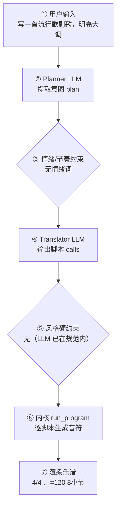

# 作曲生产报告：Rising Light（程序员版）

> 面向产品/工程：记录本次生成的完整生产链路与系统状态，用于核对「说得 vs 写得」、排查缺陷与回归测试；可整体喂回大模型进一步定位具体小节/声部的问题。谱面检查与编辑者版一致，编辑者版见：`9dfb603c61_report.md`。

## 1. 会话与生成环境

- 生成时间: 2026-09-28T21:32:45
- 生成路径: translator（LLM 翻译 + 确定性内核）
- 命中技能: compose-full
- 用户原始输入: 写一首流行歌副歌，明亮大调
- 原始数据: `session.compose_trace`（本报告第 4 节即其展开，确定性可复现）

## 2. 谱面事实（与编辑者版「基本信息」一致）

- 调性: C 大调（0 个升号）
- 拍号: 4/4
- 速度: 四分音符 = 120 BPM
- 段落速度: 第 5 小节 Allegro（♩=126）
- 调内音级: C, D, E, F, G, A, B
- 声部 1: Piano，高音谱号，8 小节
- 声部 2: Piano LH，低音谱号，8 小节

## 3. 自动检查结果（与编辑者版「第 3 节」一致）

（无）当前自动检查未发现需要关注的问题。

> 说明：平行五/八度仅检查最高与最低外声部；相邻声部交叉为提示项。 共检查 22 项（✅ 22 / ⚠️ 0 / ❌ 0）。

## 4. 作曲过程透明化（可追溯）

> 本节约等于把「需求 → 大模型 → 脚本 → 谱面」的完整链路展开，便于核对「说得 vs 写得」是否一致。数据来自本次生成的 `session.compose_trace`，确定性可复现。把本报告整体喂回大模型，可进一步定位具体小节/声部的问题与修正建议。

### 4.1 流程图（本次实际链路）



（文字版流程图，便于无 Mermaid 渲染环境阅读）

```
用户输入
  → [② Planner LLM] 提取意图 plan
  → [③ 情绪/节奏约束] 命中=否
  → [④ Translator LLM] 输出 calls + reasoning
  → [⑤ 风格硬约束] 触发=否
  → [⑥ 内核 run_program] 逐脚本执行
  → [⑦ 渲染谱面] 4/4 ♩=120 8小节
```

### 4.2 大模型输入输出（LLM I/O）

#### Planner（意图解析）

- **系统提示**（固定指令模板，已截断）：

```
You are a professional composer and music theorist acting as an Intent Parser.

Transform the user's natural-language request (and optional slash-commands already applied as preferences) into a Composition Plan JSON only.

Think like a composer first: infer genre, mood, form, motif character, harmony language, climax — do NOT invent note lists yet.

Output ONE JSON object, no Markdown:
{
  "title": "string",
  "genre": "string",
  "mood": ["..."],
  "tempo": 72,
  "meter": "4/4",
  "key_sharps": 0,
  "mode": "major|minor",
  "instrumentation": ["Piano"] or ["Violin","Cello"],
  "form": ["A","B","A"],
  "bars": 8,
  "motif": {"character": "...", "development": ["repetition","sequence"]},
  "harmony": {"language": "...", "density": "sparse|moderate|dense"},
  "rhythm": {"character": "..."},
  "texture": "homophonic|polyphonic|sparse|orchestral",
  "climax": {"location": "section B", "dynamic": "f"},
  "difficulty": "easy|medium",
  "summary": "one sentence for the user",
  "edit_intent": null
}
Rules:
- Original music only; no copyrighted melodies.
- If user is vague, choose musically appropriate defaults.
- bars: 4–32. Prefer 8–16 for a brand-new short piece.
- If the user asks to extend/lengthen to N bars (e.g. 扩展到32小节), set bars=N (not 8).
- If edit_intent is extend/longer and no N given, increase bars vs existing_score (typically +8 to +16, max 32).
- If edit_intent is rewrit
…（已截断，完整 2397 字；固定指令模板见 skills/composition/base/ 与内核 kernel_docs）
```

- **用户输入**（喂给模型的结构化上下文）：

```json
{
  "user_request": "写一首流行歌副歌，明亮大调",
  "preferences": {
    "key_sharps": 0,
    "mode": "major",
    "tempo": 120,
    "bars": 8,
    "meter": "4/4",
    "style": "",
    "genre_id": "",
    "instrumentation": "",
    "fugue": "auto",
    "voices": 0,
    "_explicit": {}
  },
  "edit_intent": null,
  "skills": [
    "compose-full"
  ],
  "existing_plan": null,
  "revision_edits": null,
  "existing_score_summary": null
}
```

- **模型返回（原始）**：

```json
{
  "title": "Rising Light",
  "genre": "Pop",
  "mood": [
    "bright",
    "uplifting",
    "energetic"
  ],
  "tempo": 120,
  "meter": "4/4",
  "key_sharps": 0,
  "mode": "major",
  "instrumentation": [
    "Piano",
    "Synth Pad",
    "Bass",
    "Drum Kit"
  ],
  "form": [
    "A",
    "A'"
  ],
  "bars": 8,
  "motif": {
    "character": "short, ascending, syncopated hook with a leap up a sixth",
    "development": [
      "repetition",
      "sequence",
      "rhythmic variation"
    ]
  },
  "harmony": {
    "language": "diatonic pop with I–V–vi–IV progression and a chromatic lift",
    "density": "moderate"
  },
  "rhythm": {
    "character": "driving eighth-note pulse with syncopated vocal-style accents"
  },
  "texture": "homophonic",
  "climax": {
    "location": "section A' (bars 5–8)",
    "dynamic": "f"
  },
  "difficulty": "easy",
  "summary": "An 8-bar bright major pop chorus in C major at 120 BPM, built on a syncopated ascending hook over I–V–vi–IV, peaking in the second half.",
  "edit_intent": null
}
```

#### Translator（脚本翻译）

- **系统提示**（固定指令模板，已截断）：

````
# 翻译器（Translator）

你不是作曲家，是**翻译器**：把用户的自然语言音乐需求与 plan 翻译成
对确定性脚本的调用序列。你**不写任何音符**——所有音符由脚本生成并保证
正确（时值、调性、织体、力度、终止）。你的职责是选对脚本、给对参数。

## 输出格式（只输出 JSON，不要任何解释文字）

```
{"reasoning": "用中文简述你如何把需求翻译成参数与脚本（2–5 句）：识别了什么风格/情绪，怎么决定速度/调式/织体，段落如何安排，调用了哪些脚本。", "calls": [{"script": "脚本名", "args": {...}}, ...]}
```

## 硬规则

1. 调用顺序：`new_score` → `set_sections` → 对每个段落 `{ set_harmony →
   accompaniment → melody }` →（高潮段可加 `thicken`）→（最后一段可加
   `cadence`）→（**可选** `narrative(...)`：仅当你需要关掉自动叙事层的
   动机变形/惊喜和弦时，见下「叙事层」）→ `finalize`
2. `new_score` 与 `finalize` 必须各恰好一次，且分别在最前/最后
3. **每个段落**都必须调用 set_harmony / accompaniment / melody，
   一次都不许漏（漏了 finalize 会报错）
4. args 必须严格符合脚本文档的字段名与取值范围；不要发明不存在的参数
5. 脚本执行失败时你会收到错误信息——修正 calls 后完整重新输出
6. `plan.tempo` / `plan.mode` / `plan.mood` / `plan.tempo_text` /
   `plan._emotion_hint` 是已解析的**明确约束**（来自用户情绪/速度词或
   `/tempo`），**优先级最高**——调用 `new_score` / `set_harmony` / `melody`
   时直接采用，不要用风格基线默认值覆盖。`reasoning` 字段必须如实写出你
   如何据此翻译，便于用户核查。
7. **乐器编制**：brief 提到管弦乐/弦乐/铜管/木管/具体乐器（小提琴、长笛、
   圆号、定音鼓…）或某种编制（弦乐四重奏、铜管五重奏…）时，`new_score`
   **必须传 `instruments`**（长度=voices，从高音到低音，低音乐器放最后），
   可用名：flute/oboe/**piccolo**/clarinet/bassoon/horn/trumpet/trombone/
   tuba/violin/viola/cello/contrabass/timpani/**harp**/piano/soprano/alto/
   tenor/bass。例：「弦乐四重奏」→ voices=4 +
   `["violin","violin","viola","cello"]`；「管弦乐小品」→ voices=4 +
   `["flute","violin","cello","timpani"]` 之类按 brief
…（已截断，完整 18024 字；固定指令模板见 skills/composition/base/ 与内核 kernel_docs）
````

- **用户输入**（喂给模型的结构化上下文）：

```json
{
  "plan": {
    "title": "Rising Light",
    "genre": "Pop",
    "mood": [
      "bright",
      "uplifting",
      "energetic"
    ],
    "tempo": 120,
    "tempo_text": null,
    "meter": "4/4",
    "key_sharps": 0,
    "mode": "major",
    "_emotion_hint": null,
    "instrumentation": [
      "Piano",
      "Synth Pad",
      "Bass",
      "Drum Kit"
    ],
    "form": [
      "A",
      "A'"
    ],
    "bars": 8,
    "motif": {
      "character": "short, ascending, syncopated hook with a leap up a sixth",
      "development": [
        "repetition",
        "sequence",
        "rhythmic variation"
      ]
    },
    "harmony": {
      "language": "diatonic pop with I–V–vi–IV progression and a chromatic lift",
      "density": "moderate"
    },
    "rhythm": {
      "character": "driving eighth-note pulse with syncopated vocal-style accents"
    },
    "texture": "homophonic",
    "climax": {
      "location": "section A' (bars 5–8)",
      "dynamic": "f"
    },
    "summary": "An 8-bar bright major pop chorus in C major at 120 BPM, built on a syncopated ascending hook over I–V–vi–IV, peaking in the second half."
  },
  "user_brief": "写一首流行歌副歌，明亮大调"
}
```

- **模型返回（原始）**：

```json
{
  "reasoning": "用户要明亮大调的流行副歌，plan 已解析为 C 大调、120 BPM 快板、明亮上扬情绪，直接采用 120 与大调。流行基调 → 4/4、I–V–vi–IV、block_chords 织体、driving/flowing 旋律；8 小节分 A（4 小节）与 A'（4 小节），A 呈示上行跳进动机，A' 高潮加 thicken 与 cadence。上次 motif 总时值超 4 拍，现改为正好 4 拍（1.0+0.5+0.5+1.0+1.0）。",
  "calls": [
    {
      "script": "new_score",
      "args": {
        "title": "Rising Light",
        "key_sharps": 0,
        "mode": "major",
        "meter": "4/4",
        "tempo": 120,
        "bars": 8,
        "voices": 2,
        "instruments": [
          "piano",
          "piano"
        ]
      }
    },
    {
      "script": "set_sections",
      "args": {
        "sections": [
          {
            "name": "A",
            "bars": 4,
            "meter": "4/4",
            "dynamic": "mp",
            "tempo_text": "Allegro",
            "bpm": 120
          },
          {
            "name": "A'",
            "bars": 4,
            "meter": "4/4",
            "dynamic": "f",
            "tempo_text": "Allegro",
            "bpm": 126
          }
        ]
      }
    },
    {
      "script": "set_harmony",
      "args": {
        "section": "A",
        "progression": [
          "I",
          "V",
          "vi",
          "IV"
        ]
      }
    },
    {
      "script": "accompaniment",
      "args": {
        "section": "A",
        "pattern": "block_chords",
        "register": "low",
        "density": 1
      }
    },
    {
      "script": "melody",
      "args": {
        "section": "A",
        "register": "mid",
        "rhythm": "flowing",
        "contour": "arch",
        "motif": [
          [
            1,
            "quarter"
          ],
          [
            3,
            "eighth"
          ],
          [
            5,
            "eighth"
          ],
          [
            6,
            "quarter"
          ],
          [
            5,
            "quarter"
          ]
        ]
      }
    },
    {
      "script": "set_harmony",
      "args": {
        "section": "A'",
        "progression": [
          "I",
          "V",
          "vi",
          "IV"
        ]
      }
    },
    {
      "script": "accompaniment",
      "args": {
        "section": "A'",
        "pattern": "block_chords",
        "register": "low",
        "density": 2
      }
    },
    {
      "script": "melody",
      "args": {
        "section": "A'",
        "register": "high",
        "rhythm": "driving",
        "contour": "ascending"
      }
    },
    {
      "script": "thicken",
      "args": {
        "section": "A'"
      }
    },
    {
      "script": "cadence",
      "args": {
        "bars": 1,
        "section": "A'"
      }
    },
    {
      "script": "finalize",
      "args": {}
    }
  ]
}
```

### 4.3 脚本调用与输入输出

| # | 脚本 | 输入(args) | 输出（新增音符 / 状态变更） |
|---|---|---|---|
| 1 | new_score | title=Rising Light，key_sharps=0，mode=major，meter=4/4，tempo=120，bars=8，voices=2，instruments=["piano", "piano"] | 建立乐曲：4/4 ♩=120 2声部 major；新增 — |
| 2 | set_sections | sections=[{"name": "A", "bars": 4, "meter": "4/4", "dynamic": "mp", "tempo_text": "Allegro", "bpm": 120}, {"name": "A'", "bars": 4, "meter": "4/4", "dynamic": "f", "tempo_text": "Allegro", "bpm": 126}] | 分段：A(4小节)，A'(4小节)；新增 — |
| 3 | set_harmony | section=A，progression=["I", "V", "vi", "IV"] | 和声：段落A 进行['I', 'V', 'vi', 'IV']；新增 — |
| 4 | accompaniment | section=A，pattern=block_chords，register=low，density=1 | 伴奏：段落A pattern=block_chords register=low density=1；新增 声部2:+8 |
| 5 | new_score | title=Rising Light，key_sharps=0，mode=major，meter=4/4，tempo=120，bars=8，voices=2，instruments=["piano", "piano"]　⟲ **LLM 重试**：此前调用序列出错回滚，从 new_score 重新执行 | 建立乐曲：4/4 ♩=120 2声部 major；新增 — |
| 6 | set_sections | sections=[{"name": "A", "bars": 4, "meter": "4/4", "dynamic": "mp", "tempo_text": "Allegro", "bpm": 120}, {"name": "A'", "bars": 4, "meter": "4/4", "dynamic": "f", "tempo_text": "Allegro", "bpm": 126}] | 分段：A(4小节)，A'(4小节)；新增 — |
| 7 | set_harmony | section=A，progression=["I", "V", "vi", "IV"] | 和声：段落A 进行['I', 'V', 'vi', 'IV']；新增 — |
| 8 | accompaniment | section=A，pattern=block_chords，register=low，density=1 | 伴奏：段落A pattern=block_chords register=low density=1；新增 声部2:+8 |
| 9 | melody | section=A，register=mid，rhythm=flowing，contour=arch，motif=[[1, "quarter"], [3, "eighth"], [5, "eighth"], [6, "quarter"], [5, "quarter"]] | 旋律：段落A rhythm=flowing；新增 声部1:+22 |
| 10 | set_harmony | section=A'，progression=["I", "V", "vi", "IV"] | 和声：段落A' 进行['I', 'V', 'vi', 'IV']；新增 — |
| 11 | accompaniment | section=A'，pattern=block_chords，register=low，density=2 | 伴奏：段落A' pattern=block_chords register=low density=2；新增 声部2:+8 |
| 12 | melody | section=A'，register=high，rhythm=driving，contour=ascending | 旋律：段落A' rhythm=driving；新增 声部1:+16 |
| 13 | thicken | section=A' | 加厚：段落A'；新增 — |
| 14 | cadence | bars=1，section=A' | 终止：bars=1；新增 — |
| 15 | finalize |  | 收束装配：8小节 / 2声部；新增 声部1:+7 |

<details><summary>逐脚本新增音符样例（前 8 个 / 声部）</summary>

- **new_score**：声部1: —；声部2: —
- **set_sections**：声部1: —；声部2: —
- **set_harmony**：声部1: —；声部2: —
- **accompaniment**：声部1: —；声部2: C2+E3+G3:half, C2+E3+G3:half, G2+B3+D3:half, G2+B3+D3:half, A2+C3+E3:half, A2+C3+E3:half, F2+A3+C3:half, F2+A3+C3:half
- **new_score**：声部1: —；声部2: —
- **set_sections**：声部1: —；声部2: —
- **set_harmony**：声部1: —；声部2: —
- **accompaniment**：声部1: —；声部2: C2+E3+G3:half, C2+E3+G3:half, G2+B3+D3:half, G2+B3+D3:half, A2+C3+E3:half, A2+C3+E3:half, F2+A3+C3:half, F2+A3+C3:half
- **melody**：声部1: C5:quarter, E5:eighth, G5:eighth, A5:quarter, G5:quarter, D5:quarter, C5:eighth, B4:eighth；声部2: —
- **set_harmony**：声部1: —；声部2: —
- **accompaniment**：声部1: —；声部2: C2+E3+G3:half, C2+E3+G3:half, G2+B3+D3:half, G2+B3+D3:half, A2+C3+E3:half, A2+C3+E3:half, F2+A3+C3:half, F2+A3+C3:half
- **melody**：声部1: C5:eighth, B4:eighth, C5:eighth, B4:eighth, E5:quarter, C5:quarter, D5:quarter, G5:quarter；声部2: —
- **thicken**：声部1: —；声部2: —
- **cadence**：声部1: —；声部2: —
- **finalize**：声部1: F5+F6:half, A5:quarter, C6:eighth, E6:eighth, F5:quarter, E6:quarter, C4+C5:whole；声部2: —

</details>

### 4.4 本地强制约束（确定性兜底，优先级高于 LLM）

- 情绪/节奏约束：未触发（用户未给情绪/速度词，或已被风格基线覆盖）
- 风格/速度强制纠正：未触发（LLM 输出已在 genre 规范内）
- **风格契约施加的约束**：无（该风格包没有 `style_contract.yaml`，或契约证据量不足、和声分区未生效）
### 4.5 自动问题定位（可疑点 + 程度）

| 检查项 | 程度 | 说明 |
|---|---|---|
| 情绪约束 | 🟢 未触发 | 用户未给情绪/速度词 |
| 意图拍号↔谱面 | 🟢 一致 | 最终拍号 4/4 |
| 计划小节↔实际小节 | 🟢 一致 | 8 小节 |
| 风格规范遵循 | 🟢 良好 | LLM 输出均在 genre 规范内，无需强制 |
| 计划编制↔实际编制 | 🟡 注意 | 计划编制含 Synth Pad、Bass、Drum Kit，但谱面 2 个声部未落地（voices 数不足或 translator 取舍）——用户对编制的明确要求可能未满足 |

> 说明：上表为程序自动比对「意图 ↔ 谱面」的初判（🔴 严重 / 🟡 注意 / 🟢 一致）。将本报告整体喂给大模型，可进一步定位具体小节/声部的问题与修正建议。

## 5. 记谱与演奏法

**规则日志**（共 11 条，其中仲裁 0 次）

- [articulation/style] tenuto — 挂 Tenuto：叙事/风格标记 tenuto
- [articulation/style] accent — 挂 Accent：叙事/风格标记 accent
- [articulation/style] tenuto — 挂 Tenuto：叙事/风格标记 tenuto
- [articulation/style] tenuto — 挂 Tenuto：叙事/风格标记 tenuto
- [articulation/style] accent — 挂 Accent：叙事/风格标记 accent
- [articulation/style] tenuto — 挂 Tenuto：叙事/风格标记 tenuto
- [stem/layout] 52 处 — 已应用：符干方向
- [beams/layout] 20 处 — 已应用：连符尾分组
- [articulation/layout] 10 处 — 已应用：演奏法记号
- [layout/layout] 2 处 — 已应用：系统换行
- [rehearsal/layout] 1 处 — 已应用：排练记号

可演奏性：1 项 MAJOR / 12 项总计
- [MINOR] 声部1 大跳 13 半音（>八度）
- [MAJOR] 声部1 连续大跳 28 半音（>两个八度）
- [MINOR] 声部2 和弦跨度 19 > 八度，单手/单声部不易演奏
- [MINOR] 声部2 和弦跨度 19 > 八度，单手/单声部不易演奏
- [MINOR] 声部2 和弦跨度 16 > 八度，单手/单声部不易演奏
- [MINOR] 声部2 和弦跨度 16 > 八度，单手/单声部不易演奏
- [MINOR] 声部2 和弦跨度 16 > 八度，单手/单声部不易演奏
- [MINOR] 声部2 和弦跨度 16 > 八度，单手/单声部不易演奏
- …其余 4 项从略

## 6. 生成质量评估（三指标）

- **风格重叠率**：N/A（未指定目标包）
- **属性遵循度**：1.00（0 项）
- **最近邻**：march（相似度 0.72）— ✅ 无抄袭嫌疑
