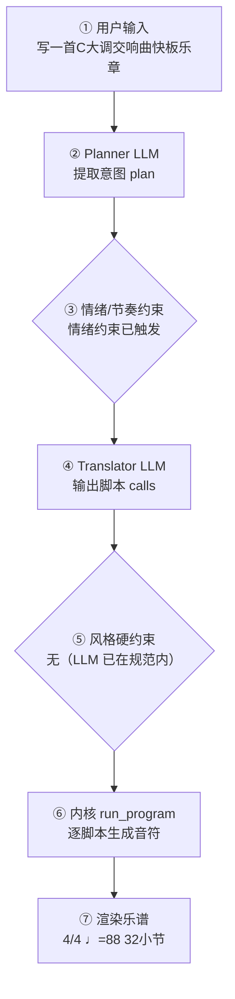

# 作曲生产报告：早春交响快板（程序员版）

> 面向产品/工程：记录本次生成的完整生产链路与系统状态，用于核对「说得 vs 写得」、排查缺陷与回归测试；可整体喂回大模型进一步定位具体小节/声部的问题。谱面检查与编辑者版一致，编辑者版见：`a045496a86_report.md`。

## 1. 会话与生成环境

- 生成时间: 2026-09-28T21:33:28
- 生成路径: translator（LLM 翻译 + 确定性内核）
- 命中技能: compose-full, genre:classical/symphony
- 用户原始输入: 写一首C大调交响曲快板乐章
- 原始数据: `session.compose_trace`（本报告第 4 节即其展开，确定性可复现）

## 2. 谱面事实（与编辑者版「基本信息」一致）

- 调性: A 小调（0 个升号）
- 转调: 第 16 小节 → A 小调
- 拍号: 4/4
- 速度: 四分音符 = 88 BPM
- 段落速度: 第 5 小节 Allegro（♩=110）；第 11 小节 Allegro（♩=120）；第 16 小节 Agitato（♩=126）；第 24 小节 Tempo I（♩=112）；第 29 小节 Maestoso（♩=100）
- 调内音级: C, D, E, F, G, A, B
- 声部 1: 长笛 (Flute)，高音谱号，32 小节
- 声部 2: 双簧管 (Oboe)，高音谱号，32 小节
- 声部 3: Clarinet，高音谱号，32 小节
- 声部 4: Bassoon，低音谱号，32 小节
- 声部 5: 圆号 (Horn)，高音谱号，32 小节
- 声部 6: 小号 (Trumpet)，高音谱号，32 小节
- 声部 7: 定音鼓 (Timpani)，低音谱号，32 小节
- 声部 8: 小提琴 (Violin)，高音谱号，32 小节
- 声部 9: 中提琴 (Viola)，ALTO，32 小节
- 声部 10: 大提琴 (Cello)，低音谱号，32 小节
- 声部 11: Contrabass，低音谱号，32 小节

## 3. 自动检查结果（与编辑者版「第 3 节」一致）

| 检查类别 | 状态 | 描述 |
|---|---|---|
| 调号一致性 | ⚠️ 注意 | A 小调 段出现变化音 Eb, Bb（转调段调外音/经过音） |
| 声部交叉 | ⚠️ 注意 | 纵向上方声部 1（长笛 (Flute)）与下方声部 3（Clarinet）在第 2.0 拍交叉：F5 低于 F6（同类交叉共 89 处，此处为第 1 例） |
| 声部交叉 | ⚠️ 注意 | 纵向上方声部 3（Clarinet）与下方声部 2（双簧管 (Oboe)）在第 0.0 拍交叉：C5 低于 E5（同类交叉共 115 处，此处为第 1 例） |
| 声部交叉 | ⚠️ 注意 | 纵向上方声部 9（中提琴 (Viola)）与下方声部 6（小号 (Trumpet)）在第 0.5 拍交叉：C4 低于 C5（同类交叉共 104 处，此处为第 1 例） |
| 音域 | ⚠️ 注意 | 长笛 (Flute): B4–E7（MIDI 71–100） |

> 说明：平行五/八度仅检查最高与最低外声部；相邻声部交叉为提示项。 共检查 372 项（✅ 367 / ⚠️ 5 / ❌ 0）。

## 4. 作曲过程透明化（可追溯）

> 本节约等于把「需求 → 大模型 → 脚本 → 谱面」的完整链路展开，便于核对「说得 vs 写得」是否一致。数据来自本次生成的 `session.compose_trace`，确定性可复现。把本报告整体喂回大模型，可进一步定位具体小节/声部的问题与修正建议。

### 4.1 流程图（本次实际链路）



（文字版流程图，便于无 Mermaid 渲染环境阅读）

```
用户输入
  → [② Planner LLM] 提取意图 plan
  → [③ 情绪/节奏约束] 命中=是
  → [④ Translator LLM] 输出 calls + reasoning
  → [⑤ 风格硬约束] 触发=否
  → [⑥ 内核 run_program] 逐脚本执行
  → [⑦ 渲染谱面] 4/4 ♩=88 32小节
```

### 4.2 大模型输入输出（LLM I/O）

#### Planner（意图解析）

- **系统提示**（固定指令模板，已截断）：

```
You are a professional composer and music theorist acting as an Intent Parser.

Transform the user's natural-language request (and optional slash-commands already applied as preferences) into a Composition Plan JSON only.

Think like a composer first: infer genre, mood, form, motif character, harmony language, climax — do NOT invent note lists yet.

Output ONE JSON object, no Markdown:
{
  "title": "string",
  "genre": "string",
  "mood": ["..."],
  "tempo": 72,
  "meter": "4/4",
  "key_sharps": 0,
  "mode": "major|minor",
  "instrumentation": ["Piano"] or ["Violin","Cello"],
  "form": ["A","B","A"],
  "bars": 8,
  "motif": {"character": "...", "development": ["repetition","sequence"]},
  "harmony": {"language": "...", "density": "sparse|moderate|dense"},
  "rhythm": {"character": "..."},
  "texture": "homophonic|polyphonic|sparse|orchestral",
  "climax": {"location": "section B", "dynamic": "f"},
  "difficulty": "easy|medium",
  "summary": "one sentence for the user",
  "edit_intent": null
}
Rules:
- Original music only; no copyrighted melodies.
- If user is vague, choose musically appropriate defaults.
- bars: 4–32. Prefer 8–16 for a brand-new short piece.
- If the user asks to extend/lengthen to N bars (e.g. 扩展到32小节), set bars=N (not 8).
- If edit_intent is extend/longer and no N given, increase bars vs existing_score (typically +8 to +16, max 32).
- If edit_intent is rewrit
…（已截断，完整 4147 字；固定指令模板见 skills/composition/base/ 与内核 kernel_docs）
```

- **用户输入**（喂给模型的结构化上下文）：

```json
{
  "user_request": "【作品】为完整交响乐团而作的单乐章交响曲快板《早春交响快板》，C 大调\n（key_sharps=0, mode=major），4/4，共 32 小节，\n奏鸣曲式：引子—主部—副部—展开—再现—尾声（舒伯特早期明朗气质）。\n\n【编制】交响乐团（双管木管 + 铜管 + 定音鼓 + 完整弦乐组）；旋律由长笛与第一小提琴\n交替，低声部大提琴与低音提琴。旋律音区最高 high，不要 very_high。\n\n【速度】引子 ♩=88 → 主部 ♩=112 → 副部 ♩=120 → 展开 ♩=126 → 再现 ♩=112 → 尾声 ♩=100。\n六段小节数之和必须等于 32。\n\n【旋律总则】六段 rhythm/contour 逐段不同；不要赋格；narrative(appearances=false)；\n展开可转关系小调；再现换节奏勿原样照搬主部。\n\n【第 1 段 · 引子】4 小节 · Andante ♩=88 · p · 主调。柱式+长音，I–V。\n【第 2 段 · 主部】6 小节 · Allegro ♩=112 · f · 主调。driving+arch，I–vi–IV–V7。\n【第 3 段 · 副部】5 小节 · Allegro ♩=120 · mf · 属调。flowing+arch，分解和弦。\n【第 4 段 · 展开】8 小节 · Agitato ♩=126 · ff · 关系小调。fragmented+wave。\n【第 5 段 · 再现】5 小节 · Tempo I ♩=112 · f · 主调。flowing+descending。\n【第 6 段 · 尾声】4 小节 · Maestoso ♩=100 · ff · 主调。driving 推进后 cadence(2)。\n\n【不要】不要赋格，不要卡农，不要整曲 sparse。",
  "preferences": {
    "key_sharps": 0,
    "mode": "major",
    "tempo": 120,
    "bars": 8,
    "meter": "4/4",
    "style": "交响曲",
    "genre_id": "genre:classical/symphony",
    "instrumentation": "",
    "fugue": "auto",
    "voices": 0,
    "_explicit": {}
  },
  "edit_intent": null,
  "skills": [
    "compose-full",
    "genre:classical/symphony"
  ],
  "existing_plan": null,
  "revision_edits": null,
  "existing_score_summary": null
}
```

- **模型返回（原始）**：

```json
{
  "title": "早春交响快板",
  "genre": "古典交响曲（单乐章奏鸣快板）",
  "mood": [
    "明朗",
    "生机勃勃",
    "戏剧性",
    "堂皇"
  ],
  "tempo": 112,
  "meter": "4/4",
  "key_sharps": 0,
  "mode": "major",
  "instrumentation": [
    "Flute",
    "Oboe",
    "Clarinet",
    "Bassoon",
    "Horn",
    "Trumpet",
    "Timpani",
    "Violin",
    "Viola",
    "Cello",
    "Contrabass"
  ],
  "form": [
    "引子",
    "主部",
    "副部",
    "展开",
    "再现",
    "尾声"
  ],
  "bars": 32,
  "motif": {
    "character": "级进为主的三音上行种子动机，带附点推动力，明朗而富有春意",
    "development": [
      "repetition",
      "sequence",
      "rhythmic change",
      "fragmentation",
      "inversion"
    ]
  },
  "harmony": {
    "language": "功能性和声，I–V–I 与 I–vi–IV–V7 为骨架，展开部转入关系小调（a 小调）后经四五度移位回归",
    "density": "moderate"
  },
  "rhythm": {
    "character": "管弦混合节奏：引子柱式和长音，主部 driving 拱形，副部流动分解和弦，展开部碎裂化与波浪推进，再现部流动下行，尾声 driving 后收束"
  },
  "texture": "orchestral",
  "climax": {
    "location": "展开部后段（第 19–23 小节）",
    "dynamic": "ff"
  },
  "difficulty": "medium",
  "summary": "为完整交响乐团而作的 C 大调单乐章奏鸣快板，含引子—主部—副部—展开—再现—尾声六段共 32 小节，木管与弦乐交替主题，展开部转关系小调，尾声以完全终止收束。",
  "edit_intent": null
}
```

#### Translator（脚本翻译）

- **系统提示**（固定指令模板，已截断）：

````
# 翻译器（Translator）

你不是作曲家，是**翻译器**：把用户的自然语言音乐需求与 plan 翻译成
对确定性脚本的调用序列。你**不写任何音符**——所有音符由脚本生成并保证
正确（时值、调性、织体、力度、终止）。你的职责是选对脚本、给对参数。

## 输出格式（只输出 JSON，不要任何解释文字）

```
{"reasoning": "用中文简述你如何把需求翻译成参数与脚本（2–5 句）：识别了什么风格/情绪，怎么决定速度/调式/织体，段落如何安排，调用了哪些脚本。", "calls": [{"script": "脚本名", "args": {...}}, ...]}
```

## 硬规则

1. 调用顺序：`new_score` → `set_sections` → 对每个段落 `{ set_harmony →
   accompaniment → melody }` →（高潮段可加 `thicken`）→（最后一段可加
   `cadence`）→（**可选** `narrative(...)`：仅当你需要关掉自动叙事层的
   动机变形/惊喜和弦时，见下「叙事层」）→ `finalize`
2. `new_score` 与 `finalize` 必须各恰好一次，且分别在最前/最后
3. **每个段落**都必须调用 set_harmony / accompaniment / melody，
   一次都不许漏（漏了 finalize 会报错）
4. args 必须严格符合脚本文档的字段名与取值范围；不要发明不存在的参数
5. 脚本执行失败时你会收到错误信息——修正 calls 后完整重新输出
6. `plan.tempo` / `plan.mode` / `plan.mood` / `plan.tempo_text` /
   `plan._emotion_hint` 是已解析的**明确约束**（来自用户情绪/速度词或
   `/tempo`），**优先级最高**——调用 `new_score` / `set_harmony` / `melody`
   时直接采用，不要用风格基线默认值覆盖。`reasoning` 字段必须如实写出你
   如何据此翻译，便于用户核查。
7. **乐器编制**：brief 提到管弦乐/弦乐/铜管/木管/具体乐器（小提琴、长笛、
   圆号、定音鼓…）或某种编制（弦乐四重奏、铜管五重奏…）时，`new_score`
   **必须传 `instruments`**（长度=voices，从高音到低音，低音乐器放最后），
   可用名：flute/oboe/**piccolo**/clarinet/bassoon/horn/trumpet/trombone/
   tuba/violin/viola/cello/contrabass/timpani/**harp**/piano/soprano/alto/
   tenor/bass。例：「弦乐四重奏」→ voices=4 +
   `["violin","violin","viola","cello"]`；「管弦乐小品」→ voices=4 +
   `["flute","violin","cello","timpani"]` 之类按 brief
…（已截断，完整 20425 字；固定指令模板见 skills/composition/base/ 与内核 kernel_docs）
````

- **用户输入**（喂给模型的结构化上下文）：

```json
{
  "plan": {
    "title": "早春交响快板",
    "genre": "古典交响曲（单乐章奏鸣快板）",
    "mood": [
      "明朗",
      "生机勃勃",
      "戏剧性",
      "堂皇",
      "cheerful",
      "bright"
    ],
    "tempo": 132,
    "tempo_text": "Allegro",
    "meter": "4/4",
    "key_sharps": 0,
    "mode": "major",
    "_emotion_hint": {
      "group": "fast",
      "matched": [
        "快板",
        "明朗"
      ],
      "bpm": 132,
      "tempo_text": "Allegro",
      "mode_bias": "major",
      "rhythm": "flowing",
      "dynamics": "f",
      "contour": "arch"
    },
    "instrumentation": [
      "Flute",
      "Oboe",
      "Clarinet",
      "Bassoon",
      "Horn",
      "Trumpet",
      "Timpani",
      "Violin",
      "Viola",
      "Cello",
      "Contrabass"
    ],
    "form": [
      "引子",
      "主部",
      "副部",
      "展开",
      "再现",
      "尾声"
    ],
    "bars": 32,
    "motif": {
      "character": "级进为主的三音上行种子动机，带附点推动力，明朗而富有春意",
      "development": [
        "repetition",
        "sequence",
        "rhythmic change",
        "fragmentation",
        "inversion"
      ]
    },
    "harmony": {
      "language": "功能性和声，I–V–I 与 I–vi–IV–V7 为骨架，展开部转入关系小调（a 小调）后经四五度移位回归",
      "density": "moderate"
    },
    "rhythm": {
      "character": "管弦混合节奏：引子柱式和长音，主部 driving 拱形，副部流动分解和弦，展开部碎裂化与波浪推进，再现部流动下行，尾声 driving 后收束"
    },
    "texture": "orchestral",
    "climax": {
      "location": "展开部后段（第 19–23 小节）",
      "dynamic": "ff"
    },
    "summary": "为完整交响乐团而作的 C 大调单乐章奏鸣快板，含引子—主部—副部—展开—再现—尾声六段共 32 小节，木管与弦乐交替主题，展开部转关系小调，尾声以完全终止收束。"
  },
  "user_brief": "【作品】为完整交响乐团而作的单乐章交响曲快板《早春交响快板》，C 大调\n（key_sharps=0, mode=major），4/4，共 32 小节，\n奏鸣曲式：引子—主部—副部—展开—再现—尾声（舒伯特早期明朗气质）。\n\n【编制】交响乐团（双管木管 + 铜管 + 定音鼓 + 完整弦乐组）；旋律由长笛与第一小提琴\n交替，低声部大提琴与低音提琴。旋律音区最高 high，不要 very_high。\n\n【速度】引子 ♩=88 → 主部 ♩=112 → 副部 ♩=120 → 展开 ♩=126 → 再现 ♩=112 → 尾声 ♩=100。\n六段小节数之和必须等于 32。\n\n【旋律总则】六段 rhythm/contour 逐段不同；不要赋格；narrative(appearances=false)；\n展开可转关系小调；再现换节奏勿原样照搬主部。\n\n【第 1 段 · 引子】4 小节 · Andante ♩=88 · p · 主调。柱式+长音，I–V。\n【第 2 段 · 主部】6 小节 · Allegro ♩=112 · f · 主调。driving+arch，I–vi–IV–V7。\n【第 3 段 · 副部】5 小节 · Allegro ♩=120 · mf · 属调。flowing+arch，分解和弦。\n【第 4 段 · 展开】8 小节 · Agitato ♩=126 · ff · 关系小调。fragmented+wave。\n【第 5 段 · 再现】5 小节 · Tempo I ♩=112 · f · 主调。flowing+descending。\n【第 6 段 · 尾声】4 小节 · Maestoso ♩=100 · ff · 主调。driving 推进后 cadence(2)。\n\n【不要】不要赋格，不要卡农，不要整曲 sparse。 交响曲"
}
```

- **模型返回（原始）**：

```json
{
  "reasoning": "识别为古典交响曲快板（symphony 风格包），plan 已解析：C 大调、4/4、Allegro ♩=132、fast/major 情绪。按 brief 六段共 32 小节精确分配：引子4/主部6/副部5/展开8/再现5/尾声4，速度按 brief 各段给值（88→112→120→126→112→100，相邻变化均≤25%）。编制用完整双管管弦乐 11 声部（flute/oboe/clarinet/bassoon/horn/trumpet/timpani/violin/viola/cello/contrabass），旋律由长笛与第一小提琴交替（长笛在声部0）。六段 rhythm/contour 逐段不同：引子 sustained/sparse 柱式长音、主部 driving+arch、副部 flowing+arch 分解和弦、展开 fragmented+wave 转 a 小调（key_sharps=0 关系小调用 mode=minor + i-iv-V7-i）、再现 flowing+descending、尾声 driving 后 cadence(2)。展开段 thicken 加厚，末段显式 cadence(bars=2)，并按用户要求 narrative(appearances=false) 关闭动机变形以保持旋律形态。",
  "calls": [
    {
      "script": "new_score",
      "args": {
        "title": "早春交响快板",
        "key_sharps": 0,
        "mode": "major",
        "meter": "4/4",
        "tempo": 88,
        "bars": 32,
        "voices": 11,
        "instruments": [
          "flute",
          "oboe",
          "clarinet",
          "bassoon",
          "horn",
          "trumpet",
          "timpani",
          "violin",
          "viola",
          "cello",
          "contrabass"
        ]
      }
    },
    {
      "script": "set_sections",
      "args": {
        "sections": [
          {
            "name": "引子",
            "bars": 4,
            "meter": "4/4",
            "dynamic": "p",
            "tempo_text": "Andante",
            "bpm": 88
          },
          {
            "name": "主部",
            "bars": 6,
            "meter": "4/4",
            "dynamic": "f",
            "tempo_text": "Allegro",
            "bpm": 112
          },
          {
            "name": "副部",
            "bars": 5,
            "meter": "4/4",
            "dynamic": "mf",
            "tempo_text": "Allegro",
            "bpm": 120
          },
          {
            "name": "展开",
            "bars": 8,
            "meter": "4/4",
            "dynamic": "ff",
            "tempo_text": "Agitato",
            "bpm": 126
          },
          {
            "name": "再现",
            "bars": 5,
            "meter": "4/4",
            "dynamic": "f",
            "tempo_text": "Tempo I",
            "bpm": 112
          },
          {
            "name": "尾声",
            "bars": 4,
            "meter": "4/4",
            "dynamic": "ff",
            "tempo_text": "Maestoso",
            "bpm": 100
          }
        ]
      }
    },
    {
      "script": "set_harmony",
      "args": {
        "section": "引子",
        "progression": [
          "I",
          "V",
          "I",
          "V"
        ]
      }
    },
    {
      "script": "accompaniment",
      "args": {
        "section": "引子",
        "pattern": "block_chords",
        "register": "low",
        "density": 1
      }
    },
    {
      "script": "melody",
      "args": {
        "section": "引子",
        "register": "mid",
        "rhythm": "sparse",
        "contour": "arch",
        "motif": [
          [
            1,
            "quarter"
          ],
          [
            3,
            "eighth"
          ],
          [
            5,
            "eighth"
          ],
          [
            4,
            "half"
          ]
        ]
      }
    },
    {
      "script": "set_harmony",
      "args": {
        "section": "主部",
        "progression": [
          "I",
          "vi",
          "IV",
          "V7"
        ]
      }
    },
    {
      "script": "accompaniment",
      "args": {
        "section": "主部",
        "pattern": "alberti",
        "register": "low",
        "density": 1
      }
    },
    {
      "script": "melody",
      "args": {
        "section": "主部",
        "register": "high",
        "rhythm": "driving",
        "contour": "arch",
        "motif": [
          [
            1,
            "dotted_quarter"
          ],
          [
            3,
            "eighth"
          ],
          [
            5,
            "quarter"
          ],
          [
            4,
            "quarter"
          ]
        ]
      }
    },
    {
      "script": "set_harmony",
      "args": {
        "section": "副部",
        "progression": [
          "V",
          "V7",
          "I",
          "IV",
          "V"
        ]
      }
    },
    {
      "script": "accompaniment",
      "args": {
        "section": "副部",
        "pattern": "broken_arpeggio",
        "register": "low",
        "density": 1
      }
    },
    {
      "script": "melody",
      "args": {
        "section": "副部",
        "register": "high",
        "rhythm": "flowing",
        "contour": "arch"
      }
    },
    {
      "script": "set_harmony",
      "args": {
        "section": "展开",
        "progression": [
          "i",
          "iv",
          "V7",
          "i",
          "V7",
          "i",
          "iv",
          "V7"
        ],
        "mode": "minor"
      }
    },
    {
      "script": "accompaniment",
      "args": {
        "section": "展开",
        "pattern": "octave_pulse",
        "register": "low",
        "density": 2
      }
    },
    {
      "script": "melody",
      "args": {
        "section": "展开",
        "register": "high",
        "rhythm": "fragmented",
        "contour": "wave"
      }
    },
    {
      "script": "thicken",
      "args": {
        "section": "展开"
      }
    },
    {
      "script": "set_harmony",
      "args": {
        "section": "再现",
        "progression": [
          "I",
          "vi",
          "IV",
          "V7",
          "I"
        ]
      }
    },
    {
      "script": "accompaniment",
      "args": {
        "section": "再现",
        "pattern": "broken_arpeggio",
        "register": "low",
        "density": 1
      }
    },
    {
      "script": "melody",
      "args": {
        "section": "再现",
        "register": "high",
        "rhythm": "flowing",
        "contour": "descending",
        "motif": [
          [
            5,
            "dotted_quarter"
          ],
          [
            1,
            "eighth"
          ],
          [
            3,
            "half"
          ]
        ]
      }
    },
    {
      "script": "set_harmony",
      "args": {
        "section": "尾声",
        "progression": [
          "I",
          "IV",
          "V7",
          "I"
        ]
      }
    },
    {
      "script": "accompaniment",
      "args": {
        "section": "尾声",
        "pattern": "block_chords",
        "register": "low",
        "density": 2
      }
    },
    {
      "script": "melody",
      "args": {
        "section": "尾声",
        "register": "high",
        "rhythm": "driving",
        "contour": "ascending"
      }
    },
    {
      "script": "cadence",
      "args": {
        "bars": 2,
        "section": "尾声"
      }
    },
    {
      "script": "narrative",
      "args": {
        "appearances": false
      }
    },
    {
      "script": "finalize",
      "args": {}
    }
  ]
}
```

### 4.3 脚本调用与输入输出

| # | 脚本 | 输入(args) | 输出（新增音符 / 状态变更） |
|---|---|---|---|
| 1 | new_score | title=早春交响快板，key_sharps=0，mode=major，meter=4/4，tempo=88，bars=32，voices=11，instruments=["flute", "oboe", "clarinet", "bassoon", "horn", "trumpet", "timpani", "violin", "viola", "cello", "contrabass"]，style=classical/symphony | 建立乐曲：4/4 ♩=88 11声部 major；新增 — |
| 2 | set_sections | sections=[{"name": "引子", "bars": 4, "meter": "4/4", "dynamic": "p", "tempo_text": "Andante", "bpm": 88}, {"name": "主部", "bars": 6, "meter": "4/4", "dynamic": "f", "tempo_text": "Allegro", "bpm": 112}, {"name": "副部", "bars": 5, "meter": "4/4", "dynamic": "mf", "tempo_text": "Allegro", "bpm": 120}, {"name": "展开", "bars": 8, "meter": "4/4", "dynamic": "ff", "tempo_text": "Agitato", "bpm": 126}, {"name": "再现", "bars": 5, "meter": "4/4", "dynamic": "f", "tempo_text": "Tempo I", "bpm": 112}, {"name": "尾声", "bars": 4, "meter": "4/4", "dynamic": "ff", "tempo_text": "Maestoso", "bpm": 100}] | 分段：引子(4小节)，主部(6小节)，副部(5小节)，展开(8小节)，再现(5小节)，尾声(4小节)；新增 — |
| 3 | set_harmony | section=引子，progression=["I", "V", "I", "V"] | 和声：段落引子 进行['I', 'V', 'I', 'V']；新增 — |
| 4 | accompaniment | section=引子，pattern=block_chords，register=low，density=1 | 伴奏：段落引子 pattern=block_chords register=low density=1；新增 声部2:+32，声部3:+32，声部4:+32，声部5:+8，声部6:+8，声部7:+16，声部8:+32，声部9:+32，声部10:+32，声部11:+8 |
| 5 | melody | section=引子，register=mid，rhythm=sparse，contour=arch，motif=[[1, "quarter"], [3, "eighth"], [5, "eighth"], [4, "half"]] | 旋律：段落引子 rhythm=sparse；新增 声部1:+17 |
| 6 | set_harmony | section=主部，progression=["I", "vi", "IV", "V7"] | 和声：段落主部 进行['I', 'vi', 'IV', 'V7']；新增 — |
| 7 | accompaniment | section=主部，pattern=alberti，register=low，density=1 | 伴奏：段落主部 pattern=alberti register=low density=1；新增 声部2:+48，声部3:+48，声部4:+48，声部5:+12，声部6:+12，声部7:+24，声部8:+48，声部9:+48，声部10:+48，声部11:+24 |
| 8 | melody | section=主部，register=high，rhythm=driving，contour=arch，motif=[[1, "dotted_quarter"], [3, "eighth"], [5, "quarter"], [4, "quarter"]] | 旋律：段落主部 rhythm=driving；新增 声部1:+25 |
| 9 | set_harmony | section=副部，progression=["V", "V7", "I", "IV", "V"] | 和声：段落副部 进行['V', 'V7', 'I', 'IV', 'V']；新增 — |
| 10 | accompaniment | section=副部，pattern=broken_arpeggio，register=low，density=1 | 伴奏：段落副部 pattern=broken_arpeggio register=low density=1；新增 声部2:+40，声部3:+40，声部4:+40，声部5:+10，声部6:+10，声部7:+20，声部8:+40，声部9:+40，声部10:+40，声部11:+20 |
| 11 | melody | section=副部，register=high，rhythm=flowing，contour=arch | 旋律：段落副部 rhythm=flowing；新增 声部1:+23 |
| 12 | set_harmony | section=展开，progression=["i", "iv", "V7", "i", "V7", "i", "iv", "V7"]，mode=minor | 和声：段落展开 进行['i', 'iv', 'V7', 'i', 'V7', 'i', 'iv', 'V7']；新增 — |
| 13 | accompaniment | section=展开，pattern=octave_pulse，register=low，density=2 | 伴奏：段落展开 pattern=octave_pulse register=low density=2；新增 声部2:+64，声部3:+64，声部4:+64，声部5:+16，声部6:+16，声部7:+32，声部8:+64，声部9:+64，声部10:+64，声部11:+64 |
| 14 | melody | section=展开，register=high，rhythm=fragmented，contour=wave | 旋律：段落展开 rhythm=fragmented；新增 声部1:+44 |
| 15 | thicken | section=展开 | 加厚：段落展开；新增 — |
| 16 | set_harmony | section=再现，progression=["I", "vi", "IV", "V7", "I"] | 和声：段落再现 进行['I', 'vi', 'IV', 'V7', 'I']；新增 — |
| 17 | accompaniment | section=再现，pattern=broken_arpeggio，register=low，density=1 | 伴奏：段落再现 pattern=broken_arpeggio register=low density=1；新增 声部2:+40，声部3:+40，声部4:+40，声部5:+10，声部6:+10，声部7:+20，声部8:+40，声部9:+40，声部10:+40，声部11:+20 |
| 18 | melody | section=再现，register=high，rhythm=flowing，contour=descending，motif=[[5, "dotted_quarter"], [1, "eighth"], [3, "half"]] | 旋律：段落再现 rhythm=flowing；新增 声部1:+16 |
| 19 | set_harmony | section=尾声，progression=["I", "IV", "V7", "I"] | 和声：段落尾声 进行['I', 'IV', 'V7', 'I']；新增 — |
| 20 | accompaniment | section=尾声，pattern=block_chords，register=low，density=2 | 伴奏：段落尾声 pattern=block_chords register=low density=2；新增 声部2:+32，声部3:+32，声部4:+32，声部5:+8，声部6:+8，声部7:+16，声部8:+32，声部9:+32，声部10:+32，声部11:+8 |
| 21 | melody | section=尾声，register=high，rhythm=driving，contour=ascending | 旋律：段落尾声 rhythm=driving；新增 声部1:+18 |
| 22 | cadence | bars=2，section=尾声 | 终止：bars=2；新增 — |
| 23 | narrative | appearances=False | narrative；新增 — |
| 24 | finalize |  | 收束装配：32小节 / 11声部；新增 — |

<details><summary>逐脚本新增音符样例（前 8 个 / 声部）</summary>

- **new_score**：声部1: —；声部2: —；声部3: —；声部4: —；声部5: —；声部6: —；声部7: —；声部8: —；声部9: —；声部10: —；声部11: —
- **set_sections**：声部1: —；声部2: —；声部3: —；声部4: —；声部5: —；声部6: —；声部7: —；声部8: —；声部9: —；声部10: —；声部11: —
- **set_harmony**：声部1: —；声部2: —；声部3: —；声部4: —；声部5: —；声部6: —；声部7: —；声部8: —；声部9: —；声部10: —；声部11: —
- **accompaniment**：声部1: —；声部2: E5:eighth, G5:eighth, C6:eighth, E6:eighth, G6:eighth, E6:eighth, B5:eighth, G5:eighth；声部3: C5:eighth, E5:eighth, G5:eighth, C6:eighth, F6:eighth, G5:eighth, E5:eighth, B4:eighth；声部4: G3:eighth, C4:eighth, E4:eighth, G4:eighth, C5:eighth, G3:eighth, E4:eighth, C4:eighth；声部5: C3:half, C4:half, G3:half, G3:half, C3:half, C4:half, G3:half, G3:half；声部6: C5:half, C5:half, G4:half, G4:half, C5:half, C5:half, G4:half, G4:half；声部7: C3:quarter, None:quarter, C3:quarter, None:quarter, G2:quarter, None:quarter, G2:quarter, None:quarter；声部8: None:eighth, C5:eighth, E5:eighth, G5:eighth, C6:eighth, C5:eighth, E5:eighth, G4:eighth；声部9: None:eighth, C4:eighth, E4:eighth, G4:eighth, C5:eighth, C4:eighth, E4:eighth, G4:eighth；声部10: None:eighth, C3:eighth, E3:eighth, G3:eighth, C4:eighth, C3:eighth, E3:eighth, G3:eighth；声部11: C2+E3+G3:half, C2+E3+G3:half, G2+B3+D3:half, G2+B3+D3:half, C2+E3+G3+Bb3:half, C2+E3+G3+Bb3:half, G2+B3+D3:half, G2+B3+D3:half
- **melody**：声部1: C5:quarter, E5:eighth, G5:eighth, F5:half, D5:quarter, D5:eighth, E5:eighth, None:eighth；声部2: —；声部3: —；声部4: —；声部5: —；声部6: —；声部7: —；声部8: —；声部9: —；声部10: —；声部11: —
- **set_harmony**：声部1: —；声部2: —；声部3: —；声部4: —；声部5: —；声部6: —；声部7: —；声部8: —；声部9: —；声部10: —；声部11: —
- **accompaniment**：声部1: —；声部2: E5:eighth, G5:eighth, C6:eighth, F6:eighth, G6:eighth, E6:eighth, C6:eighth, G5:eighth；声部3: C5:eighth, E5:eighth, G5:eighth, C6:eighth, E6:eighth, G5:eighth, E5:eighth, C5:eighth；声部4: G3:eighth, C4:eighth, E4:eighth, G4:eighth, C5:eighth, G3:eighth, D4:eighth, C4:eighth；声部5: C3:half, C4:half, A3:half, A3:half, F3:half, F3:half, G3:half, G4:half；声部6: C5:half, C5:half, A3:half, A4:half, F4:half, F5:half, G4:half, G4:half；声部7: C3:quarter, None:quarter, C4:quarter, None:quarter, A2:quarter, None:quarter, A2:quarter, None:quarter；声部8: None:eighth, C5:eighth, E5:eighth, G5:eighth, C6:eighth, C5:eighth, E5:eighth, G4:eighth；声部9: None:eighth, C4:eighth, E4:eighth, G4:eighth, C5:eighth, C4:eighth, E4:eighth, G4:eighth；声部10: None:eighth, C3:eighth, E4:eighth, G3:eighth, C4:eighth, C3:eighth, E4:eighth, G3:eighth；声部11: C2:quarter, G3:quarter, E3:quarter, G3:quarter, A2:quarter, E3:quarter, C3:quarter, E3:quarter
- **melody**：声部1: B5:dotted_quarter, D6:eighth, F6:quarter, E6:quarter, D6:eighth, A5:quarter, C6:quarter, B5:dotted_quarter；声部2: —；声部3: —；声部4: —；声部5: —；声部6: —；声部7: —；声部8: —；声部9: —；声部10: —；声部11: —
- **set_harmony**：声部1: —；声部2: —；声部3: —；声部4: —；声部5: —；声部6: —；声部7: —；声部8: —；声部9: —；声部10: —；声部11: —
- **accompaniment**：声部1: —；声部2: D5:eighth, G5:eighth, B5:eighth, D6:eighth, G6:eighth, D6:eighth, B5:eighth, G5:eighth；声部3: B4:eighth, D5:eighth, G5:eighth, B5:eighth, D6:eighth, G5:eighth, D5:eighth, B4:eighth；声部4: G3:eighth, B3:eighth, D4:eighth, G3:eighth, B3:eighth, G4:eighth, D4:eighth, B3:eighth；声部5: G3:half, G3:half, G3:half, G3:half, C3:half, C4:half, F3:half, F3:half；声部6: G4:half, G4:half, G4:half, G4:half, C5:half, C5:half, F4:half, F5:half；声部7: G2:quarter, None:quarter, G2:quarter, None:quarter, G2:quarter, None:quarter, G2:quarter, None:quarter；声部8: None:eighth, G4:eighth, B4:eighth, D5:eighth, G5:eighth, G5:eighth, B4:eighth, D4:eighth；声部9: None:eighth, G4:eighth, B4:eighth, D4:eighth, G5:eighth, G4:eighth, B4:eighth, D4:eighth；声部10: None:eighth, G3:eighth, B3:eighth, D3:eighth, G3:eighth, G3:eighth, B3:eighth, D3:eighth；声部11: G2:quarter, B3:quarter, D3:quarter, G2:quarter, G2:quarter, B3:quarter, D3:quarter, F3:quarter
- **melody**：声部1: G5:quarter, B5:quarter, A5:quarter, G5:eighth, F5:eighth, G5:eighth, A5:eighth, B5:half；声部2: —；声部3: —；声部4: —；声部5: —；声部6: —；声部7: —；声部8: —；声部9: —；声部10: —；声部11: —
- **set_harmony**：声部1: —；声部2: —；声部3: —；声部4: —；声部5: —；声部6: —；声部7: —；声部8: —；声部9: —；声部10: —；声部11: —
- **accompaniment**：声部1: —；声部2: E4:eighth, A4:eighth, C5:eighth, E5:eighth, B4:eighth, G5:eighth, E4:eighth, C5:eighth；声部3: C5:eighth, F5:eighth, A5:eighth, C6:eighth, E6:eighth, A6:eighth, D6:eighth, C6:eighth；声部4: A3:eighth, C4:eighth, E3:eighth, A3:eighth, C4:eighth, A4:eighth, E3:eighth, C4:eighth；声部5: A3:half, A3:half, D3:half, D3:half, E3:half, E3:half, A3:half, A3:half；声部6: A3:half, A4:half, D4:half, D5:half, E4:half, E5:half, A3:half, A4:half；声部7: A2:quarter, None:quarter, A2:quarter, None:quarter, D3:quarter, None:quarter, D3:quarter, None:quarter；声部8: None:eighth, A4:eighth, C5:eighth, E5:eighth, A5:eighth, A5:eighth, C5:eighth, E5:eighth；声部9: None:eighth, A4:eighth, C4:eighth, E4:eighth, A4:eighth, A4:eighth, C4:eighth, E4:eighth；声部10: None:eighth, A3:eighth, C3:eighth, E3:eighth, A3:eighth, A3:eighth, C3:eighth, E3:eighth；声部11: A2+A3:eighth, A2+A3:eighth, A2+A3:eighth, A2+A3:eighth, A2+A3:eighth, A2+A3:eighth, A2+A3:eighth, A2+A3:eighth
- **melody**：声部1: A5:quarter, E5:quarter, None:eighth, A5:quarter, G5:eighth, F5:quarter, None:eighth, D6:eighth；声部2: —；声部3: —；声部4: —；声部5: —；声部6: —；声部7: —；声部8: —；声部9: —；声部10: —；声部11: —
- **thicken**：声部1: —；声部2: —；声部3: —；声部4: —；声部5: —；声部6: —；声部7: —；声部8: —；声部9: —；声部10: —；声部11: —
- **set_harmony**：声部1: —；声部2: —；声部3: —；声部4: —；声部5: —；声部6: —；声部7: —；声部8: —；声部9: —；声部10: —；声部11: —
- **accompaniment**：声部1: —；声部2: F5:eighth, G5:eighth, C6:eighth, E6:eighth, G6:eighth, E6:eighth, C6:eighth, G5:eighth；声部3: C5:eighth, E5:eighth, G5:eighth, C6:eighth, E6:eighth, G5:eighth, D5:eighth, B4:eighth；声部4: G3:eighth, C4:eighth, E4:eighth, G4:eighth, C5:eighth, G3:eighth, E4:eighth, B3:eighth；声部5: C3:half, C4:half, A3:half, A3:half, F3:half, F3:half, G3:half, G3:half；声部6: C5:half, C5:half, A3:half, A4:half, F4:half, F5:half, G4:half, G4:half；声部7: C3:quarter, None:quarter, C4:quarter, None:quarter, A2:quarter, None:quarter, A2:quarter, None:quarter；声部8: None:eighth, C5:eighth, E5:eighth, G5:eighth, C6:eighth, C5:eighth, E4:eighth, G4:eighth；声部9: None:eighth, C4:eighth, E4:eighth, G4:eighth, C5:eighth, C4:eighth, E4:eighth, G4:eighth；声部10: None:eighth, C3:eighth, E3:eighth, G3:eighth, C4:eighth, C3:eighth, E3:eighth, G3:eighth；声部11: C2:quarter, E3:quarter, G3:quarter, C2:quarter, A2:quarter, C3:quarter, E3:quarter, A2:quarter
- **melody**：声部1: G5:dotted_quarter, C5:eighth, E5:half, D5:dotted_eighth, E5:16th, A5:quarter, C6:half, B5:half；声部2: —；声部3: —；声部4: —；声部5: —；声部6: —；声部7: —；声部8: —；声部9: —；声部10: —；声部11: —
- **set_harmony**：声部1: —；声部2: —；声部3: —；声部4: —；声部5: —；声部6: —；声部7: —；声部8: —；声部9: —；声部10: —；声部11: —
- **accompaniment**：声部1: —；声部2: E5:eighth, G5:eighth, C6:eighth, E6:eighth, G6:eighth, D6:eighth, C6:eighth, F5:eighth；声部3: C5:eighth, F5:eighth, G5:eighth, C6:eighth, E6:eighth, G5:eighth, E5:eighth, B4:eighth；声部4: G3:eighth, C4:eighth, E4:eighth, G4:eighth, C5:eighth, G3:eighth, D4:eighth, C4:eighth；声部5: C3:half, C4:half, F3:half, F3:half, G3:half, G3:half, C3:half, C4:half；声部6: C5:half, C5:half, F4:half, F5:half, G4:half, G4:half, C5:half, C5:half；声部7: C3:quarter, None:quarter, C3:quarter, None:quarter, F3:quarter, None:quarter, F3:quarter, None:quarter；声部8: None:eighth, C5:eighth, E5:eighth, G5:eighth, C6:eighth, C5:eighth, E5:eighth, G4:eighth；声部9: None:eighth, C4:eighth, E4:eighth, G4:eighth, C5:eighth, C4:eighth, E4:eighth, G4:eighth；声部10: None:eighth, C3:eighth, E3:eighth, G3:eighth, C4:eighth, C3:eighth, E3:eighth, G3:eighth；声部11: C2+E3+G3+Bb3:half, C2+E3+G3+Bb3:half, F2+A3+C3+Eb3:half, F2+A3+C3+Eb3:half, G2+B3+D3+F3:half, G2+B3+D3+F3:half, C2+E3+G3+Bb3:half, C2+E3+G3+Bb3:half
- **melody**：声部1: E5:quarter, D5:eighth, C5:eighth, C5:eighth, D5:eighth, C5:quarter, Eb5:quarter, E5:eighth；声部2: —；声部3: —；声部4: —；声部5: —；声部6: —；声部7: —；声部8: —；声部9: —；声部10: —；声部11: —
- **cadence**：声部1: —；声部2: —；声部3: —；声部4: —；声部5: —；声部6: —；声部7: —；声部8: —；声部9: —；声部10: —；声部11: —
- **narrative**：声部1: —；声部2: —；声部3: —；声部4: —；声部5: —；声部6: —；声部7: —；声部8: —；声部9: —；声部10: —；声部11: —
- **finalize**：声部1: —；声部2: —；声部3: —；声部4: —；声部5: —；声部6: —；声部7: —；声部8: —；声部9: —；声部10: —；声部11: —

</details>

### 4.4 本地强制约束（确定性兜底，优先级高于 LLM）

- 情绪/节奏约束命中：`快板 / 明朗` → ♩=132 Allegro · major · flowing · f
- 风格/速度强制纠正：未触发（LLM 输出已在 genre 规范内）
- **风格契约施加的约束**（6 条，来自该包实测语料的 `style_contract.yaml`）：
  - 段落 引子 按风格契约加和弦品质：I→I7
  - 段落 主部 按风格契约加和弦品质：I→Imaj7
  - 段落 副部 按风格契约加和弦品质：V→V7
  - 段落 尾声 按风格契约加和弦品质：I→I7
  - 段落 尾声 按风格契约加和弦品质：IV→IV7
  - 段落 尾声 按风格契约加和弦品质：I→I7
### 4.5 自动问题定位（可疑点 + 程度）

| 检查项 | 程度 | 说明 |
|---|---|---|
| 情绪↔最终调式 | 🔴 严重 | 情绪约束要求 major，但谱面为 minor（需求与谱面冲突） |
| 情绪↔最终速度 | 🔴 严重 | 情绪要求约 ♩=132，但谱面 ♩=88（偏差过大） |
| 意图拍号↔谱面 | 🟢 一致 | 最终拍号 4/4 |
| 计划小节↔实际小节 | 🟢 一致 | 32 小节 |
| 风格规范遵循 | 🟢 良好 | LLM 输出均在 genre 规范内，无需强制 |
| 本地修复 | 🟡 注意 | 校验后触发了本地修复（时值/声部进行），说明初版谱存在 CRITICAL/MAJOR 问题 |
| 计划编制↔实际编制 | 🟢 一致 | 计划 11 件乐器与谱面 11 声部对应 |

> 说明：上表为程序自动比对「意图 ↔ 谱面」的初判（🔴 严重 / 🟡 注意 / 🟢 一致）。将本报告整体喂给大模型，可进一步定位具体小节/声部的问题与修正建议。

## 5. 记谱与演奏法

**规则日志**（共 101 条，其中仲裁 0 次）

- [articulation/style] tenuto — 挂 Tenuto：叙事/风格标记 tenuto
- [articulation/style] tenuto — 挂 Tenuto：叙事/风格标记 tenuto
- [articulation/style] tenuto — 挂 Tenuto：叙事/风格标记 tenuto
- [articulation/style] tenuto — 挂 Tenuto：叙事/风格标记 tenuto
- [articulation/style] tenuto — 挂 Tenuto：叙事/风格标记 tenuto
- [articulation/style] tenuto — 挂 Tenuto：叙事/风格标记 tenuto
- [articulation/style] accent — 挂 Accent：叙事/风格标记 accent
- [articulation/style] tenuto — 挂 Tenuto：叙事/风格标记 tenuto
- [spelling/correctness] p1m30 E- — → Eb：调号 0 下变音记号更少
- [articulation/style] tenuto — 挂 Tenuto：叙事/风格标记 tenuto
- [articulation/style] tenuto — 挂 Tenuto：叙事/风格标记 tenuto
- [articulation/style] tenuto — 挂 Tenuto：叙事/风格标记 tenuto
- …另有 89 条

可演奏性：7 项 MAJOR / 123 项总计
- [MAJOR] 声部1（Flute）音 98 超出音域 60–96
- [MAJOR] 声部1（Flute）音 98 超出音域 60–96
- [MAJOR] 声部1（Flute）音 100 超出音域 60–96
- [MAJOR] 声部1（Flute）音 98 超出音域 60–96
- [MAJOR] 声部1（Flute）音 100 超出音域 60–96
- [MAJOR] 声部1（Flute）音 98 超出音域 60–96
- [MAJOR] 声部1（Flute）音 98 超出音域 60–96
- [MINOR] 声部2 大跳 15 半音（>八度）
- …其余 115 项从略

## 6. 生成质量评估（三指标）

- **风格重叠率**：N/A（未指定目标包）
- **属性遵循度**：1.00（0 项）
- **最近邻**：string-serenade（相似度 0.71）— ✅ 无抄袭嫌疑
