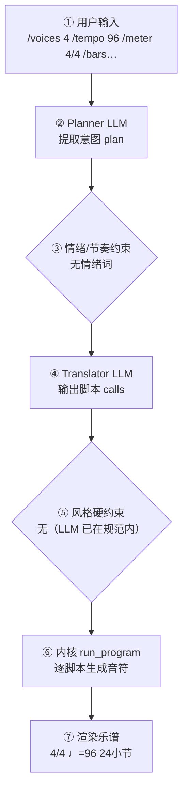

# 作曲分析报告：Heroic Fugue in C

本文件供人工或大模型核对。第 3 节仅列出需关注的问题与提示。

## 1. 要核对的作曲原则

1. **调内音高**：各音应落在该调号自然音阶内（调号升降号已计入；小调和声导音亦计入）。
2. **节奏完整**：每个声部每一小节时值之和应等于拍号。
3. **声部进行**：外声部（小提琴对大提琴）同向平行纯五度需避免；管弦乐八度加强不计入错误。
4. **声部交叉**：功能相邻声部不宜明显越过（木管互叠不计）。
5. **音域**：各声部应落在该乐器常用音域内。
6. **旋律**：器乐旋律允许较大跳进与较复杂节奏；极端无序跳进再提示。
7. **终止**：结束处最好含主音/主三和弦，旋律落在主音上更有完全终止感。

## 2. 基本信息

- 调性: C 大调（0 个升号）
- 转调: 第 9 小节 → A 小调
- 拍号: 4/4
- 速度: 四分音符 = 96 BPM
- 调内音级: C, D, E, F, G, A, B
- 声部 1: Soprano，高音谱号，24 小节
- 声部 2: Alto，高音谱号，24 小节
- 声部 3: Bass，低音谱号，24 小节

## 3. 需关注的问题与提示

| 检查类别 | 状态 | 描述 |
|---|---|---|
| 调号一致性 | ⚠️ 注意 | A 小调 段出现变化音 F#, A#；C 大调 段出现变化音 A#（转调段调外音/经过音） |
| 声部进行 | ⚠️ 注意 | 声部1/3 在第 7.0→8.0 拍 平行五度（D6->G5 对 G3->C2）（管弦织体常见，可接受） |
| 音域 | ⚠️ 注意 | Soprano: E4–G7（MIDI 64–103） |
| 音域 | ⚠️ 注意 | Bass: C2–B3（MIDI 36–59） |

> 说明：平行五/八度仅检查最高与最低外声部；相邻声部交叉为提示项。 共检查 79 项（✅ 75 / ⚠️ 4 / ❌ 0）。

## 4. 作曲过程透明化（可追溯）

> 本节约等于把「需求 → 大模型 → 脚本 → 谱面」的完整链路展开，便于核对「说得 vs 写得」是否一致。数据来自本次生成的 `session.compose_trace`，确定性可复现。把本报告整体喂回大模型，可进一步定位具体小节/声部的问题与修正建议。

### 4.1 流程图（本次实际链路）



（文字版流程图，便于无 Mermaid 渲染环境阅读）

```
用户输入
  → [② Planner LLM] 提取意图 plan
  → [③ 情绪/节奏约束] 命中=否
  → [④ Translator LLM] 输出 calls + reasoning
  → [⑤ 风格硬约束] 触发=否
  → [⑥ 内核 run_program] 逐脚本执行
  → [⑦ 渲染谱面] 4/4 ♩=96 24小节
```

### 4.2 大模型输入输出（LLM I/O）

#### Planner（意图解析）

- **系统提示**（固定指令模板，已截断）：

```
You are a professional composer and music theorist acting as an Intent Parser.

Transform the user's natural-language request (and optional slash-commands already applied as preferences) into a Composition Plan JSON only.

Think like a composer first: infer genre, mood, form, motif character, harmony language, climax — do NOT invent note lists yet.

Output ONE JSON object, no Markdown:
{
  "title": "string",
  "genre": "string",
  "mood": ["..."],
  "tempo": 72,
  "meter": "4/4",
  "key_sharps": 0,
  "mode": "major|minor",
  "instrumentation": ["Piano"] or ["Violin","Cello"],
  "form": ["A","B","A"],
  "bars": 8,
  "motif": {"character": "...", "development": ["repetition","sequence"]},
  "harmony": {"language": "...", "density": "sparse|moderate|dense"},
  "rhythm": {"character": "..."},
  "texture": "homophonic|polyphonic|sparse|orchestral",
  "climax": {"location": "section B", "dynamic": "f"},
  "difficulty": "easy|medium",
  "summary": "one sentence for the user",
  "edit_intent": null
}
Rules:
- Original music only; no copyrighted melodies.
- If user is vague, choose musically appropriate defaults.
- bars: 4–32. Prefer 8–16 for a brand-new short piece.
- If the user asks to extend/lengthen to N bars (e.g. 扩展到32小节), set bars=N (not 8).
- If edit_intent is extend/longer and no N given, increase bars vs existing_score (typically +8 to +16, max 32).
- If edit_intent is rewrit
…（已截断，完整 5748 字；固定指令模板见 skills/composition/base/ 与内核 kernel_docs）
```

- **用户输入**（喂给模型的结构化上下文）：

```json
{
  "user_request": "史诗战争 写一首史诗风格的管弦乐小品：弦乐组（小提琴+中提琴+大提琴）铺底推进， 圆号奏英雄气概的主题，定音鼓在高潮处滚奏，B段转入关系小调制造阴云， 结尾回到大调辉煌收束。不要",
  "preferences": {
    "key_sharps": 0,
    "mode": "major",
    "tempo": 96,
    "bars": 24,
    "meter": "4/4",
    "style": "赋格",
    "genre_id": "genre:academic/fugue",
    "instrumentation": "",
    "fugue": "auto",
    "voices": 4,
    "_explicit": {
      "tempo": true,
      "meter": true,
      "bars": true
    }
  },
  "edit_intent": null,
  "skills": [
    "orchestrate",
    "genre:academic/fugue",
    "genre:cinematic/epic-battle"
  ],
  "existing_plan": null,
  "revision_edits": null,
  "existing_score_summary": null
}
```

- **模型返回（原始）**：

```json
{
  "title": "Heroic Fugue in C",
  "genre": "cinematic/epic-battle",
  "mood": [
    "heroic",
    "dramatic",
    "solemn"
  ],
  "tempo": 96,
  "meter": "4/4",
  "key_sharps": 0,
  "mode": "major",
  "instrumentation": [
    "Violin",
    "Viola",
    "Cello",
    "Horn",
    "Timpani"
  ],
  "form": [
    "A",
    "B",
    "A'"
  ],
  "bars": 24,
  "motif": {
    "character": "noble horn theme with dotted rhythm, clear subject length",
    "development": [
      "repetition",
      "sequence",
      "inversion"
    ]
  },
  "harmony": {
    "language": "functional tonality with fugal entries; I-V-I, i-VI-III in B section",
    "density": "moderate"
  },
  "rhythm": {
    "character": "steady martial pulse with contrapuntal entries; dotted heroic motif"
  },
  "texture": "polyphonic",
  "climax": {
    "location": "section A'",
    "dynamic": "ff"
  },
  "difficulty": "medium",
  "summary": "A 24-bar epic fugal miniature in C major: strings lay a driving groundwork, horn states the heroic subject, B section shifts to A minor with timpani rolls, ending in a brilliant C major close.",
  "edit_intent": null
}
```

#### Translator（脚本翻译）

- **系统提示**（固定指令模板，已截断）：

````
# 翻译器（Translator）

你不是作曲家，是**翻译器**：把用户的自然语言音乐需求与 plan 翻译成
对确定性脚本的调用序列。你**不写任何音符**——所有音符由脚本生成并保证
正确（时值、调性、织体、力度、终止）。你的职责是选对脚本、给对参数。

## 输出格式（只输出 JSON，不要任何解释文字）

```
{"reasoning": "用中文简述你如何把需求翻译成参数与脚本（2–5 句）：识别了什么风格/情绪，怎么决定速度/调式/织体，段落如何安排，调用了哪些脚本。", "calls": [{"script": "脚本名", "args": {...}}, ...]}
```

## 硬规则

1. 调用顺序：`new_score` → `set_sections` → 对每个段落 `{ set_harmony →
   accompaniment → melody }` →（高潮段可加 `thicken`）→（最后一段可加
   `cadence`）→ `finalize`
2. `new_score` 与 `finalize` 必须各恰好一次，且分别在最前/最后
3. **每个段落**都必须调用 set_harmony / accompaniment / melody，
   一次都不许漏（漏了 finalize 会报错）
4. args 必须严格符合脚本文档的字段名与取值范围；不要发明不存在的参数
5. 脚本执行失败时你会收到错误信息——修正 calls 后完整重新输出
6. `plan.tempo` / `plan.mode` / `plan.mood` / `plan.tempo_text` /
   `plan._emotion_hint` 是已解析的**明确约束**（来自用户情绪/速度词或
   `/tempo`），**优先级最高**——调用 `new_score` / `set_harmony` / `melody`
   时直接采用，不要用风格基线默认值覆盖。`reasoning` 字段必须如实写出你
   如何据此翻译，便于用户核查。

## 音乐判断指南（把情绪翻译成参数）

| 用户意图 | melody | accompaniment | 其他 |
|---|---|---|---|
| 安静/朦胧/pp 前奏、结尾 | rhythm=sparse, register=mid/low | sustained 或 broken_arpeggio(density 0.5–1) | 可给 motif |
| 不安/挣扎/冲突 | rhythm=fragmented, register=high | octave_pulse 或 chromatic_descent | 和声用 bII/vii°7/V7 |
| 高潮/宣泄/ff | rhythm=driving, register=high/very_high | broken_arpeggio(density 2) | thicken |
| 平静收束 | rhythm=sparse, contour=descending | sustained | cadence |

## 情绪 / 速度词的确定性映射（plan 已解析，最高优先级）

用户的「欢快 / 快
…（已截断，完整 12852 字；固定指令模板见 skills/composition/base/ 与内核 kernel_docs）
````

- **用户输入**（喂给模型的结构化上下文）：

```json
{
  "plan": {
    "title": "Heroic Fugue in C",
    "genre": "cinematic/epic-battle",
    "mood": [
      "heroic",
      "dramatic",
      "solemn"
    ],
    "tempo": 96,
    "tempo_text": null,
    "meter": "4/4",
    "key_sharps": 0,
    "mode": "major",
    "_emotion_hint": null,
    "instrumentation": [
      "Violin",
      "Viola",
      "Cello",
      "Horn",
      "Timpani"
    ],
    "form": [
      "A",
      "B",
      "A'"
    ],
    "bars": 24,
    "motif": {
      "character": "noble horn theme with dotted rhythm, clear subject length",
      "development": [
        "repetition",
        "sequence",
        "inversion"
      ]
    },
    "harmony": {
      "language": "functional tonality with fugal entries; I-V-I, i-VI-III in B section",
      "density": "moderate"
    },
    "rhythm": {
      "character": "steady martial pulse with contrapuntal entries; dotted heroic motif"
    },
    "texture": "polyphonic",
    "climax": {
      "location": "section A'",
      "dynamic": "ff"
    },
    "summary": "A 24-bar epic fugal miniature in C major: strings lay a driving groundwork, horn states the heroic subject, B section shifts to A minor with timpani rolls, ending in a brilliant C major close."
  },
  "user_brief": "史诗战争 写一首史诗风格的管弦乐小品：弦乐组（小提琴+中提琴+大提琴）铺底推进， 圆号奏英雄气概的主题，定音鼓在高潮处滚奏，B段转入关系小调制造阴云， 结尾回到大调辉煌收束。不要"
}
```

- **模型返回（原始）**：

```json
{
  "calls": [
    {
      "script": "new_score",
      "args": {
        "title": "Heroic Fugue in C",
        "key_sharps": 0,
        "mode": "major",
        "meter": "4/4",
        "tempo": 96,
        "bars": 24,
        "voices": 3
      }
    },
    {
      "script": "set_sections",
      "args": {
        "sections": [
          {
            "name": "A",
            "bars": 8,
            "meter": "4/4",
            "dynamic": "mf",
            "tempo_text": "Andante",
            "bpm": 96
          },
          {
            "name": "B",
            "bars": 8,
            "meter": "4/4",
            "dynamic": "f",
            "tempo_text": "Andante",
            "bpm": 96
          },
          {
            "name": "A'",
            "bars": 8,
            "meter": "4/4",
            "dynamic": "ff",
            "tempo_text": "Andante",
            "bpm": 96
          }
        ]
      }
    },
    {
      "script": "set_harmony",
      "args": {
        "section": "A",
        "progression": [
          "I",
          "V",
          "I",
          "IV"
        ]
      }
    },
    {
      "script": "accompaniment",
      "args": {
        "section": "A",
        "pattern": "octave_pulse",
        "register": "low",
        "density": 1
      }
    },
    {
      "script": "melody",
      "args": {
        "section": "A",
        "register": "high",
        "rhythm": "driving",
        "contour": "ascending",
        "motif": [
          [
            1,
            "quarter"
          ],
          [
            5,
            "eighth"
          ],
          [
            5,
            "eighth"
          ],
          [
            3,
            "quarter"
          ]
        ]
      }
    },
    {
      "script": "set_harmony",
      "args": {
        "section": "B",
        "progression": [
          "i",
          "VI",
          "III",
          "VII"
        ],
        "key_sharps": 0,
        "mode": "minor"
      }
    },
    {
      "script": "fugue",
      "args": {
        "section": "B",
        "voices": 3,
        "answer": "tonal",
        "entry_bars": 2,
        "stretto": true,
        "episodes": true,
        "pedal": true
      }
    },
    {
      "script": "set_harmony",
      "args": {
        "section": "A'",
        "progression": [
          "I",
          "V",
          "IV",
          "V7"
        ],
        "key_sharps": 0,
        "mode": "major"
      }
    },
    {
      "script": "accompaniment",
      "args": {
        "section": "A'",
        "pattern": "broken_arpeggio",
        "register": "low",
        "density": 2
      }
    },
    {
      "script": "melody",
      "args": {
        "section": "A'",
        "register": "very_high",
        "rhythm": "driving",
        "contour": "ascending"
      }
    },
    {
      "script": "thicken",
      "args": {
        "section": "A'"
      }
    },
    {
      "script": "cadence",
      "args": {
        "section": "A'",
        "bars": 2
      }
    },
    {
      "script": "finalize",
      "args": {}
    }
  ]
}
```

### 4.3 脚本调用与输入输出

| # | 脚本 | 输入(args) | 输出（新增音符 / 状态变更） |
|---|---|---|---|
| 1 | new_score | title=Heroic Fugue in C，key_sharps=0，mode=major，meter=4/4，tempo=96，bars=24，voices=3 | 建立乐曲：4/4 ♩=96 3声部 major；新增 — |
| 2 | set_sections | sections=[{"name": "A", "bars": 8, "meter": "4/4", "dynamic": "mf", "tempo_text": "Andante", "bpm": 96}, {"name": "B", "bars": 8, "meter": "4/4", "dynamic": "f", "tempo_text": "Andante", "bpm": 96}, {"name": "A'", "bars": 8, "meter": "4/4", "dynamic": "ff", "tempo_text": "Andante", "bpm": 96}] | 分段：A(8小节)，B(8小节)，A'(8小节)；新增 — |
| 3 | set_harmony | section=A，progression=["I", "V", "I", "IV"] | 和声：段落A 进行['I', 'V', 'I', 'IV']；新增 — |
| 4 | accompaniment | section=A，pattern=octave_pulse，register=low，density=1 | 伴奏：段落A pattern=octave_pulse register=low density=1；新增 声部2:+8，声部3:+32 |
| 5 | melody | section=A，register=high，rhythm=driving，contour=ascending，motif=[[1, "quarter"], [5, "eighth"], [5, "eighth"], [3, "quarter"]] | 旋律：段落A rhythm=driving；新增 声部1:+39 |
| 6 | set_harmony | section=B，progression=["i", "VI", "III", "VII"]，key_sharps=0，mode=minor | 和声：段落B 进行['i', 'VI', 'III', 'VII']；新增 — |
| 7 | fugue | section=B，voices=3，answer=tonal，entry_bars=2，stretto=True，episodes=True，pedal=True | 赋格：段落B；新增 声部1:+26，声部2:+27，声部3:+8 |
| 8 | set_harmony | section=A'，progression=["I", "V", "IV", "V7"]，key_sharps=0，mode=major | 和声：段落A' 进行['I', 'V', 'IV', 'V7']；新增 — |
| 9 | accompaniment | section=A'，pattern=broken_arpeggio，register=low，density=2 | 伴奏：段落A' pattern=broken_arpeggio register=low density=2；新增 声部2:+8，声部3:+64 |
| 10 | melody | section=A'，register=very_high，rhythm=driving，contour=ascending | 旋律：段落A' rhythm=driving；新增 声部1:+35 |
| 11 | thicken | section=A' | 加厚：段落A'；新增 — |
| 12 | cadence | section=A'，bars=2 | 终止：bars=2；新增 — |
| 13 | finalize |  | 收束装配：24小节 / 3声部；新增 声部1:+3 |

<details><summary>逐脚本新增音符样例（前 8 个 / 声部）</summary>

- **new_score**：声部1: —；声部2: —；声部3: —
- **set_sections**：声部1: —；声部2: —；声部3: —
- **set_harmony**：声部1: —；声部2: —；声部3: —
- **accompaniment**：声部1: —；声部2: E4:whole, B4:whole, E4:whole, A4:whole, E4:whole, B4:whole, E4:whole, A4:whole；声部3: C2+C3:quarter, C2+C3:quarter, C2+C3:quarter, C2+C3:quarter, G2+G3:quarter, G2+G3:quarter, G2+G3:quarter, G2+G3:quarter
- **melody**：声部1: C5:quarter, G5:eighth, G5:eighth, E5:quarter, E5:quarter, D5:quarter, G5:quarter, B5:quarter；声部2: —；声部3: —
- **set_harmony**：声部1: —；声部2: —；声部3: —
- **fugue**：声部1: None:whole, None:whole, D5:eighth, D5:eighth, C5:quarter, B4:quarter, A4:quarter, G4:eighth；声部2: G4:eighth, G4:eighth, F4:quarter, E4:quarter, D4:quarter, C4:eighth, D4:eighth, E4:quarter；声部3: None:whole, None:whole, None:whole, None:whole, None:whole, None:whole, D3:whole, C3:whole
- **set_harmony**：声部1: —；声部2: —；声部3: —
- **accompaniment**：声部1: —；声部2: E4:whole, B4:whole, A4:whole, B4:whole, E4:whole, B4:whole, A4:whole, B4:whole；声部3: C2:eighth, E3:eighth, G3:eighth, C3:eighth, G3:eighth, E3:eighth, C2:eighth, E3:eighth
- **melody**：声部1: G5:quarter, E5:quarter, F5:eighth, G5:eighth, G5:quarter, B5:quarter, D6:quarter, G6:quarter；声部2: —；声部3: —
- **thicken**：声部1: —；声部2: —；声部3: —
- **cadence**：声部1: —；声部2: —；声部3: —
- **finalize**：声部1: D6+D7:quarter, C5+C6:whole, C5+C6:whole；声部2: —；声部3: —

</details>

### 4.4 本地强制约束（确定性兜底，优先级高于 LLM）

- 情绪/节奏约束：未触发（用户未给情绪/速度词，或已被风格基线覆盖）
- 风格/速度强制纠正：未触发（LLM 输出已在 genre 规范内）
### 4.5 自动问题定位（可疑点 + 程度）

| 检查项 | 程度 | 说明 |
|---|---|---|
| 情绪约束 | 🟢 未触发 | 用户未给情绪/速度词 |
| 意图拍号↔谱面 | 🟢 一致 | 最终拍号 4/4 |
| 计划小节↔实际小节 | 🟢 一致 | 24 小节 |
| 风格规范遵循 | 🟢 良好 | LLM 输出均在 genre 规范内，无需强制 |

> 说明：上表为程序自动比对「意图 ↔ 谱面」的初判（🔴 严重 / 🟡 注意 / 🟢 一致）。将本报告整体喂给大模型，可进一步定位具体小节/声部的问题与修正建议。

## 5. 记谱与演奏法

**规则日志**（共 30 条，其中仲裁 0 次）

- [spelling/correctness] p1m5 B- — → A#：调号 0 下变音记号更少
- [spelling/correctness] p1m5 B- — → A#：调号 0 下变音记号更少
- [spelling/correctness] p1m9 G- — → Gb：调号 0 下变音记号更少
- [spelling/correctness] p1m9 G- — → Gb：调号 0 下变音记号更少
- [spelling/correctness] p1m13 B- — → Bb：调号 0 下变音记号更少
- [spelling/correctness] p1m13 B- — → Bb：调号 0 下变音记号更少
- [articulation/style] tenuto — 挂 Tenuto：叙事/风格标记 tenuto
- [articulation/style] tenuto — 挂 Tenuto：叙事/风格标记 tenuto
- [articulation/style] tenuto — 挂 Tenuto：叙事/风格标记 tenuto
- [articulation/style] tenuto — 挂 Tenuto：叙事/风格标记 tenuto
- [articulation/style] accent — 挂 Accent：叙事/风格标记 accent
- [articulation/style] tenuto — 挂 Tenuto：叙事/风格标记 tenuto
- …另有 18 条

可演奏性：10 项 MAJOR / 35 项总计
- [MINOR] 声部1 大跳 17 半音（>八度）
- [MINOR] 声部1 大跳 15 半音（>八度）
- [MAJOR] 声部1（Soprano）音 98 超出音域 40–95
- [MAJOR] 声部1（Soprano）音 103 超出音域 40–95
- [MAJOR] 声部1（Soprano）音 96 超出音域 40–95
- [MAJOR] 声部1（Soprano）音 96 超出音域 40–95
- [MAJOR] 声部1（Soprano）音 98 超出音域 40–95
- [MAJOR] 声部1（Soprano）音 98 超出音域 40–95
- …其余 27 项从略

## 6. 生成质量评估（三指标）

- **风格重叠率**：N/A（未指定目标包）
- **属性遵循度**：1.00（0 项）
- **最近邻**：heroic-fanfare（相似度 0.69）— ✅ 无抄袭嫌疑
