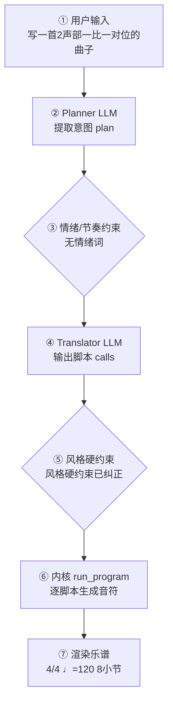

# 作曲生产报告：二声部一比一对位练习（程序员版）

> 面向产品/工程：记录本次生成的完整生产链路与系统状态，用于核对「说得 vs 写得」、排查缺陷与回归测试；可整体喂回大模型进一步定位具体小节/声部的问题。谱面检查与编辑者版一致，编辑者版见：`c45396c8d8_report.md`。

## 1. 会话与生成环境

- 生成时间: 2026-10-01T18:33:59
- 生成路径: two_part_species（确定性第一类对位，意图来自 planner，未写音符 LLM）
- 命中技能: compose-full
- 用户原始输入: 写一首2声部一比一对位的曲子
- 原始数据: `session.compose_trace`（本报告第 4 节即其展开，确定性可复现）

## 2. 谱面事实（与编辑者版「基本信息」一致）

- 调性: C 大调（0 个升号）
- 拍号: 4/4
- 速度: 四分音符 = 120 BPM
- 调内音级: C, D, E, F, G, A, B
- 声部 1: Piano，高音谱号，8 小节
- 声部 2: Piano，低音谱号，8 小节

## 3. 自动检查结果（与编辑者版「第 3 节」一致）

（无）当前自动检查未发现需要关注的问题。

> 说明：众赞歌/钢琴四部叠写检查全部逻辑声部对的平行五八度；管弦织体仅查外声部平行五度（八度加强不报）。相邻声部交叉为提示项。 共检查 23 项（✅ 23 / ⚠️ 0 / ❌ 0）。

## 4. 作曲过程透明化（可追溯）

> 本节约等于把「需求 → 大模型 → 脚本 → 谱面」的完整链路展开，便于核对「说得 vs 写得」是否一致。数据来自本次生成的 `session.compose_trace`，确定性可复现。把本报告整体喂回大模型，可进一步定位具体小节/声部的问题与修正建议。

### 4.1 流程图（本次实际链路）



（文字版流程图，便于无 Mermaid 渲染环境阅读）

```
用户输入
  → [② Planner LLM] 提取意图 plan
  → [③ 情绪/节奏约束] 命中=否
  → [④ Translator LLM] 输出 calls + reasoning
  → [⑤ 风格硬约束] 触发=是
  → [⑥ 内核 run_program] 逐脚本执行
  → [⑦ 渲染谱面] 4/4 ♩=120 8小节
```

### 4.2 大模型输入输出（LLM I/O）

#### Planner（意图解析）

- **系统提示**（固定指令模板，已截断）：

```
You are a professional composer and music theorist acting as an Intent Parser.

Transform the user's natural-language request (and optional slash-commands already applied as preferences) into a Composition Plan JSON only.

Think like a composer first: infer genre, mood, form, motif character, harmony language, climax — do NOT invent note lists yet.

A **风格目录（仅已学包）** is injected at the end of this system prompt. Use it to set `genre_id`.

Output ONE JSON object, no Markdown:
{
  "title": "string",
  "genre": "string (human label, e.g. 摇摆标准曲（爵士）)",
  "genre_id": "family/pack_id from 风格目录, e.g. jazz/swing-standard; empty if none",
  "mood": ["..."],
  "tempo": 72,
  "meter": "4/4",
  "key_sharps": 0,
  "mode": "major|minor",
  "instrumentation": ["trumpet","piano","contrabass"] (kernel English names; map fiddle→violin, double bass→contrabass, tin whistle→flute; avoid unknown names),
  "form": ["A","B","A"],
  "bars": 16,
  "motif": {"character": "...", "development": ["repetition","sequence"]},
  "harmony": {"language": "...", "density": "sparse|moderate|dense"},
  "rhythm": {"character": "..."},
  "texture": "homophonic|polyphonic|sparse|orchestral|first-species",
  "species": false,
  "want_fugue": false,
  "climax": {"location": "section B", "dynamic": "f"},
  "difficulty": "easy|medium",
  "summary": "one sentence for the user",
  "edit_intent": null
}
Rules:
- Original music 
…（已截断，完整 4830 字；固定指令模板见 skills/composition/base/ 与内核 kernel_docs）
```

- **用户输入**（喂给模型的结构化上下文）：

```json
{
  "user_request": "写一首2声部一比一对位的曲子",
  "preferences": {
    "key_sharps": 0,
    "mode": "major",
    "tempo": 120,
    "bars": 8,
    "meter": "4/4",
    "style": "",
    "genre_id": "",
    "instrumentation": "",
    "fugue": "auto",
    "voices": 0,
    "_explicit": {}
  },
  "edit_intent": null,
  "skills": [
    "compose-full"
  ],
  "existing_plan": null,
  "revision_edits": null,
  "existing_score_summary": null
}
```

- **模型返回（原始）**：

```json
{
  "title": "二声部一比一对位练习",
  "genre": "第一类对位（二声部）",
  "genre_id": "",
  "mood": [
    "平稳",
    "清澈",
    "古典"
  ],
  "tempo": 120,
  "meter": "4/4",
  "key_sharps": 0,
  "mode": "major",
  "instrumentation": [
    "piano",
    "piano"
  ],
  "form": [
    "A",
    "A'"
  ],
  "bars": 8,
  "motif": {
    "character": "级进为主、音域适中的可唱旋律，起于主音、终于主音",
    "development": [
      "repetition",
      "sequence"
    ]
  },
  "harmony": {
    "language": "严格第一类对位：协和音程为主，终止式用 6→8 度扩张",
    "density": "sparse"
  },
  "rhythm": {
    "character": "二声部同节奏、音符对音符，全音符/二分音符为主，末小节收束"
  },
  "texture": "first-species",
  "species": true,
  "want_fugue": false,
  "climax": {
    "location": "section A' 前半",
    "dynamic": "mf"
  },
  "difficulty": "easy",
  "summary": "为钢琴大谱表写作的 8 小节 C 大调二声部第一类（一比一）对位练习，音对音、协和为主、终止清晰。",
  "edit_intent": null
}
```

### 4.3 脚本调用与输入输出

（本次路径未经过确定性脚本内核：`two_part_species（确定性第一类对位，意图来自 planner，未写音符 LLM）`—— 该路径由 LLM 直接产出乐谱或纯确定性生成，无逐脚本记录）

### 4.4 本地强制约束（确定性兜底，优先级高于 LLM）

- 情绪/节奏约束：未触发（用户未给情绪/速度词，或已被风格基线覆盖）
- 风格/速度强制纠正：二声部对位：编制强制钢琴大谱表 RH/LH
- 风格/速度强制纠正：1 小节 1 音 · 中间仅 3/6 度 · 禁纯四 · 结尾反向八度 · 最高音错开
- **风格契约施加的约束**：无（该风格包没有 `style_contract.yaml`，或契约证据量不足、和声分区未生效）
### 4.5 自动问题定位（可疑点 + 程度）

| 检查项 | 程度 | 说明 |
|---|---|---|
| 情绪约束 | 🟢 未触发 | 用户未给情绪/速度词 |
| 意图拍号↔谱面 | 🟢 一致 | 最终拍号 4/4 |
| 计划小节↔实际小节 | 🟢 一致 | 8 小节 |
| 风格规范遵循 | 🟡 注意 | LLM 偏离 genre 规范，已强制纠正 2 处（说明模型未严格遵循风格包） |
| 计划编制↔实际编制 | 🟢 一致 | 计划 2 件乐器与谱面 2 声部对应 |

> 说明：上表为程序自动比对「意图 ↔ 谱面」的初判（🔴 严重 / 🟡 注意 / 🟢 一致）。将本报告整体喂给大模型，可进一步定位具体小节/声部的问题与修正建议。

## 5. 记谱与演奏法

可演奏性：0 项 MAJOR / 1 项总计
- [MINOR] 声部2 大跳 14 半音（>八度）

## 生成质量评估

- **风格重叠率**：N/A（未指定目标包）
- **属性遵循度**：1.00（0 项）
- **包级最近邻**：british-folk-tune（相似度 0.71）— ✅ 无抄袭嫌疑
