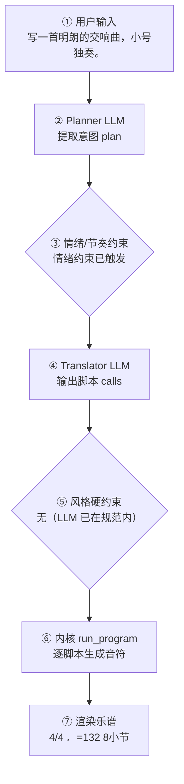

# 作曲生产报告：Sunlit Fanfare（程序员版）

> 面向产品/工程：记录本次生成的完整生产链路与系统状态，用于核对「说得 vs 写得」、排查缺陷与回归测试；可整体喂回大模型进一步定位具体小节/声部的问题。谱面检查与编辑者版一致，编辑者版见：`d0afa6ac1c_report.md`。

## 1. 会话与生成环境

- 生成时间: 2026-09-27T16:25:21
- 生成路径: translator（LLM 翻译 + 确定性内核）
- 命中技能: compose-full
- 用户原始输入: 写一首明朗的交响曲，小号独奏。
- 原始数据: `session.compose_trace`（本报告第 4 节即其展开，确定性可复现）

## 2. 谱面事实（与编辑者版「基本信息」一致）

- 调性: C 大调（0 个升号）
- 拍号: 4/4
- 速度: 四分音符 = 132 BPM
- 段落速度: 第 5 小节 Allegro（♩=138）
- 调内音级: C, D, E, F, G, A, B
- 声部 1: 小号 (Trumpet)，高音谱号，8 小节
- 声部 2: 长笛 (Flute)，高音谱号，8 小节
- 声部 3: 双簧管 (Oboe)，高音谱号，8 小节
- 声部 4: Clarinet，高音谱号，8 小节
- 声部 5: Bassoon，低音谱号，8 小节
- 声部 6: 圆号 (Horn)，高音谱号，8 小节
- 声部 7: Trombone，低音谱号，8 小节
- 声部 8: Tuba，低音谱号，8 小节
- 声部 9: 定音鼓 (Timpani)，低音谱号，8 小节
- 声部 10: 小提琴 (Violin)，高音谱号，8 小节
- 声部 11: 小提琴 (Violin)，高音谱号，8 小节
- 声部 12: 中提琴 (Viola)，ALTO，8 小节
- 声部 13: 大提琴 (Cello)，低音谱号，8 小节
- 声部 14: Contrabass，低音谱号，8 小节

## 3. 自动检查结果（与编辑者版「第 3 节」一致）

| 检查类别 | 状态 | 描述 |
|---|---|---|
| 调号一致性 | ⚠️ 注意 | C 大调下出现变化音 C, D, D#, E, F, G, A, B（经过音/离调） |
| 声部交叉 | ⚠️ 注意 | 纵向上方声部 4（Clarinet）与下方声部 1（小号 (Trumpet)）在第 0.0 拍交叉：C5 低于 B5（同类交叉共 25 处，此处为第 1 例） |
| 声部交叉 | ⚠️ 注意 | 纵向上方声部 12（中提琴 (Viola)）与下方声部 5（Bassoon）在第 2.5 拍交叉：C4 低于 E4（同类交叉共 7 处，此处为第 1 例） |
| 声部交叉 | ⚠️ 注意 | 纵向上方声部 5（Bassoon）与下方声部 13（大提琴 (Cello)）在第 9.0 拍交叉：F3 低于 A3（同类交叉共 8 处，此处为第 1 例） |
| 音域 | ⚠️ 注意 | 小号 (Trumpet): A4–G6（MIDI 69–91） |

> 说明：平行五/八度仅检查最高与最低外声部；相邻声部交叉为提示项。 共检查 136 项（✅ 131 / ⚠️ 5 / ❌ 0）。

## 4. 作曲过程透明化（可追溯）

> 本节约等于把「需求 → 大模型 → 脚本 → 谱面」的完整链路展开，便于核对「说得 vs 写得」是否一致。数据来自本次生成的 `session.compose_trace`，确定性可复现。把本报告整体喂回大模型，可进一步定位具体小节/声部的问题与修正建议。

### 4.1 流程图（本次实际链路）



（文字版流程图，便于无 Mermaid 渲染环境阅读）

```
用户输入
  → [② Planner LLM] 提取意图 plan
  → [③ 情绪/节奏约束] 命中=是
  → [④ Translator LLM] 输出 calls + reasoning
  → [⑤ 风格硬约束] 触发=否
  → [⑥ 内核 run_program] 逐脚本执行
  → [⑦ 渲染谱面] 4/4 ♩=132 8小节
```

### 4.2 大模型输入输出（LLM I/O）

#### Planner（意图解析）

- **系统提示**（固定指令模板，已截断）：

```
You are a professional composer and music theorist acting as an Intent Parser.

Transform the user's natural-language request (and optional slash-commands already applied as preferences) into a Composition Plan JSON only.

Think like a composer first: infer genre, mood, form, motif character, harmony language, climax — do NOT invent note lists yet.

Output ONE JSON object, no Markdown:
{
  "title": "string",
  "genre": "string",
  "mood": ["..."],
  "tempo": 72,
  "meter": "4/4",
  "key_sharps": 0,
  "mode": "major|minor",
  "instrumentation": ["Piano"] or ["Violin","Cello"],
  "form": ["A","B","A"],
  "bars": 8,
  "motif": {"character": "...", "development": ["repetition","sequence"]},
  "harmony": {"language": "...", "density": "sparse|moderate|dense"},
  "rhythm": {"character": "..."},
  "texture": "homophonic|polyphonic|sparse|orchestral",
  "climax": {"location": "section B", "dynamic": "f"},
  "difficulty": "easy|medium",
  "summary": "one sentence for the user",
  "edit_intent": null
}
Rules:
- Original music only; no copyrighted melodies.
- If user is vague, choose musically appropriate defaults.
- bars: 4–32. Prefer 8–16 for a brand-new short piece.
- If the user asks to extend/lengthen to N bars (e.g. 扩展到32小节), set bars=N (not 8).
- If edit_intent is extend/longer and no N given, increase bars vs existing_score (typically +8 to +16, max 32).
- If edit_intent is rewrit
…（已截断，完整 2397 字；固定指令模板见 skills/composition/base/ 与内核 kernel_docs）
```

- **用户输入**（喂给模型的结构化上下文）：

```json
{
  "user_request": "写一首明朗的交响曲，小号独奏。",
  "preferences": {
    "key_sharps": 0,
    "mode": "major",
    "tempo": 120,
    "bars": 8,
    "meter": "4/4",
    "style": "",
    "genre_id": "",
    "instrumentation": "",
    "fugue": "auto",
    "voices": 0,
    "_explicit": {}
  },
  "edit_intent": null,
  "skills": [
    "compose-full"
  ],
  "existing_plan": null,
  "revision_edits": null,
  "existing_score_summary": null
}
```

- **模型返回（原始）**：

```json
{
  "title": "Sunlit Fanfare",
  "genre": "Symphonic",
  "mood": [
    "bright",
    "triumphant",
    "optimistic"
  ],
  "tempo": 120,
  "meter": "4/4",
  "key_sharps": 0,
  "mode": "major",
  "instrumentation": [
    "Trumpet",
    "Strings",
    "Horns",
    "Timpani"
  ],
  "form": [
    "A",
    "A'"
  ],
  "bars": 8,
  "motif": {
    "character": "rising triadic fanfare figure with dotted rhythm",
    "development": [
      "repetition",
      "sequence",
      "rhythmic augmentation"
    ]
  },
  "harmony": {
    "language": "tonal diatonic with bright major triads and dominant motion",
    "density": "moderate"
  },
  "rhythm": {
    "character": "crisp dotted fanfare figures against steady string pulse"
  },
  "texture": "homophonic",
  "climax": {
    "location": "section A'",
    "dynamic": "f"
  },
  "difficulty": "medium",
  "summary": "A bright 8-bar symphonic fanfare in C major featuring a solo trumpet over warm strings, horns, and timpani."
}
```

#### Translator（脚本翻译）

- **系统提示**（固定指令模板，已截断）：

````
# 翻译器（Translator）

你不是作曲家，是**翻译器**：把用户的自然语言音乐需求与 plan 翻译成
对确定性脚本的调用序列。你**不写任何音符**——所有音符由脚本生成并保证
正确（时值、调性、织体、力度、终止）。你的职责是选对脚本、给对参数。

## 输出格式（只输出 JSON，不要任何解释文字）

```
{"reasoning": "用中文简述你如何把需求翻译成参数与脚本（2–5 句）：识别了什么风格/情绪，怎么决定速度/调式/织体，段落如何安排，调用了哪些脚本。", "calls": [{"script": "脚本名", "args": {...}}, ...]}
```

## 硬规则

1. 调用顺序：`new_score` → `set_sections` → 对每个段落 `{ set_harmony →
   accompaniment → melody }` →（高潮段可加 `thicken`）→（最后一段可加
   `cadence`）→ `finalize`
2. `new_score` 与 `finalize` 必须各恰好一次，且分别在最前/最后
3. **每个段落**都必须调用 set_harmony / accompaniment / melody，
   一次都不许漏（漏了 finalize 会报错）
4. args 必须严格符合脚本文档的字段名与取值范围；不要发明不存在的参数
5. 脚本执行失败时你会收到错误信息——修正 calls 后完整重新输出
6. `plan.tempo` / `plan.mode` / `plan.mood` / `plan.tempo_text` /
   `plan._emotion_hint` 是已解析的**明确约束**（来自用户情绪/速度词或
   `/tempo`），**优先级最高**——调用 `new_score` / `set_harmony` / `melody`
   时直接采用，不要用风格基线默认值覆盖。`reasoning` 字段必须如实写出你
   如何据此翻译，便于用户核查。
7. **乐器编制**：brief 提到管弦乐/弦乐/铜管/木管/具体乐器（小提琴、长笛、
   圆号、定音鼓…）或某种编制（弦乐四重奏、铜管五重奏…）时，`new_score`
   **必须传 `instruments`**（长度=voices，从高音到低音，低音乐器放最后），
   可用名：flute/oboe/**piccolo**/clarinet/bassoon/horn/trumpet/trombone/
   tuba/violin/viola/cello/contrabass/timpani/**harp**/piano/soprano/alto/
   tenor/bass。例：「弦乐四重奏」→ voices=4 +
   `["violin","violin","viola","cello"]`；「管弦乐小品」→ voices=4 +
   `["flute","violin","cello","timpani"]` 之类按 brief 取舍。不传时 2 声部
   默认钢琴大谱表、3/4 声部默认人声 SATB。
   - **「交响乐 / 交响曲 / 管
…（已截断，完整 10474 字；固定指令模板见 skills/composition/base/ 与内核 kernel_docs）
````

- **用户输入**（喂给模型的结构化上下文）：

```json
{
  "plan": {
    "title": "Sunlit Fanfare",
    "genre": "Symphonic",
    "mood": [
      "bright",
      "triumphant",
      "optimistic",
      "cheerful"
    ],
    "tempo": 132,
    "tempo_text": "Allegro",
    "meter": "4/4",
    "key_sharps": 0,
    "mode": "major",
    "_emotion_hint": {
      "group": "fast",
      "matched": [
        "明朗"
      ],
      "bpm": 132,
      "tempo_text": "Allegro",
      "mode_bias": "major",
      "rhythm": "flowing",
      "dynamics": "f",
      "contour": "arch"
    },
    "instrumentation": [
      "Trumpet",
      "Strings",
      "Horns",
      "Timpani"
    ],
    "form": [
      "A",
      "A'"
    ],
    "bars": 8,
    "motif": {
      "character": "rising triadic fanfare figure with dotted rhythm",
      "development": [
        "repetition",
        "sequence",
        "rhythmic augmentation"
      ]
    },
    "harmony": {
      "language": "tonal diatonic with bright major triads and dominant motion",
      "density": "moderate"
    },
    "rhythm": {
      "character": "crisp dotted fanfare figures against steady string pulse"
    },
    "texture": "homophonic",
    "climax": {
      "location": "section A'",
      "dynamic": "f"
    },
    "summary": "A bright 8-bar symphonic fanfare in C major featuring a solo trumpet over warm strings, horns, and timpani."
  },
  "user_brief": "写一首明朗的交响曲，小号独奏。"
}
```

- **模型返回（原始）**：

```json
{
  "reasoning": "用户要求「明朗的交响曲，小号独奏」，plan 已解析为 C 大调、Allegro 132、4/4、fast 情绪组（大调、f 力度、arch 拱形、flowing 节奏）。交响曲需用管弦编制，brief 指定小号独奏，因此 new_score 传双管编制并设 solo_instrument=\"trumpet\"，让旋律路由到小号。全曲 8 小节分 A（4 小节）与 A'（4 小节），A 段用 I–V7–IV–V7 明亮和声、弦乐 sustained 铺底、小号奏号角式 arch 旋律；A' 段作为高潮用 IV–V7–IV–V7、broken_arpeggio density 2 加厚并 thicken，末段 cadence 收束。",
  "calls": [
    {
      "script": "new_score",
      "args": {
        "title": "Sunlit Fanfare",
        "key_sharps": 0,
        "mode": "major",
        "meter": "4/4",
        "tempo": 132,
        "bars": 8,
        "voices": 14,
        "instruments": [
          "flute",
          "oboe",
          "clarinet",
          "bassoon",
          "horn",
          "trumpet",
          "trombone",
          "tuba",
          "timpani",
          "violin",
          "violin",
          "viola",
          "cello",
          "contrabass"
        ],
        "solo_instrument": "trumpet"
      }
    },
    {
      "script": "set_sections",
      "args": {
        "sections": [
          {
            "name": "A",
            "bars": 4,
            "meter": "4/4",
            "dynamic": "f",
            "tempo_text": "Allegro",
            "bpm": 132
          },
          {
            "name": "A'",
            "bars": 4,
            "meter": "4/4",
            "dynamic": "ff",
            "tempo_text": "Allegro",
            "bpm": 138
          }
        ]
      }
    },
    {
      "script": "set_harmony",
      "args": {
        "section": "A",
        "progression": [
          "I",
          "V7",
          "IV",
          "V7"
        ]
      }
    },
    {
      "script": "accompaniment",
      "args": {
        "section": "A",
        "pattern": "sustained",
        "register": "low",
        "density": 1
      }
    },
    {
      "script": "melody",
      "args": {
        "section": "A",
        "register": "high",
        "rhythm": "flowing",
        "contour": "arch",
        "motif": [
          [
            1,
            "quarter"
          ],
          [
            3,
            "eighth"
          ],
          [
            5,
            "eighth"
          ],
          [
            1,
            "half"
          ]
        ]
      }
    },
    {
      "script": "set_harmony",
      "args": {
        "section": "A'",
        "progression": [
          "IV",
          "V7",
          "IV",
          "V7"
        ]
      }
    },
    {
      "script": "accompaniment",
      "args": {
        "section": "A'",
        "pattern": "broken_arpeggio",
        "register": "low",
        "density": 2
      }
    },
    {
      "script": "melody",
      "args": {
        "section": "A'",
        "register": "very_high",
        "rhythm": "driving",
        "contour": "ascending"
      }
    },
    {
      "script": "thicken",
      "args": {
        "section": "A'"
      }
    },
    {
      "script": "cadence",
      "args": {
        "bars": 2,
        "section": "A'"
      }
    },
    {
      "script": "finalize",
      "args": {}
    }
  ]
}
```

### 4.3 脚本调用与输入输出

| # | 脚本 | 输入(args) | 输出（新增音符 / 状态变更） |
|---|---|---|---|
| 1 | new_score | title=Sunlit Fanfare，key_sharps=0，mode=major，meter=4/4，tempo=132，bars=8，voices=14，instruments=["flute", "oboe", "clarinet", "bassoon", "horn", "trumpet", "trombone", "tuba", "timpani", "violin", "violin", "viola", "cello", "contrabass"]，solo_instrument=trumpet | 建立乐曲：4/4 ♩=132 14声部 major；新增 — |
| 2 | set_sections | sections=[{"name": "A", "bars": 4, "meter": "4/4", "dynamic": "f", "tempo_text": "Allegro", "bpm": 132}, {"name": "A'", "bars": 4, "meter": "4/4", "dynamic": "ff", "tempo_text": "Allegro", "bpm": 138}] | 分段：A(4小节)，A'(4小节)；新增 — |
| 3 | set_harmony | section=A，progression=["I", "V7", "IV", "V7"] | 和声：段落A 进行['I', 'V7', 'IV', 'V7']；新增 — |
| 4 | accompaniment | section=A，pattern=sustained，register=low，density=1 | 伴奏：段落A pattern=sustained register=low density=1；新增 声部2:+32，声部3:+32，声部4:+32，声部5:+32，声部6:+8，声部7:+8，声部8:+8，声部9:+16，声部10:+32，声部11:+32，声部12:+32，声部13:+32，声部14:+8 |
| 5 | melody | section=A，register=high，rhythm=flowing，contour=arch，motif=[[1, "quarter"], [3, "eighth"], [5, "eighth"], [1, "half"]] | 旋律：段落A rhythm=flowing；新增 声部1:+19 |
| 6 | set_harmony | section=A'，progression=["IV", "V7", "IV", "V7"] | 和声：段落A' 进行['IV', 'V7', 'IV', 'V7']；新增 — |
| 7 | accompaniment | section=A'，pattern=broken_arpeggio，register=low，density=2 | 伴奏：段落A' pattern=broken_arpeggio register=low density=2；新增 声部2:+32，声部3:+32，声部4:+32，声部5:+32，声部6:+8，声部7:+8，声部8:+8，声部9:+16，声部10:+32，声部11:+32，声部12:+32，声部13:+32，声部14:+32 |
| 8 | melody | section=A'，register=very_high，rhythm=driving，contour=ascending | 旋律：段落A' rhythm=driving；新增 声部1:+20 |
| 9 | thicken | section=A' | 加厚：段落A'；新增 — |
| 10 | cadence | bars=2，section=A' | 终止：bars=2；新增 — |
| 11 | finalize |  | 收束装配：8小节 / 14声部；新增 声部1:+2 |

<details><summary>逐脚本新增音符样例（前 8 个 / 声部）</summary>

- **new_score**：声部1: —；声部2: —；声部3: —；声部4: —；声部5: —；声部6: —；声部7: —；声部8: —；声部9: —；声部10: —；声部11: —；声部12: —；声部13: —；声部14: —
- **set_sections**：声部1: —；声部2: —；声部3: —；声部4: —；声部5: —；声部6: —；声部7: —；声部8: —；声部9: —；声部10: —；声部11: —；声部12: —；声部13: —；声部14: —
- **set_harmony**：声部1: —；声部2: —；声部3: —；声部4: —；声部5: —；声部6: —；声部7: —；声部8: —；声部9: —；声部10: —；声部11: —；声部12: —；声部13: —；声部14: —
- **accompaniment**：声部1: —；声部2: G5:eighth, C6:eighth, F6:eighth, G6:eighth, C7:eighth, F6:eighth, E6:eighth, C6:eighth；声部3: E5:eighth, G5:eighth, C6:eighth, E6:eighth, G6:eighth, E6:eighth, C6:eighth, G5:eighth；声部4: C5:eighth, E5:eighth, G5:eighth, C6:eighth, F6:eighth, G5:eighth, E5:eighth, C5:eighth；声部5: G3:eighth, C4:eighth, E4:eighth, G4:eighth, C5:eighth, F3:eighth, D4:eighth, C4:eighth；声部6: C3:half, C4:half, G3:half, G3:half, F3:half, F3:half, G3:half, G3:half；声部7: C3:half, C3:half, G3:half, G3:half, F3:half, F3:half, G3:half, G3:half；声部8: C3:half, C3:half, G2:half, G2:half, F2:half, F2:half, G2:half, G2:half；声部9: C3:quarter, None:quarter, C3:quarter, None:quarter, G2:quarter, None:quarter, G2:quarter, None:quarter；声部10: None:eighth, C5:eighth, E5:eighth, G5:eighth, C6:eighth, C5:eighth, E5:eighth, G4:eighth；声部11: None:eighth, C5:eighth, E5:eighth, G5:eighth, C6:eighth, C5:eighth, E5:eighth, G4:eighth；声部12: None:eighth, C4:eighth, E4:eighth, G4:eighth, C5:eighth, C4:eighth, E4:eighth, G4:eighth；声部13: None:eighth, C3:eighth, E3:eighth, G3:eighth, C4:eighth, C3:eighth, E3:eighth, G3:eighth；声部14: C2:half, G2:half, G2:half, D2:half, F2:half, C2:half, G2:half, D2:half
- **melody**：声部1: B5:quarter, D6:eighth, F6:eighth, B5:half, A5:eighth, G5:eighth, G5:quarter, F5:quarter；声部2: —；声部3: —；声部4: —；声部5: —；声部6: —；声部7: —；声部8: —；声部9: —；声部10: —；声部11: —；声部12: —；声部13: —；声部14: —
- **set_harmony**：声部1: —；声部2: —；声部3: —；声部4: —；声部5: —；声部6: —；声部7: —；声部8: —；声部9: —；声部10: —；声部11: —；声部12: —；声部13: —；声部14: —
- **accompaniment**：声部1: —；声部2: A5:eighth, C6:eighth, F6:eighth, A6:eighth, C7:eighth, G6:eighth, F6:eighth, C6:eighth；声部3: F4:eighth, A4:eighth, C5:eighth, F5:eighth, C6:eighth, A4:eighth, E5:eighth, B4:eighth；声部4: C5:eighth, F5:eighth, A5:eighth, C6:eighth, F6:eighth, A5:eighth, F6:eighth, C6:eighth；声部5: A3:eighth, C4:eighth, F4:eighth, A3:eighth, C5:eighth, G3:eighth, E4:eighth, B3:eighth；声部6: F3:half, F3:half, G3:half, G3:half, F3:half, F3:half, G3:half, G3:half；声部7: F3:half, F3:half, G3:half, G3:half, F3:half, F3:half, G3:half, G3:half；声部8: F2:half, F2:half, G2:half, G2:half, F2:half, F2:half, G2:half, G2:half；声部9: F3:quarter, None:quarter, F3:quarter, None:quarter, G2:quarter, None:quarter, G2:quarter, None:quarter；声部10: None:eighth, F5:eighth, A5:eighth, C5:eighth, F6:eighth, F5:eighth, A5:eighth, C5:eighth；声部11: None:eighth, F5:eighth, A5:eighth, C5:eighth, F6:eighth, F5:eighth, A5:eighth, C5:eighth；声部12: None:eighth, F4:eighth, A4:eighth, C4:eighth, F5:eighth, F4:eighth, A4:eighth, C4:eighth；声部13: None:eighth, F4:eighth, A3:eighth, C4:eighth, F4:eighth, F4:eighth, A3:eighth, C4:eighth；声部14: F2:eighth, A3:eighth, C3:eighth, F3:eighth, C3:eighth, A3:eighth, F2:eighth, A3:eighth
- **melody**：声部1: A5:quarter, F5:quarter, E5:eighth, D5:eighth, C5:quarter, G5:quarter, B5:quarter, C6:eighth；声部2: —；声部3: —；声部4: —；声部5: —；声部6: —；声部7: —；声部8: —；声部9: —；声部10: —；声部11: —；声部12: —；声部13: —；声部14: —
- **thicken**：声部1: —；声部2: —；声部3: —；声部4: —；声部5: —；声部6: —；声部7: —；声部8: —；声部9: —；声部10: —；声部11: —；声部12: —；声部13: —；声部14: —
- **cadence**：声部1: —；声部2: —；声部3: —；声部4: —；声部5: —；声部6: —；声部7: —；声部8: —；声部9: —；声部10: —；声部11: —；声部12: —；声部13: —；声部14: —
- **finalize**：声部1: C6:half, C5+C6:whole；声部2: —；声部3: —；声部4: —；声部5: —；声部6: —；声部7: —；声部8: —；声部9: —；声部10: —；声部11: —；声部12: —；声部13: —；声部14: —

</details>

### 4.4 本地强制约束（确定性兜底，优先级高于 LLM）

- 情绪/节奏约束命中：`明朗` → ♩=132 Allegro · major · flowing · f
- 风格/速度强制纠正：未触发（LLM 输出已在 genre 规范内）
### 4.5 自动问题定位（可疑点 + 程度）

| 检查项 | 程度 | 说明 |
|---|---|---|
| 情绪↔最终调式 | 🟢 一致 | 情绪要求 major，谱面 major |
| 情绪↔最终速度 | 🟢 一致 | ♩=132（情绪目标 132） |
| 意图拍号↔谱面 | 🟢 一致 | 最终拍号 4/4 |
| 计划小节↔实际小节 | 🟢 一致 | 8 小节 |
| 风格规范遵循 | 🟢 良好 | LLM 输出均在 genre 规范内，无需强制 |
| 本地修复 | 🟡 注意 | 校验后触发了本地修复（时值/声部进行），说明初版谱存在 CRITICAL/MAJOR 问题 |
| 计划编制↔实际编制 | 🟡 注意 | 计划编制含 Strings，但谱面 14 个声部未落地（voices 数不足或 translator 取舍）——用户对编制的明确要求可能未满足 |

> 说明：上表为程序自动比对「意图 ↔ 谱面」的初判（🔴 严重 / 🟡 注意 / 🟢 一致）。将本报告整体喂给大模型，可进一步定位具体小节/声部的问题与修正建议。

## 5. 记谱与演奏法

**规则日志**（共 50 条，其中仲裁 0 次）

- [articulation/style] tenuto — 挂 Tenuto：叙事/风格标记 tenuto
- [articulation/style] accent — 挂 Accent：叙事/风格标记 accent
- [spelling/correctness] p1m7 E- — → D#：调号 0 下变音记号更少
- [spelling/correctness] p1m7 E- — → D#：调号 0 下变音记号更少
- [articulation/style] tenuto — 挂 Tenuto：叙事/风格标记 tenuto
- [articulation/style] tenuto — 挂 Tenuto：叙事/风格标记 tenuto
- [articulation/style] accent — 挂 Accent：叙事/风格标记 accent
- [articulation/style] tenuto — 挂 Tenuto：叙事/风格标记 tenuto
- [articulation/style] tenuto — 挂 Tenuto：叙事/风格标记 tenuto
- [articulation/style] accent — 挂 Accent：叙事/风格标记 accent
- [articulation/style] tenuto — 挂 Tenuto：叙事/风格标记 tenuto
- [articulation/style] tenuto — 挂 Tenuto：叙事/风格标记 tenuto
- …另有 38 条

可演奏性：5 项 MAJOR / 27 项总计
- [MAJOR] 声部1（Trumpet）音 89 超出音域 55–88
- [MINOR] 声部1 大跳 14 半音（>八度）
- [MAJOR] 声部1（Trumpet）音 89 超出音域 55–88
- [MAJOR] 声部1（Trumpet）音 91 超出音域 55–88
- [MAJOR] 声部1（Trumpet）音 89 超出音域 55–88
- [MAJOR] 声部1（Trumpet）音 91 超出音域 55–88
- [MINOR] 声部3 大跳 14 半音（>八度）
- [MINOR] 声部4 大跳 13 半音（>八度）
- …其余 19 项从略

## 6. 生成质量评估（三指标）

- **风格重叠率**：N/A（未指定目标包）
- **属性遵循度**：1.00（0 项）
- **最近邻**：polka（相似度 0.78）— ✅ 无抄袭嫌疑
