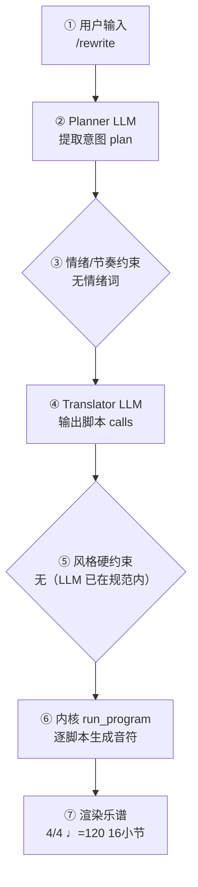

# 作曲分析报告：雨夜圆舞（复调改写）

本文件供人工或大模型核对。第 3 节仅列出需关注的问题与提示。

## 1. 要核对的作曲原则

1. **调内音高**：各音应落在该调号自然音阶内（调号升降号已计入；小调和声导音亦计入）。
2. **节奏完整**：每个声部每一小节时值之和应等于拍号。
3. **声部进行**：外声部（小提琴对大提琴）同向平行纯五度需避免；管弦乐八度加强不计入错误。
4. **声部交叉**：功能相邻声部不宜明显越过（木管互叠不计）。
5. **音域**：各声部应落在该乐器常用音域内。
6. **旋律**：器乐旋律允许较大跳进与较复杂节奏；极端无序跳进再提示。
7. **终止**：结束处最好含主音/主三和弦，旋律落在主音上更有完全终止感。

## 2. 基本信息

- 调性: C 大调（0 个升号）
- 拍号: 4/4
- 速度: 四分音符 = 112 BPM
- 调内音级: C, D, E, F, G, A, B
- 声部 1: Piano，高音谱号，16 小节
- 声部 2: Piano LH，BASS，16 小节

## 3. 需关注的问题与提示

| 检查类别 | 状态 | 描述 |
|---|---|---|
| 调号一致性 | ⚠️ 注意 | C 大调下出现变化音 C#（经过音/离调） |
| 终止式 | ⚠️ 注意 | C 大调结尾音级含 D，旋律落在 D4（上主音） |

> 说明：平行五/八度仅检查最高与最低外声部；相邻声部交叉为提示项。 共检查 38 项（✅ 36 / ⚠️ 2 / ❌ 0）。

## 4. 作曲过程透明化（可追溯）

> 本节约等于把「需求 → 大模型 → 脚本 → 谱面」的完整链路展开，便于核对「说得 vs 写得」是否一致。数据来自本次生成的 `session.compose_trace`，确定性可复现。把本报告整体喂回大模型，可进一步定位具体小节/声部的问题与修正建议。

### 4.1 流程图（本次实际链路）



（文字版流程图，便于无 Mermaid 渲染环境阅读）

```
用户输入
  → [② Planner LLM] 提取意图 plan
  → [③ 情绪/节奏约束] 命中=否
  → [④ Translator LLM] 输出 calls + reasoning
  → [⑤ 风格硬约束] 触发=否
  → [⑥ 内核 run_program] 逐脚本执行
  → [⑦ 渲染谱面] 4/4 ♩=120 16小节
```

### 4.2 大模型输入输出（LLM I/O）

#### Planner（意图解析）

- **系统提示**（固定指令模板，已截断）：

```
You are a professional composer and music theorist acting as an Intent Parser.

Transform the user's natural-language request (and optional slash-commands already applied as preferences) into a Composition Plan JSON only.

Think like a composer first: infer genre, mood, form, motif character, harmony language, climax — do NOT invent note lists yet.

Output ONE JSON object, no Markdown:
{
  "title": "string",
  "genre": "string",
  "mood": ["..."],
  "tempo": 72,
  "meter": "4/4",
  "key_sharps": 0,
  "mode": "major|minor",
  "instrumentation": ["Piano"] or ["Violin","Cello"],
  "form": ["A","B","A"],
  "bars": 8,
  "motif": {"character": "...", "development": ["repetition","sequence"]},
  "harmony": {"language": "...", "density": "sparse|moderate|dense"},
  "rhythm": {"character": "..."},
  "texture": "homophonic|polyphonic|sparse|orchestral",
  "climax": {"location": "section B", "dynamic": "f"},
  "difficulty": "easy|medium",
  "summary": "one sentence for the user",
  "edit_intent": null
}
Rules:
- Original music only; no copyrighted melodies.
- If user is vague, choose musically appropriate defaults.
- bars: 4–32. Prefer 8–16 for a brand-new short piece.
- If the user asks to extend/lengthen to N bars (e.g. 扩展到32小节), set bars=N (not 8).
- If edit_intent is extend/longer and no N given, increase bars vs existing_score (typically +8 to +16, max 32).
- If edit_intent is rewrit
…（已截断，完整 2397 字；固定指令模板见 skills/composition/base/ 与内核 kernel_docs）
```

- **用户输入**（喂给模型的结构化上下文）：

```json
{"user_request": "Command /rewrite", "preferences": {"key_sharps": 0, "mode": "major", "tempo": 120, "bars": 16, "meter": "4/4", "style": "", "genre_id": "", "instrumentation": "", "fugue": "full", "voices": 0}, "edit_intent": "rewrite", "skills": ["complexify"], "existing_plan": {"title": "雨夜圆舞", "genre": "waltz-nocturne hybrid", "mood": ["melancholic", "elegant", "introspective", "rainy", "sad"], "tempo": 72, "meter": "3/4", "key_sharps": 0, "mode": "minor", "instrumentation": ["Piano"], "form": ["A", "A'"], "bars": 16, "motif": {"character": "descending sighing gesture in the upper voice, like raindrops on glass", "development": ["repetition", "sequence", "rhythmic displacement"]}, "harmony": {"language": "tonal minor with modal color, functional waltz bass supporting gentle chromatic neighbors", "density": "sparse"}, "rhythm": {"character": "slow oom-pah-pah waltz pulse with soft rain-drop broken-chord accompaniment"}, "texture": "homophonic", "climax": {"location": "second half of A'", "dynamic": "mp"}, "difficulty": "easy", "summary": "A melancholic piano waltz in D minor that blends the sway of 3/4 with the intimate, rain-soaked mood of a nocturne.", "edit_intent": null, "user_brief": "做一首雨夜钢琴风格的圆舞曲，带一点忧伤", "_emotion_hint": {"group": "slow", "matched": ["忧伤"], "bpm": 64, "tempo_text": "Adagio", "mode_bias": "minor", "rhythm": "sparse", "dynamics": "p", "contour": "descending"}}, "revision_edits": null, "existing_score_summary": {"title": "雨夜圆舞", "bars": 16, "tempo": 72, "parts": ["Soprano", "Alto", "Bass"]}}
```

- **模型返回（原始）**：

```json
{
  "title": "雨夜圆舞（复调改写）",
  "genre": "waltz-nocturne hybrid, contrapuntal",
  "mood": ["melancholic", "elegant", "introspective", "rainy", "sad"],
  "tempo": 72,
  "meter": "3/4",
  "key_sharps": 0,
  "mode": "minor",
  "instrumentation": ["Piano"],
  "form": ["A", "A'", "B", "A''"],
  "bars": 16,
  "motif": {
    "character": "descending sighing gesture in the upper voice, like raindrops on glass",
    "development": ["repetition", "sequence", "rhythmic displacement", "inversion", "imitation", "augmentation"]
  },
  "harmony": {
    "language": "tonal minor with modal color, functional waltz bass now enriched with passing chromaticism and contrapuntal inner voices",
    "density": "moderate"
  },
  "rhythm": {
    "character": "slow oom-pah-pah waltz pulse with rain-drop broken-chord accompaniment, now layered with independent counter-rhythms and syncopated inner lines"
  },
  "texture": "polyphonic",
  "climax": {
    "location": "section B",
    "dynamic": "mf"
  },
  "difficulty": "medium",
  "summary": "A contrapuntally enriched rewrite of the rain-night waltz: the sighing motif is inverted, imitated, and augmented across four voices while keeping the 3/4 sway and melancholic D-minor mood.",
  "edit_intent": "rewrite"
}
```

### 4.3 脚本调用与输入输出

（本次路径未经过确定性脚本内核：`composer（LLM 直出乐谱，无脚本序列）`—— 该路径由 LLM 直接产出乐谱或纯确定性生成，无逐脚本记录）

### 4.4 本地强制约束（确定性兜底，优先级高于 LLM）

- 情绪/节奏约束：未触发（用户未给情绪/速度词，或已被风格基线覆盖）
- 风格/速度强制纠正：未触发（LLM 输出已在 genre 规范内）
### 4.5 自动问题定位（可疑点 + 程度）

| 检查项 | 程度 | 说明 |
|---|---|---|
| 情绪约束 | 🟢 未触发 | 用户未给情绪/速度词 |
| 意图拍号↔谱面 | 🟢 一致 | 最终拍号 4/4 |
| 计划小节↔实际小节 | 🟢 一致 | 16 小节 |
| 风格规范遵循 | 🟢 良好 | LLM 输出均在 genre 规范内，无需强制 |
| 生成路径 | 🟡 提示 | 旧 composer 路径：LLM 直出乐谱 JSON，无脚本调用序列（透明度为脚本级缺失，建议改用翻译路径） |
| 本地修复 | 🟡 注意 | 校验后触发了本地修复（时值/声部进行），说明初版谱存在 CRITICAL/MAJOR 问题 |

> 说明：上表为程序自动比对「意图 ↔ 谱面」的初判（🔴 严重 / 🟡 注意 / 🟢 一致）。将本报告整体喂给大模型，可进一步定位具体小节/声部的问题与修正建议。

## 记谱与演奏法

规则日志：共 3 条，其中仲裁 0 次；[stem/layout] 92 处 — 已应用：符干方向；[layout/layout] 4 处 — 已应用：系统换行；[rehearsal/layout] 1 处 — 已应用：排练记号

可演奏性：✅ 无音域/大跳/跨度/密度问题

## 生成质量评估（三指标）

- **风格重叠率**：N/A（目标包 未指定）
- **属性遵循度**：1.00（0 项）
- **最近邻**：nocturne（相似度 0.52）— ✅ 无抄袭嫌疑
