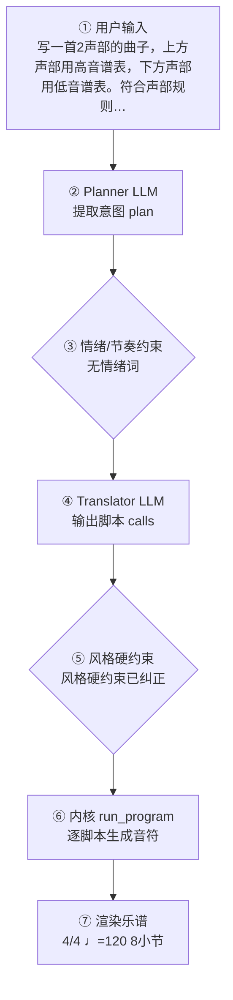

# 作曲生产报告：二声部对位（程序员版）

> 面向产品/工程：记录本次生成的完整生产链路与系统状态，用于核对「说得 vs 写得」、排查缺陷与回归测试；可整体喂回大模型进一步定位具体小节/声部的问题。谱面检查与编辑者版一致，编辑者版见：`d4d226b578_report.md`。

## 1. 会话与生成环境

- 生成时间: 2026-10-01T18:17:27
- 生成路径: two_part_species（确定性第一类对位，未调 LLM）
- 命中技能: compose-full
- 用户原始输入: 写一首2声部的曲子，上方声部用高音谱表，下方声部用低音谱表。符合声部规则，要求低音线条以级进为主跳进为辅。1小节一个音符。除了开头和结尾，中间只能用3度和6度，结尾最后一个音符反向进行到8度。高音声部和低音声部最高的音要错开——在不同的小节…
- 原始数据: `session.compose_trace`（本报告第 4 节即其展开，确定性可复现）

## 2. 谱面事实（与编辑者版「基本信息」一致）

- 调性: C 大调（0 个升号）
- 拍号: 4/4
- 速度: 四分音符 = 120 BPM
- 调内音级: C, D, E, F, G, A, B
- 声部 1: Piano，高音谱号，8 小节
- 声部 2: Piano，低音谱号，8 小节

## 3. 自动检查结果（与编辑者版「第 3 节」一致）

（无）当前自动检查未发现需要关注的问题。

> 说明：众赞歌/钢琴四部叠写检查全部逻辑声部对的平行五八度；管弦织体仅查外声部平行五度（八度加强不报）。相邻声部交叉为提示项。 共检查 23 项（✅ 23 / ⚠️ 0 / ❌ 0）。

## 4. 作曲过程透明化（可追溯）

> 本节约等于把「需求 → 大模型 → 脚本 → 谱面」的完整链路展开，便于核对「说得 vs 写得」是否一致。数据来自本次生成的 `session.compose_trace`，确定性可复现。把本报告整体喂回大模型，可进一步定位具体小节/声部的问题与修正建议。

### 4.1 流程图（本次实际链路）



（文字版流程图，便于无 Mermaid 渲染环境阅读）

```
用户输入
  → [② Planner LLM] 提取意图 plan
  → [③ 情绪/节奏约束] 命中=否
  → [④ Translator LLM] 输出 calls + reasoning
  → [⑤ 风格硬约束] 触发=是
  → [⑥ 内核 run_program] 逐脚本执行
  → [⑦ 渲染谱面] 4/4 ♩=120 8小节
```

### 4.2 大模型输入输出（LLM I/O）

（本次为确定性生成，未调用大模型——见 4.3 / 4.5 说明）

### 4.3 脚本调用与输入输出

（本次路径未经过确定性脚本内核：`two_part_species（确定性第一类对位，未调 LLM）`—— 该路径由 LLM 直接产出乐谱或纯确定性生成，无逐脚本记录）

### 4.4 本地强制约束（确定性兜底，优先级高于 LLM）

- 情绪/节奏约束：未触发（用户未给情绪/速度词，或已被风格基线覆盖）
- 风格/速度强制纠正：二声部对位：编制强制钢琴大谱表 RH/LH
- 风格/速度强制纠正：1 小节 1 音 · 中间仅 3/6 度 · 禁纯四 · 结尾反向八度 · 最高音错开
- **风格契约施加的约束**：无（该风格包没有 `style_contract.yaml`，或契约证据量不足、和声分区未生效）
### 4.5 自动问题定位（可疑点 + 程度）

| 检查项 | 程度 | 说明 |
|---|---|---|
| 情绪约束 | 🟢 未触发 | 用户未给情绪/速度词 |
| 意图拍号↔谱面 | 🟢 一致 | 最终拍号 4/4 |
| 计划小节↔实际小节 | 🟢 一致 | 8 小节 |
| 风格规范遵循 | 🟡 注意 | LLM 偏离 genre 规范，已强制纠正 2 处（说明模型未严格遵循风格包） |

> 说明：上表为程序自动比对「意图 ↔ 谱面」的初判（🔴 严重 / 🟡 注意 / 🟢 一致）。将本报告整体喂给大模型，可进一步定位具体小节/声部的问题与修正建议。

## 5. 记谱与演奏法

可演奏性：✅ 无音域/大跳/跨度/密度问题

## 生成质量评估

- **风格重叠率**：N/A（未指定目标包）
- **属性遵循度**：1.00（0 项）
- **包级最近邻**：swing-standard（相似度 0.49）— ✅ 无抄袭嫌疑
