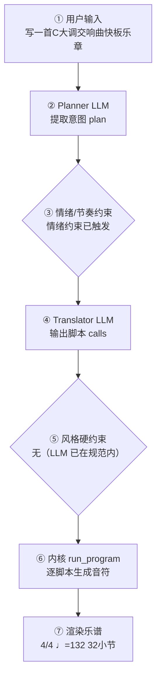

# 作曲生产报告：早春交响快板（程序员版）

> 面向产品/工程：记录本次生成的完整生产链路与系统状态，用于核对「说得 vs 写得」、排查缺陷与回归测试；可整体喂回大模型进一步定位具体小节/声部的问题。谱面检查与编辑者版一致，编辑者版见：`e5c02aa825_report.md`。

## 1. 会话与生成环境

- 生成时间: 2026-09-28T21:51:54
- 生成路径: translator（LLM 翻译 + 确定性内核）
- 命中技能: compose-full, genre:classical/symphony
- 用户原始输入: 写一首C大调交响曲快板乐章
- 原始数据: `session.compose_trace`（本报告第 4 节即其展开，确定性可复现）

## 2. 谱面事实（与编辑者版「基本信息」一致）

- 调性: C 大调（0 个升号）
- 转调: 第 11 小节 → G 大调；第 16 小节 → A 小调
- 拍号: 4/4
- 速度: 四分音符 = 92 BPM
- 段落速度: 第 5 小节 Allegro（♩=112）；第 11 小节 Allegro（♩=120）；第 16 小节 Agitato（♩=126）；第 24 小节 Tempo I（♩=112）；第 29 小节 Maestoso（♩=100）
- 调内音级: C, D, E, F, G, A, B
- 声部 1: 小提琴 (Violin)，高音谱号，32 小节
- 声部 2: 小提琴 (Violin)，高音谱号，32 小节
- 声部 3: 长笛 (Flute)，高音谱号，32 小节
- 声部 4: 双簧管 (Oboe)，高音谱号，32 小节
- 声部 5: Clarinet，高音谱号，32 小节
- 声部 6: 中提琴 (Viola)，ALTO，32 小节
- 声部 7: 圆号 (Horn)，高音谱号，32 小节
- 声部 8: 小号 (Trumpet)，高音谱号，32 小节
- 声部 9: 大提琴 (Cello)，低音谱号，32 小节
- 声部 10: Bassoon，低音谱号，32 小节
- 声部 11: 定音鼓 (Timpani)，低音谱号，32 小节
- 声部 12: Contrabass，低音谱号，32 小节

## 3. 自动检查结果（与编辑者版「第 3 节」一致）

| 检查类别 | 状态 | 描述 |
|---|---|---|
| 调号一致性 | ⚠️ 注意 | A 小调 段出现变化音 Eb, Bb（转调段调外音/经过音） |
| 声部交叉 | ⚠️ 注意 | 纵向上方声部 8（小号 (Trumpet)）与下方声部 5（Clarinet）在第 0.0 拍交叉：C5 低于 E5（同类交叉共 160 处，此处为第 1 例） |
| 声部交叉 | ⚠️ 注意 | 纵向上方声部 6（中提琴 (Viola)）与下方声部 9（大提琴 (Cello)）在第 107.0 拍交叉：E4 低于 G4（同类交叉共 2 处，此处为第 1 例） |
| 声部交叉 | ⚠️ 注意 | 纵向上方声部 9（大提琴 (Cello)）与下方声部 7（圆号 (Horn)）在第 0.0 拍交叉：C3 低于 C4（同类交叉共 103 处，此处为第 1 例） |

> 说明：平行五/八度仅检查最高与最低外声部；相邻声部交叉为提示项。 共检查 406 项（✅ 402 / ⚠️ 4 / ❌ 0）。

## 4. 作曲过程透明化（可追溯）

> 本节约等于把「需求 → 大模型 → 脚本 → 谱面」的完整链路展开，便于核对「说得 vs 写得」是否一致。数据来自本次生成的 `session.compose_trace`，确定性可复现。把本报告整体喂回大模型，可进一步定位具体小节/声部的问题与修正建议。

### 4.1 流程图（本次实际链路）



（文字版流程图，便于无 Mermaid 渲染环境阅读）

```
用户输入
  → [② Planner LLM] 提取意图 plan
  → [③ 情绪/节奏约束] 命中=是
  → [④ Translator LLM] 输出 calls + reasoning
  → [⑤ 风格硬约束] 触发=否
  → [⑥ 内核 run_program] 逐脚本执行
  → [⑦ 渲染谱面] 4/4 ♩=132 32小节
```

### 4.2 大模型输入输出（LLM I/O）

#### Planner（意图解析）

- **系统提示**（固定指令模板，已截断）：

```
You are a professional composer and music theorist acting as an Intent Parser.

Transform the user's natural-language request (and optional slash-commands already applied as preferences) into a Composition Plan JSON only.

Think like a composer first: infer genre, mood, form, motif character, harmony language, climax — do NOT invent note lists yet.

A **风格目录（仅已学包）** is injected at the end of this system prompt. Use it to set `genre_id`.

Output ONE JSON object, no Markdown:
{
  "title": "string",
  "genre": "string (human label, e.g. 摇摆标准曲（爵士）)",
  "genre_id": "family/pack_id from 风格目录, e.g. jazz/swing-standard; empty if none",
  "mood": ["..."],
  "tempo": 72,
  "meter": "4/4",
  "key_sharps": 0,
  "mode": "major|minor",
  "instrumentation": ["trumpet","piano","contrabass"] (kernel English names; map fiddle→violin, double bass→contrabass, tin whistle→flute; avoid unknown names),
  "form": ["A","B","A"],
  "bars": 16,
  "motif": {"character": "...", "development": ["repetition","sequence"]},
  "harmony": {"language": "...", "density": "sparse|moderate|dense"},
  "rhythm": {"character": "..."},
  "texture": "homophonic|polyphonic|sparse|orchestral",
  "climax": {"location": "section B", "dynamic": "f"},
  "difficulty": "easy|medium",
  "summary": "one sentence for the user",
  "edit_intent": null
}
Rules:
- Original music only; no copyrighted melodies.
- If user is vague, choose
…（已截断，完整 6759 字；固定指令模板见 skills/composition/base/ 与内核 kernel_docs）
```

- **用户输入**（喂给模型的结构化上下文）：

```json
{
  "user_request": "【作品】为完整交响乐团而作的单乐章交响曲快板《早春交响快板》，C 大调\n（key_sharps=0, mode=major），4/4，共 32 小节，\n奏鸣曲式：引子—主部—副部—展开—再现—尾声（舒伯特早期明朗气质）。\n\n【编制】交响乐团（缩编双管 + 定音鼓 + 弦乐组）；\n**主旋律由第一小提琴承担**（new_score 声部0必须是 violin）；\n木管只做长音衬托，铜管做支撑长音，勿让全体木管/弦乐写满八分音抢戏。\n旋律音区最高 high，不要 very_high。\n\n【速度】引子 ♩=88 → 主部 ♩=112 → 副部 ♩=120 → 展开 ♩=126 → 再现 ♩=112 → 尾声 ♩=100。\n六段小节数之和必须等于 32。\n\n【旋律总则】六段 rhythm/contour 逐段不同；不要赋格；narrative(appearances=false)；\n展开可转关系小调；再现换节奏勿原样照搬主部。\nnew_score 须带 style=classical/symphony。\n\n【第 1 段 · 引子】4 小节 · Andante ♩=88 · p · 主调。伴奏 sustained；旋律 sparse。\n【第 2 段 · 主部】6 小节 · Allegro ♩=112 · f · 主调。driving+arch，I–vi–IV–V7。\n【第 3 段 · 副部】5 小节 · Allegro ♩=120 · mf · 属调。flowing+arch，分解和弦。\n【第 4 段 · 展开】8 小节 · Agitato ♩=126 · ff · 关系小调。fragmented+wave。\n【第 5 段 · 再现】5 小节 · Tempo I ♩=112 · f · 主调。flowing+descending。\n【第 6 段 · 尾声】4 小节 · Maestoso ♩=100 · ff · 主调。driving 推进后 cadence(2)。\n\n【不要】不要赋格，不要卡农，不要整曲 sparse，不要木管写密集跑动盖过小提琴。",
  "preferences": {
    "key_sharps": 0,
    "mode": "major",
    "tempo": 120,
    "bars": 8,
    "meter": "4/4",
    "style": "交响曲",
    "genre_id": "genre:classical/symphony",
    "instrumentation": "",
    "fugue": "auto",
    "voices": 0,
    "_explicit": {}
  },
  "edit_intent": null,
  "skills": [
    "compose-full",
    "genre:classical/symphony"
  ],
  "existing_plan": null,
  "revision_edits": null,
  "existing_score_summary": null
}
```

- **模型返回（原始）**：

```json
{
  "title": "早春交响快板",
  "genre": "交响曲乐章（古典）",
  "genre_id": "classical/symphony",
  "mood": [
    "明朗",
    "朝气",
    "戏剧性",
    "舒伯特式清新"
  ],
  "tempo": 112,
  "meter": "4/4",
  "key_sharps": 0,
  "mode": "major",
  "instrumentation": [
    "flute",
    "oboe",
    "clarinet",
    "bassoon",
    "horn",
    "trumpet",
    "timpani",
    "violin",
    "viola",
    "cello",
    "contrabass"
  ],
  "form": [
    "Introduction",
    "Exposition-Theme1",
    "Exposition-Theme2",
    "Development",
    "Recapitulation",
    "Coda"
  ],
  "bars": 32,
  "motif": {
    "character": "短促上行的三音细胞，带附点推动感，明朗而富弹性",
    "development": [
      "repetition",
      "sequence",
      "fragmentation",
      "rhythmic change",
      "tonal shift"
    ]
  },
  "harmony": {
    "language": "功能性和声，I–vi–IV–V7 为核心进行；展开部转向关系小调并以四五度移位",
    "density": "moderate"
  },
  "rhythm": {
    "character": "六段节奏性格逐段不同：引子 sustained、主部 driving、副部 flowing、展开 fragmented、再现 flowing/descending、尾声 driving 后收束"
  },
  "texture": "orchestral",
  "climax": {
    "location": "Development（第 4 段，8 小节）",
    "dynamic": "ff"
  },
  "difficulty": "medium",
  "summary": "为完整交响乐团而作的 C 大调单乐章奏鸣曲式快板，六段速度与节奏性格逐段变化，主旋律由第一小提琴承担，展开部转入关系小调推向高潮。",
  "edit_intent": null
}
```

#### Translator（脚本翻译）

- **系统提示**（固定指令模板，已截断）：

````
# 翻译器（Translator）

你不是作曲家，是**翻译器**：把用户的自然语言音乐需求与 plan 翻译成
对确定性脚本的调用序列。你**不写任何音符**——所有音符由脚本生成并保证
正确（时值、调性、织体、力度、终止）。你的职责是选对脚本、给对参数。

## 输出格式（只输出 JSON，不要任何解释文字）

```
{"reasoning": "用中文简述你如何把需求翻译成参数与脚本（2–5 句）：识别了什么风格/情绪，怎么决定速度/调式/织体，段落如何安排，调用了哪些脚本。", "calls": [{"script": "脚本名", "args": {...}}, ...]}
```

## 硬规则

1. 调用顺序：`new_score` → `set_sections` → 对每个段落 `{ set_harmony →
   accompaniment → melody }` →（高潮段可加 `thicken`）→（最后一段可加
   `cadence`）→（**可选** `narrative(...)`：仅当你需要关掉自动叙事层的
   动机变形/惊喜和弦时，见下「叙事层」）→ `finalize`
2. `new_score` 与 `finalize` 必须各恰好一次，且分别在最前/最后
3. **每个段落**都必须调用 set_harmony / accompaniment / melody，
   一次都不许漏（漏了 finalize 会报错）
4. args 必须严格符合脚本文档的字段名与取值范围；不要发明不存在的参数
5. 脚本执行失败时你会收到错误信息——修正 calls 后完整重新输出
6. `plan.tempo` / `plan.mode` / `plan.mood` / `plan.tempo_text` /
   `plan._emotion_hint` 是已解析的**明确约束**（来自用户情绪/速度词或
   `/tempo`），**优先级最高**——调用 `new_score` / `set_harmony` / `melody`
   时直接采用，不要用风格基线默认值覆盖。`reasoning` 字段必须如实写出你
   如何据此翻译，便于用户核查。
7. **乐器编制**：brief 提到管弦乐/弦乐/铜管/木管/具体乐器（小提琴、长笛、
   圆号、定音鼓…）或某种编制（弦乐四重奏、铜管五重奏…）时，`new_score`
   **必须传 `instruments`**（长度=voices，从高音到低音，低音乐器放最后），
   可用名：flute/oboe/**piccolo**/clarinet/bassoon/horn/trumpet/trombone/
   tuba/violin/viola/cello/contrabass/timpani/**harp**/piano/soprano/alto/
   tenor/bass。例：「弦乐四重奏」→ voices=4 +
   `["violin","violin","viola","cello"]`；「管弦乐小品」→ voices=4 +
   `["flute","violin","cello","timpani"]` 之类按 brief
…（已截断，完整 20697 字；固定指令模板见 skills/composition/base/ 与内核 kernel_docs）
````

- **用户输入**（喂给模型的结构化上下文）：

```json
{
  "plan": {
    "title": "早春交响快板",
    "genre": "交响曲乐章",
    "mood": [
      "明朗",
      "朝气",
      "戏剧性",
      "舒伯特式清新",
      "cheerful",
      "bright"
    ],
    "tempo": 132,
    "tempo_text": "Allegro",
    "meter": "4/4",
    "key_sharps": 0,
    "mode": "major",
    "_emotion_hint": {
      "group": "fast",
      "matched": [
        "快板",
        "明朗"
      ],
      "bpm": 132,
      "tempo_text": "Allegro",
      "mode_bias": "major",
      "rhythm": "flowing",
      "dynamics": "f",
      "contour": "arch"
    },
    "instrumentation": [
      "flute",
      "oboe",
      "clarinet",
      "bassoon",
      "horn",
      "trumpet",
      "timpani",
      "violin",
      "viola",
      "cello",
      "contrabass"
    ],
    "form": [
      "Introduction",
      "Exposition-Theme1",
      "Exposition-Theme2",
      "Development",
      "Recapitulation",
      "Coda"
    ],
    "bars": 32,
    "motif": {
      "character": "短促上行的三音细胞，带附点推动感，明朗而富弹性",
      "development": [
        "repetition",
        "sequence",
        "fragmentation",
        "rhythmic change",
        "tonal shift"
      ]
    },
    "harmony": {
      "language": "功能性和声，I–vi–IV–V7 为核心进行；展开部转向关系小调并以四五度移位",
      "density": "moderate"
    },
    "rhythm": {
      "character": "六段节奏性格逐段不同：引子 sustained、主部 driving、副部 flowing、展开 fragmented、再现 flowing/descending、尾声 driving 后收束"
    },
    "texture": "orchestral",
    "climax": {
      "location": "Development（第 4 段，8 小节）",
      "dynamic": "ff"
    },
    "summary": "为完整交响乐团而作的 C 大调单乐章奏鸣曲式快板，六段速度与节奏性格逐段变化，主旋律由第一小提琴承担，展开部转入关系小调推向高潮。"
  },
  "user_brief": "【作品】为完整交响乐团而作的单乐章交响曲快板《早春交响快板》，C 大调\n（key_sharps=0, mode=major），4/4，共 32 小节，\n奏鸣曲式：引子—主部—副部—展开—再现—尾声（舒伯特早期明朗气质）。\n\n【编制】交响乐团（缩编双管 + 定音鼓 + 弦乐组）；\n**主旋律由第一小提琴承担**（new_score 声部0必须是 violin）；\n木管只做长音衬托，铜管做支撑长音，勿让全体木管/弦乐写满八分音抢戏。\n旋律音区最高 high，不要 very_high。\n\n【速度】引子 ♩=88 → 主部 ♩=112 → 副部 ♩=120 → 展开 ♩=126 → 再现 ♩=112 → 尾声 ♩=100。\n六段小节数之和必须等于 32。\n\n【旋律总则】六段 rhythm/contour 逐段不同；不要赋格；narrative(appearances=false)；\n展开可转关系小调；再现换节奏勿原样照搬主部。\nnew_score 须带 style=classical/symphony。\n\n【第 1 段 · 引子】4 小节 · Andante ♩=88 · p · 主调。伴奏 sustained；旋律 sparse。\n【第 2 段 · 主部】6 小节 · Allegro ♩=112 · f · 主调。driving+arch，I–vi–IV–V7。\n【第 3 段 · 副部】5 小节 · Allegro ♩=120 · mf · 属调。flowing+arch，分解和弦。\n【第 4 段 · 展开】8 小节 · Agitato ♩=126 · ff · 关系小调。fragmented+wave。\n【第 5 段 · 再现】5 小节 · Tempo I ♩=112 · f · 主调。flowing+descending。\n【第 6 段 · 尾声】4 小节 · Maestoso ♩=100 · ff · 主调。driving 推进后 cadence(2)。\n\n【不要】不要赋格，不要卡农，不要整曲 sparse，不要木管写密集跑动盖过小提琴。 交响曲"
}
```

- **模型返回（原始）**：

```json
{
  "reasoning": "用户要求为完整交响乐团创作C大调单乐章奏鸣曲式快板，速度132（Allegro），4/4拍，32小节，六段结构。根据plan，基调为classical/symphony，主旋律由第一小提琴承担，编制为缩编双管+定音鼓+弦乐组。我将按段落安排：引子4小节(Andante 88, p, sustained+sparse)、主部6小节(Allegro 112, f, driving+arch, I-vi-IV-V7)、副部5小节(Allegro 120, mf, 属调G大调, flowing+arch, broken_arpeggio)、展开8小节(Agitato 126, ff, 关系小调A小调, fragmented+wave, 高潮+thicken)、再现5小节(Tempo I 112, f, 主调, flowing+descending)、尾声4小节(Maestoso 100, ff, driving后cadence(2))。调用new_score时传入instruments和solo_instrument='violin'，并设置style=classical/symphony。每段依次调用set_harmony、accompaniment、melody，展开段加thicken，尾声加cadence，最后调用narrative(appearances=false)关闭动机变形，再finalize。",
  "calls": [
    {
      "script": "new_score",
      "args": {
        "title": "早春交响快板",
        "key_sharps": 0,
        "mode": "major",
        "meter": "4/4",
        "tempo": 132,
        "bars": 32,
        "voices": 11,
        "instruments": [
          "violin",
          "violin",
          "viola",
          "cello",
          "contrabass",
          "flute",
          "oboe",
          "clarinet",
          "bassoon",
          "horn",
          "trumpet"
        ],
        "solo_instrument": "violin",
        "style": "classical/symphony"
      }
    },
    {
      "script": "set_sections",
      "args": {
        "sections": [
          {
            "name": "Introduction",
            "bars": 4,
            "meter": "4/4",
            "dynamic": "p",
            "tempo_text": "Andante",
            "bpm": 88
          },
          {
            "name": "Exposition-Theme1",
            "bars": 6,
            "meter": "4/4",
            "dynamic": "f",
            "tempo_text": "Allegro",
            "bpm": 112
          },
          {
            "name": "Exposition-Theme2",
            "bars": 5,
            "meter": "4/4",
            "dynamic": "mf",
            "tempo_text": "Allegro",
            "bpm": 120
          },
          {
            "name": "Development",
            "bars": 8,
            "meter": "4/4",
            "dynamic": "ff",
            "tempo_text": "Agitato",
            "bpm": 126
          },
          {
            "name": "Recapitulation",
            "bars": 5,
            "meter": "4/4",
            "dynamic": "f",
            "tempo_text": "Tempo I",
            "bpm": 112
          },
          {
            "name": "Coda",
            "bars": 4,
            "meter": "4/4",
            "dynamic": "ff",
            "tempo_text": "Maestoso",
            "bpm": 100
          }
        ]
      }
    },
    {
      "script": "set_harmony",
      "args": {
        "section": "Introduction",
        "progression": [
          "I",
          "IV",
          "V7",
          "I"
        ]
      }
    },
    {
      "script": "accompaniment",
      "args": {
        "section": "Introduction",
        "pattern": "sustained",
        "register": "low",
        "density": 1
      }
    },
    {
      "script": "melody",
      "args": {
        "section": "Introduction",
        "register": "mid",
        "rhythm": "sparse",
        "contour": "arch"
      }
    },
    {
      "script": "set_harmony",
      "args": {
        "section": "Exposition-Theme1",
        "progression": [
          "I",
          "vi",
          "IV",
          "V7"
        ]
      }
    },
    {
      "script": "accompaniment",
      "args": {
        "section": "Exposition-Theme1",
        "pattern": "broken_arpeggio",
        "register": "low",
        "density": 1
      }
    },
    {
      "script": "melody",
      "args": {
        "section": "Exposition-Theme1",
        "register": "high",
        "rhythm": "driving",
        "contour": "arch"
      }
    },
    {
      "script": "set_harmony",
      "args": {
        "section": "Exposition-Theme2",
        "progression": [
          "V",
          "ii",
          "V7",
          "I"
        ],
        "key_sharps": 1,
        "mode": "major"
      }
    },
    {
      "script": "accompaniment",
      "args": {
        "section": "Exposition-Theme2",
        "pattern": "broken_arpeggio",
        "register": "low",
        "density": 1
      }
    },
    {
      "script": "melody",
      "args": {
        "section": "Exposition-Theme2",
        "register": "high",
        "rhythm": "flowing",
        "contour": "arch"
      }
    },
    {
      "script": "set_harmony",
      "args": {
        "section": "Development",
        "progression": [
          "i",
          "iv",
          "V7",
          "i"
        ],
        "key_sharps": 0,
        "mode": "minor"
      }
    },
    {
      "script": "accompaniment",
      "args": {
        "section": "Development",
        "pattern": "octave_pulse",
        "register": "low",
        "density": 1
      }
    },
    {
      "script": "melody",
      "args": {
        "section": "Development",
        "register": "high",
        "rhythm": "fragmented",
        "contour": "wave"
      }
    },
    {
      "script": "thicken",
      "args": {
        "section": "Development"
      }
    },
    {
      "script": "set_harmony",
      "args": {
        "section": "Recapitulation",
        "progression": [
          "I",
          "IV",
          "V7",
          "I"
        ]
      }
    },
    {
      "script": "accompaniment",
      "args": {
        "section": "Recapitulation",
        "pattern": "broken_arpeggio",
        "register": "low",
        "density": 1
      }
    },
    {
      "script": "melody",
      "args": {
        "section": "Recapitulation",
        "register": "high",
        "rhythm": "flowing",
        "contour": "descending"
      }
    },
    {
      "script": "set_harmony",
      "args": {
        "section": "Coda",
        "progression": [
          "IV",
          "I",
          "ii",
          "V7"
        ]
      }
    },
    {
      "script": "accompaniment",
      "args": {
        "section": "Coda",
        "pattern": "block_chords",
        "register": "low",
        "density": 1
      }
    },
    {
      "script": "melody",
      "args": {
        "section": "Coda",
        "register": "high",
        "rhythm": "driving",
        "contour": "ascending"
      }
    },
    {
      "script": "cadence",
      "args": {
        "bars": 2,
        "section": "Coda"
      }
    },
    {
      "script": "narrative",
      "args": {
        "appearances": false
      }
    },
    {
      "script": "finalize",
      "args": {}
    }
  ]
}
```

### 4.3 脚本调用与输入输出

| # | 脚本 | 输入(args) | 输出（新增音符 / 状态变更） |
|---|---|---|---|
| 1 | new_score | title=早春交响快板，key_sharps=0，mode=major，meter=4/4，tempo=132，bars=32，voices=12，instruments=["violin", "violin", "flute", "oboe", "clarinet", "viola", "horn", "trumpet", "cello", "bassoon", "timpani", "contrabass"]，solo_instrument=violin，style=classical/symphony | 建立乐曲：4/4 ♩=132 12声部 major；新增 — |
| 2 | set_sections | sections=[{"name": "Introduction", "bars": 4, "meter": "4/4", "dynamic": "p", "tempo_text": "Andante", "bpm": 88}, {"name": "Exposition-Theme1", "bars": 6, "meter": "4/4", "dynamic": "f", "tempo_text": "Allegro", "bpm": 112}, {"name": "Exposition-Theme2", "bars": 5, "meter": "4/4", "dynamic": "mf", "tempo_text": "Allegro", "bpm": 120}, {"name": "Development", "bars": 8, "meter": "4/4", "dynamic": "ff", "tempo_text": "Agitato", "bpm": 126}, {"name": "Recapitulation", "bars": 5, "meter": "4/4", "dynamic": "f", "tempo_text": "Tempo I", "bpm": 112}, {"name": "Coda", "bars": 4, "meter": "4/4", "dynamic": "ff", "tempo_text": "Maestoso", "bpm": 100}] | 分段：Introduction(4小节)，Exposition-Theme1(6小节)，Exposition-Theme2(5小节)，Development(8小节)，Recapitulation(5小节)，Coda(4小节)；新增 — |
| 3 | set_harmony | section=Introduction，progression=["I", "IV", "V7", "I"] | 和声：段落Introduction 进行['I', 'IV', 'V7', 'I']；新增 — |
| 4 | accompaniment | section=Introduction，pattern=sustained，register=low，density=1 | 伴奏：段落Introduction pattern=sustained register=low density=1；新增 声部2:+32，声部3:+4，声部4:+4，声部5:+4，声部6:+12，声部7:+8，声部8:+8，声部9:+16，声部10:+4，声部11:+16，声部12:+8 |
| 5 | melody | section=Introduction，register=mid，rhythm=sparse，contour=arch | 旋律：段落Introduction rhythm=sparse；新增 声部1:+9 |
| 6 | set_harmony | section=Exposition-Theme1，progression=["I", "vi", "IV", "V7"] | 和声：段落Exposition-Theme1 进行['I', 'vi', 'IV', 'V7']；新增 — |
| 7 | accompaniment | section=Exposition-Theme1，pattern=broken_arpeggio，register=low，density=1 | 伴奏：段落Exposition-Theme1 pattern=broken_arpeggio register=low density=1；新增 声部2:+48，声部3:+6，声部4:+6，声部5:+6，声部6:+18，声部7:+12，声部8:+12，声部9:+24，声部10:+6，声部11:+24，声部12:+24 |
| 8 | melody | section=Exposition-Theme1，register=high，rhythm=driving，contour=arch | 旋律：段落Exposition-Theme1 rhythm=driving；新增 声部1:+30 |
| 9 | set_harmony | section=Exposition-Theme2，progression=["V", "ii", "V7", "I"]，key_sharps=1，mode=major | 和声：段落Exposition-Theme2 进行['V', 'ii', 'V7', 'I']；新增 — |
| 10 | accompaniment | section=Exposition-Theme2，pattern=broken_arpeggio，register=low，density=1 | 伴奏：段落Exposition-Theme2 pattern=broken_arpeggio register=low density=1；新增 声部2:+40，声部3:+5，声部4:+5，声部5:+5，声部6:+15，声部7:+10，声部8:+10，声部9:+20，声部10:+5，声部11:+20，声部12:+20 |
| 11 | melody | section=Exposition-Theme2，register=high，rhythm=flowing，contour=arch | 旋律：段落Exposition-Theme2 rhythm=flowing；新增 声部1:+23 |
| 12 | set_harmony | section=Development，progression=["i", "iv", "V7", "i"]，key_sharps=0，mode=minor | 和声：段落Development 进行['i', 'iv', 'V7', 'i']；新增 — |
| 13 | accompaniment | section=Development，pattern=octave_pulse，register=low，density=1 | 伴奏：段落Development pattern=octave_pulse register=low density=1；新增 声部2:+64，声部3:+8，声部4:+8，声部5:+8，声部6:+24，声部7:+16，声部8:+16，声部9:+32，声部10:+8，声部11:+32，声部12:+32 |
| 14 | melody | section=Development，register=high，rhythm=fragmented，contour=wave | 旋律：段落Development rhythm=fragmented；新增 声部1:+45 |
| 15 | thicken | section=Development | 加厚：段落Development；新增 — |
| 16 | set_harmony | section=Recapitulation，progression=["I", "IV", "V7", "I"] | 和声：段落Recapitulation 进行['I', 'IV', 'V7', 'I']；新增 — |
| 17 | accompaniment | section=Recapitulation，pattern=broken_arpeggio，register=low，density=1 | 伴奏：段落Recapitulation pattern=broken_arpeggio register=low density=1；新增 声部2:+40，声部3:+5，声部4:+5，声部5:+5，声部6:+15，声部7:+10，声部8:+10，声部9:+20，声部10:+5，声部11:+20，声部12:+20 |
| 18 | melody | section=Recapitulation，register=high，rhythm=flowing，contour=descending | 旋律：段落Recapitulation rhythm=flowing；新增 声部1:+23 |
| 19 | set_harmony | section=Coda，progression=["IV", "I", "ii", "V7"] | 和声：段落Coda 进行['IV', 'I', 'ii', 'V7']；新增 — |
| 20 | accompaniment | section=Coda，pattern=block_chords，register=low，density=1 | 伴奏：段落Coda pattern=block_chords register=low density=1；新增 声部2:+32，声部3:+4，声部4:+4，声部5:+4，声部6:+12，声部7:+8，声部8:+8，声部9:+16，声部10:+4，声部11:+16，声部12:+8 |
| 21 | melody | section=Coda，register=high，rhythm=driving，contour=ascending | 旋律：段落Coda rhythm=driving；新增 声部1:+19 |
| 22 | cadence | bars=2，section=Coda | 终止：bars=2；新增 — |
| 23 | narrative | appearances=False | narrative；新增 — |
| 24 | finalize |  | 收束装配：32小节 / 12声部；新增 — |

<details><summary>逐脚本新增音符样例（前 8 个 / 声部）</summary>

- **new_score**：声部1: —；声部2: —；声部3: —；声部4: —；声部5: —；声部6: —；声部7: —；声部8: —；声部9: —；声部10: —；声部11: —；声部12: —
- **set_sections**：声部1: —；声部2: —；声部3: —；声部4: —；声部5: —；声部6: —；声部7: —；声部8: —；声部9: —；声部10: —；声部11: —；声部12: —
- **set_harmony**：声部1: —；声部2: —；声部3: —；声部4: —；声部5: —；声部6: —；声部7: —；声部8: —；声部9: —；声部10: —；声部11: —；声部12: —
- **accompaniment**：声部1: —；声部2: E5:eighth, C5:eighth, G5:eighth, E5:eighth, C5:eighth, G5:eighth, E5:eighth, C5:eighth；声部3: E5:whole, A5:whole, B5:whole, E5:whole；声部4: E5:whole, A4:whole, B4:whole, E5:whole；声部5: E5:whole, A4:whole, B4:whole, E5:whole；声部6: None:half, C4:quarter, E4:quarter, None:half, F4:quarter, A4:quarter, None:half, G4:quarter；声部7: C4:half, C4:half, F3:half, F3:half, G3:half, G3:half, C4:half, C4:half；声部8: C5:half, C5:half, F5:half, F5:half, G4:half, G4:half, C5:half, C5:half；声部9: C3:quarter, G3:quarter, C3:quarter, G3:quarter, F3:quarter, C3:quarter, F3:quarter, C3:quarter；声部10: E3:whole, A3:whole, B2:whole, E3:whole；声部11: C3:quarter, None:quarter, C3:quarter, None:quarter, F3:quarter, None:quarter, F3:quarter, None:quarter；声部12: C2:half, G2:half, F2:half, C2:half, G2:half, D2:half, C2:half, G2:half
- **melody**：声部1: C5:quarter, G4:half, B4:quarter, C5:quarter, A4:quarter, B4:half, D5:half, F5:half；声部2: —；声部3: —；声部4: —；声部5: —；声部6: —；声部7: —；声部8: —；声部9: —；声部10: —；声部11: —；声部12: —
- **set_harmony**：声部1: —；声部2: —；声部3: —；声部4: —；声部5: —；声部6: —；声部7: —；声部8: —；声部9: —；声部10: —；声部11: —；声部12: —
- **accompaniment**：声部1: —；声部2: E5:eighth, C5:eighth, G5:eighth, E5:eighth, C5:eighth, G5:eighth, E5:eighth, C5:eighth；声部3: E5:whole, C5:whole, A5:whole, B5:whole, E5:whole, C5:whole；声部4: E5:whole, C5:whole, A4:whole, B4:whole, E5:whole, C5:whole；声部5: E5:whole, C5:whole, A4:whole, B4:whole, E5:whole, C5:whole；声部6: None:half, C4:quarter, E4:quarter, None:half, A4:quarter, C4:quarter, None:half, F4:quarter；声部7: C4:half, C4:half, A3:half, A3:half, F3:half, F3:half, G3:half, G3:half；声部8: C5:half, C5:half, A4:half, A4:half, F5:half, F5:half, G4:half, G4:half；声部9: C3:quarter, G3:quarter, C3:quarter, G3:quarter, A3:quarter, E3:quarter, A3:quarter, E3:quarter；声部10: E3:whole, C3:whole, A3:whole, B2:whole, E3:whole, C3:whole；声部11: C3:quarter, None:quarter, C4:quarter, None:quarter, A2:quarter, None:quarter, A2:quarter, None:quarter；声部12: C2:quarter, E3:quarter, G3:quarter, C2:quarter, A2:quarter, C3:quarter, E3:quarter, A2:quarter
- **melody**：声部1: C6:eighth, B5:eighth, A5:eighth, G5:eighth, G5:half, A5:quarter, C6:quarter, B5:quarter；声部2: —；声部3: —；声部4: —；声部5: —；声部6: —；声部7: —；声部8: —；声部9: —；声部10: —；声部11: —；声部12: —
- **set_harmony**：声部1: —；声部2: —；声部3: —；声部4: —；声部5: —；声部6: —；声部7: —；声部8: —；声部9: —；声部10: —；声部11: —；声部12: —
- **accompaniment**：声部1: —；声部2: F#5:eighth, D5:eighth, A5:eighth, F#5:eighth, D5:eighth, A5:eighth, F#5:eighth, D5:eighth；声部3: F#5:whole, C5:whole, F#5:whole, B5:whole, F#5:whole；声部4: F#5:whole, C5:whole, F#5:whole, B4:whole, F#5:whole；声部5: F#4:whole, C5:whole, F#4:whole, B4:whole, F#4:whole；声部6: None:half, D4:quarter, F#4:quarter, None:half, A4:quarter, C4:quarter, None:half, D4:quarter；声部7: D3:half, D3:half, A3:half, A3:half, D3:half, D3:half, G3:half, G3:half；声部8: D5:half, D5:half, A4:half, A4:half, D5:half, D5:half, G4:half, G4:half；声部9: D3:quarter, A3:quarter, D3:quarter, A3:quarter, A3:quarter, E3:quarter, A3:quarter, E3:quarter；声部10: F#3:whole, C3:whole, F#3:whole, B2:whole, F#3:whole；声部11: D3:quarter, None:quarter, D3:quarter, None:quarter, A2:quarter, None:quarter, A2:quarter, None:quarter；声部12: D2:quarter, F#3:quarter, A3:quarter, D2:quarter, A2:quarter, C3:quarter, E3:quarter, A2:quarter
- **melody**：声部1: F#5:quarter, E5:eighth, G5:eighth, A5:half, C6:quarter, B5:eighth, B5:eighth, A5:quarter；声部2: —；声部3: —；声部4: —；声部5: —；声部6: —；声部7: —；声部8: —；声部9: —；声部10: —；声部11: —；声部12: —
- **set_harmony**：声部1: —；声部2: —；声部3: —；声部4: —；声部5: —；声部6: —；声部7: —；声部8: —；声部9: —；声部10: —；声部11: —；声部12: —
- **accompaniment**：声部1: —；声部2: C5:eighth, A5:eighth, E5:eighth, C5:eighth, A5:eighth, E5:eighth, C5:eighth, A5:eighth；声部3: C5:whole, F5:whole, G#5:whole, C5:whole, C5:whole, F5:whole, G#5:whole, C5:whole；声部4: C5:whole, F5:whole, G#5:whole, C5:whole, C5:whole, F5:whole, G#5:whole, C5:whole；声部5: C5:whole, F5:whole, G#4:whole, C5:whole, C5:whole, F5:whole, G#4:whole, C5:whole；声部6: None:half, A4:quarter, C4:quarter, None:half, D4:quarter, F4:quarter, None:half, E4:quarter；声部7: A3:half, A3:half, D2:half, D3:half, E3:half, E3:half, A3:half, A3:half；声部8: A4:half, A4:half, D5:half, D5:half, E5:half, E5:half, A4:half, A4:half；声部9: A3:quarter, E3:quarter, A3:quarter, E3:quarter, D3:quarter, A3:quarter, D3:quarter, A3:quarter；声部10: C3:whole, F2:whole, G#3:whole, C3:whole, C3:whole, F2:whole, G#3:whole, C3:whole；声部11: A2:quarter, None:quarter, A2:quarter, None:quarter, D2:quarter, None:quarter, D3:quarter, None:quarter；声部12: A2+A3:quarter, A2+A3:quarter, A2+A3:quarter, A2+A3:quarter, D2+D3:quarter, D2+D3:quarter, D2+D3:quarter, D2+D3:quarter
- **melody**：声部1: A5:quarter, G5:eighth, F5:eighth, E5:quarter, G5:quarter, None:eighth, A5:quarter, B5:eighth；声部2: —；声部3: —；声部4: —；声部5: —；声部6: —；声部7: —；声部8: —；声部9: —；声部10: —；声部11: —；声部12: —
- **thicken**：声部1: —；声部2: —；声部3: —；声部4: —；声部5: —；声部6: —；声部7: —；声部8: —；声部9: —；声部10: —；声部11: —；声部12: —
- **set_harmony**：声部1: —；声部2: —；声部3: —；声部4: —；声部5: —；声部6: —；声部7: —；声部8: —；声部9: —；声部10: —；声部11: —；声部12: —
- **accompaniment**：声部1: —；声部2: E5:eighth, C5:eighth, G5:eighth, E5:eighth, C5:eighth, G5:eighth, E5:eighth, C5:eighth；声部3: E5:whole, A5:whole, B5:whole, E5:whole, E5:whole；声部4: E5:whole, A4:whole, B4:whole, E5:whole, E5:whole；声部5: E5:whole, A4:whole, B4:whole, E5:whole, E5:whole；声部6: None:half, C4:quarter, E4:quarter, None:half, F4:quarter, A4:quarter, None:half, G4:quarter；声部7: C4:half, C4:half, F3:half, F3:half, G3:half, G3:half, C4:half, C4:half；声部8: C5:half, C5:half, F5:half, F5:half, G4:half, G4:half, C5:half, C5:half；声部9: C3:quarter, G3:quarter, C3:quarter, G3:quarter, F3:quarter, C4:quarter, F3:quarter, C4:quarter；声部10: E3:whole, A3:whole, B2:whole, E3:whole, E3:whole；声部11: C3:quarter, None:quarter, C4:quarter, None:quarter, F3:quarter, None:quarter, F3:quarter, None:quarter；声部12: C2:quarter, E3:quarter, G3:quarter, C2:quarter, F2:quarter, A3:quarter, C3:quarter, Eb3:quarter
- **melody**：声部1: C6:quarter, D6:eighth, E6:eighth, E6:half, C6:half, A5:quarter, F5:quarter, B5:quarter；声部2: —；声部3: —；声部4: —；声部5: —；声部6: —；声部7: —；声部8: —；声部9: —；声部10: —；声部11: —；声部12: —
- **set_harmony**：声部1: —；声部2: —；声部3: —；声部4: —；声部5: —；声部6: —；声部7: —；声部8: —；声部9: —；声部10: —；声部11: —；声部12: —
- **accompaniment**：声部1: —；声部2: A4:eighth, F5:eighth, C5:eighth, Eb5:eighth, A4:eighth, F5:eighth, C5:eighth, Eb5:eighth；声部3: A5:whole, E5:whole, F5:whole, B5:whole；声部4: A4:whole, E5:whole, F5:whole, B4:whole；声部5: A4:whole, E5:whole, F5:whole, B4:whole；声部6: None:half, F4:quarter, A4:quarter, None:half, C4:quarter, E4:quarter, None:half, D4:quarter；声部7: F3:half, F3:half, C4:half, C4:half, D2:half, D3:half, G3:half, G3:half；声部8: F5:half, F5:half, C5:half, C5:half, D5:half, D5:half, G4:half, G4:half；声部9: F3:quarter, C3:quarter, F3:quarter, C3:quarter, C3:quarter, G3:quarter, C3:quarter, G3:quarter；声部10: A3:whole, E3:whole, F2:whole, B2:whole；声部11: F3:quarter, None:quarter, F3:quarter, None:quarter, C3:quarter, None:quarter, C3:quarter, None:quarter；声部12: F2+A3+C3+Eb3:half, F2+A3+C3+Eb3:half, C2+E3+G3:half, C2+E3+G3:half, D2+F3+A3:half, D2+F3+A3:half, G2+B3+D3+F3:half, G2+B3+D3+F3:half
- **melody**：声部1: F5:eighth, E5:eighth, Eb5:eighth, Eb5:eighth, E5:half, G5:quarter, F5:eighth, F5:eighth；声部2: —；声部3: —；声部4: —；声部5: —；声部6: —；声部7: —；声部8: —；声部9: —；声部10: —；声部11: —；声部12: —
- **cadence**：声部1: —；声部2: —；声部3: —；声部4: —；声部5: —；声部6: —；声部7: —；声部8: —；声部9: —；声部10: —；声部11: —；声部12: —
- **narrative**：声部1: —；声部2: —；声部3: —；声部4: —；声部5: —；声部6: —；声部7: —；声部8: —；声部9: —；声部10: —；声部11: —；声部12: —
- **finalize**：声部1: —；声部2: —；声部3: —；声部4: —；声部5: —；声部6: —；声部7: —；声部8: —；声部9: —；声部10: —；声部11: —；声部12: —

</details>

### 4.4 本地强制约束（确定性兜底，优先级高于 LLM）

- 情绪/节奏约束命中：`快板 / 明朗` → ♩=132 Allegro · major · flowing · f
- 风格/速度强制纠正：未触发（LLM 输出已在 genre 规范内）
- **风格契约施加的约束**（3 条，来自该包实测语料的 `style_contract.yaml`）：
  - 段落 Recapitulation 按风格契约加和弦品质：IV→IV7
  - 段落 Recapitulation 按风格契约加和弦品质：I→I7
  - 段落 Coda 按风格契约加和弦品质：IV→IV7
### 4.5 自动问题定位（可疑点 + 程度）

| 检查项 | 程度 | 说明 |
|---|---|---|
| 情绪↔最终调式 | 🟢 一致 | 情绪要求 major，谱面 major |
| 情绪↔最终速度 | 🟢 一致 | ♩=132（情绪目标 132） |
| 意图拍号↔谱面 | 🟢 一致 | 最终拍号 4/4 |
| 计划小节↔实际小节 | 🟢 一致 | 32 小节 |
| 风格规范遵循 | 🟢 良好 | LLM 输出均在 genre 规范内，无需强制 |
| 本地修复 | 🟡 注意 | 校验后触发了本地修复（时值/声部进行），说明初版谱存在 CRITICAL/MAJOR 问题 |
| 计划编制↔实际编制 | 🟢 一致 | 计划 11 件乐器与谱面 12 声部对应 |

> 说明：上表为程序自动比对「意图 ↔ 谱面」的初判（🔴 严重 / 🟡 注意 / 🟢 一致）。将本报告整体喂给大模型，可进一步定位具体小节/声部的问题与修正建议。

## 5. 记谱与演奏法

**规则日志**（共 114 条，其中仲裁 0 次）

- [articulation/style] tenuto — 挂 Tenuto：叙事/风格标记 tenuto
- [articulation/style] tenuto — 挂 Tenuto：叙事/风格标记 tenuto
- [articulation/style] tenuto — 挂 Tenuto：叙事/风格标记 tenuto
- [articulation/style] tenuto — 挂 Tenuto：叙事/风格标记 tenuto
- [articulation/style] tenuto — 挂 Tenuto：叙事/风格标记 tenuto
- [articulation/style] tenuto — 挂 Tenuto：叙事/风格标记 tenuto
- [spelling/correctness] p1m27 B- — → Bb：调号 0 下变音记号更少
- [spelling/correctness] p1m27 B- — → Bb：调号 0 下变音记号更少
- [articulation/style] accent — 挂 Accent：叙事/风格标记 accent
- [articulation/style] tenuto — 挂 Tenuto：叙事/风格标记 tenuto
- [spelling/correctness] p1m29 E- — → Eb：调号 0 下变音记号更少
- [spelling/correctness] p1m29 E- — → Eb：调号 0 下变音记号更少
- …另有 102 条

可演奏性：0 项 MAJOR / 36 项总计
- [MINOR] 声部7 大跳 19 半音（>八度）
- [MINOR] 声部7 大跳 19 半音（>八度）
- [MINOR] 声部9 大跳 14 半音（>八度）
- [MINOR] 声部9 大跳 14 半音（>八度）
- [MINOR] 声部9 大跳 19 半音（>八度）
- [MINOR] 声部9 大跳 19 半音（>八度）
- [MINOR] 声部10 大跳 15 半音（>八度）
- [MINOR] 声部10 大跳 15 半音（>八度）
- …其余 28 项从略

## 6. 生成质量评估（三指标）

- **风格重叠率**：N/A（未指定目标包）
- **属性遵循度**：1.00（0 项）
- **最近邻**：string-serenade（相似度 0.43）— ✅ 无抄袭嫌疑
