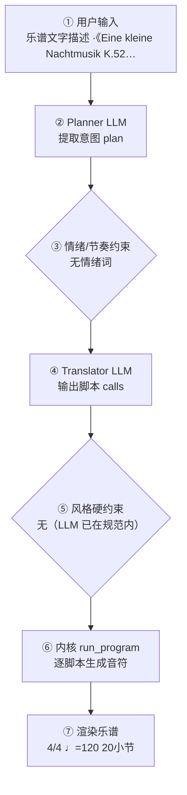

# 作曲生产报告：Eine kleine Nachtmusik K.525 (GT excerpt)（程序员版）

> 面向产品/工程：记录本次生成的完整生产链路与系统状态，用于核对「说得 vs 写得」、排查缺陷与回归测试；可整体喂回大模型进一步定位具体小节/声部的问题。谱面检查与编辑者版一致，编辑者版见：`f40eb951f9_report.md`。

## 1. 会话与生成环境

- 生成时间: 2026-09-28T19:49:40
- 生成路径: translator（LLM 翻译 + 确定性内核）
- 命中技能: develop-motif
- 用户原始输入: 乐谱文字描述 ·《Eine kleine Nachtmusik K.525 (GT excerpt)》

本文件是 MusicXML 的纯文字还原描述（不含 JSON）。
用 score_reverse.parse_score_descri…
- 原始数据: `session.compose_trace`（本报告第 4 节即其展开，确定性可复现）

## 2. 谱面事实（与编辑者版「基本信息」一致）

- 调性: G 大调（1 个升号）
- 拍号: 4/4
- 速度: 四分音符 = 120 BPM
- 调内音级: C, D, E, F#, G, A, B
- 声部 1: 小提琴 (Violin)，高音谱号，20 小节
- 声部 2: 小提琴 (Violin)，高音谱号，20 小节
- 声部 3: 中提琴 (Viola)，ALTO，20 小节
- 声部 4: 大提琴 (Cello)，低音谱号，20 小节

## 3. 自动检查结果（与编辑者版「第 3 节」一致）

| 检查类别 | 状态 | 描述 |
|---|---|---|
| 声部交叉 | ⚠️ 注意 | 纵向上方声部 2（小提琴 (Violin)）与下方声部 3（中提琴 (Viola)）在第 0.0 拍交叉：D4 低于 G4（同类交叉共 32 处，此处为第 1 例） |
| 终止式 | ⚠️ 注意 | G 大调结尾音级含 D, E, F#, G, A, B，旋律落在 A4（上主音） |

> 说明：平行五/八度仅检查最高与最低外声部；相邻声部交叉为提示项。 共检查 90 项（✅ 88 / ⚠️ 2 / ❌ 0）。

## 4. 作曲过程透明化（可追溯）

> 本节约等于把「需求 → 大模型 → 脚本 → 谱面」的完整链路展开，便于核对「说得 vs 写得」是否一致。数据来自本次生成的 `session.compose_trace`，确定性可复现。把本报告整体喂回大模型，可进一步定位具体小节/声部的问题与修正建议。

### 4.1 流程图（本次实际链路）



（文字版流程图，便于无 Mermaid 渲染环境阅读）

```
用户输入
  → [② Planner LLM] 提取意图 plan
  → [③ 情绪/节奏约束] 命中=否
  → [④ Translator LLM] 输出 calls + reasoning
  → [⑤ 风格硬约束] 触发=否
  → [⑥ 内核 run_program] 逐脚本执行
  → [⑦ 渲染谱面] 4/4 ♩=120 20小节
```

### 4.2 大模型输入输出（LLM I/O）

#### Planner（意图解析）

- **系统提示**（固定指令模板，已截断）：

```
You are a professional composer and music theorist acting as an Intent Parser.

Transform the user's natural-language request (and optional slash-commands already applied as preferences) into a Composition Plan JSON only.

Think like a composer first: infer genre, mood, form, motif character, harmony language, climax — do NOT invent note lists yet.

Output ONE JSON object, no Markdown:
{
  "title": "string",
  "genre": "string",
  "mood": ["..."],
  "tempo": 72,
  "meter": "4/4",
  "key_sharps": 0,
  "mode": "major|minor",
  "instrumentation": ["Piano"] or ["Violin","Cello"],
  "form": ["A","B","A"],
  "bars": 8,
  "motif": {"character": "...", "development": ["repetition","sequence"]},
  "harmony": {"language": "...", "density": "sparse|moderate|dense"},
  "rhythm": {"character": "..."},
  "texture": "homophonic|polyphonic|sparse|orchestral",
  "climax": {"location": "section B", "dynamic": "f"},
  "difficulty": "easy|medium",
  "summary": "one sentence for the user",
  "edit_intent": null
}
Rules:
- Original music only; no copyrighted melodies.
- If user is vague, choose musically appropriate defaults.
- bars: 4–32. Prefer 8–16 for a brand-new short piece.
- If the user asks to extend/lengthen to N bars (e.g. 扩展到32小节), set bars=N (not 8).
- If edit_intent is extend/longer and no N given, increase bars vs existing_score (typically +8 to +16, max 32).
- If edit_intent is rewrit
…（已截断，完整 2590 字；固定指令模板见 skills/composition/base/ 与内核 kernel_docs）
```

- **用户输入**（喂给模型的结构化上下文）：

```json
{
  "user_request": "乐谱文字描述 ·《Eine kleine Nachtmusik K.525 (GT excerpt)》\n\n本文件是 MusicXML 的纯文字还原描述（不含 JSON）。\n用 score_reverse.parse_score_description / text_to_musicxml 可再生成乐谱。\n\n【作品】《Eine kleine Nachtmusik K.525 (GT excerpt)》，G 大调（key_sharps=1，mode=major），\n4/4，共 20 小节，速度 ♩=120。\n\n【编制】violin, violin, viola, cello（共 4 声部）。\n\n【记谱约定】\n\n\n\n\n\n各声部按「第N小节：音名(时值)、…」逐音写出；休止写「休止(时值)」。\n\n\n\n和弦音用「+」连接，如 B4+G5(四分)。\n\n\n\n时值用中文：全音符/二分/四分/八分/十六分/三十二分/附点四分/附点八分。\n\n\n\n还原时按文字逐音写入，不要重新创作，不要赋格，不要动机变形。\n\n【复现种子】ec86629999da\n\n【声部 1 · Violin 1】\n第1小节：B4+G5(四分)、休止(八分)、D5(八分)、G5(四分)、休止(八分)、D5(八分)\n第2小节：G5(八分)、D5(八分)、G5(八分)、B5(八分)、D6(四分)、休止(四分)\n第3小节：C6(四分)、休止(八分)、A5(八分)、C6(四分)、休止(八分)、A5(八分)\n第4小节：C6(八分)、A5(八分)、F#5(八分)、A5(八分)、D5(四分)、休止(四分)\n第5小节：B4+G5(八分)、休止(八分)、G5(附点四分)、B5(八分)、A5(八分)、G5(八分)\n第6小节：G5(八分)、F#5(八分)、F#5(附点四分)、A5(八分)、C6(八分)、F#5(八分)\n第7小节：A5(八分)、G5(八分)、G5(附点四分)、B5(八分)、A5(八分)、G5(八分)\n第8小节：G5(八分)、F#5(八分)、F#5(附点四分)、A5(八分)、C6(八分)、F#5(八分)\n第9小节：G5(八分)、G5(八分)、F#5(八分)、E5(十六分)、F#5(十六分)、G5(八分)、G5(八分)、A5(八分)、G5(十六分)、A5(十六分)\n第10小节：B5(八分)、B5(八分)、C6(八分)、B5(十六分)、C6(十六分)、D6(四分)、休止(四分)\n第11小节：D5(二分)、E5(二分)\n第12小节：C5(四分)、C5(四分)、B4(四分)、B4(四分)\n第13小节：A4(四分)、A4(四分)、G4(八分)、F#4(八分)、E4(八分)、F#4(八分)\n第14小节：G4(八分)、休止(八分)、A4(八分)、休止(八分)、B4(八分)、休止(八分)、休止(四分)\n第15小节：D5(二分)、E5(二分)\n第16小节：D5(八分)、C5(八分)、C5(八分)、C5(八分)、C5(八分)、B4(八分)、B4(八分)、B4(八分)\n第17小节：B4(八分)、A4(八分)、A4(八分)、A4(八分)、G4(八分)、F#4(八分)、E4(八分)、F#4(八分)\n第18小节：G4(二分)、G4(八分)、G4(十六分)、F#4(三十二分)、G4(三十二分)、A4(八分)、F#4(八分)\n第19小节：B4(二分)、B4(八分)、B4(十六分)、A4(三十二分)、B4(三十二分)、C5(八分)、A4(八分)\n第20小节：D5(二分)、E5(四分)、F#5(四分)\n\n【声部 2 · Violin 2】\n第1小节：D4+B4(四分)、休止(八分)、D5(八分)、G5(四分)、休止(八分)、D5(八分)\n第2小节：G5(八分)、D5(八分)、G5(八分)、B5(八分)、D6(四分)、休止(四分)\n第3小节：C6(四分)、休止(八分)、A5(八分)、C6(四分)、休止(八分)、A5(八分)\n第4小节：C6(八分)、A5(八分)、F#5(八分)、A5(八分)、D5(四分)、休止(四分)\n第5小节：C4+D4(二分)、C4+D4(二分)\n第6小节：C4+D4(二分)、C4+D4(二分)\n第7小节：B3+D4(四分)、C5(八分)、C5(八分)、D5(八分)、D5(八分)、C5(八分)、B4(十六分)、A4(十六分)\n第8小节：G4(八分)、G4(八分)、F#4(八分)、F#4(八分)、G4(四分)、休止(四分)\n第9小节：B4(二分)、C5(二分)\n第10小节：A4(四分)、A4(四分)、G4(四分)、G4(四分)\n第11小节：E4(四分)、E4(四分)、C4(四分)、A3(四分)\n第12小节：D4(八分)、休止(八分)、F#4(八分)、休止(八分)、G4(八分)、休止(八分)、休止(四分)\n第13小节：B4(二分)、C5(二分)\n第14小节：B4(八分)、A4(八分)、A4(八分)、A4(八分)、A4(八分)、G4(八分)、G4(八分)、G4(八分)\n第15小节：E4(四分)、E4(八分)、E4(八分)、C4(四分)、C4(八分)、C4(八分)\n第16小节：B3(二分)、B3(八分)、B3(十六分)、A3(三十二分)、B3(三十二分)、C4(八分)、A3(八分)\n第17小节：G4(二分)、G4(八分)、G4(十六分)、F#4(三十二分)、G4(三十二分)、A4(八分)、F#4(八分)\n第18小节：B4(二分)、C5(二分)\n第19小节：休止(全音符)\n第20小节：休止(全音符)\n\n【声部 3 · Viola】\n第1小节：G4(四分)、休止(八分)、D4(八分)、G4(四分)、休止(八分)、D4(八分)\n第2小节：G4(八分)、D4(八分)、G4(八分)、B4(八分)、D5(四分)、休止(四分)\n第3小节：C5(四分)、休止(八分)、A4(八分)、C5(四分)、休止(八分)、A4(八分)\n第4小节：C5(八分)、A4(八分)、F#4(八分)、A4(八分)、D4(四分)、休止(四分)\n第5小节：G4(八分)、G4(八分)、G4(八分)、G4(八分)、G4(八分)、G4(八分)、G4(八分)、G4(八分)\n第6小节：A4(八分)、A4(八分)、A4(八分)、A4(八分)、A4(八分)、C5(八分)、F#4(八分)、A4(八分)\n第7小节：G4(八分)、G4(八分)、G4(八分)、G4(八分)、G4(八分)、G4(八分)、G4(八分)、G4(八分)\n第8小节：A4(八分)、A4(八分)、A4(八分)、A4(八分)、A4(八分)、C5(八分)、F#4(八分)、A4(八分)\n第9小节：D4(二分)、D4(二分)\n第10小节：D4(二分)、D4(四分)、休止(四分)\n第11小节：休止(全音符)\n第12小节：F#3(二分)、G3(二分)\n第13小节：C4(四分)、C4(四分)、A3(四分)、F#3(四分)\n第14小节：D3(八分)、休止(八分)、D4(八分)、休止(八分)、D4(四分)、休止(四分)\n第15小节：休止(全音符)\n第16小节：F#4(二分)、G4(二分)\n第17小节：C4(四分)、C4(八分)、C4(八分)、A3(四分)、A3(八分)、A3(八分)\n第18小节：G3(八分)、G3(八分)、G3(八分)、G3(八分)、G3(八分)、G3(八分)、G3(八分)、G3(八分)\n第19小节：G3(八分)、G3(八分)、G3(八分)、G3(八分)、G3(八分)、G3(八分)、G3(八分)、G3(八分)\n第20小节：G3(八分)、G4(八分)、G4(八分)、G4(八分)、G4(八分)、G4(八分)、A4(八分)、A4(八分)\n\n【声部 4 · Violoncello】\n第1小节：G3(四分)、休止(八分)、D3(八分)、G3(四分)、休止(八分)、D3(八分)\n第2小节：G3(八分)、D3(八分)、G3(八分)、B3(八分)、D4(四分)、休止(四分)\n第3小节：C4(四分)、休止(八分)、A3(八分)、C4(四分)、休止(八分)、A3(八分)\n第4小节：C4(八分)、A3(八分)、F#3(八分)、A3(八分)、D3(四分)、休止(四分)\n第5小节：G3(八分)、G3(八分)、G3(八分)、G3(八分)、G3(八分)、G3(八分)、G3(八分)、G3(八分)\n第6小节：G3(八分)、G3(八分)、G3(八分)、G3(八分)、G3(八分)、G3(八分)、G3(八分)、G3(八分)\n第7小节：G3(八分)、G3(八分)、G3(八分)、G3(八分)、G3(八分)、G3(八分)、G3(八分)、G3(八分)\n第8小节：G3(八分)、G3(八分)、G3(八分)、G3(八分)、G3(八分)、G3(八分)、G3(八分)、G3(八分)\n第9小节：G3(八分)、G3(八分)、A3(八分)、A3(八分)、B3(八分)、B3(八分)、F#3(八分)、F#3(八分)\n第10小节：G3(八分)、G3(八分)、A3(八分)、A3(八分)、B3(四分)、休止(四分)\n第11小节：休止(全音符)\n第12小节：D3(二分)、E3(二分)\n第13小节：C3(四分)、C3(四分)、D3(四分)、D3(四分)\n第14小节：B2(八分)、休止(八分)、D3(八分)、休止(八分)、G3(四分)、休止(四分)\n第15小节：休止(全音符)\n第16小节：D3(二分)、E3(二分)\n第17小节：C3(四分)、C3(四分)、D3(四分)、D3(四分)\n第18小节：G3(八分)、G3(八分)、G3(八分)、G3(八分)、G3(八分)、G3(八分)、G3(八分)、G3(八分)\n第19小节：G3(八分)、G3(八分)、G3(八分)、G3(八分)、G3(八分)、G3(八分)、G3(八分)、G3(八分)\n第20小节：G3(八分)、G3(八分)、G3(八分)、G3(八分)、G3(八分)、G3(八分)、G3(八分)、G3(八分)\n\n【结束】以上为全曲逐音描述。",
  "preferences": {
    "key_sharps": 0,
    "mode": "major",
    "tempo": 120,
    "bars": 8,
    "meter": "4/4",
    "style": "",
    "genre_id": "",
    "instrumentation": "",
    "fugue": "auto",
    "voices": 0,
    "_explicit": {}
  },
  "edit_intent": null,
  "skills": [
    "develop-motif"
  ],
  "existing_plan": null,
  "revision_edits": null,
  "existing_score_summary": null
}
```

- **模型返回（原始）**：

```json
{
  "title": "Nachtmusik Study in G",
  "genre": "Classical chamber",
  "mood": [
    "bright",
    "graceful",
    "playful"
  ],
  "tempo": 120,
  "meter": "4/4",
  "key_sharps": 0,
  "mode": "major",
  "instrumentation": [
    "Violin",
    "Violin",
    "Viola",
    "Cello"
  ],
  "form": [
    "A",
    "A'",
    "B",
    "A''"
  ],
  "bars": 16,
  "motif": {
    "character": "rising triadic turn figure with dotted-eighth lift, elegant and dance-like",
    "development": [
      "repetition",
      "sequence",
      "inversion",
      "rhythmic variation",
      "fragmentation"
    ]
  },
  "harmony": {
    "language": "diatonic Classical with tonic-dominant polarity and brief relative-minor colouring",
    "density": "moderate"
  },
  "rhythm": {
    "character": "steady eighth-note pulse with dotted-eighth anacrusis and occasional sixteenth-note ornament"
  },
  "texture": "homophonic",
  "climax": {
    "location": "section B",
    "dynamic": "f"
  },
  "difficulty": "medium",
  "summary": "A 16-bar Classical chamber piece in G major that develops a graceful triadic motif through sequence, inversion, and rhythmic variation over a steady 4/4 pulse.",
  "edit_intent": "develop"
}
```

#### Translator（脚本翻译）

- **系统提示**（固定指令模板，已截断）：

````
# 翻译器（Translator）

你不是作曲家，是**翻译器**：把用户的自然语言音乐需求与 plan 翻译成
对确定性脚本的调用序列。你**不写任何音符**——所有音符由脚本生成并保证
正确（时值、调性、织体、力度、终止）。你的职责是选对脚本、给对参数。

## 输出格式（只输出 JSON，不要任何解释文字）

```
{"reasoning": "用中文简述你如何把需求翻译成参数与脚本（2–5 句）：识别了什么风格/情绪，怎么决定速度/调式/织体，段落如何安排，调用了哪些脚本。", "calls": [{"script": "脚本名", "args": {...}}, ...]}
```

## 硬规则

1. 调用顺序：`new_score` → `set_sections` → 对每个段落 `{ set_harmony →
   accompaniment → melody }` →（高潮段可加 `thicken`）→（最后一段可加
   `cadence`）→（**可选** `narrative(...)`：仅当你需要关掉自动叙事层的
   动机变形/惊喜和弦时，见下「叙事层」）→ `finalize`
2. `new_score` 与 `finalize` 必须各恰好一次，且分别在最前/最后
3. **每个段落**都必须调用 set_harmony / accompaniment / melody，
   一次都不许漏（漏了 finalize 会报错）
4. args 必须严格符合脚本文档的字段名与取值范围；不要发明不存在的参数
5. 脚本执行失败时你会收到错误信息——修正 calls 后完整重新输出
6. `plan.tempo` / `plan.mode` / `plan.mood` / `plan.tempo_text` /
   `plan._emotion_hint` 是已解析的**明确约束**（来自用户情绪/速度词或
   `/tempo`），**优先级最高**——调用 `new_score` / `set_harmony` / `melody`
   时直接采用，不要用风格基线默认值覆盖。`reasoning` 字段必须如实写出你
   如何据此翻译，便于用户核查。
7. **乐器编制**：brief 提到管弦乐/弦乐/铜管/木管/具体乐器（小提琴、长笛、
   圆号、定音鼓…）或某种编制（弦乐四重奏、铜管五重奏…）时，`new_score`
   **必须传 `instruments`**（长度=voices，从高音到低音，低音乐器放最后），
   可用名：flute/oboe/**piccolo**/clarinet/bassoon/horn/trumpet/trombone/
   tuba/violin/viola/cello/contrabass/timpani/**harp**/piano/soprano/alto/
   tenor/bass。例：「弦乐四重奏」→ voices=4 +
   `["violin","violin","viola","cello"]`；「管弦乐小品」→ voices=4 +
   `["flute","violin","cello","timpani"]` 之类按 brief
…（已截断，完整 16878 字；固定指令模板见 skills/composition/base/ 与内核 kernel_docs）
````

- **用户输入**（喂给模型的结构化上下文）：

```json
{
  "plan": {
    "title": "Nachtmusik Study in G",
    "genre": "Classical chamber",
    "mood": [
      "bright",
      "graceful",
      "playful"
    ],
    "tempo": 120,
    "tempo_text": null,
    "meter": "4/4",
    "key_sharps": 0,
    "mode": "major",
    "_emotion_hint": null,
    "instrumentation": [
      "Violin",
      "Violin",
      "Viola",
      "Cello"
    ],
    "form": [
      "A",
      "A'",
      "B",
      "A''"
    ],
    "bars": 20,
    "motif": {
      "character": "rising triadic turn figure with dotted-eighth lift, elegant and dance-like",
      "development": [
        "repetition",
        "sequence",
        "inversion",
        "rhythmic variation",
        "fragmentation"
      ]
    },
    "harmony": {
      "language": "diatonic Classical with tonic-dominant polarity and brief relative-minor colouring",
      "density": "moderate"
    },
    "rhythm": {
      "character": "steady eighth-note pulse with dotted-eighth anacrusis and occasional sixteenth-note ornament"
    },
    "texture": "homophonic",
    "climax": {
      "location": "section B",
      "dynamic": "f"
    },
    "summary": "A 16-bar Classical chamber piece in G major that develops a graceful triadic motif through sequence, inversion, and rhythmic variation over a steady 4/4 pulse."
  },
  "user_brief": "乐谱文字描述 ·《Eine kleine Nachtmusik K.525 (GT excerpt)》\n\n本文件是 MusicXML 的纯文字还原描述（不含 JSON）。\n用 score_reverse.parse_score_description / text_to_musicxml 可再生成乐谱。\n\n【作品】《Eine kleine Nachtmusik K.525 (GT excerpt)》，G 大调（key_sharps=1，mode=major），\n4/4，共 20 小节，速度 ♩=120。\n\n【编制】violin, violin, viola, cello（共 4 声部）。\n\n【记谱约定】\n\n\n\n\n\n各声部按「第N小节：音名(时值)、…」逐音写出；休止写「休止(时值)」。\n\n\n\n和弦音用「+」连接，如 B4+G5(四分)。\n\n\n\n时值用中文：全音符/二分/四分/八分/十六分/三十二分/附点四分/附点八分。\n\n\n\n还原时按文字逐音写入，不要重新创作，不要赋格，不要动机变形。\n\n【复现种子】ec86629999da\n\n【声部 1 · Violin 1】\n第1小节：B4+G5(四分)、休止(八分)、D5(八分)、G5(四分)、休止(八分)、D5(八分)\n第2小节：G5(八分)、D5(八分)、G5(八分)、B5(八分)、D6(四分)、休止(四分)\n第3小节：C6(四分)、休止(八分)、A5(八分)、C6(四分)、休止(八分)、A5(八分)\n第4小节：C6(八分)、A5(八分)、F#5(八分)、A5(八分)、D5(四分)、休止(四分)\n第5小节：B4+G5(八分)、休止(八分)、G5(附点四分)、B5(八分)、A5(八分)、G5(八分)\n第6小节：G5(八分)、F#5(八分)、F#5(附点四分)、A5(八分)、C6(八分)、F#5(八分)\n第7小节：A5(八分)、G5(八分)、G5(附点四分)、B5(八分)、A5(八分)、G5(八分)\n第8小节：G5(八分)、F#5(八分)、F#5(附点四分)、A5(八分)、C6(八分)、F#5(八分)\n第9小节：G5(八分)、G5(八分)、F#5(八分)、E5(十六分)、F#5(十六分)、G5(八分)、G5(八分)、A5(八分)、G5(十六分)、A5(十六分)\n第10小节：B5(八分)、B5(八分)、C6(八分)、B5(十六分)、C6(十六分)、D6(四分)、休止(四分)\n第11小节：D5(二分)、E5(二分)\n第12小节：C5(四分)、C5(四分)、B4(四分)、B4(四分)\n第13小节：A4(四分)、A4(四分)、G4(八分)、F#4(八分)、E4(八分)、F#4(八分)\n第14小节：G4(八分)、休止(八分)、A4(八分)、休止(八分)、B4(八分)、休止(八分)、休止(四分)\n第15小节：D5(二分)、E5(二分)\n第16小节：D5(八分)、C5(八分)、C5(八分)、C5(八分)、C5(八分)、B4(八分)、B4(八分)、B4(八分)\n第17小节：B4(八分)、A4(八分)、A4(八分)、A4(八分)、G4(八分)、F#4(八分)、E4(八分)、F#4(八分)\n第18小节：G4(二分)、G4(八分)、G4(十六分)、F#4(三十二分)、G4(三十二分)、A4(八分)、F#4(八分)\n第19小节：B4(二分)、B4(八分)、B4(十六分)、A4(三十二分)、B4(三十二分)、C5(八分)、A4(八分)\n第20小节：D5(二分)、E5(四分)、F#5(四分)\n\n【声部 2 · Violin 2】\n第1小节：D4+B4(四分)、休止(八分)、D5(八分)、G5(四分)、休止(八分)、D5(八分)\n第2小节：G5(八分)、D5(八分)、G5(八分)、B5(八分)、D6(四分)、休止(四分)\n第3小节：C6(四分)、休止(八分)、A5(八分)、C6(四分)、休止(八分)、A5(八分)\n第4小节：C6(八分)、A5(八分)、F#5(八分)、A5(八分)、D5(四分)、休止(四分)\n第5小节：C4+D4(二分)、C4+D4(二分)\n第6小节：C4+D4(二分)、C4+D4(二分)\n第7小节：B3+D4(四分)、C5(八分)、C5(八分)、D5(八分)、D5(八分)、C5(八分)、B4(十六分)、A4(十六分)\n第8小节：G4(八分)、G4(八分)、F#4(八分)、F#4(八分)、G4(四分)、休止(四分)\n第9小节：B4(二分)、C5(二分)\n第10小节：A4(四分)、A4(四分)、G4(四分)、G4(四分)\n第11小节：E4(四分)、E4(四分)、C4(四分)、A3(四分)\n第12小节：D4(八分)、休止(八分)、F#4(八分)、休止(八分)、G4(八分)、休止(八分)、休止(四分)\n第13小节：B4(二分)、C5(二分)\n第14小节：B4(八分)、A4(八分)、A4(八分)、A4(八分)、A4(八分)、G4(八分)、G4(八分)、G4(八分)\n第15小节：E4(四分)、E4(八分)、E4(八分)、C4(四分)、C4(八分)、C4(八分)\n第16小节：B3(二分)、B3(八分)、B3(十六分)、A3(三十二分)、B3(三十二分)、C4(八分)、A3(八分)\n第17小节：G4(二分)、G4(八分)、G4(十六分)、F#4(三十二分)、G4(三十二分)、A4(八分)、F#4(八分)\n第18小节：B4(二分)、C5(二分)\n第19小节：休止(全音符)\n第20小节：休止(全音符)\n\n【声部 3 · Viola】\n第1小节：G4(四分)、休止(八分)、D4(八分)、G4(四分)、休止(八分)、D4(八分)\n第2小节：G4(八分)、D4(八分)、G4(八分)、B4(八分)、D5(四分)、休止(四分)\n第3小节：C5(四分)、休止(八分)、A4(八分)、C5(四分)、休止(八分)、A4(八分)\n第4小节：C5(八分)、A4(八分)、F#4(八分)、A4(八分)、D4(四分)、休止(四分)\n第5小节：G4(八分)、G4(八分)、G4(八分)、G4(八分)、G4(八分)、G4(八分)、G4(八分)、G4(八分)\n第6小节：A4(八分)、A4(八分)、A4(八分)、A4(八分)、A4(八分)、C5(八分)、F#4(八分)、A4(八分)\n第7小节：G4(八分)、G4(八分)、G4(八分)、G4(八分)、G4(八分)、G4(八分)、G4(八分)、G4(八分)\n第8小节：A4(八分)、A4(八分)、A4(八分)、A4(八分)、A4(八分)、C5(八分)、F#4(八分)、A4(八分)\n第9小节：D4(二分)、D4(二分)\n第10小节：D4(二分)、D4(四分)、休止(四分)\n第11小节：休止(全音符)\n第12小节：F#3(二分)、G3(二分)\n第13小节：C4(四分)、C4(四分)、A3(四分)、F#3(四分)\n第14小节：D3(八分)、休止(八分)、D4(八分)、休止(八分)、D4(四分)、休止(四分)\n第15小节：休止(全音符)\n第16小节：F#4(二分)、G4(二分)\n第17小节：C4(四分)、C4(八分)、C4(八分)、A3(四分)、A3(八分)、A3(八分)\n第18小节：G3(八分)、G3(八分)、G3(八分)、G3(八分)、G3(八分)、G3(八分)、G3(八分)、G3(八分)\n第19小节：G3(八分)、G3(八分)、G3(八分)、G3(八分)、G3(八分)、G3(八分)、G3(八分)、G3(八分)\n第20小节：G3(八分)、G4(八分)、G4(八分)、G4(八分)、G4(八分)、G4(八分)、A4(八分)、A4(八分)\n\n【声部 4 · Violoncello】\n第1小节：G3(四分)、休止(八分)、D3(八分)、G3(四分)、休止(八分)、D3(八分)\n第2小节：G3(八分)、D3(八分)、G3(八分)、B3(八分)、D4(四分)、休止(四分)\n第3小节：C4(四分)、休止(八分)、A3(八分)、C4(四分)、休止(八分)、A3(八分)\n第4小节：C4(八分)、A3(八分)、F#3(八分)、A3(八分)、D3(四分)、休止(四分)\n第5小节：G3(八分)、G3(八分)、G3(八分)、G3(八分)、G3(八分)、G3(八分)、G3(八分)、G3(八分)\n第6小节：G3(八分)、G3(八分)、G3(八分)、G3(八分)、G3(八分)、G3(八分)、G3(八分)、G3(八分)\n第7小节：G3(八分)、G3(八分)、G3(八分)、G3(八分)、G3(八分)、G3(八分)、G3(八分)、G3(八分)\n第8小节：G3(八分)、G3(八分)、G3(八分)、G3(八分)、G3(八分)、G3(八分)、G3(八分)、G3(八分)\n第9小节：G3(八分)、G3(八分)、A3(八分)、A3(八分)、B3(八分)、B3(八分)、F#3(八分)、F#3(八分)\n第10小节：G3(八分)、G3(八分)、A3(八分)、A3(八分)、B3(四分)、休止(四分)\n第11小节：休止(全音符)\n第12小节：D3(二分)、E3(二分)\n第13小节：C3(四分)、C3(四分)、D3(四分)、D3(四分)\n第14小节：B2(八分)、休止(八分)、D3(八分)、休止(八分)、G3(四分)、休止(四分)\n第15小节：休止(全音符)\n第16小节：D3(二分)、E3(二分)\n第17小节：C3(四分)、C3(四分)、D3(四分)、D3(四分)\n第18小节：G3(八分)、G3(八分)、G3(八分)、G3(八分)、G3(八分)、G3(八分)、G3(八分)、G3(八分)\n第19小节：G3(八分)、G3(八分)、G3(八分)、G3(八分)、G3(八分)、G3(八分)、G3(八分)、G3(八分)\n第20小节：G3(八分)、G3(八分)、G3(八分)、G3(八分)、G3(八分)、G3(八分)、G3(八分)、G3(八分)\n\n【结束】以上为全曲逐音描述。"
}
```

- **模型返回（原始）**：

```json
{
  "reasoning": "复现失败因第1小节把 B4+G5 拆成两个四分音符导致时值超限。改为用和弦音表达：write_part 支持 pitch 为 list 表示和弦（如 [\"B4\",\"G5\"]），因此第1小节声部0写 [[\"B4\",\"G5\"],\"quarter\"] 占一个四分，其余不变。其余各声部第1小节同理检查：声部1 的 D4+B4 也用和弦列表；声部2/3 为单音无需改。其余各小节时值均已核对填满 4.0。",
  "calls": [
    {
      "script": "new_score",
      "args": {
        "title": "Eine kleine Nachtmusik K.525 (GT excerpt)",
        "key_sharps": 1,
        "mode": "major",
        "meter": "4/4",
        "tempo": 120,
        "bars": 20,
        "voices": 4,
        "instruments": [
          "violin",
          "violin",
          "viola",
          "cello"
        ]
      }
    },
    {
      "script": "set_sections",
      "args": {
        "sections": [
          {
            "name": "A",
            "bars": 4,
            "meter": "4/4",
            "dynamic": "f",
            "tempo_text": "Allegro",
            "bpm": 120
          },
          {
            "name": "A'",
            "bars": 4,
            "meter": "4/4",
            "dynamic": "f",
            "tempo_text": "Allegro",
            "bpm": 120
          },
          {
            "name": "B",
            "bars": 4,
            "meter": "4/4",
            "dynamic": "f",
            "tempo_text": "Allegro",
            "bpm": 120
          },
          {
            "name": "A''",
            "bars": 8,
            "meter": "4/4",
            "dynamic": "f",
            "tempo_text": "Allegro",
            "bpm": 120
          }
        ]
      }
    },
    {
      "script": "write_part",
      "args": {
        "part": 0,
        "bars": {
          "1": [
            [
              [
                "B4",
                "G5"
              ],
              "quarter"
            ],
            [
              null,
              "eighth"
            ],
            [
              "D5",
              "eighth"
            ],
            [
              "G5",
              "quarter"
            ],
            [
              null,
              "eighth"
            ],
            [
              "D5",
              "eighth"
            ]
          ],
          "2": [
            [
              "G5",
              "eighth"
            ],
            [
              "D5",
              "eighth"
            ],
            [
              "G5",
              "eighth"
            ],
            [
              "B5",
              "eighth"
            ],
            [
              "D6",
              "quarter"
            ],
            [
              null,
              "quarter"
            ]
          ],
          "3": [
            [
              "C6",
              "quarter"
            ],
            [
              null,
              "eighth"
            ],
            [
              "A5",
              "eighth"
            ],
            [
              "C6",
              "quarter"
            ],
            [
              null,
              "eighth"
            ],
            [
              "A5",
              "eighth"
            ]
          ],
          "4": [
            [
              "C6",
              "eighth"
            ],
            [
              "A5",
              "eighth"
            ],
            [
              "F#5",
              "eighth"
            ],
            [
              "A5",
              "eighth"
            ],
            [
              "D5",
              "quarter"
            ],
            [
              null,
              "quarter"
            ]
          ],
          "5": [
            [
              [
                "B4",
                "G5"
              ],
              "eighth"
            ],
            [
              null,
              "eighth"
            ],
            [
              "G5",
              "dotted_quarter"
            ],
            [
              "B5",
              "eighth"
            ],
            [
              "A5",
              "eighth"
            ],
            [
              "G5",
              "eighth"
            ]
          ],
          "6": [
            [
              "G5",
              "eighth"
            ],
            [
              "F#5",
              "eighth"
            ],
            [
              "F#5",
              "dotted_quarter"
            ],
            [
              "A5",
              "eighth"
            ],
            [
              "C6",
              "eighth"
            ],
            [
              "F#5",
              "eighth"
            ]
          ],
          "7": [
            [
              "A5",
              "eighth"
            ],
            [
              "G5",
              "eighth"
            ],
            [
              "G5",
              "dotted_quarter"
            ],
            [
              "B5",
              "eighth"
            ],
            [
              "A5",
              "eighth"
            ],
            [
              "G5",
              "eighth"
            ]
          ],
          "8": [
            [
              "G5",
              "eighth"
            ],
            [
              "F#5",
              "eighth"
            ],
            [
              "F#5",
              "dotted_quarter"
            ],
            [
              "A5",
              "eighth"
            ],
            [
              "C6",
              "eighth"
            ],
            [
              "F#5",
              "eighth"
            ]
          ],
          "9": [
            [
              "G5",
              "eighth"
            ],
            [
              "G5",
              "eighth"
            ],
            [
              "F#5",
              "eighth"
            ],
            [
              "E5",
              "16th"
            ],
            [
              "F#5",
              "16th"
            ],
            [
              "G5",
              "eighth"
            ],
            [
              "G5",
              "eighth"
            ],
            [
              "A5",
              "eighth"
            ],
            [
              "G5",
              "16th"
            ],
            [
              "A5",
              "16th"
            ]
          ],
          "10": [
            [
              "B5",
              "eighth"
            ],
            [
              "B5",
              "eighth"
            ],
            [
              "C6",
              "eighth"
            ],
            [
              "B5",
              "16th"
            ],
            [
              "C6",
              "16th"
            ],
            [
              "D6",
              "quarter"
            ],
            [
              null,
              "quarter"
            ]
          ],
          "11": [
            [
              "D5",
              "half"
            ],
            [
              "E5",
              "half"
            ]
          ],
          "12": [
            [
              "C5",
              "quarter"
            ],
            [
              "C5",
              "quarter"
            ],
            [
              "B4",
              "quarter"
            ],
            [
              "B4",
              "quarter"
            ]
          ],
          "13": [
            [
              "A4",
              "quarter"
            ],
            [
              "A4",
              "quarter"
            ],
            [
              "G4",
              "eighth"
            ],
            [
              "F#4",
              "eighth"
            ],
            [
              "E4",
              "eighth"
            ],
            [
              "F#4",
              "eighth"
            ]
          ],
          "14": [
            [
              "G4",
              "eighth"
            ],
            [
              null,
              "eighth"
            ],
            [
              "A4",
              "eighth"
            ],
            [
              null,
              "eighth"
            ],
            [
              "B4",
              "eighth"
            ],
            [
              null,
              "eighth"
            ],
            [
              null,
              "quarter"
            ]
          ],
          "15": [
            [
              "D5",
              "half"
            ],
            [
              "E5",
              "half"
            ]
          ],
          "16": [
            [
              "D5",
              "eighth"
            ],
            [
              "C5",
              "eighth"
            ],
            [
              "C5",
              "eighth"
            ],
            [
              "C5",
              "eighth"
            ],
            [
              "C5",
              "eighth"
            ],
            [
              "B4",
              "eighth"
            ],
            [
              "B4",
              "eighth"
            ],
            [
              "B4",
              "eighth"
            ]
          ],
          "17": [
            [
              "B4",
              "eighth"
            ],
            [
              "A4",
              "eighth"
            ],
            [
              "A4",
              "eighth"
            ],
            [
              "A4",
              "eighth"
            ],
            [
              "G4",
              "eighth"
            ],
            [
              "F#4",
              "eighth"
            ],
            [
              "E4",
              "eighth"
            ],
            [
              "F#4",
              "eighth"
            ]
          ],
          "18": [
            [
              "G4",
              "half"
            ],
            [
              "G4",
              "eighth"
            ],
            [
              "G4",
              "16th"
            ],
            [
              "F#4",
              "32nd"
            ],
            [
              "G4",
              "32nd"
            ],
            [
              "A4",
              "eighth"
            ],
            [
              "F#4",
              "eighth"
            ]
          ],
          "19": [
            [
              "B4",
              "half"
            ],
            [
              "B4",
              "eighth"
            ],
            [
              "B4",
              "16th"
            ],
            [
              "A4",
              "32nd"
            ],
            [
              "B4",
              "32nd"
            ],
            [
              "C5",
              "eighth"
            ],
            [
              "A4",
              "eighth"
            ]
          ],
          "20": [
            [
              "D5",
              "half"
            ],
            [
              "E5",
              "quarter"
            ],
            [
              "F#5",
              "quarter"
            ]
          ]
        }
      }
    },
    {
      "script": "write_part",
      "args": {
        "part": 1,
        "bars": {
          "1": [
            [
              [
                "D4",
                "B4"
              ],
              "quarter"
            ],
            [
              null,
              "eighth"
            ],
            [
              "D5",
              "eighth"
            ],
            [
              "G5",
              "quarter"
            ],
            [
              null,
              "eighth"
            ],
            [
              "D5",
              "eighth"
            ]
          ],
          "2": [
            [
              "G5",
              "eighth"
            ],
            [
              "D5",
              "eighth"
            ],
            [
              "G5",
              "eighth"
            ],
            [
              "B5",
              "eighth"
            ],
            [
              "D6",
              "quarter"
            ],
            [
              null,
              "quarter"
            ]
          ],
          "3": [
            [
              "C6",
              "quarter"
            ],
            [
              null,
              "eighth"
            ],
            [
              "A5",
              "eighth"
            ],
            [
              "C6",
              "quarter"
            ],
            [
              null,
              "eighth"
            ],
            [
              "A5",
              "eighth"
            ]
          ],
          "4": [
            [
              "C6",
              "eighth"
            ],
            [
              "A5",
              "eighth"
            ],
            [
              "F#5",
              "eighth"
            ],
            [
              "A5",
              "eighth"
            ],
            [
              "D5",
              "quarter"
            ],
            [
              null,
              "quarter"
            ]
          ],
          "5": [
            [
              [
                "C4",
                "D4"
              ],
              "half"
            ],
            [
              [
                "C4",
                "D4"
              ],
              "half"
            ]
          ],
          "6": [
            [
              [
                "C4",
                "D4"
              ],
              "half"
            ],
            [
              [
                "C4",
                "D4"
              ],
              "half"
            ]
          ],
          "7": [
            [
              [
                "B3",
                "D4"
              ],
              "quarter"
            ],
            [
              "C5",
              "eighth"
            ],
            [
              "C5",
              "eighth"
            ],
            [
              "D5",
              "eighth"
            ],
            [
              "D5",
              "eighth"
            ],
            [
              "C5",
              "eighth"
            ],
            [
              "B4",
              "16th"
            ],
            [
              "A4",
              "16th"
            ]
          ],
          "8": [
            [
              "G4",
              "eighth"
            ],
            [
              "G4",
              "eighth"
            ],
            [
              "F#4",
              "eighth"
            ],
            [
              "F#4",
              "eighth"
            ],
            [
              "G4",
              "quarter"
            ],
            [
              null,
              "quarter"
            ]
          ],
          "9": [
            [
              "B4",
              "half"
            ],
            [
              "C5",
              "half"
            ]
          ],
          "10": [
            [
              "A4",
              "quarter"
            ],
            [
              "A4",
              "quarter"
            ],
            [
              "G4",
              "quarter"
            ],
            [
              "G4",
              "quarter"
            ]
          ],
          "11": [
            [
              "E4",
              "quarter"
            ],
            [
              "E4",
              "quarter"
            ],
            [
              "C4",
              "quarter"
            ],
            [
              "A3",
              "quarter"
            ]
          ],
          "12": [
            [
              "D4",
              "eighth"
            ],
            [
              null,
              "eighth"
            ],
            [
              "F#4",
              "eighth"
            ],
            [
              null,
              "eighth"
            ],
            [
              "G4",
              "eighth"
            ],
            [
              null,
              "eighth"
            ],
            [
              null,
              "quarter"
            ]
          ],
          "13": [
            [
              "B4",
              "half"
            ],
            [
              "C5",
              "half"
            ]
          ],
          "14": [
            [
              "B4",
              "eighth"
            ],
            [
              "A4",
              "eighth"
            ],
            [
              "A4",
              "eighth"
            ],
            [
              "A4",
              "eighth"
            ],
            [
              "A4",
              "eighth"
            ],
            [
              "G4",
              "eighth"
            ],
            [
              "G4",
              "eighth"
            ],
            [
              "G4",
              "eighth"
            ]
          ],
          "15": [
            [
              "E4",
              "quarter"
            ],
            [
              "E4",
              "eighth"
            ],
            [
              "E4",
              "eighth"
            ],
            [
              "C4",
              "quarter"
            ],
            [
              "C4",
              "eighth"
            ],
            [
              "C4",
              "eighth"
            ]
          ],
          "16": [
            [
              "B3",
              "half"
            ],
            [
              "B3",
              "eighth"
            ],
            [
              "B3",
              "16th"
            ],
            [
              "A3",
              "32nd"
            ],
            [
              "B3",
              "32nd"
            ],
            [
              "C4",
              "eighth"
            ],
            [
              "A3",
              "eighth"
            ]
          ],
          "17": [
            [
              "G4",
              "half"
            ],
            [
              "G4",
              "eighth"
            ],
            [
              "G4",
              "16th"
            ],
            [
              "F#4",
              "32nd"
            ],
            [
              "G4",
              "32nd"
            ],
            [
              "A4",
              "eighth"
            ],
            [
              "F#4",
              "eighth"
            ]
          ],
          "18": [
            [
              "B4",
              "half"
            ],
            [
              "C5",
              "half"
            ]
          ],
          "19": [
            [
              null,
              "whole"
            ]
          ],
          "20": [
            [
              null,
              "whole"
            ]
          ]
        }
      }
    },
    {
      "script": "write_part",
      "args": {
        "part": 2,
        "bars": {
          "1": [
            [
              "G4",
              "quarter"
            ],
            [
              null,
              "eighth"
            ],
            [
              "D4",
              "eighth"
            ],
            [
              "G4",
              "quarter"
            ],
            [
              null,
              "eighth"
            ],
            [
              "D4",
              "eighth"
            ]
          ],
          "2": [
            [
              "G4",
              "eighth"
            ],
            [
              "D4",
              "eighth"
            ],
            [
              "G4",
              "eighth"
            ],
            [
              "B4",
              "eighth"
            ],
            [
              "D5",
              "quarter"
            ],
            [
              null,
              "quarter"
            ]
          ],
          "3": [
            [
              "C5",
              "quarter"
            ],
            [
              null,
              "eighth"
            ],
            [
              "A4",
              "eighth"
            ],
            [
              "C5",
              "quarter"
            ],
            [
              null,
              "eighth"
            ],
            [
              "A4",
              "eighth"
            ]
          ],
          "4": [
            [
              "C5",
              "eighth"
            ],
            [
              "A4",
              "eighth"
            ],
            [
              "F#4",
              "eighth"
            ],
            [
              "A4",
              "eighth"
            ],
            [
              "D4",
              "quarter"
            ],
            [
              null,
              "quarter"
            ]
          ],
          "5": [
            [
              "G4",
              "eighth"
            ],
            [
              "G4",
              "eighth"
            ],
            [
              "G4",
              "eighth"
            ],
            [
              "G4",
              "eighth"
            ],
            [
              "G4",
              "eighth"
            ],
            [
              "G4",
              "eighth"
            ],
            [
              "G4",
              "eighth"
            ],
            [
              "G4",
              "eighth"
            ]
          ],
          "6": [
            [
              "A4",
              "eighth"
            ],
            [
              "A4",
              "eighth"
            ],
            [
              "A4",
              "eighth"
            ],
            [
              "A4",
              "eighth"
            ],
            [
              "A4",
              "eighth"
            ],
            [
              "C5",
              "eighth"
            ],
            [
              "F#4",
              "eighth"
            ],
            [
              "A4",
              "eighth"
            ]
          ],
          "7": [
            [
              "G4",
              "eighth"
            ],
            [
              "G4",
              "eighth"
            ],
            [
              "G4",
              "eighth"
            ],
            [
              "G4",
              "eighth"
            ],
            [
              "G4",
              "eighth"
            ],
            [
              "G4",
              "eighth"
            ],
            [
              "G4",
              "eighth"
            ],
            [
              "G4",
              "eighth"
            ]
          ],
          "8": [
            [
              "A4",
              "eighth"
            ],
            [
              "A4",
              "eighth"
            ],
            [
              "A4",
              "eighth"
            ],
            [
              "A4",
              "eighth"
            ],
            [
              "A4",
              "eighth"
            ],
            [
              "C5",
              "eighth"
            ],
            [
              "F#4",
              "eighth"
            ],
            [
              "A4",
              "eighth"
            ]
          ],
          "9": [
            [
              "D4",
              "half"
            ],
            [
              "D4",
              "half"
            ]
          ],
          "10": [
            [
              "D4",
              "half"
            ],
            [
              "D4",
              "quarter"
            ],
            [
              null,
              "quarter"
            ]
          ],
          "11": [
            [
              null,
              "whole"
            ]
          ],
          "12": [
            [
              "F#3",
              "half"
            ],
            [
              "G3",
              "half"
            ]
          ],
          "13": [
            [
              "C4",
              "quarter"
            ],
            [
              "C4",
              "quarter"
            ],
            [
              "A3",
              "quarter"
            ],
            [
              "F#3",
              "quarter"
            ]
          ],
          "14": [
            [
              "D3",
              "eighth"
            ],
            [
              null,
              "eighth"
            ],
            [
              "D4",
              "eighth"
            ],
            [
              null,
              "eighth"
            ],
            [
              "D4",
              "quarter"
            ],
            [
              null,
              "quarter"
            ]
          ],
          "15": [
            [
              null,
              "whole"
            ]
          ],
          "16": [
            [
              "F#4",
              "half"
            ],
            [
              "G4",
              "half"
            ]
          ],
          "17": [
            [
              "C4",
              "quarter"
            ],
            [
              "C4",
              "eighth"
            ],
            [
              "C4",
              "eighth"
            ],
            [
              "A3",
              "quarter"
            ],
            [
              "A3",
              "eighth"
            ],
            [
              "A3",
              "eighth"
            ]
          ],
          "18": [
            [
              "G3",
              "eighth"
            ],
            [
              "G3",
              "eighth"
            ],
            [
              "G3",
              "eighth"
            ],
            [
              "G3",
              "eighth"
            ],
            [
              "G3",
              "eighth"
            ],
            [
              "G3",
              "eighth"
            ],
            [
              "G3",
              "eighth"
            ],
            [
              "G3",
              "eighth"
            ]
          ],
          "19": [
            [
              "G3",
              "eighth"
            ],
            [
              "G3",
              "eighth"
            ],
            [
              "G3",
              "eighth"
            ],
            [
              "G3",
              "eighth"
            ],
            [
              "G3",
              "eighth"
            ],
            [
              "G3",
              "eighth"
            ],
            [
              "G3",
              "eighth"
            ],
            [
              "G3",
              "eighth"
            ]
          ],
          "20": [
            [
              "G3",
              "eighth"
            ],
            [
              "G4",
              "eighth"
            ],
            [
              "G4",
              "eighth"
            ],
            [
              "G4",
              "eighth"
            ],
            [
              "G4",
              "eighth"
            ],
            [
              "G4",
              "eighth"
            ],
            [
              "A4",
              "eighth"
            ],
            [
              "A4",
              "eighth"
            ]
          ]
        }
      }
    },
    {
      "script": "write_part",
      "args": {
        "part": 3,
        "bars": {
          "1": [
            [
              "G3",
              "quarter"
            ],
            [
              null,
              "eighth"
            ],
            [
              "D3",
              "eighth"
            ],
            [
              "G3",
              "quarter"
            ],
            [
              null,
              "eighth"
            ],
            [
              "D3",
              "eighth"
            ]
          ],
          "2": [
            [
              "G3",
              "eighth"
            ],
            [
              "D3",
              "eighth"
            ],
            [
              "G3",
              "eighth"
            ],
            [
              "B3",
              "eighth"
            ],
            [
              "D4",
              "quarter"
            ],
            [
              null,
              "quarter"
            ]
          ],
          "3": [
            [
              "C4",
              "quarter"
            ],
            [
              null,
              "eighth"
            ],
            [
              "A3",
              "eighth"
            ],
            [
              "C4",
              "quarter"
            ],
            [
              null,
              "eighth"
            ],
            [
              "A3",
              "eighth"
            ]
          ],
          "4": [
            [
              "C4",
              "eighth"
            ],
            [
              "A3",
              "eighth"
            ],
            [
              "F#3",
              "eighth"
            ],
            [
              "A3",
              "eighth"
            ],
            [
              "D3",
              "quarter"
            ],
            [
              null,
              "quarter"
            ]
          ],
          "5": [
            [
              "G3",
              "eighth"
            ],
            [
              "G3",
              "eighth"
            ],
            [
              "G3",
              "eighth"
            ],
            [
              "G3",
              "eighth"
            ],
            [
              "G3",
              "eighth"
            ],
            [
              "G3",
              "eighth"
            ],
            [
              "G3",
              "eighth"
            ],
            [
              "G3",
              "eighth"
            ]
          ],
          "6": [
            [
              "G3",
              "eighth"
            ],
            [
              "G3",
              "eighth"
            ],
            [
              "G3",
              "eighth"
            ],
            [
              "G3",
              "eighth"
            ],
            [
              "G3",
              "eighth"
            ],
            [
              "G3",
              "eighth"
            ],
            [
              "G3",
              "eighth"
            ],
            [
              "G3",
              "eighth"
            ]
          ],
          "7": [
            [
              "G3",
              "eighth"
            ],
            [
              "G3",
              "eighth"
            ],
            [
              "G3",
              "eighth"
            ],
            [
              "G3",
              "eighth"
            ],
            [
              "G3",
              "eighth"
            ],
            [
              "G3",
              "eighth"
            ],
            [
              "G3",
              "eighth"
            ],
            [
              "G3",
              "eighth"
            ]
          ],
          "8": [
            [
              "G3",
              "eighth"
            ],
            [
              "G3",
              "eighth"
            ],
            [
              "G3",
              "eighth"
            ],
            [
              "G3",
              "eighth"
            ],
            [
              "G3",
              "eighth"
            ],
            [
              "G3",
              "eighth"
            ],
            [
              "G3",
              "eighth"
            ],
            [
              "G3",
              "eighth"
            ]
          ],
          "9": [
            [
              "G3",
              "eighth"
            ],
            [
              "G3",
              "eighth"
            ],
            [
              "A3",
              "eighth"
            ],
            [
              "A3",
              "eighth"
            ],
            [
              "B3",
              "eighth"
            ],
            [
              "B3",
              "eighth"
            ],
            [
              "F#3",
              "eighth"
            ],
            [
              "F#3",
              "eighth"
            ]
          ],
          "10": [
            [
              "G3",
              "eighth"
            ],
            [
              "G3",
              "eighth"
            ],
            [
              "A3",
              "eighth"
            ],
            [
              "A3",
              "eighth"
            ],
            [
              "B3",
              "quarter"
            ],
            [
              null,
              "quarter"
            ]
          ],
          "11": [
            [
              null,
              "whole"
            ]
          ],
          "12": [
            [
              "D3",
              "half"
            ],
            [
              "E3",
              "half"
            ]
          ],
          "13": [
            [
              "C3",
              "quarter"
            ],
            [
              "C3",
              "quarter"
            ],
            [
              "D3",
              "quarter"
            ],
            [
              "D3",
              "quarter"
            ]
          ],
          "14": [
            [
              "B2",
              "eighth"
            ],
            [
              null,
              "eighth"
            ],
            [
              "D3",
              "eighth"
            ],
            [
              null,
              "eighth"
            ],
            [
              "G3",
              "quarter"
            ],
            [
              null,
              "quarter"
            ]
          ],
          "15": [
            [
              null,
              "whole"
            ]
          ],
          "16": [
            [
              "D3",
              "half"
            ],
            [
              "E3",
              "half"
            ]
          ],
          "17": [
            [
              "C3",
              "quarter"
            ],
            [
              "C3",
              "quarter"
            ],
            [
              "D3",
              "quarter"
            ],
            [
              "D3",
              "quarter"
            ]
          ],
          "18": [
            [
              "G3",
              "eighth"
            ],
            [
              "G3",
              "eighth"
            ],
            [
              "G3",
              "eighth"
            ],
            [
              "G3",
              "eighth"
            ],
            [
              "G3",
              "eighth"
            ],
            [
              "G3",
              "eighth"
            ],
            [
              "G3",
              "eighth"
            ],
            [
              "G3",
              "eighth"
            ]
          ],
          "19": [
            [
              "G3",
              "eighth"
            ],
            [
              "G3",
              "eighth"
            ],
            [
              "G3",
              "eighth"
            ],
            [
              "G3",
              "eighth"
            ],
            [
              "G3",
              "eighth"
            ],
            [
              "G3",
              "eighth"
            ],
            [
              "G3",
              "eighth"
            ],
            [
              "G3",
              "eighth"
            ]
          ],
          "20": [
            [
              "G3",
              "eighth"
            ],
            [
              "G3",
              "eighth"
            ],
            [
              "G3",
              "eighth"
            ],
            [
              "G3",
              "eighth"
            ],
            [
              "G3",
              "eighth"
            ],
            [
              "G3",
              "eighth"
            ],
            [
              "G3",
              "eighth"
            ],
            [
              "G3",
              "eighth"
            ]
          ]
        }
      }
    },
    {
      "script": "finalize",
      "args": {
        "preserve": true
      }
    }
  ]
}
```

### 4.3 脚本调用与输入输出

| # | 脚本 | 输入(args) | 输出（新增音符 / 状态变更） |
|---|---|---|---|
| 1 | new_score | title=Eine kleine Nachtmusik K.525 (GT excerpt)，key_sharps=1，mode=major，meter=4/4，tempo=120，bars=20，voices=4，instruments=["violin", "violin", "viola", "cello"] | 建立乐曲：4/4 ♩=120 4声部 major；新增 — |
| 2 | set_sections | sections=[{"name": "A", "bars": 4, "meter": "4/4", "dynamic": "f", "tempo_text": "Allegro", "bpm": 120}, {"name": "A'", "bars": 4, "meter": "4/4", "dynamic": "f", "tempo_text": "Allegro", "bpm": 120}, {"name": "B", "bars": 4, "meter": "4/4", "dynamic": "f", "tempo_text": "Allegro", "bpm": 120}, {"name": "A''", "bars": 8, "meter": "4/4", "dynamic": "f", "tempo_text": "Allegro", "bpm": 120}] | 分段：A(4小节)，A'(4小节)，B(4小节)，A''(8小节)；新增 — |
| 3 | new_score | title=Eine kleine Nachtmusik K.525 (GT excerpt)，key_sharps=1，mode=major，meter=4/4，tempo=120，bars=20，voices=4，instruments=["violin", "violin", "viola", "cello"]　⟲ **LLM 重试**：此前调用序列出错回滚，从 new_score 重新执行 | 建立乐曲：4/4 ♩=120 4声部 major；新增 — |
| 4 | set_sections | sections=[{"name": "A", "bars": 4, "meter": "4/4", "dynamic": "f", "tempo_text": "Allegro", "bpm": 120}, {"name": "A'", "bars": 4, "meter": "4/4", "dynamic": "f", "tempo_text": "Allegro", "bpm": 120}, {"name": "B", "bars": 4, "meter": "4/4", "dynamic": "f", "tempo_text": "Allegro", "bpm": 120}, {"name": "A''", "bars": 8, "meter": "4/4", "dynamic": "f", "tempo_text": "Allegro", "bpm": 120}] | 分段：A(4小节)，A'(4小节)，B(4小节)，A''(8小节)；新增 — |
| 5 | write_part | part=0，bars={"1": [[["B4", "G5"], "quarter"], [null, "eighth"], ["D5", "eighth"], ["G5", "quarter"], [null, "eighth"], ["D5", "eighth"]], "2": [["G5", "eighth"], ["D5", "eighth"], ["G5", "eighth"], ["B5", "eighth"], ["D6", "quarter"], [null, "quarter"]], "3": [["C6", "quarter"], [null, "eighth"], ["A5", "eighth"], ["C6", "quarter"], [null, "eighth"], ["A5", "eighth"]], "4": [["C6", "eighth"], ["A5", "eighth"], ["F#5", "eighth"], ["A5", "eighth"], ["D5", "quarter"], [null, "quarter"]], "5": [[["B4", "G5"], "eighth"], [null, "eighth"], ["G5", "dotted_quarter"], ["B5", "eighth"], ["A5", "eighth"], ["G5", "eighth"]], "6": [["G5", "eighth"], ["F#5", "eighth"], ["F#5", "dotted_quarter"], ["A5", "eighth"], ["C6", "eighth"], ["F#5", "eighth"]], "7": [["A5", "eighth"], ["G5", "eighth"], ["G5", "dotted_quarter"], ["B5", "eighth"], ["A5", "eighth"], ["G5", "eighth"]], "8": [["G5", "eighth"], ["F#5", "eighth"], ["F#5", "dotted_quarter"], ["A5", "eighth"], ["C6", "eighth"], ["F#5", "eighth"]], "9": [["G5", "eighth"], ["G5", "eighth"], ["F#5", "eighth"], ["E5", "16th"], ["F#5", "16th"], ["G5", "eighth"], ["G5", "eighth"], ["A5", "eighth"], ["G5", "16th"], ["A5", "16th"]], "10": [["B5", "eighth"], ["B5", "eighth"], ["C6", "eighth"], ["B5", "16th"], ["C6", "16th"], ["D6", "quarter"], [null, "quarter"]], "11": [["D5", "half"], ["E5", "half"]], "12": [["C5", "quarter"], ["C5", "quarter"], ["B4", "quarter"], ["B4", "quarter"]], "13": [["A4", "quarter"], ["A4", "quarter"], ["G4", "eighth"], ["F#4", "eighth"], ["E4", "eighth"], ["F#4", "eighth"]], "14": [["G4", "eighth"], [null, "eighth"], ["A4", "eighth"], [null, "eighth"], ["B4", "eighth"], [null, "eighth"], [null, "quarter"]], "15": [["D5", "half"], ["E5", "half"]], "16": [["D5", "eighth"], ["C5", "eighth"], ["C5", "eighth"], ["C5", "eighth"], ["C5", "eighth"], ["B4", "eighth"], ["B4", "eighth"], ["B4", "eighth"]], "17": [["B4", "eighth"], ["A4", "eighth"], ["A4", "eighth"], ["A4", "eighth"], ["G4", "eighth"], ["F#4", "eighth"], ["E4", "eighth"], ["F#4", "eighth"]], "18": [["G4", "half"], ["G4", "eighth"], ["G4", "16th"], ["F#4", "32nd"], ["G4", "32nd"], ["A4", "eighth"], ["F#4", "eighth"]], "19": [["B4", "half"], ["B4", "eighth"], ["B4", "16th"], ["A4", "32nd"], ["B4", "32nd"], ["C5", "eighth"], ["A4", "eighth"]], "20": [["D5", "half"], ["E5", "quarter"], ["F#5", "quarter"]]} | write_part；新增 声部1:+119 |
| 6 | write_part | part=1，bars={"1": [[["D4", "B4"], "quarter"], [null, "eighth"], ["D5", "eighth"], ["G5", "quarter"], [null, "eighth"], ["D5", "eighth"]], "2": [["G5", "eighth"], ["D5", "eighth"], ["G5", "eighth"], ["B5", "eighth"], ["D6", "quarter"], [null, "quarter"]], "3": [["C6", "quarter"], [null, "eighth"], ["A5", "eighth"], ["C6", "quarter"], [null, "eighth"], ["A5", "eighth"]], "4": [["C6", "eighth"], ["A5", "eighth"], ["F#5", "eighth"], ["A5", "eighth"], ["D5", "quarter"], [null, "quarter"]], "5": [[["C4", "D4"], "half"], [["C4", "D4"], "half"]], "6": [[["C4", "D4"], "half"], [["C4", "D4"], "half"]], "7": [[["B3", "D4"], "quarter"], ["C5", "eighth"], ["C5", "eighth"], ["D5", "eighth"], ["D5", "eighth"], ["C5", "eighth"], ["B4", "16th"], ["A4", "16th"]], "8": [["G4", "eighth"], ["G4", "eighth"], ["F#4", "eighth"], ["F#4", "eighth"], ["G4", "quarter"], [null, "quarter"]], "9": [["B4", "half"], ["C5", "half"]], "10": [["A4", "quarter"], ["A4", "quarter"], ["G4", "quarter"], ["G4", "quarter"]], "11": [["E4", "quarter"], ["E4", "quarter"], ["C4", "quarter"], ["A3", "quarter"]], "12": [["D4", "eighth"], [null, "eighth"], ["F#4", "eighth"], [null, "eighth"], ["G4", "eighth"], [null, "eighth"], [null, "quarter"]], "13": [["B4", "half"], ["C5", "half"]], "14": [["B4", "eighth"], ["A4", "eighth"], ["A4", "eighth"], ["A4", "eighth"], ["A4", "eighth"], ["G4", "eighth"], ["G4", "eighth"], ["G4", "eighth"]], "15": [["E4", "quarter"], ["E4", "eighth"], ["E4", "eighth"], ["C4", "quarter"], ["C4", "eighth"], ["C4", "eighth"]], "16": [["B3", "half"], ["B3", "eighth"], ["B3", "16th"], ["A3", "32nd"], ["B3", "32nd"], ["C4", "eighth"], ["A3", "eighth"]], "17": [["G4", "half"], ["G4", "eighth"], ["G4", "16th"], ["F#4", "32nd"], ["G4", "32nd"], ["A4", "eighth"], ["F#4", "eighth"]], "18": [["B4", "half"], ["C5", "half"]], "19": [[null, "whole"]], "20": [[null, "whole"]]} | write_part；新增 声部2:+93 |
| 7 | write_part | part=2，bars={"1": [["G4", "quarter"], [null, "eighth"], ["D4", "eighth"], ["G4", "quarter"], [null, "eighth"], ["D4", "eighth"]], "2": [["G4", "eighth"], ["D4", "eighth"], ["G4", "eighth"], ["B4", "eighth"], ["D5", "quarter"], [null, "quarter"]], "3": [["C5", "quarter"], [null, "eighth"], ["A4", "eighth"], ["C5", "quarter"], [null, "eighth"], ["A4", "eighth"]], "4": [["C5", "eighth"], ["A4", "eighth"], ["F#4", "eighth"], ["A4", "eighth"], ["D4", "quarter"], [null, "quarter"]], "5": [["G4", "eighth"], ["G4", "eighth"], ["G4", "eighth"], ["G4", "eighth"], ["G4", "eighth"], ["G4", "eighth"], ["G4", "eighth"], ["G4", "eighth"]], "6": [["A4", "eighth"], ["A4", "eighth"], ["A4", "eighth"], ["A4", "eighth"], ["A4", "eighth"], ["C5", "eighth"], ["F#4", "eighth"], ["A4", "eighth"]], "7": [["G4", "eighth"], ["G4", "eighth"], ["G4", "eighth"], ["G4", "eighth"], ["G4", "eighth"], ["G4", "eighth"], ["G4", "eighth"], ["G4", "eighth"]], "8": [["A4", "eighth"], ["A4", "eighth"], ["A4", "eighth"], ["A4", "eighth"], ["A4", "eighth"], ["C5", "eighth"], ["F#4", "eighth"], ["A4", "eighth"]], "9": [["D4", "half"], ["D4", "half"]], "10": [["D4", "half"], ["D4", "quarter"], [null, "quarter"]], "11": [[null, "whole"]], "12": [["F#3", "half"], ["G3", "half"]], "13": [["C4", "quarter"], ["C4", "quarter"], ["A3", "quarter"], ["F#3", "quarter"]], "14": [["D3", "eighth"], [null, "eighth"], ["D4", "eighth"], [null, "eighth"], ["D4", "quarter"], [null, "quarter"]], "15": [[null, "whole"]], "16": [["F#4", "half"], ["G4", "half"]], "17": [["C4", "quarter"], ["C4", "eighth"], ["C4", "eighth"], ["A3", "quarter"], ["A3", "eighth"], ["A3", "eighth"]], "18": [["G3", "eighth"], ["G3", "eighth"], ["G3", "eighth"], ["G3", "eighth"], ["G3", "eighth"], ["G3", "eighth"], ["G3", "eighth"], ["G3", "eighth"]], "19": [["G3", "eighth"], ["G3", "eighth"], ["G3", "eighth"], ["G3", "eighth"], ["G3", "eighth"], ["G3", "eighth"], ["G3", "eighth"], ["G3", "eighth"]], "20": [["G3", "eighth"], ["G4", "eighth"], ["G4", "eighth"], ["G4", "eighth"], ["G4", "eighth"], ["G4", "eighth"], ["A4", "eighth"], ["A4", "eighth"]]} | write_part；新增 声部3:+107 |
| 8 | write_part | part=3，bars={"1": [["G3", "quarter"], [null, "eighth"], ["D3", "eighth"], ["G3", "quarter"], [null, "eighth"], ["D3", "eighth"]], "2": [["G3", "eighth"], ["D3", "eighth"], ["G3", "eighth"], ["B3", "eighth"], ["D4", "quarter"], [null, "quarter"]], "3": [["C4", "quarter"], [null, "eighth"], ["A3", "eighth"], ["C4", "quarter"], [null, "eighth"], ["A3", "eighth"]], "4": [["C4", "eighth"], ["A3", "eighth"], ["F#3", "eighth"], ["A3", "eighth"], ["D3", "quarter"], [null, "quarter"]], "5": [["G3", "eighth"], ["G3", "eighth"], ["G3", "eighth"], ["G3", "eighth"], ["G3", "eighth"], ["G3", "eighth"], ["G3", "eighth"], ["G3", "eighth"]], "6": [["G3", "eighth"], ["G3", "eighth"], ["G3", "eighth"], ["G3", "eighth"], ["G3", "eighth"], ["G3", "eighth"], ["G3", "eighth"], ["G3", "eighth"]], "7": [["G3", "eighth"], ["G3", "eighth"], ["G3", "eighth"], ["G3", "eighth"], ["G3", "eighth"], ["G3", "eighth"], ["G3", "eighth"], ["G3", "eighth"]], "8": [["G3", "eighth"], ["G3", "eighth"], ["G3", "eighth"], ["G3", "eighth"], ["G3", "eighth"], ["G3", "eighth"], ["G3", "eighth"], ["G3", "eighth"]], "9": [["G3", "eighth"], ["G3", "eighth"], ["A3", "eighth"], ["A3", "eighth"], ["B3", "eighth"], ["B3", "eighth"], ["F#3", "eighth"], ["F#3", "eighth"]], "10": [["G3", "eighth"], ["G3", "eighth"], ["A3", "eighth"], ["A3", "eighth"], ["B3", "quarter"], [null, "quarter"]], "11": [[null, "whole"]], "12": [["D3", "half"], ["E3", "half"]], "13": [["C3", "quarter"], ["C3", "quarter"], ["D3", "quarter"], ["D3", "quarter"]], "14": [["B2", "eighth"], [null, "eighth"], ["D3", "eighth"], [null, "eighth"], ["G3", "quarter"], [null, "quarter"]], "15": [[null, "whole"]], "16": [["D3", "half"], ["E3", "half"]], "17": [["C3", "quarter"], ["C3", "quarter"], ["D3", "quarter"], ["D3", "quarter"]], "18": [["G3", "eighth"], ["G3", "eighth"], ["G3", "eighth"], ["G3", "eighth"], ["G3", "eighth"], ["G3", "eighth"], ["G3", "eighth"], ["G3", "eighth"]], "19": [["G3", "eighth"], ["G3", "eighth"], ["G3", "eighth"], ["G3", "eighth"], ["G3", "eighth"], ["G3", "eighth"], ["G3", "eighth"], ["G3", "eighth"]], "20": [["G3", "eighth"], ["G3", "eighth"], ["G3", "eighth"], ["G3", "eighth"], ["G3", "eighth"], ["G3", "eighth"], ["G3", "eighth"], ["G3", "eighth"]]} | write_part；新增 声部4:+114 |
| 9 | finalize | preserve=True | 收束装配：20小节 / 4声部；新增 — |

<details><summary>逐脚本新增音符样例（前 8 个 / 声部）</summary>

- **new_score**：声部1: —；声部2: —；声部3: —；声部4: —
- **set_sections**：声部1: —；声部2: —；声部3: —；声部4: —
- **new_score**：声部1: —；声部2: —；声部3: —；声部4: —
- **set_sections**：声部1: —；声部2: —；声部3: —；声部4: —
- **write_part**：声部1: B4+G5:quarter, None:eighth, D5:eighth, G5:quarter, None:eighth, D5:eighth, G5:eighth, D5:eighth；声部2: —；声部3: —；声部4: —
- **write_part**：声部1: —；声部2: D4+B4:quarter, None:eighth, D5:eighth, G5:quarter, None:eighth, D5:eighth, G5:eighth, D5:eighth；声部3: —；声部4: —
- **write_part**：声部1: —；声部2: —；声部3: G4:quarter, None:eighth, D4:eighth, G4:quarter, None:eighth, D4:eighth, G4:eighth, D4:eighth；声部4: —
- **write_part**：声部1: —；声部2: —；声部3: —；声部4: G3:quarter, None:eighth, D3:eighth, G3:quarter, None:eighth, D3:eighth, G3:eighth, D3:eighth
- **finalize**：声部1: —；声部2: —；声部3: —；声部4: —

</details>

### 4.4 本地强制约束（确定性兜底，优先级高于 LLM）

- 情绪/节奏约束：未触发（用户未给情绪/速度词，或已被风格基线覆盖）
- 风格/速度强制纠正：未触发（LLM 输出已在 genre 规范内）
- **风格契约施加的约束**：无（该风格包没有 `style_contract.yaml`，或契约证据量不足、和声分区未生效）
### 4.5 自动问题定位（可疑点 + 程度）

| 检查项 | 程度 | 说明 |
|---|---|---|
| 情绪约束 | 🟢 未触发 | 用户未给情绪/速度词 |
| 意图拍号↔谱面 | 🟢 一致 | 最终拍号 4/4 |
| 计划小节↔实际小节 | 🟢 一致 | 20 小节 |
| 风格规范遵循 | 🟢 良好 | LLM 输出均在 genre 规范内，无需强制 |
| 本地修复 | 🟡 注意 | 校验后触发了本地修复（时值/声部进行），说明初版谱存在 CRITICAL/MAJOR 问题 |
| 计划编制↔实际编制 | 🟢 一致 | 计划 4 件乐器与谱面 4 声部对应 |

> 说明：上表为程序自动比对「意图 ↔ 谱面」的初判（🔴 严重 / 🟡 注意 / 🟢 一致）。将本报告整体喂给大模型，可进一步定位具体小节/声部的问题与修正建议。

## 5. 记谱与演奏法

**规则日志**（共 4 条，其中仲裁 0 次）

- [stem/layout] 381 处 — 已应用：符干方向
- [beams/layout] 247 处 — 已应用：连符尾分组
- [layout/layout] 5 处 — 已应用：系统换行
- [rehearsal/layout] 1 处 — 已应用：排练记号

可演奏性：0 项 MAJOR / 2 项总计
- [MINOR] 声部2 大跳 14 半音（>八度）
- [MINOR] 声部2 大跳 13 半音（>八度）

## 6. 生成质量评估（三指标）

- **风格重叠率**：N/A（未指定目标包）
- **属性遵循度**：1.00（0 项）
- **最近邻**：celtic-jig（相似度 0.53）— ✅ 无抄袭嫌疑
