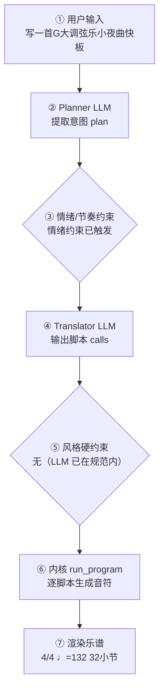

# 作曲生产报告：晨光小夜曲（程序员版）

> 面向产品/工程：记录本次生成的完整生产链路与系统状态，用于核对「说得 vs 写得」、排查缺陷与回归测试；可整体喂回大模型进一步定位具体小节/声部的问题。谱面检查与编辑者版一致，编辑者版见：`fd4dd5806d_report.md`。

## 1. 会话与生成环境

- 生成时间: 2026-09-28T21:38:01
- 生成路径: translator（LLM 翻译 + 确定性内核）
- 命中技能: orchestrate, genre:classical/string-serenade
- 用户原始输入: 写一首G大调弦乐小夜曲快板
- 原始数据: `session.compose_trace`（本报告第 4 节即其展开，确定性可复现）

## 2. 谱面事实（与编辑者版「基本信息」一致）

- 调性: G 大调（1 个升号）
- 转调: 第 9 小节 → D 大调；第 17 小节 → E 小调
- 拍号: 4/4
- 速度: 四分音符 = 120 BPM
- 段落速度: 第 17 小节 Agitato（♩=126）；第 25 小节 Allegro（♩=118）
- 调内音级: C, D, E, F#, G, A, B
- 声部 1: 小提琴 (Violin)，高音谱号，32 小节
- 声部 2: 小提琴 (Violin)，高音谱号，32 小节
- 声部 3: 中提琴 (Viola)，ALTO，32 小节
- 声部 4: 大提琴 (Cello)，低音谱号，32 小节
- 声部 5: Contrabass，低音谱号，32 小节

## 3. 自动检查结果（与编辑者版「第 3 节」一致）

| 检查类别 | 状态 | 描述 |
|---|---|---|
| 调号一致性 | ⚠️ 注意 | E 小调 段出现变化音 C#, A#（转调段调外音/经过音） |
| 声部交叉 | ⚠️ 注意 | 纵向上方声部 4（大提琴 (Cello)）与下方声部 5（Contrabass）在第 1.0 拍交叉：D3 低于 G3（同类交叉共 16 处，此处为第 1 例） |

> 说明：平行五/八度仅检查最高与最低外声部；相邻声部交叉为提示项。 共检查 171 项（✅ 169 / ⚠️ 2 / ❌ 0）。

## 4. 作曲过程透明化（可追溯）

> 本节约等于把「需求 → 大模型 → 脚本 → 谱面」的完整链路展开，便于核对「说得 vs 写得」是否一致。数据来自本次生成的 `session.compose_trace`，确定性可复现。把本报告整体喂回大模型，可进一步定位具体小节/声部的问题与修正建议。

### 4.1 流程图（本次实际链路）



（文字版流程图，便于无 Mermaid 渲染环境阅读）

```
用户输入
  → [② Planner LLM] 提取意图 plan
  → [③ 情绪/节奏约束] 命中=是
  → [④ Translator LLM] 输出 calls + reasoning
  → [⑤ 风格硬约束] 触发=否
  → [⑥ 内核 run_program] 逐脚本执行
  → [⑦ 渲染谱面] 4/4 ♩=132 32小节
```

### 4.2 大模型输入输出（LLM I/O）

#### Planner（意图解析）

- **系统提示**（固定指令模板，已截断）：

```
You are a professional composer and music theorist acting as an Intent Parser.

Transform the user's natural-language request (and optional slash-commands already applied as preferences) into a Composition Plan JSON only.

Think like a composer first: infer genre, mood, form, motif character, harmony language, climax — do NOT invent note lists yet.

Output ONE JSON object, no Markdown:
{
  "title": "string",
  "genre": "string",
  "mood": ["..."],
  "tempo": 72,
  "meter": "4/4",
  "key_sharps": 0,
  "mode": "major|minor",
  "instrumentation": ["Piano"] or ["Violin","Cello"],
  "form": ["A","B","A"],
  "bars": 8,
  "motif": {"character": "...", "development": ["repetition","sequence"]},
  "harmony": {"language": "...", "density": "sparse|moderate|dense"},
  "rhythm": {"character": "..."},
  "texture": "homophonic|polyphonic|sparse|orchestral",
  "climax": {"location": "section B", "dynamic": "f"},
  "difficulty": "easy|medium",
  "summary": "one sentence for the user",
  "edit_intent": null
}
Rules:
- Original music only; no copyrighted melodies.
- If user is vague, choose musically appropriate defaults.
- bars: 4–32. Prefer 8–16 for a brand-new short piece.
- If the user asks to extend/lengthen to N bars (e.g. 扩展到32小节), set bars=N (not 8).
- If edit_intent is extend/longer and no N given, increase bars vs existing_score (typically +8 to +16, max 32).
- If edit_intent is rewrit
…（已截断，完整 4128 字；固定指令模板见 skills/composition/base/ 与内核 kernel_docs）
```

- **用户输入**（喂给模型的结构化上下文）：

```json
{
  "user_request": "【作品】为弦乐合奏而作的单乐章小夜曲快板《晨光小夜曲》，G 大调\n（key_sharps=1, mode=major），4/4，共 32 小节，\n奏鸣骨架：呈示主部—呈示副部—展开—再现尾声。\n\n【编制】弦乐五部（第一小提琴、第二小提琴、中提琴、大提琴、低音提琴）；\n旋律由第一小提琴承担；第二小提琴写和声节奏/对句（禁止整段长音垫）；\n中提琴内声运动；大提琴行走低音；低音提琴根音支撑（含三音；V7 保留七音）。\n不要用管弦双管编制。内核会在 accompaniment 时自动展开内声部角色织体。\n\n【速度】呈示主部 ♩=120 → 呈示副部 ♩=120 → 展开 ♩=126 → 再现尾声 ♩=118。\n四段小节数之和必须等于 32。\n\n【旋律总则｜必须遵守】\n1. 四段 melody 的 rhythm/contour 必须互相区分：依次 sparse+arch / flowing+arch /\n   fragmented+wave / flowing+ascending。\n2. 不要赋格，不要复调模仿，不要卡农；显式 narrative(appearances=false)。\n3. 每段只用本段调内音；展开段可转关系小调。\n4. new_score 须带 style=classical/string-serenade（已学契约），voices=5。\n5. 五部须保持独立运动：VnII/Va 不得整小节同音长音垫。\n\n【第 1 段 · 呈示主部】8 小节 · Allegro ♩=120 · f · G 大调。\n主部主题，和声 I–V–vi–IV–I–ii–V7–I；伴奏 octave_pulse；旋律 sparse、arch。\n\n【第 2 段 · 呈示副部】8 小节 · Allegro ♩=120 · mf · 转属调（+1 升号相对主调）。\n歌唱性副题，和声 I–V7–I–IV；伴奏 broken_arpeggio；旋律 flowing、register=high、arch。\n\n【第 3 段 · 展开】8 小节 · Agitato ♩=126 · ff · 关系小调（mode=minor，按需换调号）。\n旋律 fragmented、wave；和声 i–VI–iv–V7；伴奏 chromatic_descent。\n\n【第 4 段 · 再现尾声】8 小节 · Allegro ♩=118 · f · 回 G 大调。\n旋律 flowing、ascending；和声 I–IV–V7–I；末两小节 cadence(bars=2)。\n\n【不要】不要赋格，不要双管管弦编制，不要用 very_high 音区，不要内声部长音垫。",
  "preferences": {
    "key_sharps": 0,
    "mode": "major",
    "tempo": 120,
    "bars": 8,
    "meter": "4/4",
    "style": "弦乐小夜曲",
    "genre_id": "genre:classical/string-serenade",
    "instrumentation": "",
    "fugue": "auto",
    "voices": 0,
    "_explicit": {}
  },
  "edit_intent": null,
  "skills": [
    "orchestrate",
    "genre:classical/string-serenade"
  ],
  "existing_plan": null,
  "revision_edits": null,
  "existing_score_summary": null
}
```

- **模型返回（原始）**：

```json
{
  "title": "晨光小夜曲",
  "genre": "classical/string-serenade",
  "mood": [
    "明朗",
    "典雅",
    "宫廷",
    "朝气"
  ],
  "tempo": 120,
  "meter": "4/4",
  "key_sharps": 1,
  "mode": "major",
  "instrumentation": [
    "Violin",
    "Violin",
    "Viola",
    "Cello",
    "Contrabass"
  ],
  "form": [
    "呈示主部",
    "呈示副部",
    "展开",
    "再现尾声"
  ],
  "bars": 32,
  "motif": {
    "character": "明朗上行的四音级进动机，带附点节奏与跳跃收束，具宫廷小夜曲的优雅朝气",
    "development": [
      "repetition",
      "sequence",
      "fragmentation",
      "rhythmic_change",
      "register_transfer"
    ]
  },
  "harmony": {
    "language": "功能性和声：主部 I–V–vi–IV–I–ii–V7–I；副部转属调 I–V7–I–IV；展开段关系小调 i–VI–iv–V7；再现 I–IV–V7–I 完全终止",
    "density": "moderate"
  },
  "rhythm": {
    "character": "方整 4/4 快板律动；主部 octave_pulse 伴奏，副部 broken_arpeggio，展开段 chromatic_descent 半音下行，旋律依次 sparse+arch / flowing+arch / fragmented+wave / flowing+ascending"
  },
  "texture": "homophonic",
  "climax": {
    "location": "section 展开",
    "dynamic": "ff"
  },
  "difficulty": "medium",
  "summary": "G 大调单乐章弦乐小夜曲快板《晨光小夜曲》，32 小节奏鸣骨架，弦乐五部各司其职，呈示明朗、副部歌唱、展开激动、再现收束肯定。",
  "edit_intent": null
}
```

#### Translator（脚本翻译）

- **系统提示**（固定指令模板，已截断）：

````
# 翻译器（Translator）

你不是作曲家，是**翻译器**：把用户的自然语言音乐需求与 plan 翻译成
对确定性脚本的调用序列。你**不写任何音符**——所有音符由脚本生成并保证
正确（时值、调性、织体、力度、终止）。你的职责是选对脚本、给对参数。

## 输出格式（只输出 JSON，不要任何解释文字）

```
{"reasoning": "用中文简述你如何把需求翻译成参数与脚本（2–5 句）：识别了什么风格/情绪，怎么决定速度/调式/织体，段落如何安排，调用了哪些脚本。", "calls": [{"script": "脚本名", "args": {...}}, ...]}
```

## 硬规则

1. 调用顺序：`new_score` → `set_sections` → 对每个段落 `{ set_harmony →
   accompaniment → melody }` →（高潮段可加 `thicken`）→（最后一段可加
   `cadence`）→（**可选** `narrative(...)`：仅当你需要关掉自动叙事层的
   动机变形/惊喜和弦时，见下「叙事层」）→ `finalize`
2. `new_score` 与 `finalize` 必须各恰好一次，且分别在最前/最后
3. **每个段落**都必须调用 set_harmony / accompaniment / melody，
   一次都不许漏（漏了 finalize 会报错）
4. args 必须严格符合脚本文档的字段名与取值范围；不要发明不存在的参数
5. 脚本执行失败时你会收到错误信息——修正 calls 后完整重新输出
6. `plan.tempo` / `plan.mode` / `plan.mood` / `plan.tempo_text` /
   `plan._emotion_hint` 是已解析的**明确约束**（来自用户情绪/速度词或
   `/tempo`），**优先级最高**——调用 `new_score` / `set_harmony` / `melody`
   时直接采用，不要用风格基线默认值覆盖。`reasoning` 字段必须如实写出你
   如何据此翻译，便于用户核查。
7. **乐器编制**：brief 提到管弦乐/弦乐/铜管/木管/具体乐器（小提琴、长笛、
   圆号、定音鼓…）或某种编制（弦乐四重奏、铜管五重奏…）时，`new_score`
   **必须传 `instruments`**（长度=voices，从高音到低音，低音乐器放最后），
   可用名：flute/oboe/**piccolo**/clarinet/bassoon/horn/trumpet/trombone/
   tuba/violin/viola/cello/contrabass/timpani/**harp**/piano/soprano/alto/
   tenor/bass。例：「弦乐四重奏」→ voices=4 +
   `["violin","violin","viola","cello"]`；「管弦乐小品」→ voices=4 +
   `["flute","violin","cello","timpani"]` 之类按 brief
…（已截断，完整 19258 字；固定指令模板见 skills/composition/base/ 与内核 kernel_docs）
````

- **用户输入**（喂给模型的结构化上下文）：

```json
{
  "plan": {
    "title": "晨光小夜曲",
    "genre": "classical/string-serenade",
    "mood": [
      "明朗",
      "典雅",
      "宫廷",
      "朝气",
      "cheerful",
      "bright"
    ],
    "tempo": 132,
    "tempo_text": "Allegro",
    "meter": "4/4",
    "key_sharps": 1,
    "mode": "major",
    "_emotion_hint": {
      "group": "fast",
      "matched": [
        "快板"
      ],
      "bpm": 132,
      "tempo_text": "Allegro",
      "mode_bias": "major",
      "rhythm": "flowing",
      "dynamics": "f",
      "contour": "arch"
    },
    "instrumentation": [
      "Violin",
      "Violin",
      "Viola",
      "Cello",
      "Contrabass"
    ],
    "form": [
      "呈示主部",
      "呈示副部",
      "展开",
      "再现尾声"
    ],
    "bars": 32,
    "motif": {
      "character": "明朗上行的四音级进动机，带附点节奏与跳跃收束，具宫廷小夜曲的优雅朝气",
      "development": [
        "repetition",
        "sequence",
        "fragmentation",
        "rhythmic_change",
        "register_transfer"
      ]
    },
    "harmony": {
      "language": "功能性和声：主部 I–V–vi–IV–I–ii–V7–I；副部转属调 I–V7–I–IV；展开段关系小调 i–VI–iv–V7；再现 I–IV–V7–I 完全终止",
      "density": "moderate"
    },
    "rhythm": {
      "character": "方整 4/4 快板律动；主部 octave_pulse 伴奏，副部 broken_arpeggio，展开段 chromatic_descent 半音下行，旋律依次 sparse+arch / flowing+arch / fragmented+wave / flowing+ascending"
    },
    "texture": "homophonic",
    "climax": {
      "location": "section 展开",
      "dynamic": "ff"
    },
    "summary": "G 大调单乐章弦乐小夜曲快板《晨光小夜曲》，32 小节奏鸣骨架，弦乐五部各司其职，呈示明朗、副部歌唱、展开激动、再现收束肯定。"
  },
  "user_brief": "【作品】为弦乐合奏而作的单乐章小夜曲快板《晨光小夜曲》，G 大调\n（key_sharps=1, mode=major），4/4，共 32 小节，\n奏鸣骨架：呈示主部—呈示副部—展开—再现尾声。\n\n【编制】弦乐五部（第一小提琴、第二小提琴、中提琴、大提琴、低音提琴）；\n旋律由第一小提琴承担；第二小提琴写和声节奏/对句（禁止整段长音垫）；\n中提琴内声运动；大提琴行走低音；低音提琴根音支撑（含三音；V7 保留七音）。\n不要用管弦双管编制。内核会在 accompaniment 时自动展开内声部角色织体。\n\n【速度】呈示主部 ♩=120 → 呈示副部 ♩=120 → 展开 ♩=126 → 再现尾声 ♩=118。\n四段小节数之和必须等于 32。\n\n【旋律总则｜必须遵守】\n1. 四段 melody 的 rhythm/contour 必须互相区分：依次 sparse+arch / flowing+arch /\n   fragmented+wave / flowing+ascending。\n2. 不要赋格，不要复调模仿，不要卡农；显式 narrative(appearances=false)。\n3. 每段只用本段调内音；展开段可转关系小调。\n4. new_score 须带 style=classical/string-serenade（已学契约），voices=5。\n5. 五部须保持独立运动：VnII/Va 不得整小节同音长音垫。\n\n【第 1 段 · 呈示主部】8 小节 · Allegro ♩=120 · f · G 大调。\n主部主题，和声 I–V–vi–IV–I–ii–V7–I；伴奏 octave_pulse；旋律 sparse、arch。\n\n【第 2 段 · 呈示副部】8 小节 · Allegro ♩=120 · mf · 转属调（+1 升号相对主调）。\n歌唱性副题，和声 I–V7–I–IV；伴奏 broken_arpeggio；旋律 flowing、register=high、arch。\n\n【第 3 段 · 展开】8 小节 · Agitato ♩=126 · ff · 关系小调（mode=minor，按需换调号）。\n旋律 fragmented、wave；和声 i–VI–iv–V7；伴奏 chromatic_descent。\n\n【第 4 段 · 再现尾声】8 小节 · Allegro ♩=118 · f · 回 G 大调。\n旋律 flowing、ascending；和声 I–IV–V7–I；末两小节 cadence(bars=2)。\n\n【不要】不要赋格，不要双管管弦编制，不要用 very_high 音区，不要内声部长音垫。 弦乐小夜曲"
}
```

- **模型返回（原始）**：

```json
{
  "reasoning": "识别为古典弦乐小夜曲快板（G大调，4/4，♩=132 来自 plan.tempo/_emotion_hint fast），编制为弦乐五部，故 new_score 传 voices=5 与 violin×2/viola/cello/contrabass，solo_instrument=violin 让第一小提琴主奏。四段按奏鸣骨架 8+8+8+8=32 小节：主部 I–V–vi–IV–I–ii–V7–I + octave_pulse + sparse/arch；副部转属调（key_sharps=2）+ broken_arpeggio + flowing/high/arch；展开段转关系小调（mode=minor, key_sharps=1）+ chromatic_descent + fragmented/wave + thicken 做 ff 高潮；再现回 G 大调 + flowing/ascending，末两小节 cadence(bars=2)。用户明确禁止赋格/复调模仿，故在 cadence 后显式 narrative(appearances=false)。",
  "calls": [
    {
      "script": "new_score",
      "args": {
        "title": "晨光小夜曲",
        "key_sharps": 1,
        "mode": "major",
        "meter": "4/4",
        "tempo": 132,
        "bars": 32,
        "voices": 5,
        "instruments": [
          "violin",
          "violin",
          "viola",
          "cello",
          "contrabass"
        ],
        "solo_instrument": "violin"
      }
    },
    {
      "script": "set_sections",
      "args": {
        "sections": [
          {
            "name": "呈示主部",
            "bars": 8,
            "meter": "4/4",
            "dynamic": "f",
            "tempo_text": "Allegro",
            "bpm": 120
          },
          {
            "name": "呈示副部",
            "bars": 8,
            "meter": "4/4",
            "dynamic": "mf",
            "tempo_text": "Allegro",
            "bpm": 120
          },
          {
            "name": "展开",
            "bars": 8,
            "meter": "4/4",
            "dynamic": "ff",
            "tempo_text": "Agitato",
            "bpm": 126
          },
          {
            "name": "再现尾声",
            "bars": 8,
            "meter": "4/4",
            "dynamic": "f",
            "tempo_text": "Allegro",
            "bpm": 118
          }
        ]
      }
    },
    {
      "script": "set_harmony",
      "args": {
        "section": "呈示主部",
        "progression": [
          "I",
          "V",
          "vi",
          "IV",
          "I",
          "ii",
          "V7",
          "I"
        ]
      }
    },
    {
      "script": "accompaniment",
      "args": {
        "section": "呈示主部",
        "pattern": "octave_pulse",
        "register": "low",
        "density": 1
      }
    },
    {
      "script": "melody",
      "args": {
        "section": "呈示主部",
        "register": "mid",
        "rhythm": "sparse",
        "contour": "arch",
        "motif": [
          [
            5,
            "quarter"
          ],
          [
            4,
            "eighth"
          ],
          [
            3,
            "eighth"
          ],
          [
            2,
            "half"
          ]
        ]
      }
    },
    {
      "script": "set_harmony",
      "args": {
        "section": "呈示副部",
        "key_sharps": 2,
        "mode": "major",
        "progression": [
          "I",
          "V7",
          "I",
          "IV"
        ]
      }
    },
    {
      "script": "accompaniment",
      "args": {
        "section": "呈示副部",
        "pattern": "broken_arpeggio",
        "register": "low",
        "density": 1
      }
    },
    {
      "script": "melody",
      "args": {
        "section": "呈示副部",
        "register": "high",
        "rhythm": "flowing",
        "contour": "arch"
      }
    },
    {
      "script": "set_harmony",
      "args": {
        "section": "展开",
        "key_sharps": 1,
        "mode": "minor",
        "progression": [
          "i",
          "VI",
          "iv",
          "V7"
        ]
      }
    },
    {
      "script": "accompaniment",
      "args": {
        "section": "展开",
        "pattern": "chromatic_descent",
        "register": "low",
        "density": 1
      }
    },
    {
      "script": "melody",
      "args": {
        "section": "展开",
        "register": "high",
        "rhythm": "fragmented",
        "contour": "wave"
      }
    },
    {
      "script": "thicken",
      "args": {
        "section": "展开"
      }
    },
    {
      "script": "set_harmony",
      "args": {
        "section": "再现尾声",
        "key_sharps": 1,
        "mode": "major",
        "progression": [
          "I",
          "IV",
          "V7",
          "I"
        ]
      }
    },
    {
      "script": "accompaniment",
      "args": {
        "section": "再现尾声",
        "pattern": "broken_arpeggio",
        "register": "low",
        "density": 1
      }
    },
    {
      "script": "melody",
      "args": {
        "section": "再现尾声",
        "register": "high",
        "rhythm": "flowing",
        "contour": "ascending"
      }
    },
    {
      "script": "cadence",
      "args": {
        "bars": 2,
        "section": "再现尾声"
      }
    },
    {
      "script": "narrative",
      "args": {
        "appearances": false
      }
    },
    {
      "script": "finalize",
      "args": {}
    }
  ]
}
```

### 4.3 脚本调用与输入输出

| # | 脚本 | 输入(args) | 输出（新增音符 / 状态变更） |
|---|---|---|---|
| 1 | new_score | title=晨光小夜曲，key_sharps=1，mode=major，meter=4/4，tempo=132，bars=32，voices=5，instruments=["violin", "violin", "viola", "cello", "contrabass"]，solo_instrument=violin，style=classical/string-serenade | 建立乐曲：4/4 ♩=132 5声部 major；新增 — |
| 2 | set_sections | sections=[{"name": "呈示主部", "bars": 8, "meter": "4/4", "dynamic": "f", "tempo_text": "Allegro", "bpm": 120}, {"name": "呈示副部", "bars": 8, "meter": "4/4", "dynamic": "mf", "tempo_text": "Allegro", "bpm": 120}, {"name": "展开", "bars": 8, "meter": "4/4", "dynamic": "ff", "tempo_text": "Agitato", "bpm": 126}, {"name": "再现尾声", "bars": 8, "meter": "4/4", "dynamic": "f", "tempo_text": "Allegro", "bpm": 118}] | 分段：呈示主部(8小节)，呈示副部(8小节)，展开(8小节)，再现尾声(8小节)；新增 — |
| 3 | set_harmony | section=呈示主部，progression=["I", "V", "vi", "IV", "I", "ii", "V7", "I"] | 和声：段落呈示主部 进行['I', 'V', 'vi', 'IV', 'I', 'ii', 'V7', 'I']；新增 — |
| 4 | accompaniment | section=呈示主部，pattern=octave_pulse，register=low，density=1 | 伴奏：段落呈示主部 pattern=octave_pulse register=low density=1；新增 声部2:+64，声部3:+64，声部4:+32，声部5:+32 |
| 5 | melody | section=呈示主部，register=mid，rhythm=sparse，contour=arch，motif=[[5, "quarter"], [4, "eighth"], [3, "eighth"], [2, "half"]] | 旋律：段落呈示主部 rhythm=sparse；新增 声部1:+33 |
| 6 | set_harmony | section=呈示副部，key_sharps=2，mode=major，progression=["I", "V7", "I", "IV"] | 和声：段落呈示副部 进行['I', 'V7', 'I', 'IV']；新增 — |
| 7 | accompaniment | section=呈示副部，pattern=broken_arpeggio，register=low，density=1 | 伴奏：段落呈示副部 pattern=broken_arpeggio register=low density=1；新增 声部2:+64，声部3:+64，声部4:+32，声部5:+32 |
| 8 | melody | section=呈示副部，register=high，rhythm=flowing，contour=arch | 旋律：段落呈示副部 rhythm=flowing；新增 声部1:+37 |
| 9 | set_harmony | section=展开，key_sharps=1，mode=minor，progression=["i", "VI", "iv", "V7"] | 和声：段落展开 进行['i', 'VI', 'iv', 'V7']；新增 — |
| 10 | accompaniment | section=展开，pattern=chromatic_descent，register=low，density=1 | 伴奏：段落展开 pattern=chromatic_descent register=low density=1；新增 声部2:+64，声部3:+64，声部4:+32，声部5:+32 |
| 11 | melody | section=展开，register=high，rhythm=fragmented，contour=wave | 旋律：段落展开 rhythm=fragmented；新增 声部1:+43 |
| 12 | thicken | section=展开 | 加厚：段落展开；新增 — |
| 13 | set_harmony | section=再现尾声，key_sharps=1，mode=major，progression=["I", "IV", "V7", "I"] | 和声：段落再现尾声 进行['I', 'IV', 'V7', 'I']；新增 — |
| 14 | accompaniment | section=再现尾声，pattern=broken_arpeggio，register=low，density=1 | 伴奏：段落再现尾声 pattern=broken_arpeggio register=low density=1；新增 声部2:+64，声部3:+64，声部4:+32，声部5:+32 |
| 15 | melody | section=再现尾声，register=high，rhythm=flowing，contour=ascending | 旋律：段落再现尾声 rhythm=flowing；新增 声部1:+38 |
| 16 | cadence | bars=2，section=再现尾声 | 终止：bars=2；新增 — |
| 17 | narrative | appearances=False | narrative；新增 — |
| 18 | finalize |  | 收束装配：32小节 / 5声部；新增 — |

<details><summary>逐脚本新增音符样例（前 8 个 / 声部）</summary>

- **new_score**：声部1: —；声部2: —；声部3: —；声部4: —；声部5: —
- **set_sections**：声部1: —；声部2: —；声部3: —；声部4: —；声部5: —
- **set_harmony**：声部1: —；声部2: —；声部3: —；声部4: —；声部5: —
- **accompaniment**：声部1: —；声部2: B4:eighth, G5:eighth, D5:eighth, B4:eighth, G5:eighth, D5:eighth, B4:eighth, G5:eighth；声部3: G4:eighth, B4:eighth, D4:eighth, G4:eighth, G4:eighth, B4:eighth, D4:eighth, G5:eighth；声部4: G3:quarter, D3:quarter, G3:quarter, D3:quarter, D3:quarter, A3:quarter, D3:quarter, A3:quarter；声部5: G2+G3:quarter, G2+G3:quarter, G2+G3:quarter, G2+G3:quarter, D2+D3:quarter, D2+D3:quarter, D2+D3:quarter, D2+D3:quarter
- **melody**：声部1: D5:quarter, C5:eighth, A5:eighth, G5:half, D5:quarter, None:eighth, D5:eighth, A4:half；声部2: —；声部3: —；声部4: —；声部5: —
- **set_harmony**：声部1: —；声部2: —；声部3: —；声部4: —；声部5: —
- **accompaniment**：声部1: —；声部2: F#5:eighth, D5:eighth, A5:eighth, F#5:eighth, D5:eighth, A5:eighth, F#5:eighth, D5:eighth；声部3: D4:eighth, F#4:eighth, A4:eighth, D5:eighth, D4:eighth, F#4:eighth, A4:eighth, D5:eighth；声部4: D3:quarter, A3:quarter, D4:quarter, A3:quarter, A3:quarter, E3:quarter, A3:quarter, E4:quarter；声部5: D2:quarter, F#3:quarter, A3:quarter, D2:quarter, A2:quarter, C#3:quarter, E3:quarter, G3:quarter
- **melody**：声部1: F#5:quarter, G5:eighth, A5:eighth, A5:quarter, G5:quarter, E5:half, A5:quarter, G5:quarter；声部2: —；声部3: —；声部4: —；声部5: —
- **set_harmony**：声部1: —；声部2: —；声部3: —；声部4: —；声部5: —
- **accompaniment**：声部1: —；声部2: G5:eighth, E5:eighth, B4:eighth, G5:eighth, E5:eighth, B4:eighth, G5:eighth, E5:eighth；声部3: E4:eighth, G4:eighth, B4:eighth, E5:eighth, E4:eighth, G4:eighth, B4:eighth, E5:eighth；声部4: E3:quarter, B3:quarter, E3:quarter, B3:quarter, C3:quarter, G3:quarter, C3:quarter, G3:quarter；声部5: E2:quarter, D#2:quarter, C#2:quarter, C2:quarter, C2:quarter, D#2:quarter, F#2:quarter, A2:quarter
- **melody**：声部1: E5:eighth, G5:quarter, F#5:eighth, E5:quarter, F#5:quarter, G5:quarter, F#5:eighth, G5:eighth；声部2: —；声部3: —；声部4: —；声部5: —
- **thicken**：声部1: —；声部2: —；声部3: —；声部4: —；声部5: —
- **set_harmony**：声部1: —；声部2: —；声部3: —；声部4: —；声部5: —
- **accompaniment**：声部1: —；声部2: B4:eighth, G5:eighth, D5:eighth, B4:eighth, G5:eighth, D5:eighth, B4:eighth, G5:eighth；声部3: G4:eighth, B4:eighth, D4:eighth, G4:eighth, G4:eighth, B4:eighth, D4:eighth, G5:eighth；声部4: G3:quarter, D4:quarter, G3:quarter, D3:quarter, C3:quarter, G3:quarter, C4:quarter, G3:quarter；声部5: G2:quarter, B3:quarter, D3:quarter, G2:quarter, C2:quarter, E3:quarter, G3:quarter, C2:quarter
- **melody**：声部1: D5:quarter, B4:quarter, C5:quarter, D5:quarter, E5:quarter, G5:eighth, G5:eighth, F#5:quarter；声部2: —；声部3: —；声部4: —；声部5: —
- **cadence**：声部1: —；声部2: —；声部3: —；声部4: —；声部5: —
- **narrative**：声部1: —；声部2: —；声部3: —；声部4: —；声部5: —
- **finalize**：声部1: —；声部2: —；声部3: —；声部4: —；声部5: —

</details>

### 4.4 本地强制约束（确定性兜底，优先级高于 LLM）

- 情绪/节奏约束命中：`快板` → ♩=132 Allegro · major · flowing · f
- 风格/速度强制纠正：未触发（LLM 输出已在 genre 规范内）
- **风格契约施加的约束**：无（该风格包没有 `style_contract.yaml`，或契约证据量不足、和声分区未生效）
### 4.5 自动问题定位（可疑点 + 程度）

| 检查项 | 程度 | 说明 |
|---|---|---|
| 情绪↔最终调式 | 🟢 一致 | 情绪要求 major，谱面 major |
| 情绪↔最终速度 | 🟢 一致 | ♩=132（情绪目标 132） |
| 意图拍号↔谱面 | 🟢 一致 | 最终拍号 4/4 |
| 计划小节↔实际小节 | 🟢 一致 | 32 小节 |
| 风格规范遵循 | 🟢 良好 | LLM 输出均在 genre 规范内，无需强制 |
| 本地修复 | 🟡 注意 | 校验后触发了本地修复（时值/声部进行），说明初版谱存在 CRITICAL/MAJOR 问题 |
| 计划编制↔实际编制 | 🟢 一致 | 计划 5 件乐器与谱面 5 声部对应 |

> 说明：上表为程序自动比对「意图 ↔ 谱面」的初判（🔴 严重 / 🟡 注意 / 🟢 一致）。将本报告整体喂给大模型，可进一步定位具体小节/声部的问题与修正建议。

## 5. 记谱与演奏法

**规则日志**（共 66 条，其中仲裁 0 次）

- [articulation/style] tenuto — 挂 Tenuto：叙事/风格标记 tenuto
- [articulation/style] tenuto — 挂 Tenuto：叙事/风格标记 tenuto
- [articulation/style] accent — 挂 Accent：叙事/风格标记 accent
- [articulation/style] tenuto — 挂 Tenuto：叙事/风格标记 tenuto
- [articulation/style] tenuto — 挂 Tenuto：叙事/风格标记 tenuto
- [articulation/style] tenuto — 挂 Tenuto：叙事/风格标记 tenuto
- [articulation/style] tenuto — 挂 Tenuto：叙事/风格标记 tenuto
- [articulation/style] tenuto — 挂 Tenuto：叙事/风格标记 tenuto
- [articulation/style] tenuto — 挂 Tenuto：叙事/风格标记 tenuto
- [articulation/style] tenuto — 挂 Tenuto：叙事/风格标记 tenuto
- [spelling/correctness] p1m20 E- — → D#：导音：主音下方半音按功能拼升号
- [spelling/correctness] p1m20 E- — → D#：导音：主音下方半音按功能拼升号
- …另有 54 条

可演奏性：0 项 MAJOR / 43 项总计
- [MINOR] 声部3 大跳 17 半音（>八度）
- [MINOR] 声部3 大跳 17 半音（>八度）
- [MINOR] 声部3 大跳 16 半音（>八度）
- [MINOR] 声部3 大跳 17 半音（>八度）
- [MINOR] 声部3 大跳 17 半音（>八度）
- [MINOR] 声部3 大跳 19 半音（>八度）
- [MINOR] 声部3 大跳 17 半音（>八度）
- [MINOR] 声部3 大跳 17 半音（>八度）
- …其余 35 项从略

## 6. 生成质量评估（三指标）

- **风格重叠率**：N/A（未指定目标包）
- **属性遵循度**：1.00（0 项）
- **最近邻**：string-serenade（相似度 0.56）— ✅ 无抄袭嫌疑
