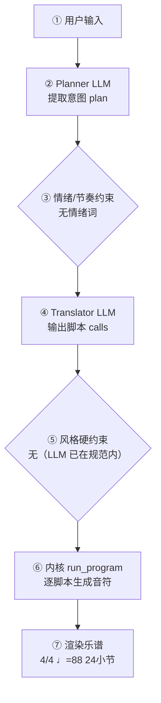

# 作曲生产报告：黎明与抗争（程序员版）

> 面向产品/工程：记录本次生成的完整生产链路与系统状态，用于核对「说得 vs 写得」、排查缺陷与回归测试；可整体喂回大模型进一步定位具体小节/声部的问题。谱面检查与编辑者版一致，编辑者版见：`symphony_demo_report.md`。

## 1. 会话与生成环境

- 生成时间: —
- 生成路径: —
- 命中技能: compose-full
- 原始数据: `session.compose_trace`（本报告第 4 节即其展开，确定性可复现）

## 2. 谱面事实（与编辑者版「基本信息」一致）

- 调性: C 大调（0 个升号）
- 转调: 第 9 小节 → A 小调
- 拍号: 4/4
- 速度: 四分音符 = 88 BPM
- 调内音级: C, D, E, F, G, A, B
- 声部 1: 长笛 (Flute)，高音谱号，24 小节
- 声部 2: 小提琴 (Violin)，高音谱号，24 小节
- 声部 3: 小提琴 (Violin)，高音谱号，24 小节
- 声部 4: 双簧管 (Oboe)，高音谱号，24 小节
- 声部 5: Clarinet，高音谱号，24 小节
- 声部 6: 小号 (Trumpet)，高音谱号，24 小节
- 声部 7: 中提琴 (Viola)，ALTO，24 小节
- 声部 8: 圆号 (Horn)，高音谱号，24 小节
- 声部 9: 大提琴 (Cello)，低音谱号，24 小节
- 声部 10: Bassoon，低音谱号，24 小节
- 声部 11: Trombone，低音谱号，24 小节
- 声部 12: 定音鼓 (Timpani)，低音谱号，24 小节
- 声部 13: Tuba，低音谱号，24 小节
- 声部 14: Contrabass，低音谱号，24 小节

## 3. 自动检查结果（与编辑者版「第 3 节」一致）

| 检查类别 | 状态 | 描述 |
|---|---|---|
| 调号一致性 | ⚠️ 注意 | A 小调 段出现变化音 Gb, Bb；C 大调 段出现变化音 C#, D#, F#, G#（转调段调外音/经过音） |
| 声部交叉 | ⚠️ 注意 | 纵向上方声部 1（长笛 (Flute)）与下方声部 5（Clarinet）在第 0.5 拍交叉：B5 低于 E6（同类交叉共 61 处，此处为第 1 例） |
| 声部交叉 | ⚠️ 注意 | 纵向上方声部 5（Clarinet）与下方声部 2（小提琴 (Violin)）在第 4.5 拍交叉：E4 低于 A4（同类交叉共 36 处，此处为第 1 例） |
| 声部交叉 | ⚠️ 注意 | 纵向上方声部 6（小号 (Trumpet)）与下方声部 7（中提琴 (Viola)）在第 4.5 拍交叉：A3 低于 A4（同类交叉共 22 处，此处为第 1 例） |
| 终止式 | ⚠️ 注意 | A 小调结尾音级含 C, E, G，旋律落在 G5（主音上方 10 个半音） |

> 说明：平行五/八度仅检查最高与最低外声部；相邻声部交叉为提示项。 共检查 360 项（✅ 355 / ⚠️ 5 / ❌ 0）。

## 4. 作曲过程透明化（可追溯）

> 本节约等于把「需求 → 大模型 → 脚本 → 谱面」的完整链路展开，便于核对「说得 vs 写得」是否一致。数据来自本次生成的 `session.compose_trace`，确定性可复现。把本报告整体喂回大模型，可进一步定位具体小节/声部的问题与修正建议。

### 4.1 流程图（本次实际链路）



（文字版流程图，便于无 Mermaid 渲染环境阅读）

```
用户输入
  → [② Planner LLM] 提取意图 plan
  → [③ 情绪/节奏约束] 命中=否
  → [④ Translator LLM] 输出 calls + reasoning
  → [⑤ 风格硬约束] 触发=否
  → [⑥ 内核 run_program] 逐脚本执行
  → [⑦ 渲染谱面] 4/4 ♩=88 24小节
```

### 4.2 大模型输入输出（LLM I/O）

#### LLM 调用

- **系统提示**（固定指令模板，已截断）：

```

```

- **用户输入**（喂给模型的结构化上下文）：

```json

```

- **模型返回（原始）**：

```json

```

#### LLM 调用

- **系统提示**（固定指令模板，已截断）：

```

```

- **用户输入**（喂给模型的结构化上下文）：

```json

```

- **模型返回（原始）**：

```json

```

### 4.3 脚本调用与输入输出

| # | 脚本 | 输入(args) | 输出（新增音符 / 状态变更） |
|---|---|---|---|
| 1 | new_score | voices=14，meter=4/4，bars=24，tempo=88，title=黎明与抗争，seed=symphony-demo-v1，instruments=["flute", "violin", "violin", "oboe", "clarinet", "trumpet", "viola", "horn", "cello", "bassoon", "trombone", "timpani", "tuba", "contrabass"] | 建立乐曲：4/4 ♩=88 14声部 None；新增 — |
| 2 | set_sections | sections=[{"name": "黎明", "bars": 8, "meter": "4/4", "tempo_text": "Andante", "dynamic": "p"}, {"name": "抗争", "bars": 8, "meter": "4/4", "tempo_text": "Allegro", "dynamic": "ff"}, {"name": "黎明再现", "bars": 8, "meter": "4/4", "tempo_text": "Maestoso", "dynamic": "f"}] | 分段：黎明(8小节)，抗争(8小节)，黎明再现(8小节)；新增 — |
| 3 | set_harmony | section=黎明，progression=["I", "vi", "IV", "V"]，key_sharps=0，mode=major | 和声：段落黎明 进行['I', 'vi', 'IV', 'V']；新增 — |
| 4 | set_harmony | section=抗争，progression=["i", "VI", "III", "VII"]，key_sharps=0，mode=minor | 和声：段落抗争 进行['i', 'VI', 'III', 'VII']；新增 — |
| 5 | set_harmony | section=黎明再现，progression=["I", "IV", "V", "I"]，key_sharps=0，mode=major | 和声：段落黎明再现 进行['I', 'IV', 'V', 'I']；新增 — |
| 6 | melody | section=黎明，register=high，rhythm=flowing，contour=arch | 旋律：段落黎明 rhythm=flowing；新增 声部1:+37 |
| 7 | melody | section=抗争，register=very_high，rhythm=driving，contour=ascending | 旋律：段落抗争 rhythm=driving；新增 声部1:+37 |
| 8 | melody | section=黎明再现，register=high，rhythm=flowing，contour=arch | 旋律：段落黎明再现 rhythm=flowing；新增 声部1:+36 |
| 9 | accompaniment | section=黎明，pattern=sustained，register=low，density=0.5 | 伴奏：段落黎明 pattern=sustained register=low density=0.5；新增 声部2:+64，声部3:+64，声部4:+64，声部5:+64，声部6:+16，声部7:+64，声部8:+16，声部9:+64，声部10:+64，声部11:+16，声部12:+32，声部13:+16，声部14:+16 |
| 10 | accompaniment | section=抗争，pattern=octave_pulse，register=low，density=2.0 | 伴奏：段落抗争 pattern=octave_pulse register=low density=2.0；新增 声部2:+64，声部3:+64，声部4:+64，声部5:+64，声部6:+16，声部7:+64，声部8:+16，声部9:+64，声部10:+64，声部11:+16，声部12:+32，声部13:+16，声部14:+64 |
| 11 | accompaniment | section=黎明再现，pattern=broken_arpeggio，register=low，density=1.0 | 伴奏：段落黎明再现 pattern=broken_arpeggio register=low density=1.0；新增 声部2:+64，声部3:+64，声部4:+64，声部5:+64，声部6:+16，声部7:+64，声部8:+16，声部9:+64，声部10:+64，声部11:+16，声部12:+32，声部13:+16，声部14:+32 |
| 12 | cadence | section=黎明再现 | 终止：bars=None；新增 — |
| 13 | finalize |  | 收束装配：24小节 / 14声部；新增 声部1:+1 |

<details><summary>逐脚本新增音符样例（前 8 个 / 声部）</summary>

- **new_score**：声部1: —；声部2: —；声部3: —；声部4: —；声部5: —；声部6: —；声部7: —；声部8: —；声部9: —；声部10: —；声部11: —；声部12: —；声部13: —；声部14: —
- **set_sections**：声部1: —；声部2: —；声部3: —；声部4: —；声部5: —；声部6: —；声部7: —；声部8: —；声部9: —；声部10: —；声部11: —；声部12: —；声部13: —；声部14: —
- **set_harmony**：声部1: —；声部2: —；声部3: —；声部4: —；声部5: —；声部6: —；声部7: —；声部8: —；声部9: —；声部10: —；声部11: —；声部12: —；声部13: —；声部14: —
- **set_harmony**：声部1: —；声部2: —；声部3: —；声部4: —；声部5: —；声部6: —；声部7: —；声部8: —；声部9: —；声部10: —；声部11: —；声部12: —；声部13: —；声部14: —
- **set_harmony**：声部1: —；声部2: —；声部3: —；声部4: —；声部5: —；声部6: —；声部7: —；声部8: —；声部9: —；声部10: —；声部11: —；声部12: —；声部13: —；声部14: —
- **melody**：声部1: C6:eighth, B5:eighth, G5:quarter, E5:half, F5:eighth, G5:eighth, A5:quarter, C6:quarter；声部2: —；声部3: —；声部4: —；声部5: —；声部6: —；声部7: —；声部8: —；声部9: —；声部10: —；声部11: —；声部12: —；声部13: —；声部14: —
- **melody**：声部1: A5:quarter, C6:quarter, D6:eighth, E6:eighth, E6:quarter, D6:eighth, C6:eighth, C6:quarter；声部2: —；声部3: —；声部4: —；声部5: —；声部6: —；声部7: —；声部8: —；声部9: —；声部10: —；声部11: —；声部12: —；声部13: —；声部14: —
- **melody**：声部1: C6:eighth, B5:eighth, G5:quarter, E5:quarter, C5:quarter, D5:eighth, E5:eighth, F5:quarter；声部2: —；声部3: —；声部4: —；声部5: —；声部6: —；声部7: —；声部8: —；声部9: —；声部10: —；声部11: —；声部12: —；声部13: —；声部14: —
- **accompaniment**：声部1: —；声部2: None:eighth, C5:eighth, E5:eighth, G5:eighth, C5:eighth, C5:eighth, E5:eighth, G4:eighth；声部3: None:eighth, C5:eighth, E5:eighth, G5:eighth, C5:eighth, C5:eighth, E5:eighth, G4:eighth；声部4: E5:eighth, G5:eighth, C6:eighth, F6:eighth, G6:eighth, D6:eighth, C6:eighth, G5:eighth；声部5: C6:eighth, E6:eighth, G5:eighth, C6:eighth, E6:eighth, G5:eighth, E5:eighth, C5:eighth；声部6: C5:half, C5:half, A3:half, A4:half, F4:half, F4:half, G4:half, G4:half；声部7: None:eighth, C4:eighth, E4:eighth, G4:eighth, C5:eighth, C4:eighth, E4:eighth, G4:eighth；声部8: C3:half, C4:half, A3:half, A3:half, F3:half, F3:half, G3:half, G3:half；声部9: None:eighth, C3:eighth, E3:eighth, G3:eighth, C4:eighth, C3:eighth, E3:eighth, G3:eighth；声部10: G3:eighth, C4:eighth, E4:eighth, G4:eighth, C5:eighth, G3:eighth, E4:eighth, B3:eighth；声部11: C3:half, C3:half, A3:half, A3:half, F3:half, F3:half, G3:half, G3:half；声部12: C3:quarter, None:quarter, C3:quarter, None:quarter, A2:quarter, None:quarter, A2:quarter, None:quarter；声部13: C3:half, C3:half, A2:half, A2:half, F2:half, F2:half, G2:half, G2:half；声部14: C2:half, G2:half, A2:half, E2:half, F2:half, C2:half, G2:half, D2:half
- **accompaniment**：声部1: —；声部2: None:eighth, A5:eighth, C5:eighth, E5:eighth, A5:eighth, A5:eighth, C5:eighth, E5:eighth；声部3: None:eighth, A5:eighth, C5:eighth, E5:eighth, A5:eighth, A5:eighth, C5:eighth, E5:eighth；声部4: E4:eighth, A4:eighth, C5:eighth, F5:eighth, C5:eighth, A5:eighth, E5:eighth, C5:eighth；声部5: C5:eighth, E5:eighth, A4:eighth, C5:eighth, E5:eighth, A5:eighth, E5:eighth, C5:eighth；声部6: A3:half, A4:half, F5:half, F4:half, C5:half, C5:half, G4:half, G4:half；声部7: None:eighth, A4:eighth, C4:eighth, E4:eighth, A4:eighth, A4:eighth, C4:eighth, E4:eighth；声部8: A3:half, A3:half, F3:half, F3:half, C3:half, C4:half, G3:half, G3:half；声部9: None:eighth, A3:eighth, C3:eighth, E3:eighth, A3:eighth, A3:eighth, C3:eighth, E3:eighth；声部10: A3:eighth, C4:eighth, F3:eighth, A3:eighth, C4:eighth, A4:eighth, E3:eighth, C4:eighth；声部11: A3:half, A3:half, F3:half, F3:half, C3:half, C3:half, G3:half, G3:half；声部12: A2:quarter, None:quarter, A2:quarter, None:quarter, F3:quarter, None:quarter, F3:quarter, None:quarter；声部13: A2:half, A2:half, F2:half, F2:half, C3:half, C3:half, G2:half, G2:half；声部14: A2+A3:eighth, A2+A3:eighth, A2+A3:eighth, A2+A3:eighth, A2+A3:eighth, A2+A3:eighth, A2+A3:eighth, A2+A3:eighth
- **accompaniment**：声部1: —；声部2: None:eighth, C5:eighth, E5:eighth, G5:eighth, C5:eighth, C5:eighth, E4:eighth, G4:eighth；声部3: None:eighth, C5:eighth, E5:eighth, G5:eighth, C5:eighth, C5:eighth, E4:eighth, G4:eighth；声部4: E5:eighth, G5:eighth, C6:eighth, E6:eighth, G6:eighth, D6:eighth, C6:eighth, G5:eighth；声部5: C6:eighth, E6:eighth, G5:eighth, C6:eighth, E6:eighth, G5:eighth, E5:eighth, C5:eighth；声部6: C5:half, C5:half, F4:half, F5:half, G4:half, G4:half, C5:half, C5:half；声部7: None:eighth, C4:eighth, E4:eighth, G4:eighth, C5:eighth, C4:eighth, E4:eighth, G4:eighth；声部8: C3:half, C4:half, F3:half, F3:half, G3:half, G3:half, C3:half, C4:half；声部9: None:eighth, C3:eighth, E3:eighth, G3:eighth, C4:eighth, C3:eighth, E4:eighth, G3:eighth；声部10: G3:eighth, C4:eighth, E4:eighth, G4:eighth, C5:eighth, G3:eighth, D4:eighth, C4:eighth；声部11: C3:half, C3:half, F3:half, F3:half, G3:half, G3:half, C3:half, C3:half；声部12: C3:quarter, None:quarter, C3:quarter, None:quarter, F3:quarter, None:quarter, F3:quarter, None:quarter；声部13: C3:half, C3:half, F2:half, F2:half, G2:half, G2:half, C3:half, C3:half；声部14: C2:quarter, G2:quarter, C3:quarter, G3:quarter, F2:quarter, C2:quarter, F3:quarter, C3:quarter
- **cadence**：声部1: —；声部2: —；声部3: —；声部4: —；声部5: —；声部6: —；声部7: —；声部8: —；声部9: —；声部10: —；声部11: —；声部12: —；声部13: —；声部14: —
- **finalize**：声部1: C5+C6:whole；声部2: —；声部3: —；声部4: —；声部5: —；声部6: —；声部7: —；声部8: —；声部9: —；声部10: —；声部11: —；声部12: —；声部13: —；声部14: —

</details>

### 4.4 本地强制约束（确定性兜底，优先级高于 LLM）

- 情绪/节奏约束：未触发（用户未给情绪/速度词，或已被风格基线覆盖）
- 风格/速度强制纠正：未触发（LLM 输出已在 genre 规范内）
### 4.5 自动问题定位（可疑点 + 程度）

| 检查项 | 程度 | 说明 |
|---|---|---|
| 情绪约束 | 🟢 未触发 | 用户未给情绪/速度词 |
| 意图拍号↔谱面 | 🟢 一致 | 最终拍号 4/4 |
| 计划小节↔实际小节 | 🟢 一致 | 24 小节 |
| 风格规范遵循 | 🟢 良好 | LLM 输出均在 genre 规范内，无需强制 |

> 说明：上表为程序自动比对「意图 ↔ 谱面」的初判（🔴 严重 / 🟡 注意 / 🟢 一致）。将本报告整体喂给大模型，可进一步定位具体小节/声部的问题与修正建议。

## 5. 记谱与演奏法

可演奏性：0 项 MAJOR / 84 项总计
- [MINOR] 声部1 大跳 14 半音（>八度）
- [MINOR] 声部2 大跳 14 半音（>八度）
- [MINOR] 声部2 大跳 17 半音（>八度）
- [MINOR] 声部2 大跳 19 半音（>八度）
- [MINOR] 声部2 大跳 17 半音（>八度）
- [MINOR] 声部2 大跳 17 半音（>八度）
- [MINOR] 声部2 大跳 15 半音（>八度）
- [MINOR] 声部2 大跳 17 半音（>八度）
- …其余 76 项从略

## 6. 生成质量评估（三指标）

- **风格重叠率**：N/A（未指定目标包）
- **属性遵循度**：1.00（0 项）
- **最近邻**：pirate-allegro（相似度 0.21）— ✅ 无抄袭嫌疑
