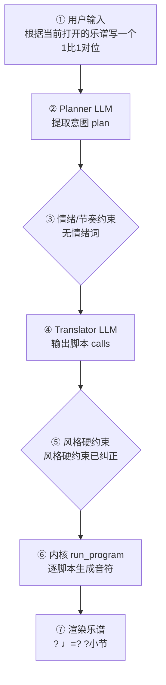

# 作曲生产报告：新乐谱（程序员版）

> 面向产品/工程：记录本次生成的完整生产链路与系统状态，用于核对「说得 vs 写得」、排查缺陷与回归测试；可整体喂回大模型进一步定位具体小节/声部的问题。谱面检查与编辑者版一致，编辑者版见：`g_major_allegro_report.md`。

## 1. 会话与生成环境

- 生成时间: 2026-10-01T19:16:09
- 生成路径: two_part_species_from_current（抽定旋律 + 确定性对位，未写音符 LLM）
- 命中技能: compose-full
- 用户原始输入: 根据当前打开的乐谱写一个1比1对位
- 原始数据: `session.compose_trace`（本报告第 4 节即其展开，确定性可复现）

## 2. 谱面事实（与编辑者版「基本信息」一致）

- 调性: G 大调（1 个升号）
- 拍号: 4/4
- 速度: 四分音符 = 126 BPM
- 调内音级: C, D, E, F#, G, A, B
- 声部 1: 声部 1，高音谱号，12 小节

## 3. 自动检查结果（与编辑者版「第 3 节」一致）

| 检查类别 | 状态 | 描述 |
|---|---|---|
| 调号一致性 | ⚠️ 注意 | G 大调下出现变化音 F（经过音/离调） |
| 终止式 | ⚠️ 注意 | 未能提取终止处音高 |

> 说明：众赞歌/钢琴四部叠写检查全部逻辑声部对的平行五八度；管弦织体仅查外声部平行五度（八度加强不报）。相邻声部交叉为提示项。 共检查 17 项（✅ 15 / ⚠️ 2 / ❌ 0）。

## 4. 作曲过程透明化（可追溯）

> 本节约等于把「需求 → 大模型 → 脚本 → 谱面」的完整链路展开，便于核对「说得 vs 写得」是否一致。数据来自本次生成的 `session.compose_trace`，确定性可复现。把本报告整体喂回大模型，可进一步定位具体小节/声部的问题与修正建议。

### 4.1 流程图（本次实际链路）



（文字版流程图，便于无 Mermaid 渲染环境阅读）

```
用户输入
  → [② Planner LLM] 提取意图 plan
  → [③ 情绪/节奏约束] 命中=否
  → [④ Translator LLM] 输出 calls + reasoning
  → [⑤ 风格硬约束] 触发=是
  → [⑥ 内核 run_program] 逐脚本执行
  → [⑦ 渲染谱面] ? ♩=? ?小节
```

### 4.2 大模型输入输出（LLM I/O）

#### Planner（意图解析）

- **系统提示**（固定指令模板，已截断）：

```
You are a professional composer and music theorist acting as an Intent Parser.

Transform the user's natural-language request (and optional slash-commands already applied as preferences) into a Composition Plan JSON only.

Think like a composer first: infer genre, mood, form, motif character, harmony language, climax — do NOT invent note lists yet.

A **风格目录（仅已学包）** is injected at the end of this system prompt. Use it to set `genre_id`.

Output ONE JSON object, no Markdown:
{
  "title": "string",
  "genre": "string (human label, e.g. 摇摆标准曲（爵士）)",
  "genre_id": "family/pack_id from 风格目录, e.g. jazz/swing-standard; empty if none",
  "mood": ["..."],
  "tempo": 72,
  "meter": "4/4",
  "key_sharps": 0,
  "mode": "major|minor",
  "instrumentation": ["trumpet","piano","contrabass"] (kernel English names; map fiddle→violin, double bass→contrabass, tin whistle→flute; avoid unknown names),
  "form": ["A","B","A"],
  "bars": 16,
  "motif": {"character": "...", "development": ["repetition","sequence"]},
  "harmony": {"language": "...", "density": "sparse|moderate|dense"},
  "rhythm": {"character": "..."},
  "texture": "homophonic|polyphonic|sparse|orchestral|first-species",
  "species": false,
  "species_from_current": false,
  "want_fugue": false,
  "climax": {"location": "section B", "dynamic": "f"},
  "difficulty": "easy|medium",
  "summary": "one sentence for the user",
  "edit_intent"
…（已截断，完整 6645 字；固定指令模板见 skills/composition/base/ 与内核 kernel_docs）
```

- **用户输入**（喂给模型的结构化上下文）：

```json
{
  "user_request": "根据当前打开的乐谱写一个1比1对位",
  "preferences": {
    "key_sharps": 0,
    "mode": "major",
    "tempo": 120,
    "bars": 12,
    "meter": "4/4",
    "style": "",
    "genre_id": "",
    "instrumentation": "",
    "fugue": "off",
    "voices": 2,
    "_explicit": {}
  },
  "edit_intent": null,
  "skills": [
    "compose-full"
  ],
  "existing_plan": {
    "title": "二声部一比一对位练习",
    "genre": "第一类二声部对位",
    "genre_id": "",
    "mood": [
      "平稳",
      "清澈",
      "古典"
    ],
    "tempo": 120,
    "meter": "4/4",
    "key_sharps": 0,
    "mode": "major",
    "instrumentation": [
      "piano",
      "piano"
    ],
    "form": "species",
    "bars": 8,
    "texture": "first-species",
    "species": true,
    "want_fugue": false,
    "summary": "一首 C 大调、4/4 拍、8 小节的二声部一比一（第一类）对位练习，钢琴大谱表上下两声部严格音符对音符，以协和音程与清晰终止写成。",
    "user_brief": "写一首2声部一比一对位的曲子",
    "_species_hint": {
      "kind": "two_part_species",
      "from": "planner"
    }
  },
  "revision_edits": null,
  "existing_score_summary": {
    "title": "二声部一比一对位练习",
    "bars": 12,
    "tempo": 120,
    "parts": [
      "Piano RH",
      "Piano LH"
    ]
  }
}
```

- **模型返回（原始）**：

```json
{
  "title": "二声部一比一对位练习（据当前乐谱）",
  "genre": "第一类二声部对位",
  "genre_id": "",
  "mood": [
    "平稳",
    "清澈",
    "古典"
  ],
  "tempo": 120,
  "meter": "4/4",
  "key_sharps": 0,
  "mode": "major",
  "instrumentation": [
    "piano",
    "piano"
  ],
  "form": [
    "species"
  ],
  "bars": 12,
  "motif": {
    "character": "以当前乐谱每小节抽取一音为定旋律，另一声部按第一类对位规则配写",
    "development": [
      "repetition"
    ]
  },
  "harmony": {
    "language": "C 大调功能和声，以三度、六度协和音程为主",
    "density": "sparse"
  },
  "rhythm": {
    "character": "每小节每声部一个全音符，严格音符对音符"
  },
  "texture": "first-species",
  "species": true,
  "species_from_current": true,
  "want_fugue": false,
  "climax": {
    "location": "第 10 小节附近",
    "dynamic": "mf"
  },
  "difficulty": "easy",
  "summary": "根据当前打开的 12 小节乐谱，抽取每小节一音作定旋律，按第一类（一比一）对位规则生成钢琴大谱表二声部对位，保持原调性、拍号与速度。",
  "edit_intent": null
}
```

### 4.3 脚本调用与输入输出

（本次路径未经过确定性脚本内核：`two_part_species_from_current（抽定旋律 + 确定性对位，未写音符 LLM）`—— 该路径由 LLM 直接产出乐谱或纯确定性生成，无逐脚本记录）

### 4.4 本地强制约束（确定性兜底，优先级高于 LLM）

- 情绪/节奏约束：未触发（用户未给情绪/速度词，或已被风格基线覆盖）
- 风格/速度强制纠正：定旋律来自当前乐谱（role=upper）
- 风格/速度强制纠正：另一声部按对位法硬约束生成；对位≠赋格
- **风格契约施加的约束**：无（该风格包没有 `style_contract.yaml`，或契约证据量不足、和声分区未生效）
### 4.5 自动问题定位（可疑点 + 程度）

| 检查项 | 程度 | 说明 |
|---|---|---|
| 情绪约束 | 🟢 未触发 | 用户未给情绪/速度词 |
| 意图拍号↔谱面 | 🟢 一致 | 最终拍号 None |
| 计划小节↔实际小节 | 🟢 一致 | None 小节 |
| 风格规范遵循 | 🟡 注意 | LLM 偏离 genre 规范，已强制纠正 2 处（说明模型未严格遵循风格包） |
| 计划编制↔实际编制 | 🟡 注意 | 计划编制含 piano、piano，但谱面 1 个声部未落地（voices 数不足或 translator 取舍）——用户对编制的明确要求可能未满足 |

> 说明：上表为程序自动比对「意图 ↔ 谱面」的初判（🔴 严重 / 🟡 注意 / 🟢 一致）。将本报告整体喂给大模型，可进一步定位具体小节/声部的问题与修正建议。
