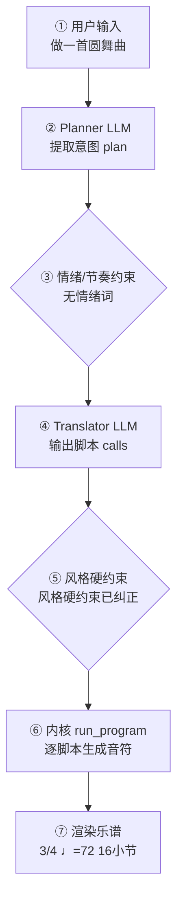

# 作曲生产报告：晨光圆舞（程序员版）

> 面向产品/工程：记录本次生成的完整生产链路与系统状态，用于核对「说得 vs 写得」、排查缺陷与回归测试；可整体喂回大模型进一步定位具体小节/声部的问题。谱面检查与编辑者版一致，编辑者版见：`tmppcia4ie6.md`。

## 1. 会话与生成环境

- 生成时间: 2026-10-02T18:25:04
- 生成路径: translator（LLM 翻译 + 确定性内核）
- 命中技能: compose-full, genre:dance/waltz
- 用户原始输入: 做一首圆舞曲
- 原始数据: `session.compose_trace`（本报告第 4 节即其展开，确定性可复现）

## 2. 谱面事实（与编辑者版「基本信息」一致）

- 调性: C 大调（0 个升号）
- 拍号: 3/4
- 速度: 四分音符 = 72 BPM
- 调内音级: C, D, E, F, G, A, B
- 声部 1: Piano，高音谱号，16 小节
- 声部 2: Piano LH，低音谱号，16 小节

## 3. 自动检查结果（与编辑者版「第 3 节」一致）

| 检查类别 | 状态 | 描述 |
|---|---|---|
| 调号一致性 | ⚠️ 注意 | C 大调下出现变化音 D#（经过音/离调） |

> 说明：众赞歌/钢琴四部叠写检查全部逻辑声部对的平行五八度；管弦织体仅查外声部平行五度（八度加强不报）。相邻声部交叉为提示项。 共检查 38 项（✅ 37 / ⚠️ 1 / ❌ 0）。

## 4. 作曲过程透明化（可追溯）

> 本节约等于把「需求 → 大模型 → 脚本 → 谱面」的完整链路展开，便于核对「说得 vs 写得」是否一致。数据来自本次生成的 `session.compose_trace`，确定性可复现。把本报告整体喂回大模型，可进一步定位具体小节/声部的问题与修正建议。

### 4.1 流程图（本次实际链路）



（文字版流程图，便于无 Mermaid 渲染环境阅读）

```
用户输入
  → [② Planner LLM] 提取意图 plan
  → [③ 情绪/节奏约束] 命中=否
  → [④ Translator LLM] 输出 calls + reasoning
  → [⑤ 风格硬约束] 触发=是
  → [⑥ 内核 run_program] 逐脚本执行
  → [⑦ 渲染谱面] 3/4 ♩=72 16小节
```

### 4.2 大模型输入输出（LLM I/O）

#### Planner（意图解析）

- **系统提示**（固定指令模板，已截断）：

```
You are a professional composer and music theorist acting as an Intent Parser.

Transform the user's natural-language request (and optional slash-commands already applied as preferences) into a Composition Plan JSON only.

Think like a composer first: infer genre, mood, form, motif character, harmony language, climax — do NOT invent note lists yet.

A **风格目录（仅已学包）** is injected at the end of this system prompt. Use it to set `genre_id`.

A **规则库摘要** is also injected（对位 / 终止 / 乐句功能 / 声部进行等）. Use it when
setting `species`, `texture`, `form`, harmony language, and cadence expectations.
Do not invent notes; map user intent onto plan fields that the translator + kernel can execute.

Output ONE JSON object, no Markdown:
{
  "title": "string",
  "genre": "string (human label, e.g. 摇摆标准曲（爵士）)",
  "genre_id": "family/pack_id from 风格目录, e.g. jazz/swing-standard; empty if none",
  "mood": ["..."],
  "tempo": 72,
  "meter": "4/4",
  "key_sharps": 0,
  "mode": "major|minor",
  "instrumentation": ["trumpet","piano","contrabass"] (kernel English names; map fiddle→violin, double bass→contrabass, tin whistle→flute; avoid unknown names),
  "form": ["A","B","A"],
  "bars": 16,
  "motif": {"character": "...", "development": ["repetition","sequence"]},
  "harmony": {"language": "...", "density": "sparse|moderate|dense"},
  "rhythm": {"character": "..."},
  "texture": "homophonic|polyphonic|sparse|o
…（已截断，完整 9619 字；固定指令模板见 skills/composition/base/ 与内核 kernel_docs）
```

- **用户输入**（喂给模型的结构化上下文）：

```json
{
  "user_request": "做一首圆舞曲",
  "preferences": {
    "fugue": "off",
    "tempo": 0,
    "meter": "",
    "bars": 0,
    "key_sharps": 0,
    "mode": "major",
    "voices": 0,
    "seed": "",
    "style": "",
    "genre_id": "",
    "instrumentation": ""
  },
  "edit_intent": null,
  "skills": [
    "compose-full"
  ],
  "existing_plan": null,
  "revision_edits": null,
  "existing_score_summary": null
}
```

- **模型返回（原始）**：

```json
{
  "title": "晨光圆舞",
  "genre": "圆舞曲",
  "mood": [
    "bright"
  ],
  "tempo": 120,
  "tempo_text": "Allegro",
  "meter": "4/4",
  "key_sharps": 0,
  "mode": "major",
  "instrumentation": "piano",
  "form": [
    "A",
    "A'"
  ],
  "bars": 8,
  "motif": {},
  "harmony": "",
  "rhythm": "flowing",
  "texture": "",
  "climax": "",
  "summary": ""
}
```

#### Translator（脚本翻译）

- **系统提示**（固定指令模板，已截断）：

````
# 翻译器（Translator）

你不是作曲家，是**翻译器**：把用户的自然语言音乐需求与 plan 翻译成
对确定性脚本的调用序列。你**不写任何音符**——所有音符由脚本生成并保证
正确（时值、调性、织体、力度、终止）。你的职责是选对脚本、给对参数。

系统提示词末尾会注入 **规则库摘要**（与作曲库「规则库」同源）：按其中的
「本阶段」对照选脚本——如终止→`cadence`、进行→`set_harmony`、伴奏型→
`accompaniment`、对位 species→禁 `fugue` 且钢琴双声部。细则以摘要与脚本文档为准。

## 输出格式（只输出 JSON，不要任何解释文字）

```
{"reasoning": "用中文简述你如何把需求翻译成参数与脚本（2–5 句）：识别了什么风格/情绪，怎么决定速度/调式/织体，段落如何安排，调用了哪些脚本。", "calls": [{"script": "脚本名", "args": {...}}, ...]}
```

## 硬规则

1. 调用顺序：`new_score` → `set_sections` → 对每个段落 `{ set_harmony →
   accompaniment → melody }` →（高潮段可加 `thicken`）→（最后一段可加
   `cadence`）→（**可选** `narrative(...)`：仅当你需要关掉自动叙事层的
   动机变形/惊喜和弦时，见下「叙事层」）→ `finalize`
2. `new_score` 与 `finalize` 必须各恰好一次，且分别在最前/最后
3. **每个段落**都必须调用 set_harmony / accompaniment / melody，
   一次都不许漏（漏了 finalize 会报错）
4. args 必须严格符合脚本文档的字段名与取值范围；不要发明不存在的参数
5. 脚本执行失败时你会收到错误信息——修正 calls 后完整重新输出
6. `plan.tempo` / `plan.mode` / `plan.mood` / `plan.tempo_text` /
   `plan._emotion_hint` 是已解析的**明确约束**（来自用户情绪/速度词或
   `/tempo`），**优先级最高**——调用 `new_score` / `set_harmony` / `melody`
   时直接采用，不要用风格基线默认值覆盖。`reasoning` 字段必须如实写出你
   如何据此翻译，便于用户核查。
7. **乐器编制**：brief 提到管弦乐/弦乐/铜管/木管/具体乐器（小提琴、长笛、
   圆号、定音鼓…）或某种编制（弦乐四重奏、铜管五重奏…）时，`new_score`
   **必须传 `instruments`**（长度=voices，从高音到低音，低音乐器放最后），
   可用名：flute/oboe/**piccolo**/clarinet/bassoon/horn/trumpet/trombone/
   tuba/violin/viola/cello/contrabass/timpani/**harp**/piano/soprano/alto/
  
…（已截断，完整 26570 字；固定指令模板见 skills/composition/base/ 与内核 kernel_docs）
````

- **用户输入**（喂给模型的结构化上下文）：

```json
{
  "plan": {
    "title": "晨光圆舞",
    "genre": "圆舞曲",
    "mood": [
      "bright"
    ],
    "tempo": 120,
    "tempo_text": "Allegro",
    "meter": "4/4",
    "key_sharps": 0,
    "mode": "major",
    "_emotion_hint": null,
    "_species_hint": null,
    "species": null,
    "instrumentation": [
      "piano",
      "piano"
    ],
    "form": [
      "A",
      "A'"
    ],
    "bars": 16,
    "motif": {},
    "harmony": "",
    "rhythm": "flowing",
    "texture": "",
    "climax": "",
    "summary": ""
  },
  "user_brief": "做一首圆舞曲"
}
```

- **模型返回（原始）**：

```json
{
  "reasoning": "这是一首4/4的圆舞曲，用broken_arpeggio伴奏。",
  "calls": [
    {
      "script": "new_score",
      "args": {
        "title": "晨光圆舞",
        "tempo": 120,
        "meter": "4/4",
        "voices": 2,
        "mode": "major",
        "key_sharps": 0,
        "bars": 8
      }
    },
    {
      "script": "set_sections",
      "args": {
        "sections": [
          {
            "name": "A",
            "bars": 4,
            "meter": "4/4"
          },
          {
            "name": "A'",
            "bars": 4,
            "meter": "4/4"
          }
        ]
      }
    },
    {
      "script": "set_harmony",
      "args": {
        "section": "A",
        "progression": [
          "I",
          "V",
          "vi",
          "IV"
        ]
      }
    },
    {
      "script": "accompaniment",
      "args": {
        "section": "A",
        "pattern": "broken_arpeggio",
        "register": "low",
        "density": 1.0
      }
    },
    {
      "script": "melody",
      "args": {
        "section": "A",
        "rhythm": "flowing"
      }
    },
    {
      "script": "set_harmony",
      "args": {
        "section": "A'",
        "progression": [
          "I",
          "ii",
          "V",
          "I"
        ]
      }
    },
    {
      "script": "accompaniment",
      "args": {
        "section": "A'",
        "pattern": "broken_arpeggio",
        "register": "low",
        "density": 1.0
      }
    },
    {
      "script": "melody",
      "args": {
        "section": "A'",
        "rhythm": "flowing"
      }
    },
    {
      "script": "cadence",
      "args": {
        "bars": 2
      }
    },
    {
      "script": "finalize",
      "args": {}
    }
  ]
}
```

### 4.3 脚本调用与输入输出

| # | 脚本 | 输入(args) | 输出（新增音符 / 状态变更） |
|---|---|---|---|
| 1 | new_score | title=晨光圆舞，tempo=120，meter=3/4，voices=2，mode=major，key_sharps=0，bars=16，instruments=["piano", "piano"]，style=dance/waltz | 建立乐曲：3/4 ♩=120 2声部 major；新增 — |
| 2 | set_sections | sections=[{"name": "A", "bars": 4, "meter": "3/4"}, {"name": "A'", "bars": 12, "meter": "3/4"}] | 分段：A(4小节)，A'(12小节)；新增 — |
| 3 | set_harmony | section=A，progression=["I", "V", "vi", "IV"] | 和声：段落A 进行['I', 'V', 'vi', 'IV']；新增 — |
| 4 | accompaniment | section=A，pattern=waltz，register=low，density=1.0 | 伴奏：段落A pattern=waltz register=low density=1.0；新增 声部2:+12 |
| 5 | melody | section=A，rhythm=flowing | 旋律：段落A rhythm=flowing；新增 声部1:+14 |
| 6 | set_harmony | section=A'，progression=["I", "ii", "V", "I"] | 和声：段落A' 进行['I', 'ii', 'V', 'I']；新增 — |
| 7 | accompaniment | section=A'，pattern=waltz，register=low，density=1.0 | 伴奏：段落A' pattern=waltz register=low density=1.0；新增 声部2:+36 |
| 8 | melody | section=A'，rhythm=flowing | 旋律：段落A' rhythm=flowing；新增 声部1:+41 |
| 9 | cadence | bars=2 | 终止：bars=2；新增 — |
| 10 | finalize |  | 收束装配：16小节 / 2声部；新增 — |

<details><summary>逐脚本新增音符样例（前 8 个 / 声部）</summary>

- **new_score**：声部1: —；声部2: —
- **set_sections**：声部1: —；声部2: —
- **set_harmony**：声部1: —；声部2: —
- **accompaniment**：声部1: —；声部2: C2:quarter, E3+G3:quarter, E3+G3:quarter, G1:quarter, B2+D2:quarter, B2+D2:quarter, A1:quarter, C2+E2:quarter
- **melody**：声部1: C5:quarter, G4:quarter, B4:quarter, C5:quarter, D5:eighth, D5:eighth, C5:quarter, D5:eighth；声部2: —
- **set_harmony**：声部1: —；声部2: —
- **accompaniment**：声部1: —；声部2: C2:quarter, E3+G3:quarter, E3+G3:quarter, D2:quarter, F3+A3:quarter, F3+A3:quarter, G2:quarter, B3+D3:quarter
- **melody**：声部1: C5:quarter, G4:quarter, B4:quarter, C5:eighth, D5:eighth, D5:quarter, F5:quarter, G5:half；声部2: —
- **cadence**：声部1: —；声部2: —
- **finalize**：声部1: —；声部2: —

</details>

### 4.4 本地强制约束（确定性兜底，优先级高于 LLM）

- 情绪/节奏约束：未触发（用户未给情绪/速度词，或已被风格基线覆盖）
- 风格/速度强制纠正：new_score 拍号 '4/4' → 3/4（genre 硬约束）
- 风格/速度强制纠正：new_score 小节 8 → 16
- 风格/速度强制纠正：段落 A 拍号 '4/4' → 3/4
- 风格/速度强制纠正：段落 A' 拍号 '4/4' → 3/4
- 风格/速度强制纠正：小节数 8 → 16（对齐 plan.bars）
- 风格/速度强制纠正：accompaniment pattern 'broken_arpeggio' → waltz
- 风格/速度强制纠正：accompaniment pattern 'broken_arpeggio' → waltz
- 风格/速度强制纠正：基础速度 ♩=120 → ♩=72（genre 范围 69–80）
- 风格/速度强制纠正：速度标记 ♩=120 → ♩=72
- **风格契约施加的约束**（2 条，来自该包实测语料的 `style_contract.yaml`）：
  - 段落 A 按风格契约加和弦品质：IV→IV7
  - 段落 A' 按风格契约加和弦品质：V→V7
### 4.5 自动问题定位（可疑点 + 程度）

| 检查项 | 程度 | 说明 |
|---|---|---|
| 情绪约束 | 🟢 未触发 | 用户未给情绪/速度词 |
| 意图拍号↔谱面 | 🟡 注意 | LLM 给出的拍号被强制纠正：new_score 拍号 '4/4' → 3/4（genre 硬约束）；段落 A 拍号 '4/4' → 3/4；段落 A' 拍号 '4/4' → 3/4；最终 3/4 |
| 计划小节↔实际小节 | 🟢 一致 | 16 小节 |
| 风格规范遵循 | 🟡 注意 | LLM 偏离 genre 规范，已强制纠正 9 处（说明模型未严格遵循风格包） |
| 计划编制↔实际编制 | 🟢 一致 | 计划 2 件乐器与谱面 2 声部对应 |

> 说明：上表为程序自动比对「意图 ↔ 谱面」的初判（🔴 严重 / 🟡 注意 / 🟢 一致）。将本报告整体喂给大模型，可进一步定位具体小节/声部的问题与修正建议。

## 5. 记谱与演奏法

可演奏性：0 项 MAJOR / 21 项总计
- [MINOR] 声部2 大跳 16 半音（>八度）
- [MINOR] 声部2 大跳 21 半音（>八度）
- [MINOR] 声部2 大跳 16 半音（>八度）
- [MINOR] 声部2 大跳 14 半音（>八度）
- [MINOR] 声部2 大跳 16 半音（>八度）
- [MINOR] 声部2 大跳 16 半音（>八度）
- [MINOR] 声部2 大跳 14 半音（>八度）
- [MINOR] 声部2 大跳 15 半音（>八度）
- …其余 13 项从略

## 生成质量评估

- **风格重叠率**：N/A（未指定目标包）
- **属性遵循度**：1.00（0 项）
- **包级最近邻**：waltz（相似度 0.52）— ✅ 无抄袭嫌疑
